# System & Software Architecture: The Complete Reference

A comprehensive visual guide exploring the complete architectural hierarchy: from **physical deployment tiers** (1-Tier to N-Tier) and **code presentation patterns** (MVC, MVP, MVVM) to **domain design patterns** (Layered, Hexagonal, Clean) and **distributed system topologies** (Monolith, Modular Monolith, Microservices).

---

## The 3 Levels of Architecture

Software architecture operates across three distinct levels of abstraction:

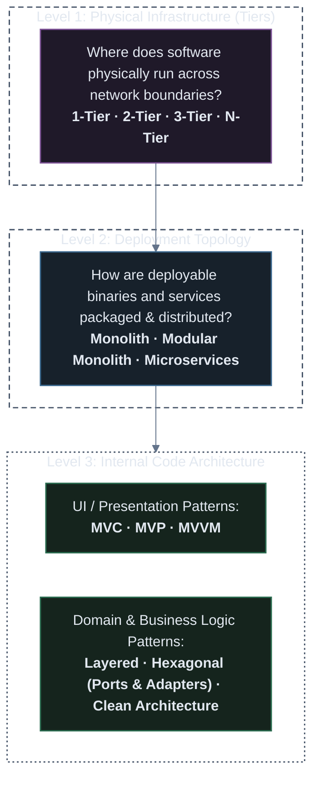

---

## Part 1: What is a "Tier"? (Tier vs. Layer)

Before designing systems, it is essential to distinguish between **Layers** and **Tiers**:

| Concept | Definition | Scope | Example |
| :--- | :--- | :--- | :--- |
| **Layer** (Logical) | How code is organized within the software codebase | Code / Conceptual | Presentation Layer, Business Logic Layer, Data Access Layer (DAL) in one project |
| **Tier** (Physical) | How software components are physically separated across distinct network machines / hardware | Infrastructure / Deployment | Client Machine (Tier 1) $\rightarrow$ Web App Server (Tier 2) $\rightarrow$ Dedicated Database Server (Tier 3) |

> [!NOTE]
> An application can have **3 logical layers** (UI, Logic, DB code) all running on **1 physical tier** (a single laptop or VM). Tiers refer specifically to **physical network boundaries**.

---

## Part 2: Physical Infrastructure Tiers

---

### 1. 1-Tier Architecture (Single Machine)

In a 1-Tier architecture, the **Presentation (UI)**, **Business Logic**, and **Data Storage** all reside on the exact same physical device.

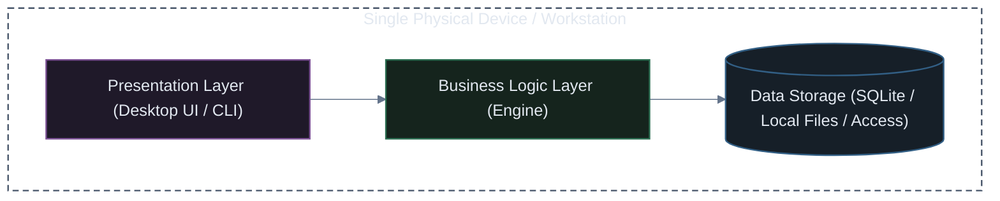

* **How it Works**: Everything runs locally inside one process boundary. Zero network overhead.
* **Examples**: Microsoft Word, Photoshop, SQLite-based command-line tools, local desktop games.
* **Pros**: Simple to build, zero network latency, works 100% offline.
* **Cons**: No concurrent multi-user collaboration, data loss if the device fails, updates must be manually installed on every client machine.

---

### 2. 2-Tier Architecture (Client-Server)

A 2-Tier architecture separates the client interface from central data storage across a local network (LAN).

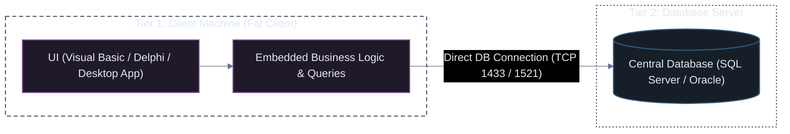

* **How it Works**: The client application (a "fat/thick client") contains both the UI and business rules, and opens a direct database socket connection.
* **Examples**: Classic internal bank software, legacy Visual Basic 6 / Delphi enterprise desktop apps.
* **The Fatal Flaws**:
  * **Critical Security Risk**: Database credentials and connection strings are baked inside client binaries.
  * **Connection Saturation**: Databases struggle when thousands of desktop clients hold persistent open database connections.
  * **Painful Updates**: Modifying business rules requires re-installing the software on every employee's PC.

---

### 3. 3-Tier Architecture (The Modern Web Foundation)

The 3-Tier model introduced an intermediate **Application Server Tier** between the client and database, revolutionizing web applications.

```mermaid
%%{init: {
  'theme': 'base',
  'themeVariables': {
    'darkMode': true,
    'background': '#0f172a',
    'primaryColor': '#1e293b',
    'primaryTextColor': '#e2e8f0',
    'primaryBorderColor': '#475569',
    'lineColor': '#64748b',
    'textColor': '#e2e8f0'
  },
  'themeCSS': '* { filter: none !important; box-shadow: none !important; } .node * { filter: none !important; } .cluster * { filter: none !important; }'
}}%%
graph LR
    subgraph Tier1["Tier 1: Presentation Tier"]
        Client["Client / Browser / Mobile App (Thin Client)"]
    end

    subgraph Tier2["Tier 2: Application / Logic Tier"]
        AppServer["Backend Server (Node / Spring / Django / Go)"]
        BizLogic["Business Logic & Security Validation"]
        AppServer --> BizLogic
    end

    subgraph Tier3["Tier 3: Data Tier"]
        DB[("Database (PostgreSQL / MySQL)")]
    end

    Client -->|"HTTPS / REST / JSON"| AppServer
    BizLogic -->|"Database Pool (TCP)"| DB

    style Tier1 fill:none,stroke:#475569,stroke-width:1.5px,stroke-dasharray: 6 4,color:#e2e8f0;
    style Tier2 fill:none,stroke:#475569,stroke-width:1.5px,stroke-dasharray: 6 4,color:#e2e8f0;
    style Tier3 fill:none,stroke:#475569,stroke-width:1.5px,stroke-dasharray: 2 3,color:#e2e8f0;

    classDef cTier1 fill:#1f1929,stroke:#7c5295,stroke-width:1.5px,color:#e2e8f0;
    classDef cTier2 fill:#152226,stroke:#346a78,stroke-width:1.5px,color:#e2e8f0;
    classDef cTier3 fill:#161f28,stroke:#325f85,stroke-width:1.5px,color:#e2e8f0;

    class Client cTier1;
    class AppServer,BizLogic cTier2;
    class DB cTier3;
```

* **Tier 1 (Presentation)**: Thin clients (Web browsers, iOS/Android apps) that render HTML/CSS/JS and capture user input.
* **Tier 2 (Application / Business Logic)**: Central server processing orders, authenticating users, and enforcing business rules.
* **Tier 3 (Data)**: Database tier isolated on private networks, never directly accessible from the public internet.
* **Why it Won**:
  * **Security**: Database credentials stay strictly inside the application tier.
  * **Maintainability**: Updating business logic on Tier 2 updates the experience for 100% of users instantly.
  * **Independent Scaling**: Application servers can scale horizontally behind a load balancer without modifying database architecture.

---

### 4. N-Tier (Multi-Tier) Architecture (High-Scale Production)

In large-scale production, a 3-tier architecture is subdivided into specialized, independently scalable tiers:

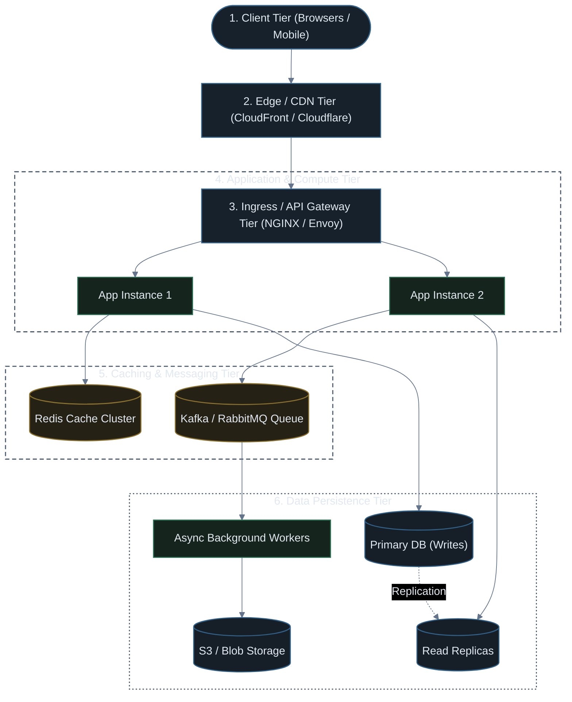

---

## Part 3: UI & Presentation Patterns (MVC, MVP, MVVM)

These patterns define **how user input flows through the UI to update business logic and presentation state**.

---

### 1. MVC (Model - View - Controller)

The foundational pattern created for graphical user interfaces and adopted by web frameworks like **Laravel, Django, Ruby on Rails, and ASP.NET MVC**.

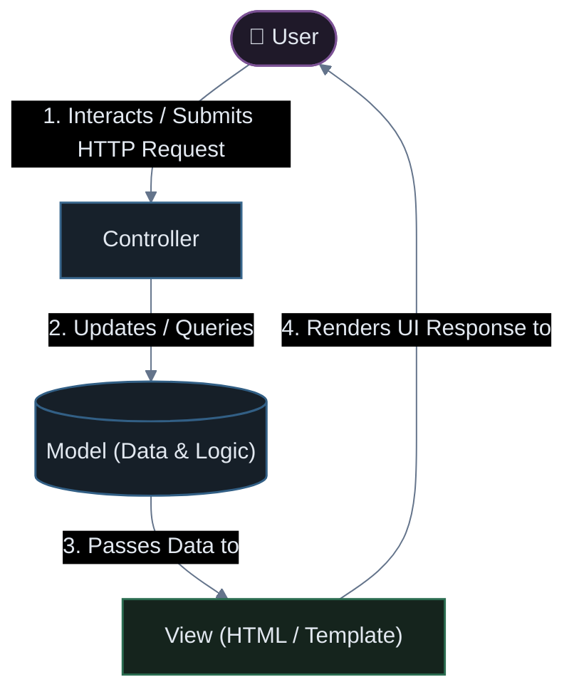

* **Model**: Encapsulates database state, business rules, and validation logic.
* **View**: Renders data on screen (HTML templates, JSON responses, Razor/Blade templates).
* **Controller**: Receives requests, calls models, and directs which view to render.
* **Best Fit**: Server-side rendered web applications (Laravel, Django, Rails).

---

### 2. MVP (Model - View - Presenter)

Created to decouple the View from the Model completely, creating a **Passive View** that is easy to unit test.

```mermaid
%%{init: {
  'theme': 'base',
  'themeVariables': {
    'darkMode': true,
    'background': '#0f172a',
    'primaryColor': '#1e293b',
    'primaryTextColor': '#e2e8f0',
    'primaryBorderColor': '#475569',
    'lineColor': '#64748b',
    'textColor': '#e2e8f0'
  },
  'themeCSS': '* { filter: none !important; box-shadow: none !important; } .node * { filter: none !important; } .cluster * { filter: none !important; }'
}}%%
graph LR
    User(["👤 User"]) -->|Interacts| View["View (Passive UI Interface)"]
    View <-->|"User Events / View Interface Updates"| Presenter["Presenter"]
    Presenter <-->|Queries & Updates| Model[("Model")]

    classDef cUser fill:#1f1929,stroke:#7c5295,stroke-width:1.5px,color:#e2e8f0;
    classDef cView fill:#15241d,stroke:#2b6d51,stroke-width:1.5px,color:#e2e8f0;
    classDef cPres fill:#17212b,stroke:#38668c,stroke-width:1.5px,color:#e2e8f0;
    classDef cModel fill:#161f28,stroke:#325f85,stroke-width:1.5px,color:#e2e8f0;

    class User cUser;
    class View cView;
    class Presenter cPres;
    class Model cModel;
```

* **View**: Completely dumb and passive. Knows **zero** details about the Model. Implements an interface (`IUserView`).
* **Presenter**: Handles 100% of presentation logic. Retrieves data from the Model, formats it, and explicitly commands the View (`view.showError()`, `view.displayUser()`).
* **Best Fit**: Legacy Android apps, Windows Forms, WPF. Highly testable via mock views.

---

### 3. MVVM (Model - View - ViewModel)

Created by Microsoft for WPF and adopted by modern frontend frameworks (**Vue.js, React + MobX, Android Jetpack, SwiftUI**).

```mermaid
%%{init: {
  'theme': 'base',
  'themeVariables': {
    'darkMode': true,
    'background': '#0f172a',
    'primaryColor': '#1e293b',
    'primaryTextColor': '#e2e8f0',
    'primaryBorderColor': '#475569',
    'lineColor': '#64748b',
    'textColor': '#e2e8f0'
  },
  'themeCSS': '* { filter: none !important; box-shadow: none !important; } .node * { filter: none !important; } .cluster * { filter: none !important; }'
}}%%
graph LR
    User(["👤 User"]) -->|Interacts| View["View (Declarative UI / XML / JSX)"]
    View <-->|"Two-Way Data Binding & Commands"| ViewModel["ViewModel (Observable State)"]
    ViewModel <-->|Fetches & Updates| Model[("Model (Domain & Data)")]

    classDef cUser fill:#1f1929,stroke:#7c5295,stroke-width:1.5px,color:#e2e8f0;
    classDef cView fill:#15241d,stroke:#2b6d51,stroke-width:1.5px,color:#e2e8f0;
    classDef cVM fill:#17212b,stroke:#38668c,stroke-width:1.5px,color:#e2e8f0;
    classDef cModel fill:#161f28,stroke:#325f85,stroke-width:1.5px,color:#e2e8f0;

    class User cUser;
    class View cView;
    class ViewModel cVM;
    class Model cModel;
```

* **Data Binding**: The View binds directly to observable properties in the ViewModel. When state in the ViewModel changes, the View updates automatically without manual DOM manipulation.
* **ViewModel**: Exposes state and commands (e.g. `submitCommand`), completely decoupled from UI controls.
* **Best Fit**: Modern single-page apps (SPAs), reactive mobile apps (iOS/Android).

---

## Part 4: Domain & Internal Code Architectures

These patterns define **how business logic is protected from external tools, frameworks, and databases**.

---

### 1. Traditional Layered (N-Layer) Architecture

The classic layered design organizing code into horizontal slices:

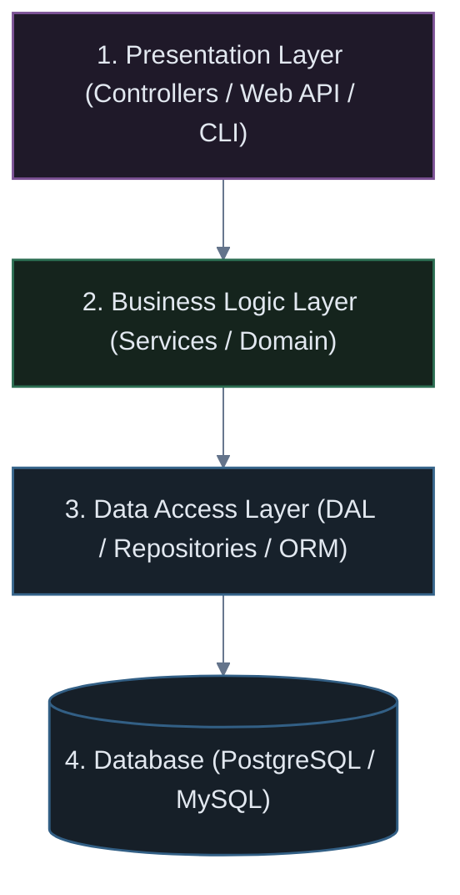

* **The Problem (Database-Centric Coupling)**: Dependencies flow **downward toward the database**. Business logic depends on database schemas and ORM entities, making it difficult to switch databases or test business rules in pure isolation.

---

### 2. Hexagonal Architecture (Ports & Adapters)

Invented by Alistair Cockburn to solve the database-centric coupling problem by **inverting dependencies**.

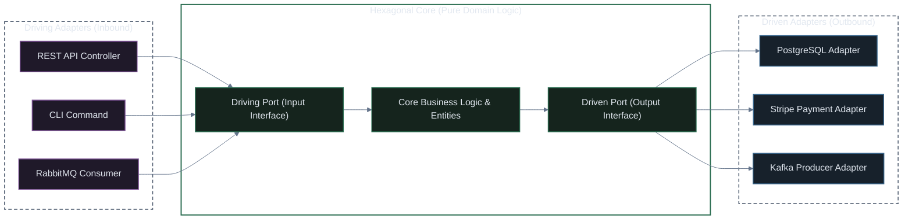

#### Core Concepts:
1. **The Core is Isolated**: Contains only business rules. It has **zero dependencies** on external frameworks, databases, or HTTP protocols.
2. **Ports (Interfaces)**:
   * **Driving Ports (Inbound)**: Interfaces that allow the outside world to invoke the core (e.g. `OrderServicePort`).
   * **Driven Ports (Outbound)**: Interfaces the core defines to declare what it needs from the outside world (e.g. `OrderRepositoryPort`, `PaymentGatewayPort`).
3. **Adapters (Implementations)**: Concrete plugins (e.g. `PostgresRepository` implements `OrderRepositoryPort`).
4. **Why it Wins**: You can swap PostgreSQL for MongoDB or replace REST with gRPC **without changing a single line of business logic**.

---

### 3. Clean Architecture (Uncle Bob)

Formalized by Robert C. Martin ("Uncle Bob"), Clean Architecture builds on Hexagonal and Onion principles by structuring code in **concentric circles**:

```mermaid
%%{init: {
  'theme': 'base',
  'themeVariables': {
    'darkMode': true,
    'background': '#0f172a',
    'primaryColor': '#1e293b',
    'primaryTextColor': '#e2e8f0',
    'primaryBorderColor': '#475569',
    'lineColor': '#64748b',
    'textColor': '#e2e8f0'
  },
  'themeCSS': '* { filter: none !important; box-shadow: none !important; } .node * { filter: none !important; } .cluster * { filter: none !important; }'
}}%%
graph TD
    subgraph Circle4["Ring 4: Frameworks & Drivers (External Web, DB, Devices)"]
        subgraph Circle3["Ring 3: Interface Adapters (Controllers, Gateways, Presenters)"]
            subgraph Circle2["Ring 2: Use Cases (Application Business Rules)"]
                subgraph Circle1["Ring 1: Entities (Enterprise Business Rules)"]
                    Entities["Core Domain Entities & Value Objects"]
                end
                UseCases["Application Workflows (Use Cases)"]
            end
            Adapters["Controllers · Gateways · Presenters"]
        end
        Drivers["Web Framework · PostgreSQL · UI · Cloud Services"]
    end

    Drivers -->|Dependencies Point Inwards| Adapters
    Adapters -->|Dependencies Point Inwards| UseCases
    UseCases -->|Dependencies Point Inwards| Entities

    style Circle4 fill:none,stroke:#475569,stroke-width:1.5px,stroke-dasharray: 6 4,color:#e2e8f0;
    style Circle3 fill:none,stroke:#38668c,stroke-width:1.5px,stroke-dasharray: 4 4,color:#e2e8f0;
    style Circle2 fill:none,stroke:#8a5832,stroke-width:1.5px,color:#e2e8f0;
    style Circle1 fill:none,stroke:#2b6d51,stroke-width:2px,color:#e2e8f0;

    classDef c1 fill:#15241d,stroke:#2b6d51,stroke-width:1.5px,color:#e2e8f0;
    classDef c2 fill:#241b16,stroke:#8a5832,stroke-width:1.5px,color:#e2e8f0;
    classDef c3 fill:#17212b,stroke:#38668c,stroke-width:1.5px,color:#e2e8f0;
    classDef c4 fill:#1e293b,stroke:#475569,stroke-width:1.5px,color:#e2e8f0;

    class Entities c1;
    class UseCases c2;
    class Adapters c3;
    class Drivers c4;
```

#### The Golden Rule: The Dependency Rule
> **Source code dependencies must only point inwards.**  
> Nothing in an inner circle can know anything about something in an outer circle.

* **Ring 1: Entities**: Enterprise business objects (e.g. `User`, `Order`). Completely pure.
* **Ring 2: Use Cases**: Application-specific actions (e.g. `RegisterUserUseCase`, `PlaceOrderUseCase`).
* **Ring 3: Interface Adapters**: Converts data from Use Cases into formats convenient for external frameworks (Controllers, Presenters).
* **Ring 4: Frameworks & Drivers**: The database, web server, or external SDKs. These are treated as **replaceable plugins**.

---

## Part 5: Deployment Patterns & Topologies

These patterns define **how the codebase is packaged, deployed, and distributed across production infrastructure**.

---

### 1. Traditional Monolith

In a classic monolith, all features, modules, and business domains are bundled into a **single deployable artifact** and share a **single relational database**.

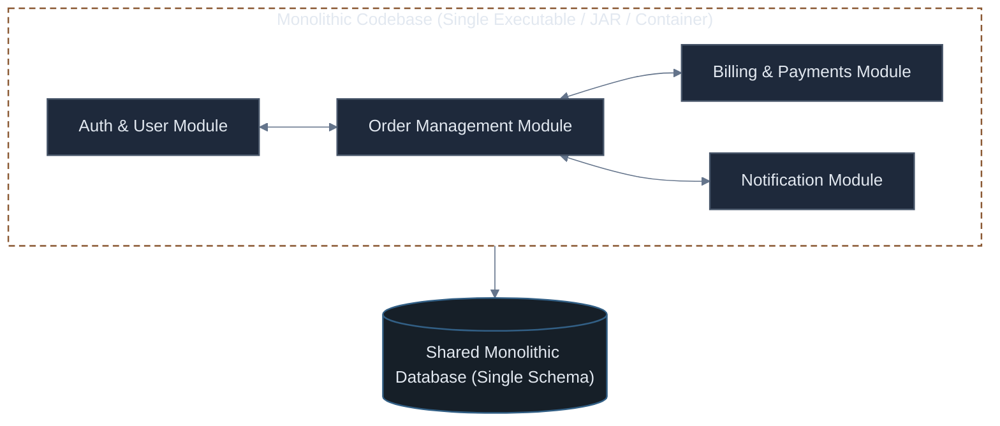

#### Pros:
* **Simple to Build & Debug**: Single codebase, easy local setup, single IDE project, simple end-to-end debugging.
* **ACID Transactions**: Everything lives in one database. Transfers and orders use atomic DB transactions (`BEGIN TRANSACTION ... COMMIT`).
* **Zero Network Latency**: Modules communicate via direct in-memory function calls (`billingService.charge()`).

#### Cons:
* **Coupling & Spaghetti Code**: Over time, modules bleed into each other, creating tight coupling.
* **All-or-Nothing Deployments**: Changing one line of code in the notification service requires rebuilding and redeploying the entire application.
* **Single Point of Failure**: A memory leak or unhandled exception in one module crashes the entire server for all users.
* **Scaling Inefficiency**: To scale the heavy video transcoding feature, you must duplicate the entire monolithic application on larger servers.

---

### 2. Modular Monolith

A Modular Monolith keeps the benefits of a **single deployment unit**, but strictly enforces **bounded domain contexts and isolation** at the code structure level.

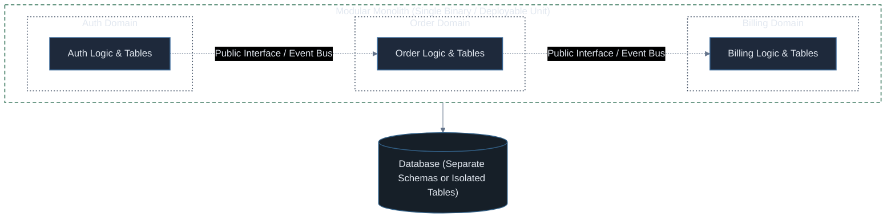

#### How it Works:
* Modules cannot directly query each other's database tables or internal classes.
* Communication happens **only through public interface APIs or an in-memory event bus**.
* Database tables are partitioned by schema (e.g. `auth.users`, `billing.invoices`).

#### Why it's Growing in Popularity:
* Delivers the clean architecture and team boundaries of microservices **without the operational nightmare of distributed networks, Kubernetes cluster management, and network latency**.
* If a module ever outgrows the monolith, it can be extracted into an independent microservice with minimal refactoring.

---

### 3. Microservices Architecture

Microservices break the application into a collection of **small, autonomous, independently deployable services**, each owning its own business domain and **its own database**.

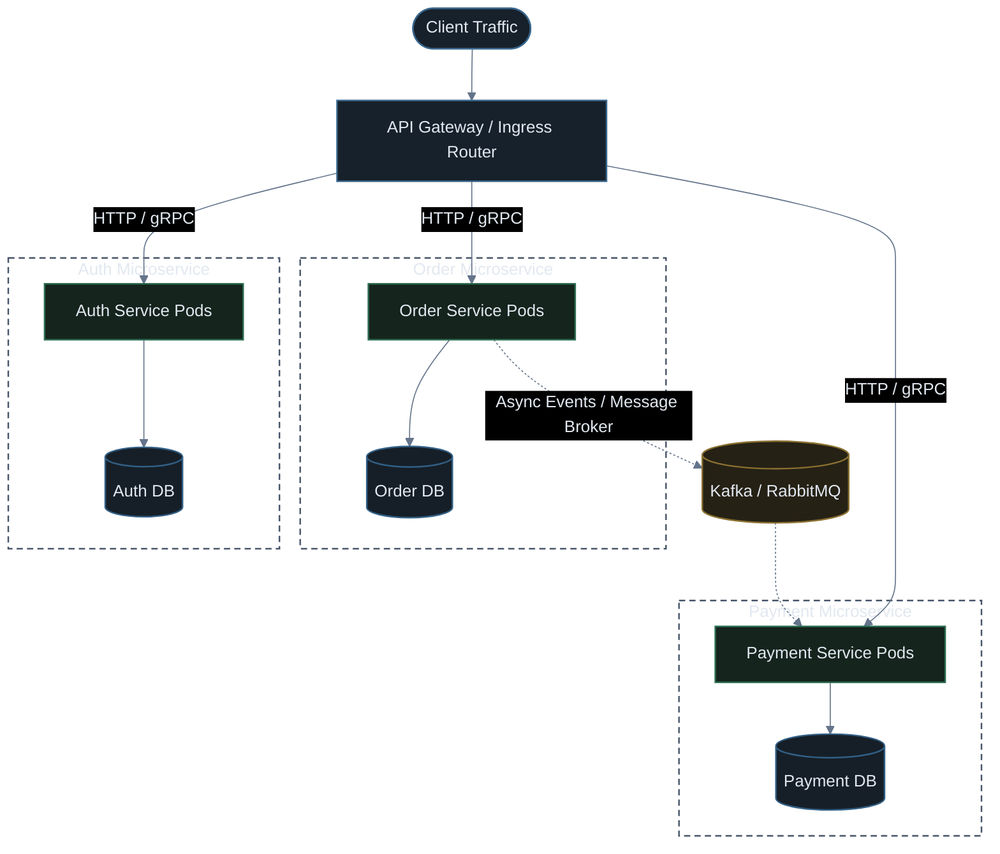

#### Core Rules of True Microservices:
1. **Database-per-Service**: Services never access another service's database directly. Data is accessed strictly through APIs.
2. **Independent Deployability**: Team A can deploy `Order Service v2` ten times a day without coordinating with Team B deploying `Payment Service`.
3. **Polyglot Stacks**: The payment service can be written in Go for speed, the ML service in Python, and the web frontend in Node.js.

---

## Part 6: Why Microservices Forced the Creation of Kubernetes

Understanding this evolution explains **why Kubernetes exists**:

| When you run a Monolith... | When you run 50 Microservices... |
| :--- | :--- |
| You manage **1 or 2 servers** running one application | You manage **hundreds of moving containers** across a distributed fleet |
| Internal function calls are **instant and guaranteed** in memory | Network calls can fail, timeout, or drop packets (**Fallacies of Distributed Computing**) |
| You scale the whole app by deploying on a bigger VM | You need to scale **only** the services under high load while conserving cloud cost |
| A static IP or DNS record is sufficient | Services crash, restart, and receive new dynamic IP addresses continuously |

> [!IMPORTANT]
> **Kubernetes was designed to be the operating system for microservices**: providing automated service discovery, rolling deployments, distributed health checks, pod autoscaling, and self-healing across thousands of containers.

---

## Part 7: How It All Connects in a Kubernetes World

Here is how all these architectural layers compose together in a production system:

```text
┌────────────────────────────────────────────────────────────────────────────────────────┐
│ Level 1: Physical Tier (AWS Cloud / Kubernetes Multi-Node Cluster - N-Tier)            │
├────────────────────────────────────────────────────────────────────────────────────────┤
│ Level 2: Deployment Topology (Microservices running in isolated Pods)                  │
├────────────────────────────────────────────────────────────────────────────────────────┤
│ Level 3: Service Code Architecture (e.g. Order Service):                               │
│  ├── Domain Pattern: Clean / Hexagonal Architecture (Domain Core isolated in center)   │
│  ├── Inbound Adapter: REST API Controller (FastAPI / Express / Go Gin)                 │
│  └── Outbound Adapter: PostgreSQL Driver via Repository Port Interface                 │
├────────────────────────────────────────────────────────────────────────────────────────┤
│ Client Frontend: React SPA using MVVM (Observable state & Two-Way Data Binding)        │
└────────────────────────────────────────────────────────────────────────────────────────┘
```

---

## Part 8: Master Comparison Matrix

| Architectural Pattern | Level | Scope | Key Characteristic | Best Fit For |
| :--- | :--- | :--- | :--- | :--- |
| **1-Tier / 3-Tier / N-Tier** | Physical | Hardware & Network | Machine/network separation of UI, compute, data | Physical infrastructure capacity planning |
| **MVC** | Presentation | User Input & View | Controller handles requests; View renders Model | Server-rendered web apps (Laravel, Rails, Django) |
| **MVP** | Presentation | User Input & View | Passive View commands Presenter via interface | Desktop apps & legacy Android with high unit testability |
| **MVVM** | Presentation | UI State Binding | Two-way reactive data binding between View & ViewModel | Modern SPAs (React, Vue) & mobile (iOS/Android) |
| **Layered (N-Layer)** | Domain | Code Organization | Horizontal slices (UI $\rightarrow$ Logic $\rightarrow$ DAL) | Rapid CRUD prototyping with traditional ORMs |
| **Hexagonal** | Domain | Boundary Protection | Ports (interfaces) & Adapters (plugins) around core | Systems requiring database/protocol agnosticism |
| **Clean Architecture** | Domain | Dependency Inversion | Concentric rings; dependencies point inward only | Complex domain enterprise applications |
| **Traditional Monolith** | Deployment | Binary Artifact | Single codebase, single deployment, shared DB | MVPs, small teams (<10 devs), early startups |
| **Modular Monolith** | Deployment | Binary Artifact | Single deployment, strict bounded domain context | Fast-growing startups, medium teams (10–50 devs) |
| **Microservices** | Deployment | Distributed Network | Independent containers, DB-per-service | Large enterprises (100+ devs), hyper-scaling |
