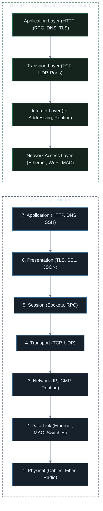
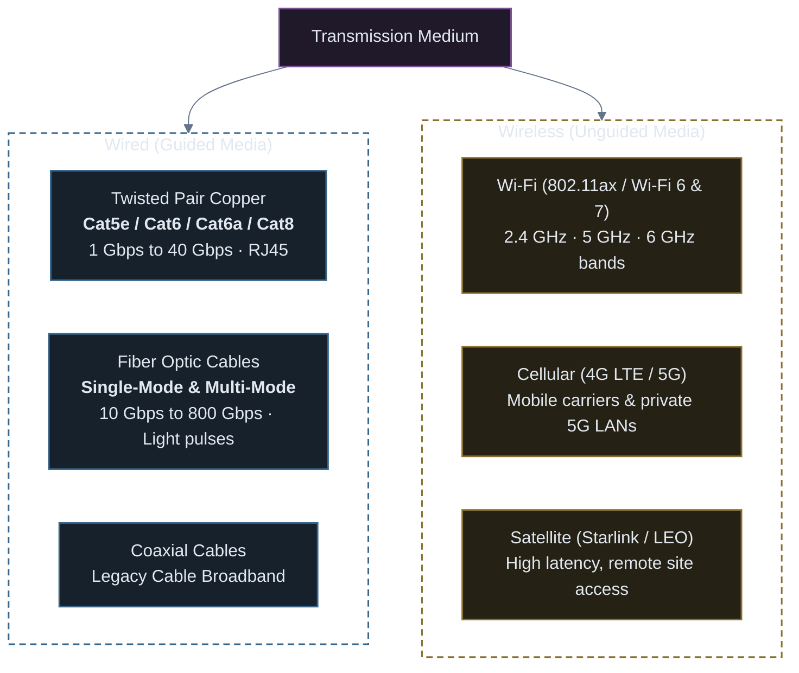
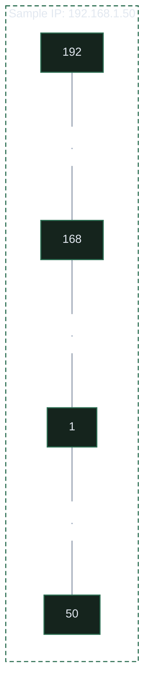
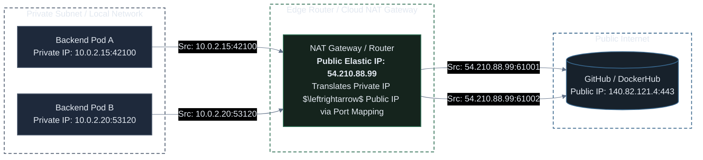
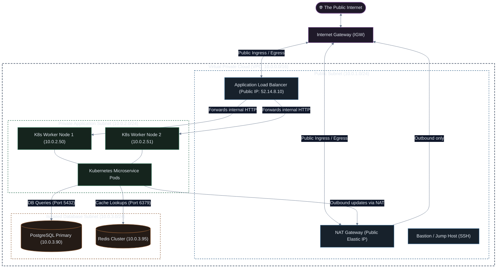
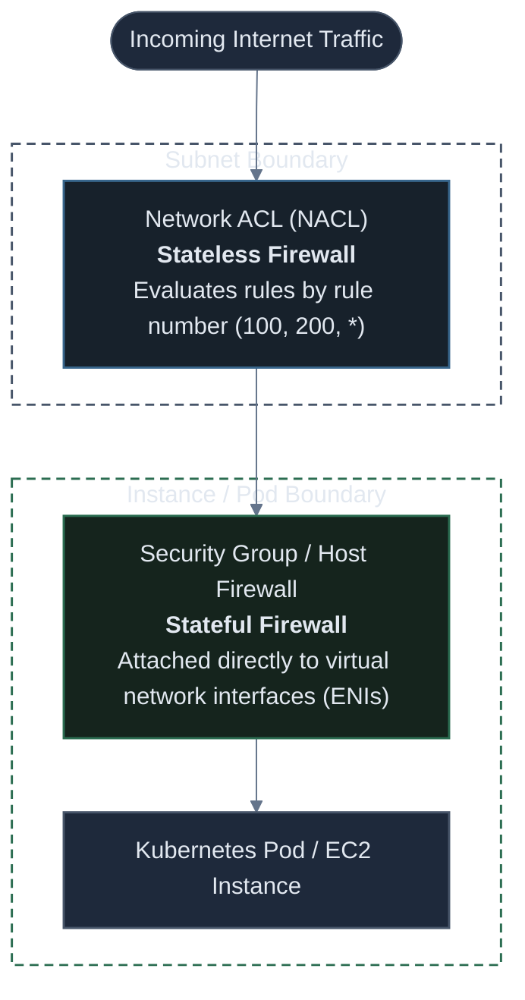
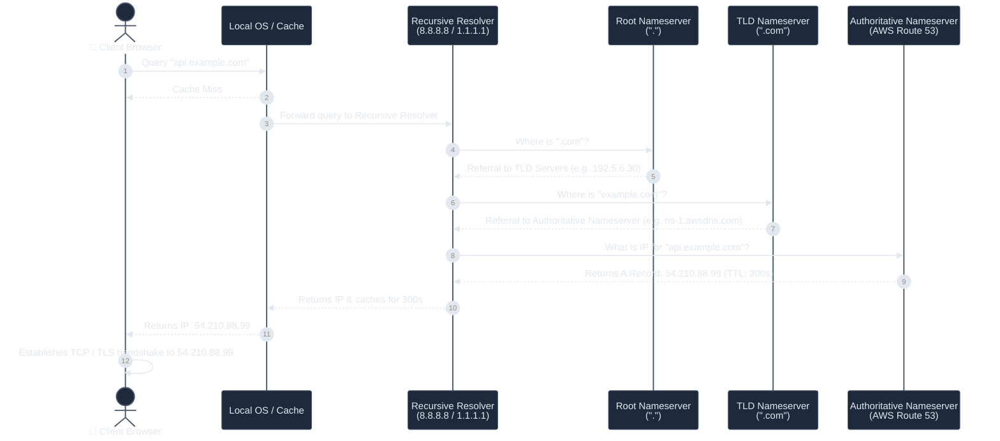
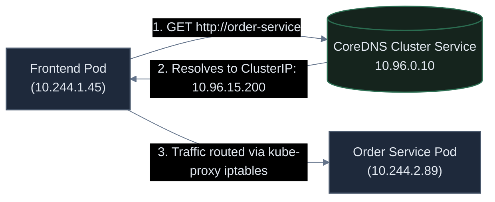

# Networking Basics: The Foundation for Production & Kubernetes

A comprehensive visual guide to computer networking fundamentals: from physical transmission media and IP addressing to CIDR subnetting, public vs. private networks, firewalls, and DNS resolution—and how they form the backbone of modern cloud and Kubernetes infrastructure.

---

## 1. What is a Network?

A **computer network** is a collection of interconnected computing devices (servers, laptops, smartphones, routers, switches) capable of exchanging data and sharing resources over communication links.

### The Two Foundational Network Models

To understand how data travels from a user's browser to a Kubernetes container, networking is abstracted into layers:



### Packet Encapsulation & Data Units

When your application sends data, each layer wraps the payload in its own header (like nesting envelopes):

| Layer | Protocol Data Unit (PDU) | Key Addressing Identifier | Hardware / Component |
| :--- | :--- | :--- | :--- |
| **Application (L7)** | **Data / Payload** | URL / API Endpoint | NGINX, Ingress, Envoy |
| **Transport (L4)** | **Segment** (TCP) / **Datagram** (UDP) | **Port Number** (e.g. `80`, `443`, `8080`) | Operating System Kernel, Load Balancers |
| **Network (L3)** | **Packet** | **IP Address** (e.g. `10.0.1.15`, `192.168.1.1`) | Routers, AWS VPC Route Tables, K8s CNI |
| **Data Link (L2)** | **Frame** | **MAC Address** (e.g. `00:1A:2B:3C:4D:5E`) | Network Switches, Linux Network Bridges |
| **Physical (L1)** | **Bits** (0s & 1s) | Voltage pulses, Light pulses, Radio waves | Ethernet Cables, Fiber Optics, Wi-Fi Antennas |

---

## 2. Transmission Medium: Wired vs. Wireless

Data must physically travel across a medium. In modern enterprise systems, understanding the trade-offs between wired and wireless networks is vital.



### Detailed Comparison: Wired vs. Wireless

| Metric | Wired (Fiber & Twisted Pair) | Wireless (Wi-Fi 6/7 & 5G) |
| :--- | :--- | :--- |
| **Speed / Throughput** | **1 Gbps to 800 Gbps** (Ultra-high, sustained) | Up to 1–9 Gbps (Theoretical, shared across all active devices) |
| **Latency** | **< 1 millisecond** (Consistent, sub-millisecond) | 10 ms to 100+ ms (Variable, subject to radio interference) |
| **Reliability & Jitter** | **99.999% stable** (Zero packet loss under normal loads) | Susceptible to walls, physical obstacles, distance, and weather |
| **Electromagnetic Interference** | **Immune** (Fiber optics immune to EMI/RFI) | **High vulnerability** to microwaves, Bluetooth, physical obstacles |
| **Security** | Requires physical physical cable tap | Radio waves broadcast in all directions; vulnerable to eavesdropping |
| **Mobility** | Fixed location (server racks, desktops) | High mobility (laptops, mobile phones, IoT sensors) |

> [!IMPORTANT]
> **Production Rule**: Data centers, cloud provider infrastructure (AWS, GCP, Azure), Top-of-Rack (ToR) switches, and Kubernetes worker node clusters are **100% wired with fiber-optic backbones**. Wireless is reserved strictly for end-user edge access (laptops, smartphones).

---

## 3. IPv4 Addressing: What is an IP?

An **Internet Protocol Version 4 (IPv4) Address** is a unique number assigned to every device on a network so devices can find and talk to each other.

Think of it like a **phone number** or **home mailing address** for computers.

---

### How an IPv4 Address Looks

An IPv4 address is always written as **4 numbers separated by dots**:

$$\text{Number 1} \ .\  \text{Number 2} \ .\  \text{Number 3} \ .\  \text{Number 4}$$



#### The Only 2 Rules to Remember:
1. **Each number must be between `0` and `255`**:
   * ✅ `192.168.1.1` is valid.
   * ❌ `192.168.1.300` is invalid (cannot exceed 255).
2. **There are always exactly 4 numbers**:
   * ✅ `10.0.0.1` is valid.
   * ❌ `10.0.1` is invalid (missing a number).

---

### Real-World Sample IP Addresses You See Every Day

| Sample IP | What It Is | Where You See It |
| :--- | :--- | :--- |
| **`127.0.0.1`** | **Localhost** (Your own computer) | When running code locally (`http://localhost:3000` or `http://127.0.0.1:3000`) |
| **`192.168.1.1`** | **Home Wi-Fi Router** | The admin gateway page to configure your home Wi-Fi |
| **`192.168.1.50`** | **Your Laptop or Phone** | The IP address assigned to your device on home Wi-Fi |
| **`1.1.1.1`** | **Cloudflare Public DNS** | Fast public internet directory server |
| **`8.8.8.8`** | **Google Public DNS** | Google's public internet directory server |
| **`172.17.0.2`** | **Docker Container** | Default private IP given to a container running in Docker |
| **`10.0.1.15`** | **Cloud Server / K8s Pod** | Private IP for a server inside an AWS VPC or Kubernetes cluster |

---

## 4. Public IP vs. Private IP (and RFC 1918)

Because the 4.29 billion IPv4 address pool was exhausted, the internet relies on a strict distinction between **Public** and **Private** IP addresses.

### Public IP Addresses
* **Globally Unique**: No two devices on the public internet can share the same public IP at the same time.
* **Globally Routable**: Can be reached directly by any computer in the world over the internet.
* **Assigned by**: ISPs and Cloud Providers (AWS, GCP, Azure).
* **Cost**: Scarce and expensive (Cloud providers charge $\approx \$3.65/\text{month}$ per public IPv4 address).

#### 5 Real-World Public IP Examples:

| Public IP | Organization | What Runs on It |
| :--- | :--- | :--- |
| **`8.8.8.8`** | Google | Google's primary public DNS resolver |
| **`1.1.1.1`** | Cloudflare | Cloudflare's fast public DNS directory |
| **`140.82.121.4`** | GitHub | Public web server hosting `github.com` |
| **`142.250.190.46`** | Google | Public web server hosting `google.com` |
| **`54.210.88.99`** | AWS (Amazon) | Public Elastic IP attached to an Application Load Balancer |

---

### Private IP Addresses (RFC 1918)
* **Non-Routable on Internet**: Internet routers immediately drop packets destined for private IPs. Nobody on the outside internet can directly ping or hack your private IP.
* **100% Free & Reusable**: Millions of homes, offices, and cloud VPCs safely reuse the exact same private IP addresses without any conflict.
* **Assigned by**: Your local home router (via DHCP), your Docker engine, or your AWS VPC.

#### 5 Real-World Private IP Examples:

| Private IP | RFC 1918 Class | Where You See It |
| :--- | :--- | :--- |
| **`192.168.1.1`** | Class C | The default gateway / admin page of your home Wi-Fi router |
| **`192.168.1.105`** | Class C | Your personal laptop or smartphone connected to home Wi-Fi |
| **`10.0.1.50`** | Class A | A private backend API server or database inside an AWS VPC |
| **`10.244.2.89`** | Class A | A microservice container (Pod) running inside a Kubernetes cluster |
| **`172.17.0.2`** | Class B | A local container running on Docker's default bridge network |

---

### The RFC 1918 Standard Ranges

Any IP starting with these numbers is guaranteed to be a **private network**:

| Class | CIDR Range | IP Range | Total Available IPs | Typical Usage |
| :--- | :--- | :--- | :--- | :--- |
| **Class A** | `10.0.0.0/8` | `10.0.0.0` – `10.255.255.255` | **16,777,216** | **Cloud VPCs (AWS, GCP)**, Large Enterprises, Kubernetes Pod CIDRs |
| **Class B** | `172.16.0.0/12` | `172.16.0.0` – `172.31.255.255` | **1,048,576** | **Docker Default Bridge (`172.17.0.0/16`)**, Corporate LANs |
| **Class C** | `192.168.0.0/16` | `192.168.0.0` – `192.168.255.255` | **65,536** | **Home Wi-Fi routers**, Small office networks |

### Special Reserved IP Addresses

* **Loopback (`127.0.0.1` / `localhost`)**: Points back to the current machine. Packets never leave your computer.
* **Link-Local / APIPA (`169.254.0.0/16`)**: Auto-assigned when DHCP fails. Also used for the **Cloud Instance Metadata Service (IMDS)**: `http://169.254.169.254`.
* **Default Route / Wildcard (`0.0.0.0/0`)**: Represents "all IPv4 addresses" or "any network" in routing tables and firewall rules.

---

### How Private Devices Access the Internet: NAT (Network Address Translation)

If private IPs cannot route on the internet, how does a laptop with IP `192.168.1.5` or a private Kubernetes Pod browse GitHub? **Via NAT**.



* **SNAT (Source NAT)**: Replaces the private source IP of outgoing packets with the NAT Gateway's public IP. The NAT maintains a translation table mapping port numbers so it knows which private machine to return responses to.
* **DNAT (Destination NAT / Port Forwarding)**: Replaces the public destination IP with a private internal IP (used when incoming internet traffic hits an ingress controller or router port 80/443).

---

## 5. Subnetting: What is a Subnet and Why?

A **Subnet** (sub-network) is simply a smaller slice of a larger network—like dividing a large building into separate rooms or departments.

---

### What does the slash (`/24`) mean?

The slash number tells you **how many numbers are locked (fixed)**:

| Subnet Mask | What It Means | Total IPs | Where It Is Used |
| :--- | :--- | :--- | :--- |
| **/24** | **First 3 numbers locked** (`192.168.1.x`) | **256** IPs | Standard home Wi-Fi and microservice subnets |
| **/16** | **First 2 numbers locked** (`10.0.x.x`) | **65,536** IPs | Cloud VPCs (AWS / GCP) |
| **/32** | **All 4 numbers locked** (`10.0.1.50`) | **1** IP | A single specific server (used in firewall rules) |

---

### Why Do We Subnet? (The 2 Big Reasons)

1. **Security (Isolation)**:
   * Keep web servers in one subnet and databases in another subnet. If a hacker breaks into a web server, they cannot immediately reach the database.
2. **Organization**:
   * Instead of throwing thousands of servers into one big chaotic pool, you group them cleanly (e.g. Subnet A for Web, Subnet B for Worker Nodes, Subnet C for Data).

---

## 6. Public Network vs. Private Network (Cloud VPC Architecture)

In production cloud engineering, you deploy your systems inside a **Virtual Private Cloud (VPC)**. The VPC is divided into **Public Subnets** and **Private Subnets**.



### The 3 Subnet Types in Production

| Subnet Type | Route Table Target for `0.0.0.0/0` | Public IP Allowed? | What Runs Here? |
| :--- | :--- | :--- | :--- |
| **Public Subnet** | Points to **Internet Gateway (`igw-xxxx`)** | **Yes** (Public Elastic IPs) | ALBs, NAT Gateways, Ingress Controllers, Bastion Hosts |
| **Private Subnet** | Points to **NAT Gateway (`nat-xxxx`)** | **No** (Private IPs only) | Kubernetes Worker Nodes, Microservices, Batch Workers |
| **Isolated Database Subnet**| **None** (No default route to internet) | **No** (Strictly internal) | Production RDS PostgreSQL, Aurora, MongoDB, Redis |

---

## 7. Firewalls: Controlling Ingress and Egress

A **Firewall** monitors and filters incoming (**Ingress**) and outgoing (**Egress**) network traffic based on predefined security rules.

### Stateful vs. Stateless Firewalls

In cloud environments like AWS, security is enforced at two distinct boundaries:



### The Fundamental Difference: Stateful vs. Stateless

| Feature | Security Group (Stateful) | Network ACL / NACL (Stateless) |
| :--- | :--- | :--- |
| **Operating Level** | Instance / Pod Network Interface (ENI) | Subnet Boundary |
| **State Tracking** | **Stateful**: Automatically tracks connections | **Stateless**: Treats request & response as completely unrelated |
| **Return Traffic** | **Automatically allowed** (If inbound port 443 is open, return traffic on any port is automatically permitted) | **Must explicitly allow return traffic** on ephemeral ports (`1024-65535`) |
| **Rule Processing** | All rules evaluated together; most permissive wins | Evaluated in strict numerical order (Rule 100, then 200) |
| **Deny Rules** | Cannot specify explicit `DENY` rules (all rules are allow) | Supports explicit `ALLOW` and `DENY` rules |

> [!TIP]
> **Kubernetes NetworkPolicies**:  
> In Kubernetes, a **NetworkPolicy** acts like a stateful pod-level firewall. By default, all Pods can talk to all other Pods across namespaces. Applying a NetworkPolicy isolates Pods so they can only accept traffic from designated services (e.g. only allow traffic from `frontend` to `backend` on TCP port 8080).

---

## 8. DNS (Domain Name System): The Phonebook of the Internet

Humans remember names (`api.mycompany.com`), but network routers only understand numerical IP addresses (`142.250.190.46`). **DNS** translates human-friendly hostnames into machine-routable IP addresses.

### Step-by-Step DNS Resolution Walkthrough

What happens under the hood when a user visits `https://api.example.com`?



### Essential DNS Record Types

| Record Type | Name | Purpose | Example |
| :--- | :--- | :--- | :--- |
| **A** | Address | Maps domain name to an **IPv4 address** | `api.example.com` $\rightarrow$ `54.210.88.99` |
| **CNAME** | Canonical Name | Creates an alias pointing to another domain name | `www.example.com` $\rightarrow$ `example.com` |
| **ALIAS / ANAME** | Virtual CNAME | Allows CNAME-like routing at the domain root (apex `@`) | `example.com` $\rightarrow$ `my-alb-123.us-east-1.elb.amazonaws.com` |
| **MX** | Mail Exchange | Directs emails to the destination mail server | `example.com` $\rightarrow$ `10 mail.google.com` |
| **TXT** | Text | Stores text metadata (SPF, DKIM, domain verification) | `"v=spf1 include:_spf.google.com ~all"` |
| **PTR** | Pointer | Reverse DNS: maps an IP back to a hostname | `54.210.88.99` $\rightarrow$ `ec2-54-210-88-99.compute.amazonaws.com` |
| **NS** | Name Server | Delegates a DNS zone to authoritative nameservers | `example.com` $\rightarrow$ `ns-1.awsdns.com` |

### TTL (Time To Live) and Caching

* **TTL** defines how many seconds a DNS resolver or client is allowed to cache the DNS record before making another query.
* **Low TTL (e.g. 60 seconds)**: Used during production migrations and blue/green deployments so changes propagate within 1 minute.
* **High TTL (e.g. 86400 seconds / 24 hours)**: Saves DNS query costs and speeds up lookups for static, rarely changing records.

---

### DNS in Kubernetes: CoreDNS

In Kubernetes, Pods are ephemeral: they die and restart with new, dynamic private IP addresses continuously. You **cannot hardcode IP addresses** in microservices.

Instead, Kubernetes runs an internal cluster DNS server called **CoreDNS**:

```text
       Format: <service-name>.<namespace>.svc.cluster.local
Example Query: order-service.prod.svc.cluster.local
```



* Every microservice exposes a static DNS name.
* When Pod A queries `http://order-service`, CoreDNS instantly resolves it to the service's virtual `ClusterIP`.
* Even if backend pods die and spin up on different worker nodes with new private IPs, the DNS name **never changes**.

---

## 9. Master Production Networking Cheat Sheet

| Concept | What It Is | Real-World Production Example | Kubernetes Manifest Equivalent |
| :--- | :--- | :--- | :--- |
| **Physical Medium** | Wired Fiber Optic | 100 Gbps AWS Direct Connect / Top-of-Rack Switch | Physical K8s Bare-Metal Node NICs |
| **Public IP** | Globally routable address | `54.210.88.99` (AWS Elastic IP) | LoadBalancer Service (`type: LoadBalancer`) |
| **Private IP** | Internal RFC 1918 address | `10.0.2.15` (AWS EC2 / K8s Worker Node IP) | Pod IP (`status.podIP`) |
| **Subnet / CIDR** | Network partition boundary | `10.0.1.0/24` (Subnet for 251 usable cloud hosts) | Pod CIDR allocation (`--pod-network-cidr=10.244.0.0/16`) |
| **Public Subnet** | Subnet with Internet Gateway route | Houses Application Load Balancers and Bastions | Ingress Controller pods with public load balancer |
| **Private Subnet** | Subnet routed via NAT Gateway | Houses Kubernetes Worker Nodes and Pods | Worker node nodes in private subnets |
| **Firewall (Stateful)** | Stateful packet inspection | AWS Security Group allowing port 443 | Kubernetes `NetworkPolicy` ingress/egress rules |
| **Firewall (Stateless)**| Subnet-level packet filtering | AWS Network ACL (NACL) blocking malicious CIDRs | Subnet ACL boundary |
| **DNS** | Domain name to IP translation | `api.company.com` $\rightarrow$ ALB Public IP | CoreDNS (`<svc>.<ns>.svc.cluster.local`) |
