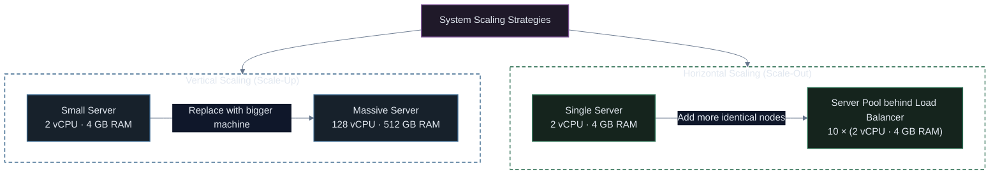
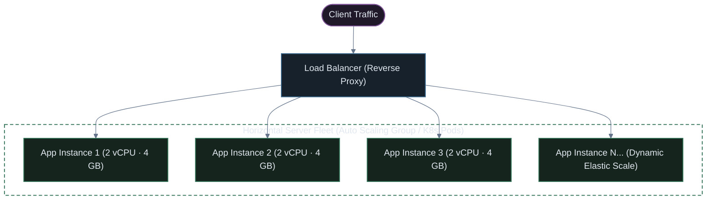
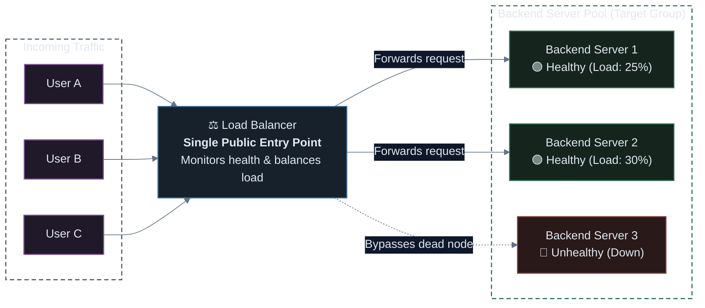
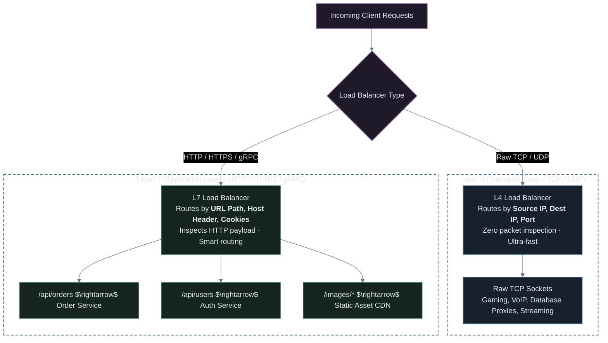
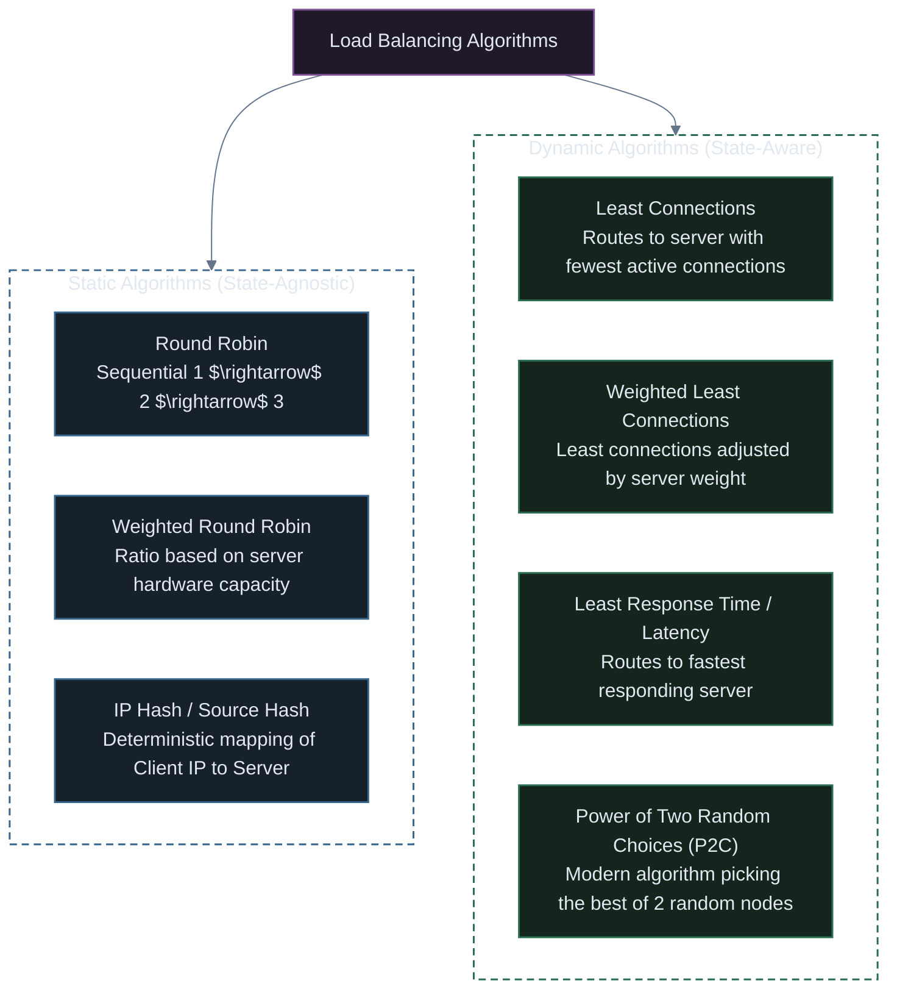

# Scaling & Load Balancing: Vertical, Horizontal, and Traffic Distribution

A comprehensive visual guide to scaling software systems: understanding the trade-offs between **Vertical Scaling (Scale-Up)** and **Horizontal Scaling (Scale-Out)**, the mechanics of **L4 vs. L7 Load Balancing**, distribution algorithms, health checks, session management, and how these principles translate into **Kubernetes Autoscaling**.

---

## 1. The Core Problem: Why Systems Must Scale

Every software application is constrained by computing resources: **CPU**, **Memory (RAM)**, **Disk I/O**, and **Network Bandwidth**.

When user traffic surges from 100 requests per second (RPS) to 100,000 RPS:
1. **Thread/Connection Starvation**: Web servers run out of worker threads or file descriptors to accept new TCP connections.
2. **Memory Exhaustion (OOM)**: Storing user sessions, caching query results, and handling concurrent requests exhausts RAM, triggering the Linux Out-Of-Memory (OOM) killer.
3. **CPU Throttling**: Cryptographic handshakes (TLS), JSON serialization, and business logic push CPU utilization to 100%, causing request queues to back up.
4. **Latency Degradation**: Response times spike from 50 ms to 30 seconds, leading to client timeouts and HTTP 504 Gateway Timeout errors.

To survive growth, a system must **scale**. There are two fundamental ways to scale computing capacity:



---

## 2. Vertical Scaling (Scale-Up / Scale-Down)

**Vertical scaling** (Scale-Up) means making **one single server bigger and stronger**. Instead of adding more computers, you upgrade the CPU, RAM, or storage of the machine you already have.

Think of it like upgrading a car: instead of buying a second car, you replace the engine in your current car with a larger, more powerful one.

---

### The 3 Steps of Vertical Scaling (The Scale-Up Journey)

In real production, vertical scaling usually happens in **3 progressive steps** as your application grows:

```mermaid
%%{init: {
  'theme': 'base',
  'themeVariables': {
    'darkMode': true,
    'background': '#0f172a',
    'primaryColor': '#1e293b',
    'primaryTextColor': '#e2e8f0',
    'primaryBorderColor': '#475569',
    'lineColor': '#64748b',
    'textColor': '#e2e8f0',
    'edgeLabelBackground': '#0f172a'
  },
  'themeCSS': '* { filter: none !important; box-shadow: none !important; } .node * { filter: none !important; }'
}}%%
graph LR
    Step1["<b>Step 1: Small Server (MVP)</b><br/>2 vCPU · 4 GB RAM<br/>~$15 / month<br/><i>Handles: ~500 users</i>"]
    -->|"Traffic increases 10x<br/>(Stop server & resize)"| Step2["<b>Step 2: Medium Server (Growth)</b><br/>8 vCPU · 16 GB RAM<br/>~$80 / month<br/><i>Handles: ~5,000 users</i>"]
    -->|"Traffic surges again<br/>(Stop server & resize)"| Step3["<b>Step 3: Large Server (Limit)</b><br/>32 vCPU · 128 GB RAM<br/>~$600 / month<br/><i>Handles: ~30,000 users</i>"]
    --> Wall["💥 <b>Hardware Ceiling Hit!</b><br/>No bigger machine available<br/>Downtime on every resize<br/>Single Point of Failure"]

    classDef c1 fill:#17212b,stroke:#38668c,stroke-width:1.5px,color:#e2e8f0;
    classDef c2 fill:#1f2838,stroke:#5c8db8,stroke-width:1.5px,color:#e2e8f0;
    classDef c3 fill:#273044,stroke:#82a9cf,stroke-width:1.5px,color:#e2e8f0;
    classDef cWall fill:#36171d,stroke:#a63d40,stroke-width:1.5px,color:#e2e8f0;

    class Step1 c1;
    class Step2 c2;
    class Step3 c3;
    class Wall cWall;
```



#### Step 1: Small Server (Starting Out / MVP)
* **Server Size**: **2 vCPU · 4 GB RAM · 50 GB SSD**
* **Cost**: ~$15 / month
* **Capacity**: Handles ~500 to 1,000 active visitors.
* **What happens**: You launch your project. CPU usage is low (~20%), memory usage is stable, and response times are fast. Everything is cheap and easy to manage because there is only one server.

#### Step 2: Medium Server (Traffic Growth)
* **Server Size**: **8 vCPU · 16 GB RAM · 200 GB SSD**
* **Cost**: ~$80 / month
* **Capacity**: Handles ~5,000 to 10,000 active visitors.
* **What happens**: Your app gets popular on social media. Suddenly CPU spikes to 95%, RAM is 90% full, and pages start loading slowly. 
* **The Fix**: You don't need to rewrite any code. You simply stop the machine, select a larger server size in your cloud dashboard (like AWS EC2 or DigitalOcean), and turn it back on. The slowdown is solved immediately!

#### Step 3: Large Server (The Limit & Hardware Ceiling)
* **Server Size**: **32 vCPU · 128 GB RAM · 1 TB NVMe SSD**
* **Cost**: ~$600 to $1,200 / month
* **Capacity**: Handles ~30,000 to 50,000 active visitors.
* **What happens**: Your company grows even more. You upgrade to a massive high-end machine. It works, but now you hit serious production problems:
  1. **The Hardware Ceiling**: There is a physical limit. You cannot buy a machine with infinite CPU or RAM. Eventually, no larger server exists in the cloud catalog.
  2. **Downtime on Every Resize**: To upgrade CPU and RAM, you must shut down the server. That means 5 to 10 minutes of outage where users cannot access your site.
  3. **Single Point of Failure (SPOF)**: If this one giant server has a hardware crash or power failure, **100% of your website goes down**.
  4. **Exponential Cost**: Supercomputers cost far more per core than smaller computers.

---

### When Vertical Scaling Makes Sense:
* **Relational Databases (RDBMS)**: PostgreSQL, MySQL, and Oracle historically rely on a single primary node for ACID transactions. Scaling up the primary DB instance is often the fastest solution.
* **Early-Stage MVPs & Startups**: Upgrading a $15/mo VM to an $80/mo VM takes 2 minutes and avoids days of complex distributed system engineering.
* **Monolithic Applications**: Legacy monoliths that share memory state can scale vertically with **zero code modifications**.

### Summary of Vertical Scaling:
* **Pros**: 
  - ✅ **Zero code changes**: The application code doesn't need to be redesigned.
  - ✅ **Simple to manage**: Only 1 server, 1 operating system, and 1 IP address to worry about.
  - ✅ **Zero network latency**: Everything runs on the same motherboard.
* **Cons**:
  - ❌ **Downtime required**: You usually have to reboot or turn off the machine to resize it.
  - ❌ **Physical limit**: You eventually hit the hardware ceiling.
  - ❌ **High risk (SPOF)**: If this single machine dies, your entire business is offline.

*(This is why high-traffic systems transition to **Horizontal Scaling**, explained below!)*

---

## 3. Horizontal Scaling (Scale-Out / Scale-In)

**Horizontal scaling** means increasing capacity by adding **more server instances or containers** to your application pool, distributing traffic among them.



### The Golden Prerequisite: Statelessness
To scale horizontally, application instances **must be completely stateless**.
* **Anti-pattern**: Storing user login sessions in server memory (`req.session`) or saving uploaded avatars directly to `/var/www/uploads` on local disk. If request #1 lands on Server 1 and request #2 lands on Server 2, Server 2 won't know the user is logged in!
* **Cloud-Native Pattern**: Externalize all state:
  * User Sessions & Tokens $\rightarrow$ Central **Redis** or stateless **JWTs**.
  * File Uploads $\rightarrow$ Object Storage (**AWS S3 / Google Cloud Storage**).
  * Application Data $\rightarrow$ Central Database (**PostgreSQL / MySQL / DynamoDB**).

### Advantages:
* **Theoretically Infinite Scaling**: You are no longer bound by hardware limits. You can run 5 instances, 50 instances, or 5,000 containers across thousands of physical machines.
* **High Availability & Fault Tolerance**: If Server 2 crashes, the load balancer simply routes traffic to Servers 1 and 3. The end-user never notices an outage.
* **Elastic Autoscaling**: You can scale out during Black Friday traffic spikes and scale in during the night, paying only for the compute you actually consume.
* **Zero-Downtime Deployments**: You can upgrade servers one-by-one (Rolling Updates or Blue/Green Deployments) without taking the entire application offline.

### Challenges:
* **Requires a Load Balancer**: Traffic must be intelligently distributed.
* **Distributed System Complexity**: Fallacies of distributed computing, network latency between nodes, distributed logging, and centralized tracing.

---

## 4. Vertical vs. Horizontal Scaling Master Comparison

| Evaluation Metric | Vertical Scaling (Scale-Up) | Horizontal Scaling (Scale-Out) |
| :--- | :--- | :--- |
| **Action** | Upgrade hardware / instance type | Add more instances / containers |
| **Max Capacity** | Hard physical hardware limit | **Virtually unlimited** |
| **Downtime to Scale** | Usually requires stopping the instance / rebooting | **Zero downtime** (new instances join pool live) |
| **Fault Tolerance** | **Low** (Single Point of Failure) | **High** (Resilient to individual node failures) |
| **Application Architecture** | Works with stateful, legacy monoliths | **Requires stateless application design** |
| **Traffic Distribution** | None needed (single endpoint) | **Requires a Load Balancer** |
| **Cost Efficiency** | Becomes exponentially expensive at high tiers | Linear, pay-as-you-go elastic pricing |
| **Maintenance** | Simple (one OS to maintain) | Requires automated deployment (K8s, Ansible, Terraform) |
| **Best Fit For** | Relational DB primaries, legacy apps, quick MVPs | Web apps, microservices, APIs, background queues |

---

## 5. Load Balancing: The Traffic Coordinator

A **Load Balancer (LB)** is a specialized reverse proxy that sits between incoming internet clients and your backend server fleet, ensuring no single server becomes overwhelmed.



### Core Responsibilities of a Load Balancer:
1. **Traffic Distribution**: Spreads requests evenly according to a balancing algorithm.
2. **Health Monitoring**: Continuously probes backend instances; automatically removes failing nodes.
3. **High Availability (HA)**: Seamlessly reroutes traffic if an instance crashes.
4. **Security & SSL/TLS Offloading**: Decrypts HTTPS traffic at the edge, freeing backend CPUs from expensive cryptographic handshakes.
5. **DDoS Mitigation**: Buffers slow client connections (Slowloris attacks) and absorbs traffic surges.

---

## 6. Layer 4 (L4) vs. Layer 7 (L7) Load Balancing

Load balancers operate primarily at two distinct layers of the OSI model:



### Deep-Dive Comparison: L4 vs. L7

| Feature | Layer 4 (L4) Load Balancer | Layer 7 (L7) Load Balancer |
| :--- | :--- | :--- |
| **OSI Layer** | Layer 4 (Transport Layer) | Layer 7 (Application Layer) |
| **Protocols Handled** | **TCP, UDP, TLS** | **HTTP, HTTPS, HTTP/2, WebSocket, gRPC** |
| **Data Inspected** | IP Address & Port Number only | URL Path, Host header, Cookies, HTTP headers |
| **Content-Based Routing** | **No** (Cannot route `/api` vs `/static`) | **Yes** (Full path, header, and cookie routing) |
| **Throughput / Latency** | **Ultra-high throughput, microsecond latency** | High throughput, slight overhead for packet inspection |
| **SSL/TLS Termination** | Pass-through or TLS termination | Full TLS termination & certificate management |
| **Typical Tools** | **AWS NLB**, HAProxy (TCP mode), IPVS, Envoy (TCP) | **AWS ALB**, NGINX, Traefik, HAProxy (HTTP mode), Envoy |
| **Best For** | Database clustering, gaming servers, high-volume raw TCP | Microservices, web APIs, SPAs, path-based routing |

---

## 7. Load Balancing Algorithms

How does the load balancer choose *which* backend server should receive the next request?



### 1. Round Robin
* **How it works**: Requests are distributed sequentially across the server list: Request 1 goes to Server A, Request 2 to Server B, Request 3 to Server C, Request 4 back to Server A.
* **Best used when**: All backend servers have **identical hardware specifications** and all incoming requests require roughly equal processing time.

### 2. Weighted Round Robin
* **How it works**: Each server is assigned a weight representing its capacity. If Server A has weight 3 and Server B has weight 1, Server A receives 3 requests for every 1 request Server B receives.
* **Best used when**: Running heterogeneous server hardware (e.g., migrating from older 4-core servers to newer 16-core servers).

### 3. Least Connections
* **How it works**: The load balancer monitors active open connections and directs incoming traffic to the server currently handling the **fewest active connections**.
* **Best used when**: Request durations vary dramatically (e.g. database transactions, file uploads, WebSocket streams, or video streaming).

### 4. IP Hash (Source IP Hashing)
* **How it works**: The client’s IP address is passed through a hashing function:
  $$\text{Target Server} = \text{hash}(\text{Client IP}) \pmod N$$
* **Guarantee**: The same client will always reach the exact same backend server, as long as no servers are added or removed.
* **Drawback**: If 10,000 corporate employees browse behind a single corporate NAT proxy (sharing one public IP), all 10,000 users overload the exact same backend node.

### 5. Power of Two Random Choices (P2C)
* **How it works**: When a request arrives, the load balancer randomly selects **two candidate servers** and picks whichever has the fewer active connections.
* **Why it's revolutionary**: Proven mathematically by Michael Mitzenmacher to eliminate the "herd effect" (where all requests rush to a single momentarily idle node). Used by modern service meshes like **Envoy** and **NGINX Plus**.

---

## 8. Essential Load Balancing Features

### 1. Health Checks (Heartbeat Probing)
A load balancer must never send traffic to a dead or misbehaving node.
* **Active Health Checks**: The load balancer periodically sends an HTTP `GET /healthz` request every 5–10 seconds. If a node returns HTTP 200, it is marked **Healthy**. If it times out or returns HTTP 500 three consecutive times, it is marked **Unhealthy** and temporarily removed from the pool.
* **Passive Health Checks**: The load balancer observes real client traffic. If a backend server returns three consecutive TCP connection resets or HTTP 502 Bad Gateway responses, it is automatically throttled or evicted.

### 2. Sticky Sessions (Session Affinity)
* When enabled, the load balancer injects a tracking cookie (e.g. `AWSALB`) into the client's browser on the first request. Subsequent requests containing that cookie are locked to that specific server.
* > [!WARNING]
  > **Architectural Warning**: Sticky sessions are considered an **anti-pattern** in modern cloud and Kubernetes environments! They create uneven traffic distribution (one server gets overloaded while others sit idle) and prevent clean pod auto-scaling. Always strive for stateless services backed by Redis or JWTs.

### 3. SSL/TLS Termination (Offloading)
* The load balancer handles the CPU-intensive cryptographic handshake with the client browser over HTTPS (Port 443).
* The connection between the load balancer and the backend application servers runs over plain HTTP (Port 80) inside the secure, private cloud network.
* **Benefits**: Simplifies certificate management (you only install your SSL certificate once on the load balancer instead of on 100 backend containers).

---

## 9. How Scaling & Load Balancing Work in Kubernetes

In Kubernetes, scaling and load balancing are not external add-ons—they are **core primitives built directly into the container orchestration control plane**:

```mermaid
%%{init: {
  'theme': 'base',
  'themeVariables': {
    'darkMode': true,
    'background': '#0f172a',
    'primaryColor': '#1e293b',
    'primaryTextColor': '#e2e8f0',
    'primaryBorderColor': '#475569',
    'lineColor': '#64748b',
    'textColor': '#e2e8f0',
    'edgeLabelBackground': '#0f172a'
  },
  'themeCSS': '* { filter: none !important; box-shadow: none !important; } .node * { filter: none !important; } .cluster * { filter: none !important; }'
}}%%
graph TD
    Client(["Internet Clients"]) --> CloudLB["Cloud Load Balancer (AWS ALB / NLB)"]
    CloudLB --> Ingress["Ingress Controller (L7 Routing / NGINX / Envoy)"]
    
    subgraph K8sCluster["Kubernetes Cluster Architecture"]
        Ingress --> K8sSvc["Kubernetes Service (L4 ClusterIP Load Balancer)"]
        
        subgraph PodFleet["Pod Replicas (Horizontal Scaling)"]
            Pod1["Pod 1"]
            Pod2["Pod 2"]
            Pod3["Pod 3"]
            PodN["Pod N..."]
        end

        K8sSvc --> Pod1
        K8sSvc --> Pod2
        K8sSvc --> Pod3
        K8sSvc --> PodN

        HPA["Horizontal Pod Autoscaler (HPA)<br/>Monitors CPU / Memory / Queue Lag"] -.->|"Scales pod count 2 $\leftrightarrow$ 50"| PodFleet
        Karpenter["Cluster Autoscaler / Karpenter"] -.->|"Adds / Removes EC2 Worker Nodes"| K8sCluster
    end

    style K8sCluster fill:none,stroke:#475569,stroke-width:2px,stroke-dasharray: 6 4,color:#e2e8f0;
    style PodFleet fill:none,stroke:#2b6d51,stroke-width:1.5px,stroke-dasharray: 4 4,color:#e2e8f0;

    classDef cEdge fill:#1f1929,stroke:#7c5295,stroke-width:1.5px,color:#e2e8f0;
    classDef cLB fill:#17212b,stroke:#38668c,stroke-width:1.5px,color:#e2e8f0;
    classDef cPod fill:#15241d,stroke:#2b6d51,stroke-width:1.5px,color:#e2e8f0;
    classDef cAuto fill:#252115,stroke:#8a7030,stroke-width:1.5px,color:#e2e8f0;

    class Client cEdge;
    class CloudLB,Ingress,K8sSvc cLB;
    class Pod1,Pod2,Pod3,PodN cPod;
    class HPA,Karpenter cAuto;
```

### The Kubernetes Scaling & Balancing Ecosystem

| Component | Level | Function | Real-World Equivalent |
| :--- | :--- | :--- | :--- |
| **Ingress Controller** | Application (L7) | Routes HTTP/HTTPS traffic to services based on URL path or hostname | NGINX, Traefik, AWS ALB Controller |
| **Kubernetes Service (`ClusterIP`)** | Transport (L4) | Internal load balancer assigning a static virtual IP to load balance across pod IPs | Linux `iptables` / `IPVS` kernel load balancing |
| **Horizontal Pod Autoscaler (HPA)** | Application Workload | Automatically increases or decreases the number of Pod replicas based on CPU/RAM or custom Prometheus metrics | Horizontal Scaling (Scale-Out) |
| **Vertical Pod Autoscaler (VPA)** | Container Resource | Automatically adjusts the CPU and Memory requests/limits of existing pods | Vertical Scaling (Scale-Up) |
| **Cluster Autoscaler / Karpenter** | Infrastructure Node | Provisions new physical or virtual cloud worker nodes when pods cannot schedule due to insufficient CPU/RAM | Cloud VM Elastic Scaling |

---

## 10. Master Summary Matrix

| Concept | What It Does | Primary Trade-Off | When to Choose |
| :--- | :--- | :--- | :--- |
| **Vertical Scaling** | Upgrades CPU/RAM on existing server | Hardware ceiling & downtime required | Quick MVPs, relational database primaries (PostgreSQL) |
| **Horizontal Scaling** | Adds more identical nodes to pool | Requires stateless design & load balancing | Web APIs, microservices, hyper-scale workloads |
| **L4 Load Balancing** | Distributes traffic by IP & TCP/UDP port | Cannot inspect URLs or HTTP headers | Database read replicas, gaming servers, high-volume TCP |
| **L7 Load Balancing** | Distributes traffic by URL path, headers, cookies | Slight CPU overhead for payload inspection | Modern microservices, web apps, gRPC services |
| **Round Robin** | Cycles requests 1 $\rightarrow$ 2 $\rightarrow$ 3 sequentially | Assumes all requests take equal processing time | Homogeneous server fleets with uniform request durations |
| **Least Connections** | Sends traffic to node with fewest active sessions | Requires load balancer to track active socket states | Long-lived connections, database queries, file uploads |
| **HPA (Kubernetes)** | Automatically scales Pod replica count | Requires metric server and stateless container design | Production Kubernetes workloads under variable traffic |
