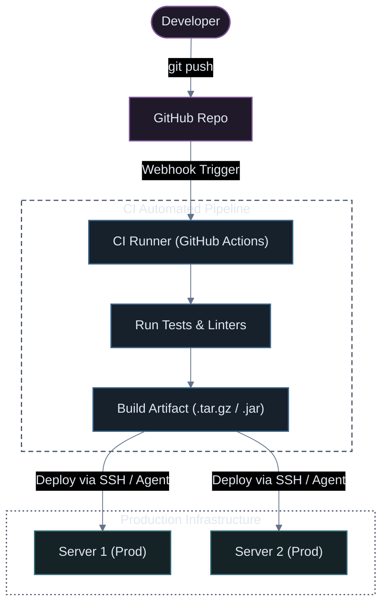
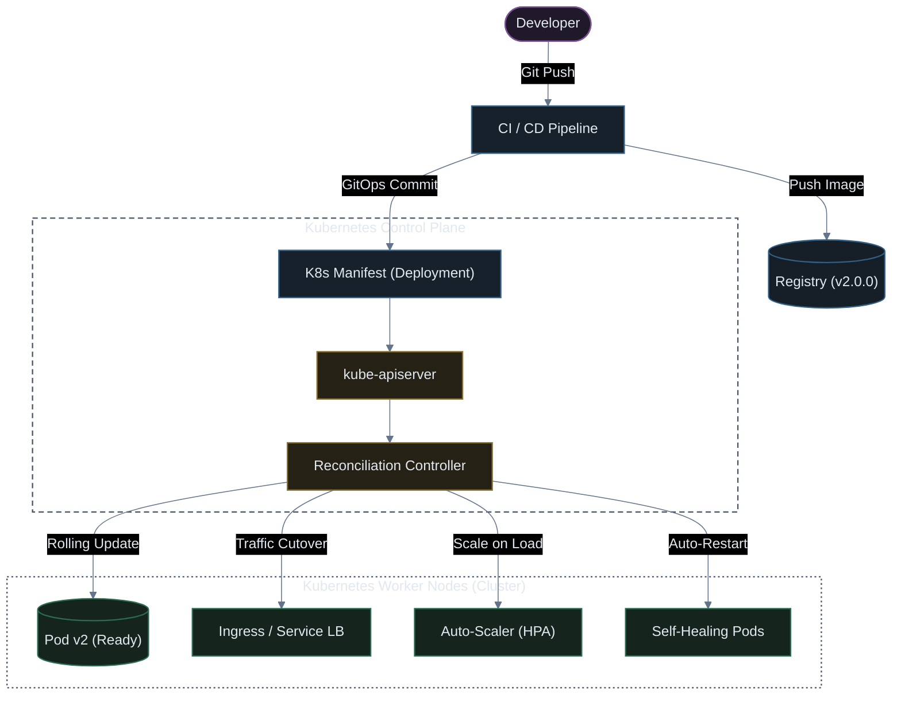

# The Evolution to Container Orchestration

A historical journey of how software deployment evolved—from manual zip uploads on single servers to automated container orchestration with Kubernetes in production.

---

## Evolution Timeline Overview

---

## 1. The Manual Era (Zip, FTP & cPanel)

In the early days of web deployment, developers wrote code on their personal machines, compressed it into an archive file, and manually transferred it to shared hosting or single virtual servers.

### Workflow Diagram

### Why This Broke in Production
* **Human Error**: Uploading to the wrong directory, missing files, or accidentally overwriting production configurations (`.env`).
* **Downtime During Upload**: Files were unzipped directly in place while active users made requests, causing broken page renders or syntax errors during extraction.
* **No Rollback Strategy**: If the new code had a bug, recovering required manually finding previous zip files or backups.
* **Zero Audit Trail**: Impossible to track who deployed what and when.

> [!WARNING]
> Manual file replacement lacks idempotency and version tracking. A single dropped file can bring down an entire production service.

---

## 2. The Version Control Era (Git & Remote Repositories)

With the widespread adoption of Git and platforms like GitHub/GitLab, deployment evolved from uploading loose files to pulling tracked commits directly onto servers.

### Workflow Diagram

### Why This Broke in Production
* **Building on Production Waste Resources**: Running `npm install`, `composer install`, or `mvn build` on production servers consumes CPU and memory, often starving live user traffic or triggering Out-Of-Memory (OOM) errors.
* **Environmental Drift**: *"Works on my machine, fails on the server."* The developer's machine had Node 20 and Python 3.11, while the server was running Node 16 and Python 3.8.
* **Secret Leakage**: Pulling code directly on production servers risks exposing source `.git` folders and requires SSH deployment keys on every single host.
* **Scale Bottleneck**: If you scale horizontally from 1 server to 10 servers, you must manually SSH into all 10 servers to pull and build.

---

## 3. The Automation Era (CI/CD Pipelines)

To eliminate manual SSH and building on production servers, Continuous Integration and Continuous Deployment (CI/CD) automated testing and artifact delivery.

### Workflow Diagram

### Key Improvements
* **Automated Quality Checks**: Code is linted and unit-tested before anything touches production.
* **Build Offloaded from Production**: Production servers only receive pre-built binaries or bundles (`dist/`, `.jar`, `.tar.gz`).
* **Audit Trail**: Every deployment is linked to a commit SHA, workflow run, and approval log.

### Remaining Bottlenecks
* **Operating System Inconsistencies**: The build artifact may rely on specific shared libraries (e.g., `glibc`, OpenSSL version, native C++ extensions) that differ between the CI runner and the target production VM.
* **Dependency Clashes**: Running multiple applications on the same server can cause library version conflicts.

---

## 4. The Container Era (Docker)

Docker transformed software delivery by packaging code along with its **entire runtime, system libraries, configuration, and dependencies** into an immutable container image.

### Workflow Diagram

```mermaid
%%{init: {
  'theme': 'base',
  'themeVariables': {
    'darkMode': true,
    'background': '#0f172a',
    'primaryColor': '#1e293b',
    'primaryTextColor': '#e2e8f0',
    'primaryBorderColor': '#475569',
    'lineColor': '#64748b',
    'textColor': '#e2e8f0'
  },
  'themeCSS': '* { filter: none !important; box-shadow: none !important; } .node * { filter: none !important; } .cluster * { filter: none !important; }'
}}%%
graph LR
    Dev(["Code + Dockerfile"]) -->|CI Build| Image["Immutable Image (app:v1.2.0)"]
    Image -->|Push| Registry[("Container Registry (ECR / DockerHub)")]
    Registry -->|Pull Image| Host["Production VM"]
    
    subgraph DockerHost["Single Host Docker Engine"]
        Host --> Run["docker run app:v1.2.0"]
        Run --> C1["Container (Isolated OS + Libs)"]
    end

    style DockerHost fill:none,stroke:#475569,stroke-width:1.5px,stroke-dasharray: 6 4,color:#e2e8f0;

    classDef cDev fill:#1f1929,stroke:#7c5295,stroke-width:1.5px,color:#e2e8f0;
    classDef cImg fill:#17212b,stroke:#38668c,stroke-width:1.5px,color:#e2e8f0;
    classDef cReg fill:#161f28,stroke:#325f85,stroke-width:1.5px,color:#e2e8f0;
    classDef cHost fill:#15241d,stroke:#2b6d51,stroke-width:1.5px,color:#e2e8f0;

    class Dev cDev;
    class Image cImg;
    class Registry cReg;
    class Host,Run,C1 cHost;
```

### What Docker Solved
* **"Works on My Machine" is Solved**: The container runs identically on a developer's MacBook, the CI server, and an Ubuntu VM on AWS.
* **Complete Isolation**: Multiple apps with conflicting dependencies run cleanly side-by-side on the same host without collisions.
* **Fast Rollbacks**: Rolling back is as simple as running the previous image tag (`docker run app:v1.1.0`).

### The New Challenges in Production
Docker alone manages containers on **a single machine**. In high-traffic production environments, questions emerge:
* **Self-Healing**: What happens if the container crashes at 3:00 AM?
* **Multi-Host Scaling**: How do we schedule and balance containers across 10 or 100 virtual machines?
* **Zero-Downtime Updates**: How do we replace 50 running containers with new versions without dropping user requests?
* **Service Discovery**: How does `backend-api` find `payment-service` when containers restart and get new IP addresses?

> [!IMPORTANT]
> Docker solved **packaging and running** containers. It did not solve **orchestrating and managing** them across distributed clusters.

---

## 5. The Orchestration Era (Kubernetes)

Kubernetes (K8s) provides the orchestration brain needed to run distributed containerized applications at scale in production.

### Workflow Diagram (GitOps & Declarative Reconciliation)

### What Kubernetes Brings to Production:
1. **Declarative State & Self-Healing**: You tell Kubernetes *"Keep 3 replicas running."* If a host VM catches fire or a container crashes, Kubernetes automatically spins up replacement Pods on a healthy node.
2. **Zero-Downtime Rolling Deployments**: Kubernetes starts new Pods, verifies their readiness probes, gradually cuts over network traffic, and terminates old Pods cleanly.
3. **Automated Scaling**: Horizontal Pod Autoscaling (HPA) automatically adjusts replica counts based on metrics like CPU, memory, or HTTP request rates.
4. **Built-in Service Discovery & Load Balancing**: Pods receive internal DNS names and load-balanced virtual IPs automatically.

---

## Summary Comparison Matrix

| Era | Packaging | Build Location | Deployment Method | Downtime Risk | Rollback Ease |
| :--- | :--- | :--- | :--- | :--- | :--- |
| **1. Manual** | Raw Files / `.zip` | Local machine | Manual FTP / cPanel | Very High | Hard (Manual) |
| **2. Git on Server** | Git repo clone | Production server | Manual `git pull` & build | High (Resource spikes) | Medium (`git checkout`) |
| **3. CI/CD** | Pre-built artifacts | CI Runner | Scripted push to servers | Medium | Easy (Re-deploy old build) |
| **4. Docker** | Immutable OCI Image | CI Runner | Pull image + `docker run` | Low (per-host) | Fast (`docker run app:prev`) |
| **5. Kubernetes** | Container + K8s Manifests | CI Runner | GitOps / Declarative Sync | **Zero** (Rolling updates) | **Instant** (`rollout undo`) |
