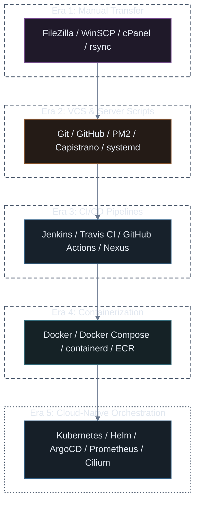

# Tooling Across the 5 Deployment Eras

A deep dive into the ecosystem, developer utilities, infrastructure platforms, and operational tools that defined each stage of software delivery.

---

## Tooling Evolution Map



---

## Era 1: Manual Transfer & Shared Hosting Tooling

During this era, tools were focused entirely on **moving files from local workstations to remote hosts** over network protocols like FTP, SFTP, and SSH.

| Tool | Category | Role in Era | Status Today |
| :--- | :--- | :--- | :--- |
| **FileZilla / WinSCP** | GUI File Transfer | Drag-and-drop FTP/SFTP clients to copy files to servers | Legacy for deployments (used for one-off file transfers) |
| **cPanel / Plesk** | Server Control Panel | Web GUI to manage MySQL databases, email, and unzipping files | Still common in cheap shared PHP/WordPress hosting |
| **rsync / scp** | CLI File Sync | Differential remote file sync over SSH | Still widely used for one-off data migration & backup scripts |
| **Apache HTTP (`.htaccess`)**| Web Server | Directory-level overrides and routing for monolithic PHP/Perl apps | Mostly replaced by NGINX / Caddy for modern web servers |

### The Operational Reality:
Deployments were driven by developer memory. If a developer forgot to upload a critical updated config file or uploaded `.env.local` by mistake, production failed instantly.

---

## Era 2: Git on Server & Scripted Deployment Tooling

The arrival of distributed version control allowed servers to become Git clients. Tooling in this era focused on **automating SSH tasks and managing long-running processes**.

| Tool | Category | Role in Era | Status Today |
| :--- | :--- | :--- | :--- |
| **Git / GitHub / GitLab** | Source Control | Canonical source of truth; code pulled directly onto hosts | Ubiquitous industry standard |
| **Capistrano** | Ruby-based Deployment | Automated SSH steps (`git clone`, symlinking releases, restarting server) | Pioneered zero-downtime atomic symlink deployments |
| **Fabric / Ansible** | Task Automation & SSH | Python scripts executing commands across multiple servers | Ansible transitioned into Configuration Management (IaC) |
| **PM2** | Process Manager | Kept Node.js processes alive, managed cluster mode & log rotation | Still popular for single-VM Node.js hosting |
| **systemd / Supervisord** | OS Service Manager | Ensured backend daemon processes restarted automatically on OS reboot | Standard Linux init system |

### The Atomic Symlink Technique (Capistrano Pattern):
To avoid downtime while files downloaded, Capistrano created timestamped release directories and swapped a symlink atomically:
```text
/var/www/app/
├── current ──▶ symlink to /var/www/app/releases/20261025-120000
└── releases/
    ├── 20261025-110000 (old release)
    └── 20261025-120000 (new release)
```

---

## Era 3: CI/CD & Automated Pipeline Tooling

As test suites grew, building and testing moved off developer machines and production hosts into dedicated **Continuous Integration (CI) and Continuous Delivery (CD) engines**.

| Tool | Category | Role in Era | Status Today |
| :--- | :--- | :--- | :--- |
| **Jenkins** | Self-Hosted CI Engine | Extensible automation server running test and build pipelines | Heavily used in enterprise legacy, but maintenance-heavy |
| **Travis CI / CircleCI** | SaaS Cloud CI | First wave of managed cloud CI configured via `.travis.yml` | Pioneered repo-centric cloud pipeline definitions |
| **GitHub Actions / GitLab CI**| Native Git CI/CD | Seamless CI/CD built directly into the repository interface | Modern default for most development teams |
| **JFrog Artifactory / Nexus** | Artifact Repository | Stores compiled binaries, `.jar`, `.tar.gz`, and language packages | Critical in regulated enterprise artifact compliance |
| **Webpack / Maven / Gradle** | Build & Bundling | Minified JS, compiled Java classes, and packaged production binaries | Core application build tools |

### The Key Shift:
Production servers **stopped compiling code**. They only received pre-compiled, tested, and packaged release artifacts directly from the CI pipeline.

---

## Era 4: Containerization & Single-Host Engines

Docker revolutionized packaging by bundling not just the application artifact, but the **entire underlying operating system filesystem, dependencies, and runtime libraries**.

| Tool | Category | Role in Era | Status Today |
| :--- | :--- | :--- | :--- |
| **Docker Engine** | Container Runtime | Built and executed OCI-compliant container images | Universal standard for developer local environments |
| **Docker Compose** | Multi-Container Local Orchestration | Defined multi-tier applications (`app`, `db`, `redis`) via YAML | De facto standard for local dev environments |
| **Docker Hub / AWS ECR** | Container Registry | Cataloged and hosted versioned Docker images (`app:v1.2.0`) | Essential component in every cloud architecture |
| **containerd / CRI-O** | Lightweight Runtimes | Stripped-down core container runtimes without desktop CLI bloat | Underlying runtime engine inside modern Kubernetes nodes |
| **Podman** | Daemonless Containers | Rootless container execution without a background daemon | Popular in high-security Red Hat/Linux environments |

### The OCI Standard:
The Open Container Initiative (OCI) ensured that any image built by Docker could run on any compatible container runtime (`containerd`, `CRI-O`, `Podman`) without vendor lock-in.

---

## Era 5: Cloud-Native & Kubernetes Production Ecosystem

Once containers became standard, managing hundreds of containers across distributed clouds required a complete **Cloud-Native Computing Foundation (CNCF)** ecosystem.

| Layer | Primary Tools | Role in Production |
| :--- | :--- | :--- |
| **Cluster Orchestration** | **Kubernetes (K8s)**, Nomad, Docker Swarm | Schedules, self-heals, and scales containers across nodes |
| **Packaging & Manifests** | **Helm**, Kustomize | Template application manifests and manage K8s releases as packages |
| **Continuous Delivery (GitOps)** | **ArgoCD**, Flux CD | Syncs git-committed manifests directly into live K8s clusters |
| **Ingress & API Gateway** | **NGINX Ingress**, Traefik, Kong, Envoy | Routes external HTTP/HTTPS traffic to internal cluster services |
| **Service Mesh & Networking** | **Cilium** (eBPF), Istio, Linkerd | Secure mTLS service-to-service communication and network observability |
| **Monitoring & Metrics** | **Prometheus**, Grafana | Scrapes time-series metrics, builds dashboards, and fires alerts |
| **Logging & Tracing** | **Fluent Bit**, Loki, OpenTelemetry, Jaeger | Centralized log aggregation and distributed request tracing |
| **Infrastructure as Code** | **Terraform**, **Pulumi**, OpenTofu | Declaratively provisions the underlying cloud VMs, VPCs, and managed EKS/GKE |

---

## Tooling Progression Matrix

```text
Era 1: FileZilla / cPanel  ──────▶ Manual uploads directly to shared hosts
Era 2: Git / PM2 / Capistrano ───▶ Code pulled and built on production VMs
Era 3: Jenkins / GitHub Actions ─▶ Automated testing & remote artifact deployment
Era 4: Docker / Docker Compose ──▶ Standardized, immutable container images
Era 5: Kubernetes / ArgoCD / Helm▶ Distributed, declarative, self-healing clusters
```

---

## Key Production Takeaways

1. **Tools follow the abstraction layer**: As applications grew more complex, tooling shifted from managing **files** (FTP) $\rightarrow$ managing **code** (Git) $\rightarrow$ managing **artifacts** (CI) $\rightarrow$ managing **containers** (Docker) $\rightarrow$ managing **desired state** (Kubernetes).
2. **Immutability won**: Mutable servers (SSH in and change things) have been almost entirely replaced by immutable artifacts (Docker images) driven by declarative GitOps pipelines (ArgoCD/Kubernetes).
3. **Operational overhead traded up**: Kubernetes eliminated manual operations, but introduced architectural complexity. Mastering Helm, Ingress, and Observability is the prerequisite for managing production Kubernetes.
