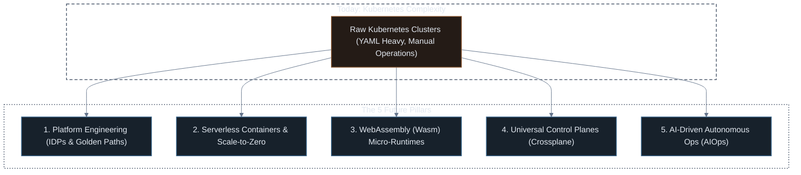
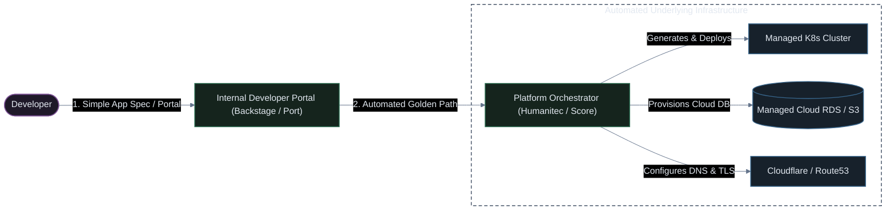

# The Future of Container Orchestration

What comes after or alongside Kubernetes? Exploring the next generation of cloud-native infrastructure, developer platforms, WebAssembly, and autonomous operations.

---

## The Next Frontier: From Orchestration to Autonomous Platforms



---

## 1. The Core Dilemma: The Kubernetes "Complexity Tax"

Kubernetes has won the container orchestration battle, but it introduced a steep challenge:

> *"Kubernetes is not an end-user platform; it is a platform for building platforms."* — Kelsey Hightower

### The Developer Pain Points Today:
* **YAML Fatigue**: Developers often write hundreds of lines of boilerplate configuration (`Deployments`, `Services`, `Ingress`, `HPA`, `NetworkPolicies`, `RBAC`) just to run a basic REST API.
* **Cognitive Overload**: Software engineers must now understand internal K8s networking (CIDR blocks, kube-proxy, CNI plugins) and complex cluster primitives instead of focusing on business logic.
* **Security & Misconfiguration**: Managing raw Kubernetes manifests manually leads to insecure defaults (running as root, missing resource limits, open ingress rules).

The future is **not replacing Kubernetes**, but **abstracting it away from everyday developers**.

---

## 2. Pillar 1: Platform Engineering & Internal Developer Platforms (IDPs)

The industry is moving from *"every developer manages raw Kubernetes"* to **Platform Engineering** teams that provide self-service portals and "Golden Paths."



### Key Technologies:
* **Developer Portals**: **Spotify Backstage**, **Port**, **Cortex** (Single pane of glass for service catalogs, docs, and self-service deployment).
* **Workload Specifications**: **Score** (A workload specification that developers write once without worrying about whether it runs on Docker Compose or production EKS).

---

## 3. Pillar 2: Serverless Containers & Scale-to-Zero

Why pay for idle VMs and manage worker node operating systems 24/7? Serverless container platforms eliminate node administration completely.

| Model | Traditional K8s | Modern Serverless Containers |
| :--- | :--- | :--- |
| **Node Management** | You patch, upgrade, and monitor EC2 / Compute instances | **Zero nodes** (Cloud provider manages capacity) |
| **Idle Costs** | Pay for VMs even when zero requests arrive | **Scale to zero** (Pay $0 when idle) |
| **Scaling Metric** | Pod CPU/Memory thresholds (slow reactive scale) | **HTTP request concurrency** (near-instant sub-second spin-up) |
| **Tools** | Raw EKS, GKE, kubeadm | **AWS Fargate**, **Google Cloud Run**, **Knative**, **KEDA** |

### Event-Driven Autoscaling (KEDA):
Rather than waiting for CPU spikes, Kubernetes Event-driven Autoscaling (KEDA) scales workloads based on external queue sizes (e.g., Kafka lag, AWS SQS message count, RabbitMQ queues).

---

## 4. Pillar 3: WebAssembly (Wasm) — Beyond Traditional Containers

> *"If WASM+WASI had existed in 2008, I wouldn't have needed to create Docker."* — Solomon Hykes, Co-founder of Docker

WebAssembly (Wasm) is rapidly expanding from the browser to server-side cloud runtimes as a complementary, ultra-lightweight alternative to Linux container images.

### Containers vs. WebAssembly Comparison

| Feature | Docker Container | WebAssembly (Wasm) Module |
| :--- | :--- | :--- |
| **Startup Time** | 1 to 5 seconds (OS boot + initialization) | **Sub-millisecond (0.5 ms)** |
| **Artifact Size** | 100 MB to 1 GB (Includes OS libraries, libc, files) | **1 MB to 20 MB** (Pure compiled bytecode) |
| **Resource Usage** | Requires kernel namespaces & memory allocation | Minimal memory footprint (Thousands run on a single host) |
| **Portability** | Compiled for specific architecture (x86 vs ARM64) | **Architecture-agnostic** (Runs anywhere Wasm runtime exists) |
| **Ecosystem Status**| Mature, universal standard | Growing rapidly (**WasmEdge**, **Spin**, **Kwasm**) |

### Running Wasm inside Kubernetes:
Tools like **Kwasm** allow Kubernetes worker nodes to run both Docker containers and WebAssembly modules side-by-side using `containerd-wasm` shims.

---

## 5. Pillar 4: Universal Declarative Control Planes (Crossplane)

Why manage cloud databases (RDS, S3, Cloudflare) with Terraform, and applications with Kubernetes?

**Crossplane** extends Kubernetes with Custom Resource Definitions (CRDs), turning the Kubernetes API into a **universal control plane for all cloud infrastructure**.

```yaml
# Developers request a production PostgreSQL DB directly in Kubernetes YAML:
apiVersion: database.aws.upbound.io/v1beta1
kind: RDSInstance
metadata:
  name: prod-user-db
spec:
  forProvider:
    engine: postgres
    instanceClass: db.t4g.medium
    allocatedStorage: 50
```

* Kubernetes automatically provisions the AWS database.
* If someone manually changes a setting in the AWS Console, the Kubernetes reconciliation loop **automatically drifts it back to desired state**.

---

## 6. Pillar 5: AI-Driven Autonomous Operations (AIOps)

The integration of LLMs and autonomous agents is transforming Kubernetes troubleshooting and capacity planning from reactive debugging to proactive remediation.

### The Shift from Reactive to Autonomous:
1. **Predictive Autoscaling**: Machine learning models analyze historical traffic patterns and pre-scale cluster capacity 15 minutes before daily traffic surges occur.
2. **Automated Root Cause Analysis (RCA)**: When a Pod enters `CrashLoopBackOff`, AI agents (like **K8sGPT** and custom sidecars) parse event streams, extract the panic log, compare it against recent code diffs, and pinpoint the exact failing line.
3. **Automated Runbook Execution**: Agents automatically trigger safe recovery actions (evicting bad nodes, draining leaking pods, adjusting resource quotas) within bounded safety policies.

---

## Summary: Evolution Matrix Across Eras

| Era | Target Abstraction | Primary Interface | Scaling Horizon | Operational Complexity |
| :--- | :--- | :--- | :--- | :--- |
| **1. Manual** | Bare Metal / Shared Hosts | FTP Client / cPanel | Single Host | High Human Error |
| **2. Git on Server** | Virtual Machines | SSH Shell / Git CLI | 1–5 Hosts | High Drift |
| **3. CI/CD** | Artifact Bundles | Pipeline Config (`.yml`) | Fixed Fleet | Medium |
| **4. Docker** | Single-Host Containers | `docker-compose.yml` | Single Machine | Medium |
| **5. Kubernetes** | Distributed Clusters | Declarative YAML / GitOps | 10–1,000 Nodes | High Architectural Overhead |
| **Future (Next)** | **Workload Intent & Platforms** | **Developer Portals & Wasm / AI** | **Universal Cloud & Edge** | **Abstracted & Autonomous** |
