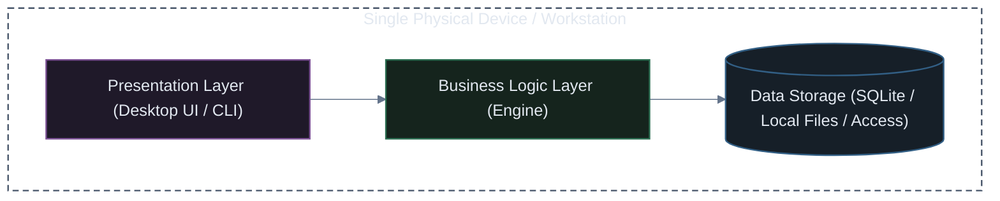
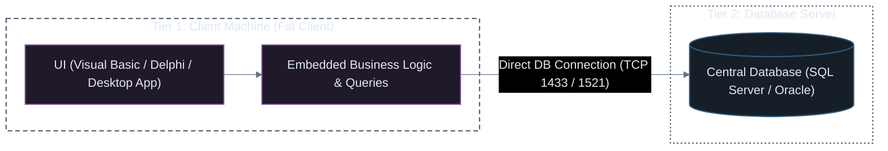
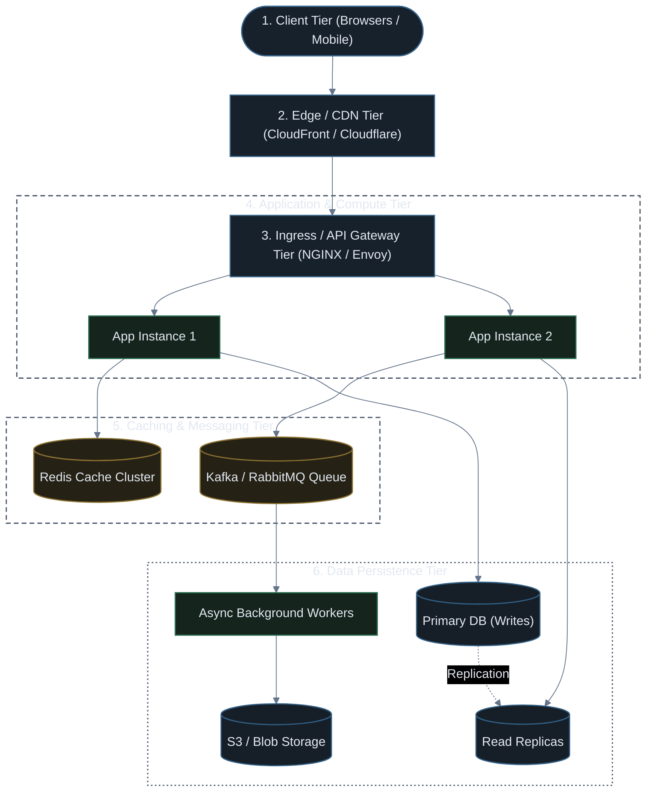
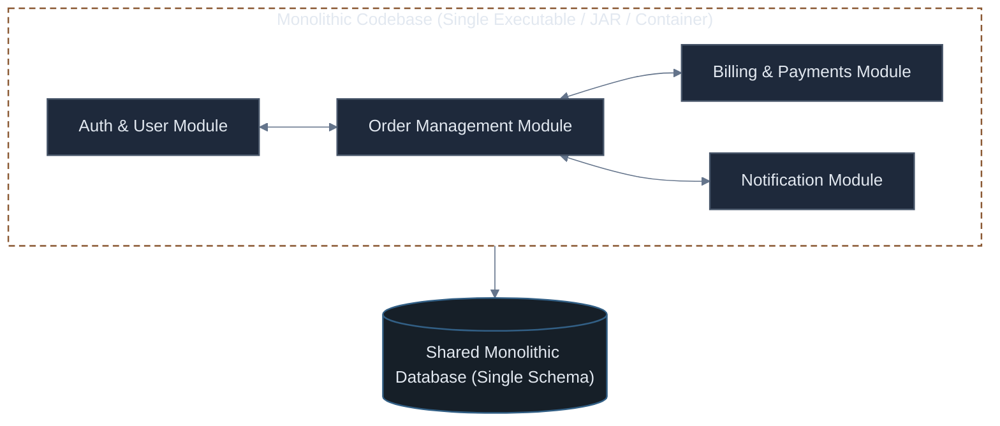
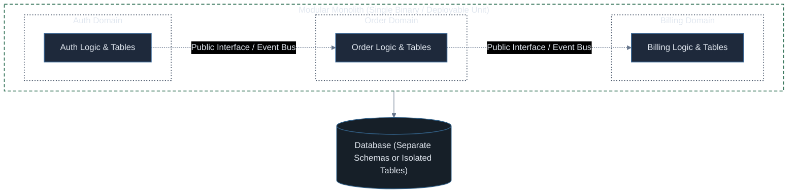
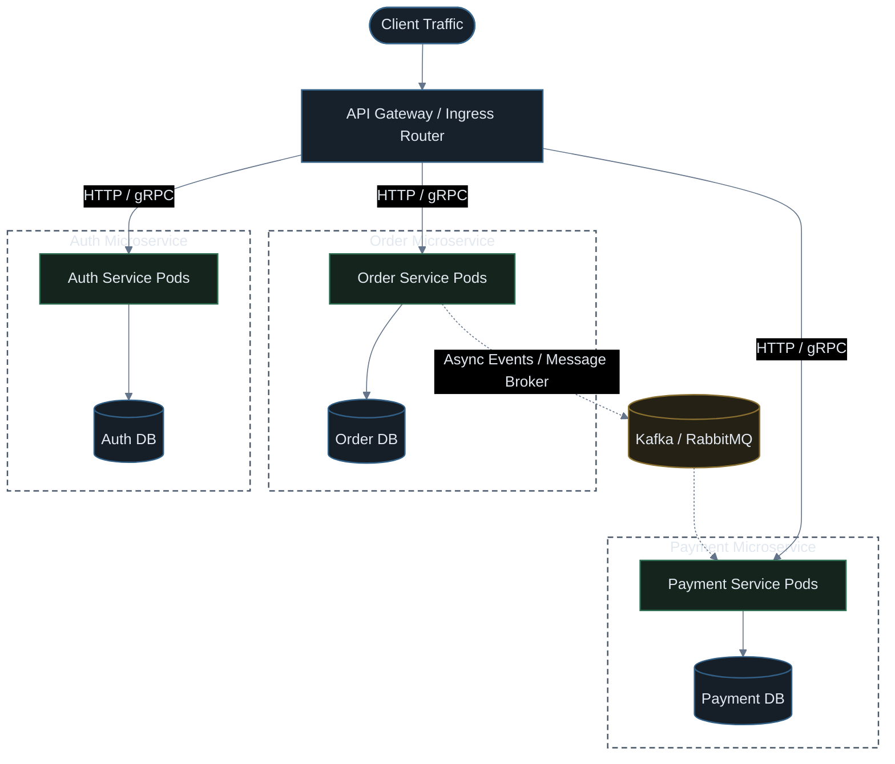

# System & Software Architecture: From Tiers to Microservices

A comprehensive visual guide exploring physical tiers (1-Tier, 2-Tier, 3-Tier, N-Tier) and application software patterns (Monolith, Modular Monolith, Microservices), and why they drove the adoption of Kubernetes in production.

---

## Part 1: What is a "Tier"? (Tier vs. Layer)

Before designing systems, it is essential to distinguish between **Layers** and **Tiers**:

| Concept | Definition | Scope | Example |
| :--- | :--- | :--- | :--- |
| **Layer** (Logical) | How code is organized within the software codebase | Code / Conceptual | Presentation Layer, Business Logic Layer, Data Access Layer (DAL) in one project |
| **Tier** (Physical) | How software components are physically separated across distinct network machines / hardware | Infrastructure / Deployment | Client Machine (Tier 1) $\rightarrow$ Web App Server (Tier 2) $\rightarrow$ Dedicated Database Server (Tier 3) |

> [!NOTE]
> An application can have **3 logical layers** (UI, Logic, DB code) all running on **1 physical tier** (a single laptop or VM). Tiers refer specifically to **physical network boundaries**.

---

## Part 2: The Physical Tier Architectures

---

### 1. 1-Tier Architecture (Single Machine)

In a 1-Tier architecture, the **Presentation (UI)**, **Business Logic**, and **Data Storage** all reside on the exact same physical device.

* **How it Works**: The user interacts with the app locally. No network calls are made to external servers.
* **Examples**: Microsoft Word, Excel, SQLite-based tools, video games, native desktop calculators.
* **Pros**: Zero network latency, works offline, simple to build.
* **Cons**: Impossible to collaborate in real-time, updates must be manually installed on every client machine, data is lost if the device fails.

---

### 2. 2-Tier Architecture (Client-Server)

The first major evolution introduced a physical network boundary between the user's workstation and a shared central database.

* **How it Works**: The client application (a "fat/thick client") contains both the UI and the business logic, and establishes a direct socket connection to the database.
* **Examples**: Classic internal bank software, legacy Visual Basic 6 / Delphi enterprise desktop apps.
* **The Fatal Flaws**:
  * **Critical Security Risk**: Database credentials and connection strings are baked inside the client desktop software.
  * **Connection Saturation**: Databases struggle when thousands of desktop clients hold persistent open database connections.
  * **Painful Updates**: Modifying business rules requires re-installing the software on every employee's PC.

---

### 3. 3-Tier Architecture (The Modern Web Foundation)

The 3-Tier model introduced an intermediate **Application Server Tier** between the client and database, revolutionizing web applications.

```mermaid
%%{init: {
  'theme': 'base',
  'themeVariables': {
    'darkMode': true,
    'background': '#0f172a',
    'primaryColor': '#1e293b',
    'primaryTextColor': '#e2e8f0',
    'primaryBorderColor': '#475569',
    'lineColor': '#64748b',
    'textColor': '#e2e8f0'
  },
  'themeCSS': '* { filter: none !important; box-shadow: none !important; } .node * { filter: none !important; } .cluster * { filter: none !important; }'
}}%%
graph LR
    subgraph Tier1["Tier 1: Presentation Tier"]
        Client["Client / Browser / Mobile App (Thin Client)"]
    end

    subgraph Tier2["Tier 2: Application / Logic Tier"]
        AppServer["Backend Server (Node / Spring / Django / Go)"]
        BizLogic["Business Logic & Security Validation"]
        AppServer --> BizLogic
    end

    subgraph Tier3["Tier 3: Data Tier"]
        DB[("Database (PostgreSQL / MySQL)")]
    end

    Client -->|"HTTPS / REST / JSON"| AppServer
    BizLogic -->|"Database Pool (TCP)"| DB

    style Tier1 fill:none,stroke:#475569,stroke-width:1.5px,stroke-dasharray: 6 4,color:#e2e8f0;
    style Tier2 fill:none,stroke:#475569,stroke-width:1.5px,stroke-dasharray: 6 4,color:#e2e8f0;
    style Tier3 fill:none,stroke:#475569,stroke-width:1.5px,stroke-dasharray: 2 3,color:#e2e8f0;

    classDef cTier1 fill:#1f1929,stroke:#7c5295,stroke-width:1.5px,color:#e2e8f0;
    classDef cTier2 fill:#152226,stroke:#346a78,stroke-width:1.5px,color:#e2e8f0;
    classDef cTier3 fill:#161f28,stroke:#325f85,stroke-width:1.5px,color:#e2e8f0;

    class Client cTier1;
    class AppServer,BizLogic cTier2;
    class DB cTier3;
```

* **Tier 1 (Presentation)**: Thin clients (Web browsers, iOS/Android apps) that render HTML/CSS/JS and capture user input.
* **Tier 2 (Application / Business Logic)**: Central server processing orders, authenticating users, and enforcing business rules.
* **Tier 3 (Data)**: Database tier isolated on private networks, never directly accessible from the public internet.
* **Why it Won**:
  * **Security**: Database credentials stay strictly inside the application tier.
  * **Maintainability**: Updating business logic on Tier 2 updates the experience for 100% of users instantly.
  * **Independent Scaling**: Application servers can scale horizontally behind a load balancer without modifying database architecture.

---

### 4. N-Tier (Multi-Tier) Architecture (High-Scale Production)

In large-scale production, a 3-tier architecture is subdivided into specialized, independently scalable tiers:

---

## Part 3: Software Architectural Patterns

While **Tiers** describe where software runs physically, **Software Patterns** describe how the code itself is structured and coupled.

---

### 1. Traditional Monolith

In a classic monolith, all features, modules, and business domains are bundled into a **single deployable artifact** and share a **single relational database**.

#### Pros:
* **Simple to Build & Debug**: Single codebase, easy local setup, single IDE project, simple end-to-end debugging.
* **ACID Transactions**: Everything lives in one database. Transfers and orders use atomic DB transactions (`BEGIN TRANSACTION ... COMMIT`).
* **Zero Network Latency**: Modules communicate via direct in-memory function calls (`billingService.charge()`).

#### Cons:
* **Coupling & Spaghetti Code**: Over time, modules bleed into each other, creating tight coupling.
* **All-or-Nothing Deployments**: Changing one line of code in the notification service requires rebuilding and redeploying the entire application.
* **Single Point of Failure**: A memory leak or unhandled exception in one module crashes the entire server for all users.
* **Scaling Inefficiency**: To scale the heavy video transcoding feature, you must duplicate the entire monolithic application on larger servers.

---

### 2. Modular Monolith

A Modular Monolith keeps the benefits of a **single deployment unit**, but strictly enforces **bounded domain contexts and isolation** at the code structure level.

#### How it Works:
* Modules cannot directly query each other's database tables or internal classes.
* Communication happens **only through public interface APIs or an in-memory event bus**.
* Database tables are partitioned by schema (e.g. `auth.users`, `billing.invoices`).

#### Why it's Growing in Popularity:
* Delivers the clean architecture and team boundaries of microservices **without the operational nightmare of distributed networks, Kubernetes cluster management, and network latency**.
* If a module ever outgrows the monolith, it can be extracted into an independent microservice with minimal refactoring.

---

### 3. Microservices Architecture

Microservices break the application into a collection of **small, autonomous, independently deployable services**, each owning its own business domain and **its own database**.

#### Core Rules of True Microservices:
1. **Database-per-Service**: Services never access another service's database directly. Data is accessed strictly through APIs.
2. **Independent Deployability**: Team A can deploy `Order Service v2` ten times a day without coordinating with Team B deploying `Payment Service`.
3. **Polyglot Stacks**: The payment service can be written in Go for speed, the ML service in Python, and the web frontend in Node.js.

---

## Part 4: Why Microservices Forced the Creation of Kubernetes

Understanding this evolution explains **why Kubernetes exists**:

| When you run a Monolith... | When you run 50 Microservices... |
| :--- | :--- |
| You manage **1 or 2 servers** running one application | You manage **hundreds of moving containers** across a distributed fleet |
| Internal function calls are **instant and guaranteed** in memory | Network calls can fail, timeout, or drop packets (**Fallacies of Distributed Computing**) |
| You scale the whole app by deploying on a bigger VM | You need to scale **only** the services under high load while conserving cloud cost |
| A static IP or DNS record is sufficient | Services crash, restart, and receive new dynamic IP addresses continuously |

> [!IMPORTANT]
> **Kubernetes was designed to be the operating system for microservices**: providing automated service discovery, rolling deployments, distributed health checks, pod autoscaling, and self-healing across thousands of containers.

---

## Part 5: Master Comparison Matrix

| Architectural Pattern | Deployment Unit | Database Strategy | Communication | Scaling Unit | Complexity | Best Fit For |
| :--- | :--- | :--- | :--- | :--- | :--- | :--- |
| **Traditional Monolith** | Single binary / artifact | Shared single database | In-memory function calls | Entire application | Low | Small teams, MVP, early startups, simple apps |
| **Modular Monolith** | Single binary / artifact | Single DB (isolated schemas) | In-memory clean interfaces | Entire application | Medium | Fast-growing startups, medium/large teams needing clean boundaries |
| **Microservices** | 10–100s of containers | Dedicated DB per service | Network (HTTP, gRPC, Kafka) | Individual services | **High** | Large organizations (100+ engineers), distinct scaling requirements |
