# Docker Warmup: Essential Commands & Real-World Dockerfiles

A practical, hands-on guide covering the entire container journey: from pulling images and running containers with ports and volumes, to writing production-ready Dockerfiles (HTML, TanStack, Elysia, Go, Python), multi-architecture builds with `buildx`, and pushing to a remote registry.

---

## 🗺️ The Complete Docker Lifecycle

```mermaid
%%{init: {
  'theme': 'base',
  'themeVariables': {
    'darkMode': true,
    'background': '#0f172a',
    'primaryColor': '#1e293b',
    'primaryTextColor': '#e2e8f0',
    'primaryBorderColor': '#475569',
    'lineColor': '#64748b',
    'textColor': '#e2e8f0',
    'edgeLabelBackground': '#0f172a'
  },
  'themeCSS': '* { filter: none !important; box-shadow: none !important; } .node * { filter: none !important; }'
}}%%
graph LR
    subgraph Dev["1. Development"]
        Code["Source Code + Dockerfile"]
    end

    subgraph Build["2. Build & Package"]
        B1["docker build / buildx"]
        Tag["docker tag"]
    end

    subgraph Registry["3. Remote Registry"]
        Hub["Docker Hub / GHCR / ECR"]
    end

    subgraph Run["4. Execution"]
        Pull["docker pull"]
        Container["docker run<br/>(-p, -v, -e, --name)"]
    end

    Code --> B1 --> Tag
    Tag -->|"docker push"| Hub
    Hub -->|"docker pull"| Pull
    Pull --> Container

    classDef cDev fill:#1f1929,stroke:#7c5295,stroke-width:1.5px,color:#e2e8f0;
    classDef cBuild fill:#17212b,stroke:#38668c,stroke-width:1.5px,color:#e2e8f0;
    classDef cReg fill:#241b16,stroke:#8a5832,stroke-width:1.5px,color:#e2e8f0;
    classDef cRun fill:#15241d,stroke:#2b6d51,stroke-width:1.5px,color:#e2e8f0;

    class Code cDev;
    class B1,Tag cBuild;
    class Hub cReg;
    class Pull,Container cRun;
```



---

## 1. `docker pull`: Downloading Pre-built Images

Before building custom images, you often pull pre-existing base images (like databases, web servers, or operating system runtimes) from a container registry.

### Syntax
```bash
docker pull <image-name>:<tag>
```

### Examples
```bash
# Pull the latest Alpine Linux (ultra-lightweight ~5MB)
docker pull alpine:latest

# Pull NGINX with Alpine base
docker pull nginx:alpine

# Pull a specific version of PostgreSQL database
docker pull postgres:16-alpine

# Pull an image from GitHub Container Registry (GHCR)
docker pull ghcr.io/username/my-service:1.0.0
```

> [!TIP]
> **Always specify a tag!** Avoid using `:latest` in production because it can change without notice and break your deployment. Prefer explicit versions like `node:20-alpine` or `postgres:16.2-alpine`.

---

## 2. `docker run`: Creating & Running Containers

`docker run` is the most powerful and frequently used Docker command. It downloads the image (if not already local), creates an isolated container, and starts it.

### Essential Flags Breakdown

| Flag | Meaning | What It Does |
| :--- | :--- | :--- |
| `-d` | **Detached** | Runs the container in the background (keeps your terminal free). |
| `-p <host>:<container>` | **Port Mapping** | Forwards traffic from your laptop/host port into the container port. |
| `-v <host>:<container>` | **Volume / Mount** | Mounts a local folder or named volume into the container for data persistence. |
| `--name <name>` | **Container Name** | Gives the container a human-readable name instead of a random string. |
| `--rm` | **Auto-Remove** | Automatically deletes the container when it stops (avoids leftover clutter). |
| `-e KEY=VALUE` | **Environment Var** | Passes environment variables (database credentials, API keys) into the app. |
| `--restart unless-stopped` | **Restart Policy** | Automatically restarts the container if it crashes or after system reboot. |

---

### Real-World `docker run` Examples

#### Example 1: Run NGINX Web Server with Port Mapping
```bash
docker run -d \
  --name my-web \
  -p 8080:80 \
  nginx:alpine
```
* **Result**: Visit `http://localhost:8080` in your browser to see the default NGINX welcome page.

#### Example 2: Run Postgres DB with Port, Volume, and Env Variables
```bash
docker run -d \
  --name my-postgres \
  -p 5432:5432 \
  -e POSTGRES_USER=admin \
  -e POSTGRES_PASSWORD=secretpassword \
  -e POSTGRES_DB=mydb \
  -v pgdata:/var/lib/postgresql/data \
  --restart unless-stopped \
  postgres:16-alpine
```
* **`-v pgdata:/var/lib/postgresql/data`**: Ensures database data is saved inside the `pgdata` volume even if you destroy the container!

#### Example 3: Quick One-Off Test (with `--rm`)
```bash
# Run a temporary Python interactive shell and auto-delete when done
docker run --rm -it python:3.12-alpine python
```

---

## 3. Real-World Dockerfiles (5 Practical Stacks)

Here are 5 battle-tested Dockerfile examples covering modern web and backend stacks:

### 1. Simple HTML / Static Project
Serves static HTML, CSS, and JS using the ultra-lightweight **NGINX Alpine** image.

```dockerfile
# File: Dockerfile
FROM nginx:alpine

# Remove default Nginx website
RUN rm -rf /usr/share/nginx/html/*

# Copy your HTML/CSS files into Nginx public directory
COPY . /usr/share/nginx/html

# Expose HTTP port
EXPOSE 80

# Start Nginx in the foreground
CMD ["nginx", "-g", "daemon off;"]
```

---

### 2. TanStack Project (React / Vite SPA)
Uses a **Multi-Stage Build**:
* **Stage 1 (Build)**: Installs dependencies and builds static assets with Node.js.
* **Stage 2 (Serve)**: Copies only the compiled `dist/` folder into a tiny NGINX image (~25MB total).

```dockerfile
# File: Dockerfile

# ==========================================
# Stage 1: Build the Application
# ==========================================
FROM node:20-alpine AS builder

WORKDIR /app

# Copy package files first to leverage Docker layer caching
COPY package.json package-lock.json ./
RUN npm ci

# Copy all source files and compile
COPY . .
RUN npm run build

# ==========================================
# Stage 2: Serve with NGINX
# ==========================================
FROM nginx:alpine

# Copy built production assets from builder stage
COPY --from=builder /app/dist /usr/share/nginx/html

# Optional: Copy custom nginx.conf for client-side SPA routing
# COPY nginx.conf /etc/nginx/conf.d/default.conf

EXPOSE 80

CMD ["nginx", "-g", "daemon off;"]
```

---

### 3. Elysia Project (Bun Runtime)
Elysia is an ultra-fast web framework running natively on **Bun**.

```dockerfile
# File: Dockerfile
FROM oven/bun:1-alpine

WORKDIR /app

# Cache package dependencies
COPY package.json bun.lockb ./
RUN bun install --frozen-lockfile --production

# Copy source code
COPY . .

# Run as non-root user for security
USER bun

EXPOSE 3000

CMD ["bun", "run", "src/index.ts"]
```

---

### 4. Go Project (Zero-Dependency Static Binary)
Uses a **Multi-Stage Build** to produce a tiny **~15MB container** using Google Distroless or `scratch`.

```dockerfile
# File: Dockerfile

# ==========================================
# Stage 1: Compile Go Binary
# ==========================================
FROM golang:1.22-alpine AS builder

WORKDIR /app

# Install git/certs if needed
RUN apk add --no-cache ca-certificates

# Cache dependencies
COPY go.mod go.sum ./
RUN go mod download

# Copy source code
COPY . .

# Compile a fully static binary (CGO_ENABLED=0) with stripped debug info (-ldflags="-w -s")
RUN CGO_ENABLED=0 GOOS=linux go build -ldflags="-w -s" -o server .

# ==========================================
# Stage 2: Minimal Distroless Runtime
# ==========================================
FROM gcr.io/distroless/static-debian12

WORKDIR /

# Copy the compiled binary and root certificates
COPY --from=builder /etc/ssl/certs/ca-certificates.crt /etc/ssl/certs/
COPY --from=builder /app/server /server

# Non-root user
USER nonroot:nonroot

EXPOSE 8080

ENTRYPOINT ["/server"]
```

---

### 5. Python Project (FastAPI / Flask)
Uses a non-root user, proper virtual environment, and no cache to keep the image slim and secure.

```dockerfile
# File: Dockerfile
FROM python:3.12-slim

# Prevent Python from writing .pyc files & enable unbuffered logs
ENV PYTHONDONTWRITEBYTECODE=1 \
    PYTHONUNBUFFERED=1

WORKDIR /app

# Install dependencies in a single layer
COPY requirements.txt .
RUN pip install --no-cache-dir -r requirements.txt

# Copy application code
COPY . .

# Create a non-root user for production security
RUN useradd -m appuser && chown -R appuser:appuser /app
USER appuser

EXPOSE 8000

CMD ["uvicorn", "main:app", "--host", "0.0.0.0", "--port", "8000"]
```

---

## 4. `docker build` & `docker buildx`: Building Images

### Standard Build (`docker build`)
Builds a local image using the `Dockerfile` in the current folder:

```bash
docker build -t myapp:1.0.0 .
```

* **`-t myapp:1.0.0`**: Names the image `myapp` with version tag `1.0.0`.
* **`.` (Period)**: Specifies the **Build Context** (the folder sent to the Docker daemon).

---

### Multi-Architecture Builds (`docker buildx`)

> [!IMPORTANT]
> **The Apple Silicon (M1/M2/M3) vs Cloud Server Problem**:
> If you build an image on an Apple Silicon Mac, it builds for `linux/arm64` by default. When you deploy it to an AWS EC2 or Kubernetes node running on standard Intel/AMD (`linux/amd64`), it will crash with:
> `exec /server: exec format error`!

To build images that run anywhere, use **`docker buildx`**:

```bash
# 1. Create and switch to a multi-platform builder
docker buildx create --name mybuilder --use

# 2. Build for BOTH Intel (amd64) and Apple/ARM (arm64) and push directly
docker buildx build \
  --platform linux/amd64,linux/arm64 \
  -t myusername/myapp:1.0.0 \
  --push .
```

---

## 5. `docker tag`: Versioning & Naming for Registries

Before pushing an image to Docker Hub, GitHub, or AWS, you must tag it with the target registry repository name:

### Syntax
```bash
docker tag <local-image>:<local-tag> <registry-username>/<repo-name>:<version>
```

### Examples
```bash
# Tag for Docker Hub
docker tag myapp:1.0.0 kendirck/myapp:1.0.0

# Also tag as latest
docker tag myapp:1.0.0 kendirck/myapp:latest

# Tag for GitHub Container Registry (GHCR)
docker tag myapp:1.0.0 ghcr.io/kendirck/myapp:1.0.0

# Tag for AWS Elastic Container Registry (ECR)
docker tag myapp:1.0.0 123456789012.dkr.ecr.us-east-1.amazonaws.com/myapp:1.0.0
```

---

## 6. `docker login` & `docker push`: Publishing to Registries

Once your image is built and tagged, upload it so Kubernetes clusters or cloud VMs can pull and run it.

### Step 1: Login to Container Registry

```bash
# Login to Docker Hub (prompts for username & personal access token)
docker login

# Login to GitHub Container Registry
docker login ghcr.io -u YOUR_GITHUB_USERNAME

# Login to AWS ECR
aws ecr get-login-password --region us-east-1 | docker login --username AWS --password-stdin 123456789012.dkr.ecr.us-east-1.amazonaws.com
```

### Step 2: Push the Image

```bash
# Push specific version
docker push kendirck/myapp:1.0.0

# Push latest tag
docker push kendirck/myapp:latest
```

---

## 7. Master Cheat Sheet

| Step | Command | Description |
| :--- | :--- | :--- |
| **Pull** | `docker pull nginx:alpine` | Download image from registry |
| **Run** | `docker run -d -p 8080:80 -v data:/data --name web nginx:alpine` | Run with ports, volumes, name |
| **Build** | `docker build -t myapp:1.0.0 .` | Build local image |
| **Buildx** | `docker buildx build --platform linux/amd64,linux/arm64 -t user/app:1.0 --push .` | Multi-arch cross-compile |
| **Tag** | `docker tag myapp:1.0.0 user/myapp:1.0.0` | Alias image with registry name |
| **Login** | `docker login` / `docker login ghcr.io` | Authenticate to registry |
| **Push** | `docker push user/myapp:1.0.0` | Upload image to registry |
