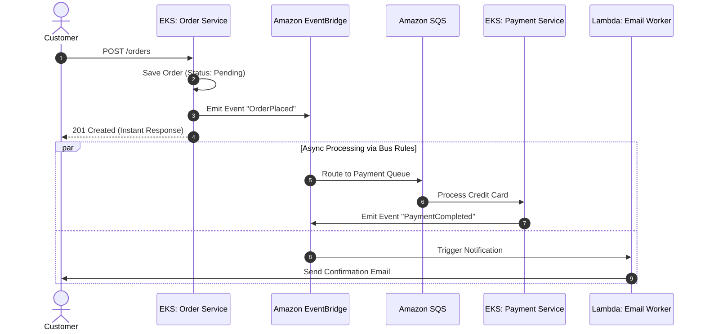

# Architecture 3: Enterprise Cloud-Native & Event-Driven Architecture (EKS + Lambda + EventBridge + DynamoDB + Bedrock)

A state-of-the-art enterprise microservices platform built on Kubernetes (**Amazon EKS**), serverless compute (**AWS Lambda**), an Event-Driven Architecture (**EDA**) bus (**Amazon EventBridge**), polyglot persistence, and Generative AI (**Amazon Bedrock**).

---

## 🏗️ Architecture Diagram

```mermaid
flowchart TD
    Clients(["📱 Web, Mobile & IoT Clients"]) -->|1. Anycast DNS| R53["Amazon Route 53"]
    R53 --> CF["Amazon CloudFront (Edge CDN)\n+ AWS WAF (AI Monetization & Rate Limiting)"]

    subgraph IngressGateway["Ingress & API Gateway Layer"]
        CF -->|HTTP REST / GraphQL| APIGW["Amazon API Gateway\n(Serverless Edge Endpoints)"]
        CF -->|Microservices Ingress| ALB["Application Load Balancer\n(AWS Load Balancer Controller)"]
    end

    subgraph ContainerCompute["Kubernetes Microservices Mesh (Amazon EKS)"]
        ECR[("Amazon ECR\n(Private Registry)")] -.->|Pulls Images| EKS_Nodes

        subgraph EKS_Nodes["EKS Cluster (VPC Subnets - Multi-AZ)"]
            OrderSvc["📦 Order Service\n(Go Pods - Deployment)"]
            UserSvc["👤 User Service\n(Node.js Pods - Deployment)"]
            PaySvc["💳 Payment Service\n(Rust Pods - Deployment)"]
            SearchSvc["🔍 Search & Catalog Svc\n(Python Pods - Deployment)"]
        end
        ALB --> OrderSvc & UserSvc & SearchSvc
    end

    subgraph EventDrivenBackbone["Event-Driven Architecture (EDA) Backbone"]
        EventBridge{{"⚡ Amazon EventBridge\n(Central Domain Event Bus)\nFilters & Routes Events"}}

        OrderSvc -->|2. Emits: OrderPlaced| EventBridge
        PaySvc -->|Emits: PaymentCompleted| EventBridge

        EventBridge -->|Route: Order Events| SQS_Order[("Amazon SQS\n(Order Processing Queue)")]
        EventBridge -->|Route: Notification Events| SNS_Fanout(("Amazon SNS\n(Fan-Out Topic)"))

        SNS_Fanout --> SQS_Email[("SQS: Email Queue")]
        SNS_Fanout --> SQS_Analytics[("SQS: Data Pipeline")]
    end

    subgraph ServerlessCompute["Serverless Worker Layer (AWS Lambda)"]
        SQS_Order --> Lambda_Fulfill["AWS Lambda\n(Fulfillment Worker)"]
        SQS_Email --> Lambda_Notify["AWS Lambda\n(Notification Sender)"]
        APIGW --> Lambda_Auth["AWS Lambda\n(Auth & Webhooks)"]
    end

    subgraph PolyglotPersistence["Polyglot Persistence Layer"]
        DynamoDB[("Amazon DynamoDB\n(Orders & User Profiles)\nSingle-Digit ms Latency")]
        Aurora[("Amazon Aurora Serverless v2\n(Financial Ledger & Transactions)\nPostgreSQL Compatible")]
        OpenSearch[("Amazon OpenSearch Service\n(Catalog Search & GPU Vector Index)")]
        S3[("Amazon S3 & S3 Vectors\n(Invoices, Media & Embeddings)")]

        OrderSvc --> DynamoDB
        PaySvc --> Aurora
        SearchSvc --> OpenSearch
        Lambda_Fulfill --> S3
    end

    subgraph CDCSync["Change Data Capture (CDC)"]
        DynamoDB -.->|DynamoDB Streams| Lambda_CDC["AWS Lambda\n(Stream Consumer)"]
        Lambda_CDC -.->|Sync Search Index| OpenSearch
    end

    subgraph AILayer["The AWS AI & Agent Layer"]
        AgentCore["🤖 Bedrock AgentCore\n(Autonomous Multi-Step AI Agent)"]
        Bedrock["Amazon Bedrock & Nova\n(Foundation Model Inference)"]
        KB["Bedrock Knowledge Bases\n(Managed RAG Pipeline)"]

        SearchSvc --> AgentCore
        AgentCore --> Bedrock
        AgentCore --> KB
        KB -->|Vector Similarity Queries| S3
        AgentCore -.->|Executes Action APIs| APIGW
    end

    subgraph TelemetrySecurity["Observability & Zero-Trust Security"]
        CW["Amazon CloudWatch\n(Container Insights & Unified Logs)"]
        XRay["AWS X-Ray\n(Distributed Tracing - ADOT)"]
        SM["AWS Secrets Manager\n(CSI Secret Provider)"]
        KMS["AWS KMS\n(Envelope Encryption)"]

        EKS_Nodes & ServerlessCompute -.-> CW
        EKS_Nodes & ServerlessCompute -.-> XRay
        SM & KMS -.-> EKS_Nodes
    end

    classDef net fill:#8C4FFF,stroke:#232F3E,stroke-width:2px,color:#fff;
    classDef compute fill:#ED7100,stroke:#232F3E,stroke-width:2px,color:#fff;
    classDef db fill:#3F8624,stroke:#232F3E,stroke-width:2px,color:#fff;
    classDef storage fill:#3B48CC,stroke:#232F3E,stroke-width:2px,color:#fff;
    classDef queue fill:#CC2264,stroke:#232F3E,stroke-width:2px,color:#fff;
    classDef ai fill:#00A4A6,stroke:#232F3E,stroke-width:2px,color:#fff;

    class R53,CF,ALB,APIGW net;
    class OrderSvc,UserSvc,PaySvc,SearchSvc,Lambda_Fulfill,Lambda_Notify,Lambda_Auth,Lambda_CDC compute;
    class DynamoDB,Aurora,OpenSearch db;
    class S3,ECR storage;
    class EventBridge,SQS_Order,SQS_Email,SQS_Analytics,SNS_Fanout queue;
    class AgentCore,Bedrock,KB ai;
```

---

## 🔑 Key Architectural Paradigms

### 1. Hybrid Compute: Kubernetes (EKS) + Serverless (Lambda)
* **Amazon EKS**: Hosts long-running, latency-sensitive microservices (`Order Service`, `User Service`, `Search Service`) with horizontal pod autoscaling (HPA) and Karpenter node provisioning on Graviton EC2 instances.
* **AWS Lambda**: Handles asynchronous bursty events, webhook integrations, and SQS queue processing where zero idle cost is desired.
* **Security**: Both EKS pods and Lambda functions access AWS resources using **EKS Pod Identity** or IAM execution roles—**zero static AWS access keys** in containers.

---

### 2. Event Choreography via Amazon EventBridge
Instead of synchronous point-to-point HTTP calls between microservices (which creates cascading failures and tight coupling), services communicate via an **Event-Driven Choreography** pattern:

---

### 3. Polyglot Persistence: Right Tool for the Right Job
Modern architectures reject the "one database fits all" anti-pattern:
* **Amazon DynamoDB**: Chosen for the `Order Service` for sub-10ms predictable write latency at any scale.
* **Amazon Aurora Serverless v2**: Chosen for `Payment Service` where ACID transactions, foreign keys, and double-entry bookkeeping are mandatory.
* **Amazon OpenSearch Service**: Serves product search, auto-complete, and faceted filtering.
* **Amazon S3**: Stores immutable invoices, contract PDFs, and AI vector embeddings.

---

### 4. Change Data Capture (CDC) with DynamoDB Streams
To keep OpenSearch in sync with DynamoDB without double-writing from application code:
1. `Order Service` writes directly to DynamoDB.
2. **DynamoDB Streams** emits a record of every change (`INSERT`, `MODIFY`, `REMOVE`).
3. A dedicated **AWS Lambda** stream processor receives batches of changes and indexes them directly into **Amazon OpenSearch Service**.
4. Eliminates distributed transaction failures!

---

### 5. Generative AI & Autonomous Agent Layer (Amazon Bedrock)
* **Foundation Models**: The `Search & Catalog Service` invokes **Amazon Nova 2 Lite** and Anthropic Claude via the unified **Amazon Bedrock** API.
* **Bedrock Knowledge Bases (RAG)**: Automatically chunks and retrieves relevant product manuals, internal knowledge, and reviews from **S3 Vectors** to answer customer questions accurately without hallucinations.
* **Bedrock AgentCore**: Production agent runtime capable of multi-step reasoning. An agent can understand a customer query (*"Find my order from last Tuesday and update shipping address"*), check the order database via API Gateway, and execute the address update autonomously.

---

### 6. Observability: Distributed Tracing with AWS X-Ray & OpenTelemetry
* Every incoming HTTP request gets injected with a unique `X-Amzn-Trace-Id` at CloudFront/ALB.
* Microservices pass this trace header across internal HTTP calls and EventBridge event envelopes.
* **AWS X-Ray** correlates traces end-to-end across EKS containers, SQS queues, Lambda functions, and DynamoDB tables into a visual service dependency graph.

---

## 📊 Evolution Comparison: From Monolith to Event-Driven

| Architectural Dimension | [Architecture 1 (Single EC2)](01-basic-ec2-architecture.md) | [Architecture 2 (Scaled Multi-AZ)](02-horizontal-scaling-architecture.md) | **Architecture 3 (Cloud-Native EDA)** |
| :--- | :--- | :--- | :--- |
| **Compute Engine** | 1x EC2 Instance (Monolith) | Auto Scaling EC2 Fleet | **Amazon EKS (K8s) + AWS Lambda** |
| **Availability** | Single AZ (High Risk) | Multi-AZ (99.99%) | **Multi-AZ + Edge Anywhere (99.999%)** |
| **Database** | Single RDS SQL Instance | Primary + Read Replicas + Redis | **Polyglot (DynamoDB + Aurora + OpenSearch)** |
| **Inter-Service Comms** | In-process function calls | In-process + SQS background jobs | **Asynchronous EventBridge + SQS/SNS** |
| **Deployment Model** | SSH / Manual Script / Downtime | Blue/Green or Rolling via CodeDeploy | **GitOps (ArgoCD / EKS) + Serverless CI/CD** |
| **AI Integration** | None | Ad-hoc external API calls | **Native Bedrock RAG + AgentCore Execution** |
| **Failure Blast Radius** | Total system outage | Subnet / Single instance crash | **Isolated to single microservice boundary** |
