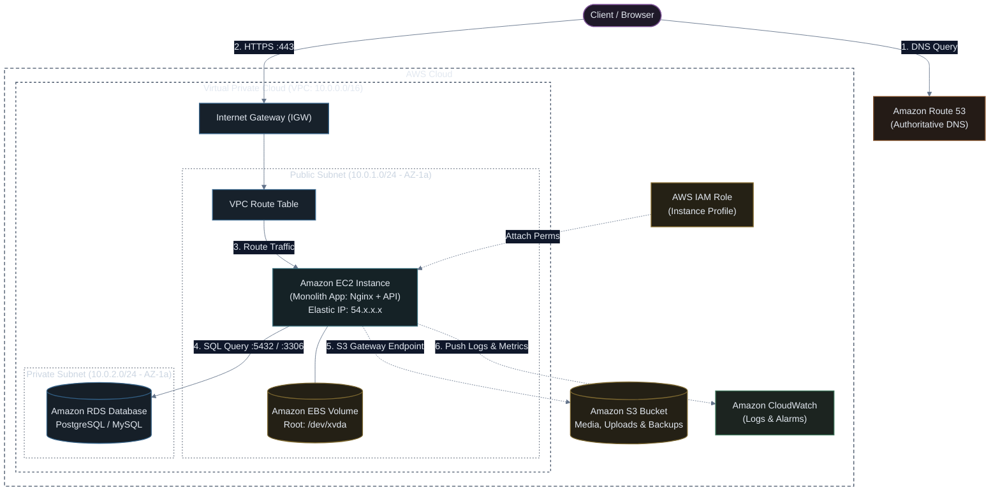

# Architecture 1: Single-Server Baseline (EC2 + VPC + RDS + S3 + Route 53)

A classic foundational architecture suitable for minimum viable products (MVPs), dev/staging environments, and early-stage monolith applications.

---

## 🏗️ Architecture Diagram

---

## 🔄 End-to-End Traffic Walkthrough

1. **DNS Lookup (`Route 53`)**:
   * The user enters `example.com` into their browser.
   * Route 53 responds with the public Elastic IP address pointing directly to the EC2 instance (or an Elastic Network Interface in the public subnet).
2. **Ingress through Internet Gateway (`IGW`)**:
   * HTTPS (TCP 443) traffic reaches the VPC Internet Gateway and traverses the public route table (`0.0.0.0/0 -> igw-xxx`).
3. **Application Processing (`EC2 + EBS`)**:
   * The EC2 instance runs an Nginx reverse proxy routing requests to a backend app runtime (e.g. Node.js, Go, Python, or Ruby).
   * Static temporary files and the operating system run on the attached **Amazon EBS** root volume (`gp3`).
4. **Secure Database Queries (`RDS`)**:
   * The application queries the **Amazon RDS** database placed safely inside a **Private Subnet**.
   * **Security Group Barrier**: The RDS Security Group allows inbound connections *strictly* from the EC2 Security Group on port `5432` (PostgreSQL) or `3306` (MySQL). RDS has **no public IP** and cannot be reached from the internet.
5. **Object Storage Offloading (`S3`)**:
   * User-uploaded files (profile avatars, PDFs, images) bypass the EC2 disk and stream directly into **Amazon S3** using pre-signed URLs or backend IAM credentials (via an **EC2 Instance Profile**).
   * S3 Gateway Endpoint enables traffic to stay within the AWS internal network without hitting the public internet.
6. **Telemetry (`CloudWatch`)**:
   * The CloudWatch Agent sends CPU, memory, disk I/O metrics, and application logs (`/var/log/app.log`) for monitoring.

---

## 🛡️ Security Group Rules Matrix

| Security Group | Direction | Protocol | Port Range | Source / Destination | Purpose |
| :--- | :---: | :---: | :---: | :--- | :--- |
| **`sg-web-ec2`** | Inbound | TCP | `443` | `0.0.0.0/0` (Anywhere) | Public HTTPS traffic |
| **`sg-web-ec2`** | Inbound | TCP | `80` | `0.0.0.0/0` (Anywhere) | HTTP to HTTPS redirection |
| **`sg-web-ec2`** | Inbound | TCP | `22` | `Admin_IP/32` (or AWS SSM) | SSH administration (or Session Manager) |
| **`sg-web-ec2`** | Outbound | All | All | `0.0.0.0/0` | Package updates & API calls |
| **`sg-rds-db`** | Inbound | TCP | `5432` / `3306` | `sg-web-ec2` (EC2 SG ID) | Only the web server can talk to DB |
| **`sg-rds-db`** | Outbound | All | All | None | Blocked egress |

---

## ⚖️ Architectural Trade-Offs

### ✅ Advantages
* **Simple to understand and manage**: Easy for a small team to build, deploy, and debug.
* **Low Initial Cost**: Can run on `t4g.small` or `t3.micro` free-tier eligible components.
* **Fast Time to Market**: No complex microservice orchestration or service discovery needed.

### ⚠️ Production Bottlenecks & Failure Modes
1. **Single Point of Failure (SPOF)**:
   * If the single EC2 instance fails or Availability Zone 1a experiences an outage, the entire service goes down.
2. **Maintenance Downtime**:
   * OS updates, security patching, and app deployments cause visible downtime.
3. **Vertical Scaling Wall**:
   * When traffic spikes, the server can only scale by resizing the instance (`vertical scaling`), which requires an instance reboot.
4. **Database Contention**:
   * Both write transactions and heavy read analytics hit the exact same single DB instance.

👉 *To solve these limitations, systems evolve into [Architecture 2: Horizontally Scaled Multi-AZ](02-horizontal-scaling-architecture.md).*
