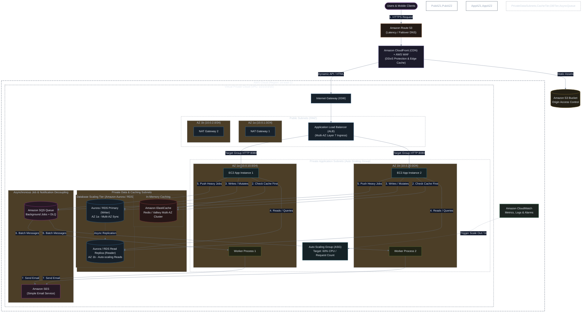
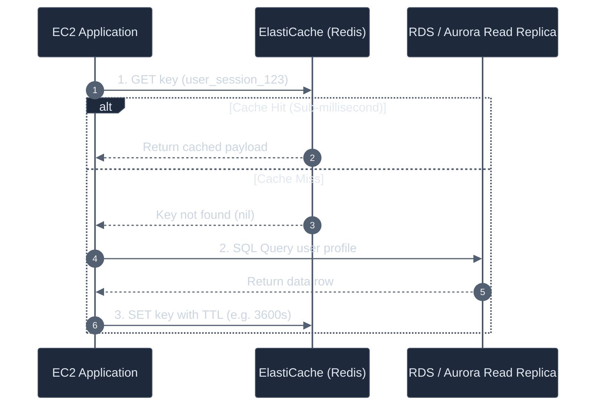

# Architecture 2: Horizontally Scaled Multi-AZ Architecture (Auto Scaling + Caching + DB Read Scaling + SQS + SES)

A resilient, high-availability multi-tier architecture engineered for production scale, high concurrency, zero downtime deployments, and asynchronous background job processing.

---

## 🏗️ Architecture Diagram



---

## ⚡ Core Scaling Strategies Explained

### 1. Ingress Layer: CloudFront + ALB
* **Edge Caching**: CloudFront caches global static assets and terminates TLS near the user, preventing unnecessary trips to the backend.
* **AWS WAF**: Blocks DDoS, SQLi, and bot traffic before reaching the VPC.
* **Application Load Balancer (ALB)**: Performs intelligent HTTP health checks (`/health`) and routes traffic across healthy EC2 instances in multiple Availability Zones.

---

### 2. Compute Layer: Auto Scaling Group (ASG)
* **Zero Downtime**: If an instance crashes, the ALB stops routing traffic to it immediately and the ASG spins up a replacement instance automatically.
* **Dynamic Scaling**: Target tracking scaling policy monitors:
  * `ASGAverageCPUUtilization` (e.g. scale out when CPU > 60%).
  * `ALBRequestCountPerTarget` (e.g. scale out when each instance receives > 1,000 requests/minute).
* **Multi-AZ Distribution**: Instances are distributed evenly between `AZ-1a` and `AZ-1b` for disaster resilience.

---

### 3. Caching Layer: Amazon ElastiCache (Redis / Valkey)
Implements the **Cache-Aside (Lazy Loading)** architectural pattern:



* **Session Store**: User sessions are stored in ElastiCache so users don't get logged out if a request hits a different EC2 server (stateless app servers).

---

### 4. Database Scaling: Primary (Writer) + Read Replicas (Reader)
* **Write Pipeline**: All mutative operations (`INSERT`, `UPDATE`, `DELETE`) hit the **Primary Writer** instance in AZ-1a.
* **Read Pipeline**: Read-heavy operations (`SELECT`) are routed to the **Read Replica** in AZ-1b.
* **Multi-AZ Failover**: If the primary hardware fails, Aurora/RDS promotes the read replica to primary in under 30 seconds with automatic DNS pointer updates.

---

### 5. Asynchronous Decoupling: Amazon SQS + Amazon SES
* **Problem**: Synchronous actions like generating PDFs, resizing uploaded images, or calling third-party email providers can take 2-5 seconds, blocking web threads and exhausting HTTP connection pools.
* **Solution**:
  1. Web app receives an order or signup request.
  2. Web app enqueues a light message into **Amazon SQS** (`{"task": "send_welcome_email", "email": "user@example.com"}`) in < 5 milliseconds.
  3. Web app responds `200 OK` to the user immediately.
  4. Background workers long-poll SQS in batches, generate the email, and dispatch it via **Amazon SES**.
  5. If an email fails, SQS automatically retries with exponential backoff before sending the poison message to a **Dead-Letter Queue (DLQ)** for investigation.

---

## 🛡️ Security Group Isolation Matrix

```text
[Internet]
    │  (Port 443)
    ▼
[sg-alb] ──(Port 8080)──► [sg-app-ec2] ──(Port 6379)──► [sg-elasticache]
                                │
                                └───(Port 5432)───────► [sg-rds-db]
```

* **`sg-alb`**: Allows `443` from `0.0.0.0/0`.
* **`sg-app-ec2`**: Allows `8080` *strictly* from `sg-alb`.
* **`sg-elasticache`**: Allows `6379` *strictly* from `sg-app-ec2`.
* **`sg-rds-db`**: Allows `5432` (or `3306`) *strictly* from `sg-app-ec2`.

---

## ⚖️ Architectural Assessment

### ✅ What this solves:
* **High Availability**: Survives full Availability Zone failure.
* **Elastic Scale**: Scales seamlessly from 2 instances to 50+ instances during traffic spikes.
* **Fast Page Loads**: Database read pressure reduced by 80%+ via caching and read replicas.
* **Snappy User Experience**: Heavy tasks processed asynchronously in background.

👉 *Next Evolution: When teams grow and monolithic codebases become deployment bottlenecks, we move to [Architecture 3: Event-Driven Microservices](03-microservices-eda-architecture.md).*
