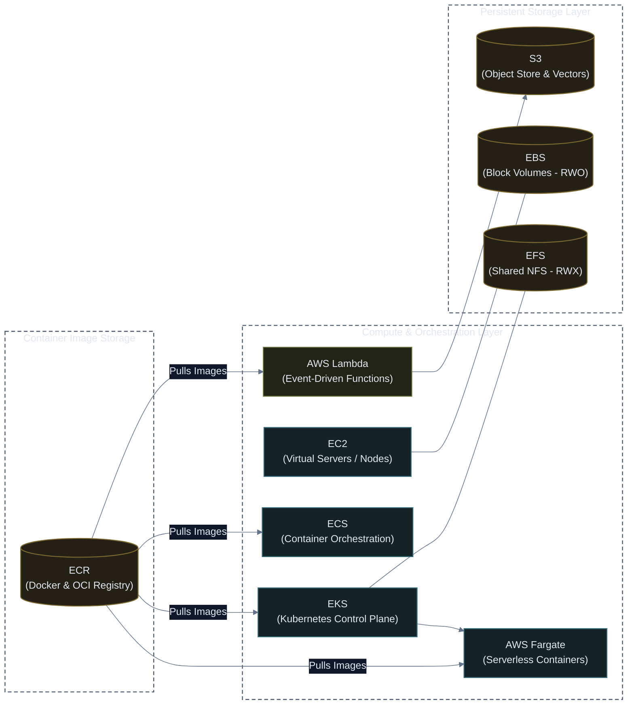
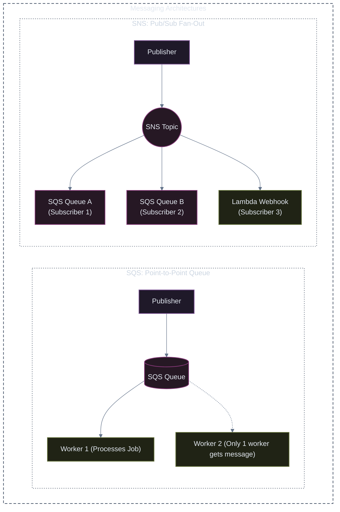
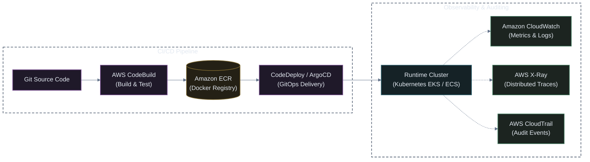
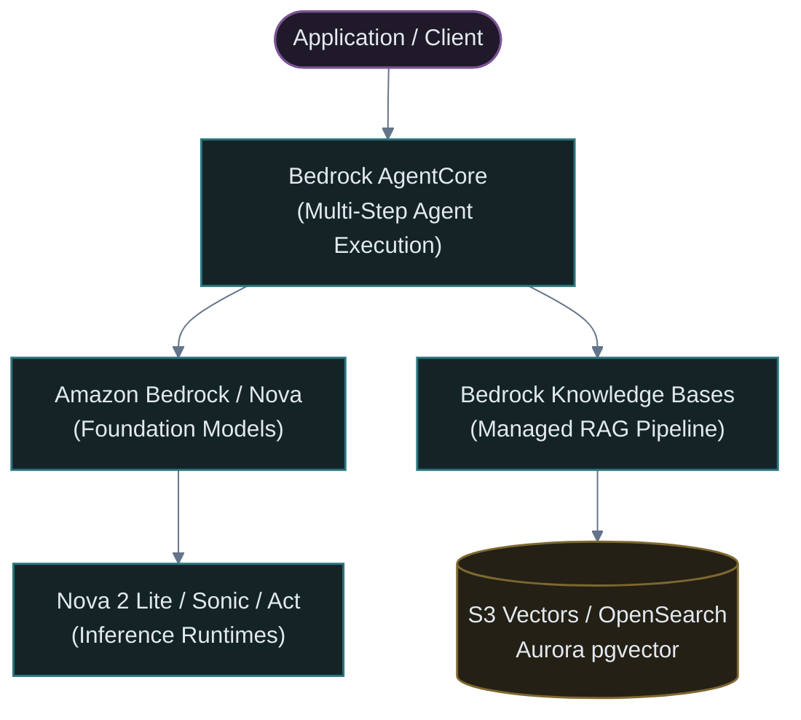

# AWS Services Roadmap & Architecture Guide (2026 Edition)

An exhaustive reference guide to core and advanced Amazon Web Services (AWS) architectures, categorised across 5 functional pillars directly matching the **AWS Services Roadmap #2026**.

---

## 🧭 Classification Legend

| Badge | Type | Meaning & Production Usage |
| :---: | :--- | :--- |
| 🔵 | **CORE** | Foundational services essential for virtually every modern production architecture. |
| ⚪ | **DEPTH** | Specialized, advanced, or high-scale alternatives for specific enterprise architectures. |
| 🟣 | **AI** | Foundation models, generative AI platforms, autonomous agents, and machine learning infrastructure. |
| 🟧 | **NEW #2026** | Cutting-edge generation features, hardware accelerators, and architectural paradigm shifts. |

---

## 📐 Production Architecture Evolution Blueprints

Explore the three detailed end-to-end architecture diagrams illustrating the evolutionary path from single-server MVP to cloud-native event-driven microservices:

| Stage | Blueprint | Key Components & Technologies | Purpose & Scale |
| :---: | :--- | :--- | :--- |
| **01** | **[Architecture 1: Single-Server Baseline](01-basic-ec2-architecture.md)** | Route 53, VPC, EC2, EBS, RDS, S3, CloudWatch | Simple monolith MVP, low cost, baseline infrastructure |
| **02** | **[Architecture 2: Horizontally Scaled Multi-AZ](02-horizontal-scaling-architecture.md)** | CloudFront, ALB, Auto Scaling (ASG), ElastiCache (Redis), Aurora/RDS Read Replicas, SQS, SES | High-traffic resilience, zero downtime, asynchronous offloading |
| **03** | **[Architecture 3: Event-Driven Microservices](03-microservices-eda-architecture.md)** | EKS (Kubernetes), Lambda, EventBridge, ECR, DynamoDB, OpenSearch, Bedrock (AI/RAG), X-Ray | Enterprise scale, polyglot persistence, autonomous AI agents |
| **CLI** | **[AWS CLI Operations Guide](aws-cli.md)** | Authentication, Profiles, Logout, S3, EC2, RDS | Terminal guide, EC2 launch & lifecycle, RDS provision & snapshots, S3 sync |
| **IAM** | **[AWS IAM & Security Guide](aws-iam.md)** | Users, Policies, AdminAccess, S3 Only, EC2 Only, EKS | Least-privilege policies, EKS Access Entries, Pod Identity |

---

# Pillar 1: Compute & Storage

High-performance computing runtimes and persistent storage backends powering containerised microservices, Kubernetes clusters, and cloud-native workflows.

---

### 💻 1.1 Compute Services

| Service | Category | Classification | Architecture Role & Summary |
| :--- | :---: | :---: | :--- |
|  **Amazon EC2** | Compute | 🔵 CORE 🟧 **NEW** | **Virtual servers with full OS and kernel control.** • Serves as the compute foundation for self-managed nodes, heavy GPU inference rigs, and custom OS requirements. • 🟧 **NEW (Graviton5)**: Latest ARM-based silicon generation delivering up to 25% higher compute performance and reduced energy consumption compared to Graviton4. |
|  **Amazon ECS** | Compute | 🔵 CORE 🟧 **NEW** | **AWS-native managed container orchestration.** • Lightweight, deeply integrated with IAM, CloudWatch, and ALB without the management overhead of Kubernetes. • 🟧 **NEW (Faster Scaling)**: 20-second metrics collection with a ~86-second scale-out trigger in official AWS benchmarks. |
|  **AWS Fargate** | Compute | 🔵 CORE | **Serverless compute engine for containers.** • Runs containers on both ECS and EKS without provisioning, scaling, or patching EC2 host instances. • Pay solely for requested CPU, memory, and ephemeral storage per pod/task. |
|  **AWS Lambda** | Compute | 🔵 CORE 🟧 **NEW** | **Serverless, event-driven functions.** • Executes code in response to S3 uploads, SQS messages, API Gateway requests, or EventBridge triggers. • 🟧 **NEW (Durable Functions)**: Stateful, resilient code execution with automatic checkpointing and pause/resume capabilities supporting workflows lasting up to one full year. |
|  **Amazon EKS** | Compute | ⚪ DEPTH | **Managed upstream Kubernetes on AWS.** • Manages control plane availability, automated version upgrades, VPC CNI native IP pod networking, and IAM Roles for Service Accounts (IRSA / Pod Identity). • Industry standard for multi-cloud, GitOps, microservices, and enterprise production platforms. |
|  **AWS Elastic Beanstalk** | Compute | ⚪ DEPTH 🟧 **NEW** | **Managed application deployment PaaS.** • Automatically handles provisioning, load balancing, auto-scaling, and health monitoring from uploaded application code. • 🟧 **NEW (Cluster Mode)**: Enables multiple applications to safely share managed underlying fleet infrastructure to maximize resource utilization. |

---

### 💾 1.2 Storage & Container Registry Services

| Service | Category | Classification | Architecture Role & Summary |
| :--- | :---: | :---: | :--- |
|  **Amazon ECR** | Storage / Containers | 🔵 CORE | **Secure, highly available private Docker and OCI container image registry.** • Directly stores and serves container images, Helm charts, and OCI artifacts for Kubernetes (EKS), ECS, and Lambda. • Features automated CVE vulnerability scanning (via AWS Inspector), KMS encryption, cross-region replication, and lifecycle policies. • Primary container image supply chain foundation for Kubernetes cluster deployments. |
|  **Amazon S3** | Storage | 🔵 CORE 🟧 **NEW** | **Globally scalable, highly durable (99.999999999%) object storage.** • Stores static assets, backups, container image layers, data lake files, and LLM checkpoints. • 🟧 **NEW (S3 Vectors)**: Native storage and fast nearest-neighbor similarity querying for AI vector embeddings directly inside S3 buckets. • 🟧 **NEW (S3 Annotations)**: Attach structured, queryable metadata context to stored objects for instant semantic retrieval. |
|  **Amazon EBS** | Storage | 🔵 CORE | **High-performance block storage volumes for EC2.** • Attached as raw block devices to single EC2 instances or mounted as `ReadWriteOnce` (RWO) PersistentVolumes in Kubernetes via the AWS EBS CSI driver. • Ideal for low-latency databases, disk caches, and file systems. |
|  **Amazon EFS** | Storage | ⚪ DEPTH | **Serverless, fully elastic POSIX shared file system (NFSv4).** • Mountable concurrently across hundreds of EC2 instances and Kubernetes pods (`ReadWriteMany` / RWX). • Ideal for shared CMS media uploads, distributed build caches, and shared ML model weights. |

---

# Pillar 2: Databases & Messaging

> [!IMPORTANT]
> **ENGINEERING RULE**: Design the access pattern before choosing the database. Relational schemas prioritize flexible ad-hoc querying, while NoSQL databases require table schemas designed around specific query access keys.

---

### 🗄️ 2.1 Database Services

| Service | Category | Classification | Architecture Role & Summary |
| :--- | :---: | :---: | :--- |
|  **Amazon RDS** | Databases | 🔵 CORE | **Managed relational database engine (PostgreSQL / MySQL / MariaDB).** • Automates hardware provisioning, database patching, automated continuous snapshots, and Multi-AZ synchronous failover. • Primary choice for transactional business applications requiring ACID guarantees and SQL schemas. |
|  **Amazon DynamoDB** | Databases | 🔵 CORE | **Fully managed, serverless NoSQL key-value and document database.** • Guarantees single-digit millisecond latency at any scale with unlimited horizontal auto-partitioning. • Ideal for user profiles, session state, shopping carts, and event logging with predictable access patterns. |
|  **Amazon ElastiCache** | Databases | 🔵 CORE | **Managed in-memory data store for Redis OSS, Valkey, and Memcached.** • Delivers sub-millisecond response times to relieve strain on relational databases. • Used for session caching, rate-limiting counters, pub/sub queues, and distributed locking. |
|  **Amazon Aurora** | Databases | ⚪ DEPTH | **Cloud-native, high-performance relational database engine.** • Delivers up to 5x throughput of standard MySQL and 3x of standard PostgreSQL. • Storage layer automatically replicates 6 copies across 3 Availability Zones with self-healing block recovery and auto-scaling read replicas. |
|  **Amazon OpenSearch** | Databases | ⚪ DEPTH 🟧 **NEW** | **Distributed search, full-text indexing, and log analytics engine.** • Fork of Elasticsearch powering interactive log exploration, observability dashboards, and search catalogs. • 🟧 **NEW (GPU Vector Indexing)**: Hardware-accelerated vector index creation and automated query graph optimization for low-latency RAG and semantic search. |

---

### 📬 2.2 Messaging & Event Streaming Services

| Service | Category | Classification | Architecture Role & Summary |
| :--- | :---: | :---: | :--- |
|  **Amazon SQS** | Messaging | 🔵 CORE | **Distributed message queuing service.** • Decouples producer microservices from consumer worker pools. Guarantees message delivery with dead-letter queue (DLQ) support. • **Point-to-Point**: Each individual message is received and processed by only one worker consumer. |
|  **Amazon SNS** | Messaging | 🔵 CORE | **High-throughput publish/subscribe (Pub/Sub) messaging service.** • Enables instant message distribution from publishers to multiple endpoints. • **Fan-Out**: Every subscriber (SQS queues, Lambda functions, HTTP webhooks, mobile push) receives an exact duplicate copy of the event. |
|  **Amazon EventBridge** | Messaging | 🔵 CORE | **Serverless event bus service for modern event-driven architectures.** • Routes real-time JSON events between internal AWS resources, third-party SaaS platforms (e.g. GitHub, Datadog), and custom apps. • Features declarative content-based filtering, schema discovery, and scheduled cron rules. |
|  **Amazon Kinesis** | Messaging | ⚪ DEPTH | **Real-time streaming platform for high-volume data ingestion.** • Captures, processes, and stores gigabytes per second of continuous streaming events (clickstreams, financial tickers, IoT feeds) with strict shard ordering. |
|  **Amazon MSK** | Messaging | ⚪ DEPTH | **Fully managed Apache Kafka service.** • Runs native Apache Kafka clusters with automated ZooKeeper/KRaft node management, multi-AZ broker replication, and AWS IAM client authentication. • Direct drop-in for Kafka enterprise pipelines. |

---

# Pillar 3: Networking & Security

End-to-end traffic routing, SSL/TLS termination, edge caching, zero-trust identity enforcement, and automated threat defense.

```mermaid
%%{init: {
  'theme': 'base',
  'themeVariables': {
    'darkMode': true,
    'background': '#0f172a',
    'primaryColor': '#1e293b',
    'primaryTextColor': '#e2e8f0',
    'primaryBorderColor': '#475569',
    'lineColor': '#64748b',
    'textColor': '#e2e8f0',
    'edgeLabelBackground': '#0f172a'
  },
  'themeCSS': '* { filter: none !important; box-shadow: none !important; } .node * { filter: none !important; } .cluster * { filter: none !important; }'
}}%%
graph LR
    User(["End User / Client"]) --> R53["Route 53<br/>(DNS)"]
    R53 --> CF["CloudFront<br/>(Edge CDN & WAF)"]
    CF --> ALB["ALB<br/>(Layer 7 Load Balancer)"]
    ALB --> ComputeCluster

    subgraph VPCNetwork["Private VPC Network"]
        ComputeCluster["Compute Layer<br/>(EKS Pods / ECS Tasks / EC2)"]
    end

    %% Container Boundaries: Transparent BG with Muted Dashed and Dotted Strokes
    style VPCNetwork fill:none,stroke:#475569,stroke-width:1.5px,stroke-dasharray: 6 4,color:#e2e8f0;

    %% Component Classes
    classDef cClient fill:#1f1929,stroke:#7c5295,stroke-width:1.5px,color:#e2e8f0;
    classDef cR53 fill:#241b16,stroke:#8a5832,stroke-width:1.5px,color:#e2e8f0;
    classDef cCF fill:#1c1b2b,stroke:#58518e,stroke-width:1.5px,color:#e2e8f0;
    classDef cNet fill:#17212b,stroke:#38668c,stroke-width:1.5px,color:#e2e8f0;
    classDef cCompute fill:#152226,stroke:#346a78,stroke-width:1.5px,color:#e2e8f0;

    class User cClient;
    class R53 cR53;
    class CF cCF;
    class ALB cNet;
    class ComputeCluster cCompute;
```

---

### 🌐 3.1 Networking & Content Delivery

| Service | Category | Classification | Architecture Role & Summary |
| :--- | :---: | :---: | :--- |
|  **Amazon VPC** | Networking | 🔵 CORE | **Logically isolated software-defined virtual private cloud network.** • Configures IP address ranges (CIDR), public/private subnets, Route Tables, Internet Gateways, NAT Gateways, and VPC Peering. • Core security boundary housing all Kubernetes worker nodes and databases away from public exposure. |
|  **Amazon API Gateway** | Networking | 🔵 CORE | **Managed API front door for REST and WebSocket APIs.** • Handles traffic throttling, rate-limiting, CORS, API keys, request validation, and authorization before reaching downstream Lambda or internal VPC services. |
|  **AWS ALB** | Networking | 🔵 CORE | **Layer 7 Application Load Balancer.** • Routes HTTP/HTTPS traffic based on advanced request attributes (host header, URL path, query params, HTTP headers). • Automatically provisioned as the Kubernetes Ingress entrypoint via the AWS Load Balancer Controller. |
|  **Amazon CloudFront** | Networking | 🔵 CORE | **Global Content Delivery Network (CDN).** • Caches static assets, images, and video at hundreds of edge points of presence (PoPs) worldwide. • Accelerates dynamic API requests with TLS termination at edge, integrated with AWS Shield and WAF. |
|  **Amazon Route 53** | Networking | 🔵 CORE 🟧 **NEW** | **Highly available, low-latency authoritative DNS and domain registrar (100% SLA).** • Provides latency-based routing, geo-DNS, weighted traffic splits (Canary), and DNS failover health checks. • 🟧 **NEW (Global Resolver)**: Secure anycast DNS resolution across global edge PoPs with automated DDoS resilience. |
|  **AWS NLB** | Networking | ⚪ DEPTH | **Layer 4 Network Load Balancer (TCP, UDP, TLS).** • Capable of handling tens of millions of requests per second with ultra-low latency. • Assigns static Elastic IPs per AZ; ideal for gRPC microservices, gaming protocols, and non-HTTP TCP traffic. |

---

### 🛡️ 3.2 Security, Identity & Compliance

| Service | Category | Classification | Architecture Role & Summary |
| :--- | :---: | :---: | :--- |
|  **AWS IAM** | Security | 🔵 CORE 🟧 **NEW** | **Fine-grained access control and identity governance across AWS.** • Governs Roles, Policies, Users, and Service Accounts via least-privilege JSON policy evaluation. • 🟧 **NEW (IAM Policy Autopilot)**: Automatically synthesizes and tightens baseline least-privilege IAM policies directly from application code inspection. |
|  **AWS Secrets Manager** | Security | 🔵 CORE | **Encrypted secrets vault with automated lifecycle rotation.** • Securely stores database passwords, API tokens, and private certificates. • Integrates natively with Kubernetes via the AWS Secrets Store CSI driver to mount credentials as files inside pods. |
|  **Amazon Cognito** | Security | 🔵 CORE | **Customer identity and access management (CIAM).** • Provides User Pools for customer registration, passwordless sign-in, MFA, and social federation (Google, Apple, SAML, OIDC). • Issues secure standard JWT tokens (ID, Access, Refresh) for frontend and mobile authorization. |
|  **AWS KMS** | Security | ⚪ DEPTH | **Hardware-backed (FIPS 140-3) cryptographic key management.** • Centralized encryption and decryption service controlling cryptographic keys for S3 buckets, EBS volumes, RDS tables, and Kubernetes secrets at rest. |
|  **AWS WAF** | Security | ⚪ DEPTH 🟧 **NEW** | **Web Application Firewall filtering malicious HTTP(S) traffic.** • Protects ALBs, CloudFront, and API Gateways against SQL injection, XSS, rate-limiting violations, and bad bots. • 🟧 **NEW (AI Traffic Monetization)**: Enables API owners to meter, rate-limit, or charge AI scrapers and automated LLM bots crawling website content. |
|  **Amazon GuardDuty** | Security | ⚪ DEPTH 🟧 **NEW** | **Continuous intelligent threat detection and anomaly monitoring.** • Analyzes CloudTrail events, VPC Flow Logs, DNS queries, and EKS audit logs using machine learning to detect unauthorized behavior and compromised keys. • 🟧 **NEW (Extended Detection)**: Correlates complex multi-stage attack patterns across diverse cloud resources into actionable kill-chain alerts. |
|  **AWS Security Agent** | Security | 🟣 AI | **AI-driven autonomous security assessment and pen-testing assistant.** • Analyzes cloud posture, identifies misconfigurations, correlates vulnerability scans, and performs automated simulated attack paths (GA March 2026). |

---

# Pillar 4: DevOps, Observability & IaC (Deploy. Observe. Automate.)

Continuous integration, automated deployment pipelines, unified operational telemetry, and declarative infrastructure-as-code automation.

---

### 🚀 4.1 DevOps & CI/CD Pipelines

| Service | Category | Classification | Architecture Role & Summary |
| :--- | :---: | :---: | :--- |
|  **Amazon ECR** | CI/CD | 🔵 CORE | **Secure, highly available private Docker and OCI container image registry.** • Directly integrates with IAM permissions, KMS encryption, automated Clair/Inspector vulnerability scanning, and image lifecycle retention policies. • Primary container image source for EKS and ECS cluster deployments. |
|  **AWS CodeBuild** | CI/CD | 🔵 CORE | **Fully managed continuous integration build service.** • Compiles source code, executes unit and integration test suites, builds Docker container images, and generates deployable artifacts. • Scales elastically with pay-per-minute compute containers. |
|  **AWS CodeDeploy** | CI/CD | 🔵 CORE | **Automated software deployment engine.** • Coordinates zero-downtime rolling, Canary, and Blue/Green deployment rollouts across EC2, ECS, Lambda, and on-premises servers with automatic rollback on failure. |
|  **AWS CodePipeline** | CI/CD | ⚪ DEPTH | **Continuous delivery workflow orchestrator.** • Models, visualizes, and coordinates pipeline stages: Source checkout $\rightarrow$ Build $\rightarrow$ Test $\rightarrow$ Manual Approval $\rightarrow$ Multi-region Production Deployment. |
|  **AWS DevOps Agent** | CI/CD | 🟣 AI | **AI-powered incident investigation and root-cause analysis assistant.** • Monitors production alarms, ingests error traces and commit logs, analyzes anomalies, and provides operational runbook recommendations during active outages. |
|  **AWS Transform** | CI/CD | 🟣 AI | **AI-assisted legacy application modernization service.** • Analyzes legacy application codebases (e.g. legacy Java, .NET Framework), generates updated boilerplate, refactors deprecated APIs, and accelerates cloud migration. |
|  **GitHub Actions** | CI/CD | *(Industry Alternative)* | *Common external CI platform. Delivery tooling often depends on the deployment destination (e.g. GitHub Actions pushing images to ECR, with ArgoCD handling GitOps deployment into EKS).* |

---

### 📊 4.2 Observability & Governance

| Service | Category | Classification | Architecture Role & Summary |
| :--- | :---: | :---: | :--- |
|  **Amazon CloudWatch** | Observability | 🔵 CORE 🟧 **NEW** | **Centralized operational telemetry, logging, and metrics platform.** • Ingests container logs (Fluent Bit / Container Insights), tracks system resource metrics, triggers automated alarm actions, and renders dashboards. • 🟧 **NEW (Unified Data Management)**: A single consolidated telemetry store unifying operations metrics, security events, and compliance audit data in one queryable repository. |
|  **AWS X-Ray** | Observability | ⚪ DEPTH | **Distributed end-to-end request tracing system.** • Tracks user requests across microservices, databases, and third-party APIs. • Generates dependency service maps and identifies high-latency bottlenecks and uncaught exceptions across distributed topologies. |
|  **AWS CloudTrail** | Observability | 🔵 CORE | **Immutable audit trail recording all AWS account management actions.** • Captures every API call made via the AWS Console, CLI, SDKs, or automated pipelines (who, what, when, where from IP) for security compliance and incident forensics. |

---

### 🏗️ 4.3 Infrastructure as Code (IaC)

| Service | Category | Classification | Architecture Role & Summary |
| :--- | :---: | :---: | :--- |
|  **AWS CloudFormation** | IaC | 🔵 CORE | **AWS-native declarative infrastructure orchestration.** • Models all AWS resources in standardized JSON or YAML templates with automated rollback and dependency ordering. |
|  **AWS CDK** | IaC | ⚪ DEPTH | **Modern programmatic infrastructure framework.** • Allows developers to define cloud infrastructure using familiar programming languages (TypeScript, Python, Go, Java, C#) that synthesizes into clean CloudFormation stacks. |
|  **HashiCorp Terraform** | IaC | 🔵 CORE | **Multi-cloud, declarative Infrastructure as Code using HCL.** • Industry standard for managing AWS infrastructure alongside Kubernetes clusters, Helm releases, and SaaS providers with state file tracking. |

---

# Pillar 5: The AWS AI Layer

The enterprise Generative AI stack: foundation models, high-performance reasoning APIs, managed RAG retrieval pipelines, and autonomous agent orchestration.

---

### 🤖 5.1 Foundation Models & APIs

| Service | Category | Classification | Architecture Role & Summary |
| :--- | :---: | :---: | :--- |
|  **Amazon Bedrock** | AI Layer | 🟣 AI | **Fully managed, serverless unified foundation model API.** • Provides single-API access to top-tier models from Anthropic (Claude), Meta (Llama), Mistral AI, Cohere, AI21 Labs, and Amazon Nova. • Includes built-in enterprise privacy (zero training on customer prompts) and Guardrails for PII redaction and safety filtering. |
|  **Amazon Nova** | AI Layer | 🟣 AI | **AWS native foundation model family built for speed, cost, and agentic workflows.** • **Nova 2 Lite**: Ultra-fast, cost-effective reasoning model optimized for high-throughput enterprise pipelines. • **Nova 2 Sonic**: Real-time speech-to-speech conversational model for human-like voice interfaces. • **Nova Act**: Specialized action-taking agentic model capable of automating browser workflows and UI executions. |

---

### 🧠 5.2 Retrieval & Autonomous Agents

| Service | Category | Classification | Architecture Role & Summary |
| :--- | :---: | :---: | :--- |
|  **Bedrock Knowledge Bases** | AI Layer | 🟣 AI | **Fully managed Retrieval-Augmented Generation (RAG) pipeline.** • Automates data chunking, text parsing, embedding generation, and vector index sync with Amazon OpenSearch Serverless, S3 Vectors, or Aurora PostgreSQL. • Enriches LLM generation with accurate, private enterprise facts without hallucinations. |
|  **Bedrock AgentCore** | AI Layer | 🟣 AI | **Infrastructure and orchestration runtime for production AI agents.** • Dynamically breaks down user prompts into multi-step execution plans, queries knowledge bases, and securely invokes internal REST APIs or Lambda functions to complete complex tasks autonomously. |

---

### ⚙️ 5.3 Customization & ML Operations

| Service | Category | Classification | Architecture Role & Summary |
| :--- | :---: | :---: | :--- |
|  **Bedrock Reinforcement Fine-Tuning** | AI Layer | 🟣 AI 🟧 **NEW** | **Model customization via feedback-based reinforcement learning (RLHF / RLAIF).** • Aligns foundation models with customized organizational guidelines, domain-specific tone, and business task reward functions. |
|  **Amazon SageMaker** | AI Layer | 🟣 AI | **End-to-end enterprise machine learning and deep learning platform.** • Covers data labeling (Ground Truth), distributed model training on GPU clusters (UltraClusters / Trainium), hyperparameter tuning, model registry, and managed real-time inference endpoints. |
|  **AWS DevOps Agent** | AI Layer | 🟣 AI | **AI operational copilot for incident response.** • Correlates system metrics, error spikes, and deployment events to suggest rapid triage steps and operational fixes during system incidents. |

---

## 🎯 Architecture Summary: How It All Fits Together in Production

In a modern Kubernetes (`Amazon EKS`) or containerized production deployment on AWS:

1. **Traffic Entry & Edge Security**: Clients query **Route 53**, hit **CloudFront** edge caches protected by **AWS WAF**, and terminate TLS at an **ALB** managed by the AWS Load Balancer Controller.
2. **Compute & Orchestration**: Incoming requests are distributed into **Amazon EKS** running on **EC2 (Graviton5)** nodes or serverless **AWS Fargate** pods.
3. **Storage & State**: Stateful pods mount low-latency **Amazon EBS** volumes for single-node state, or shared **Amazon EFS** file systems for shared multi-pod assets.
4. **Data & Caching**: Application code reads and writes transactional data to **Amazon RDS** or **Amazon Aurora**, caches hot queries and session state in **Amazon ElastiCache (Valkey/Redis)**, and offloads key-value data to **Amazon DynamoDB**.
5. **Decoupled Asynchrony**: Background tasks queue up in **Amazon SQS**, broadcast notifications through **Amazon SNS**, and route SaaS events across **Amazon EventBridge**.
6. **AI Augmentation**: Microservices invoke **Amazon Bedrock** and **Amazon Nova** foundation models, grounded by enterprise documents indexed in **Bedrock Knowledge Bases** and executed via **Bedrock AgentCore**.
7. **Delivery & Observability**: Everything is declared in **Terraform** or **AWS CDK**, built in **AWS CodeBuild**, pushed to **Amazon ECR**, deployed continuously, and monitored end-to-end with **Amazon CloudWatch** and **AWS CloudTrail**.
