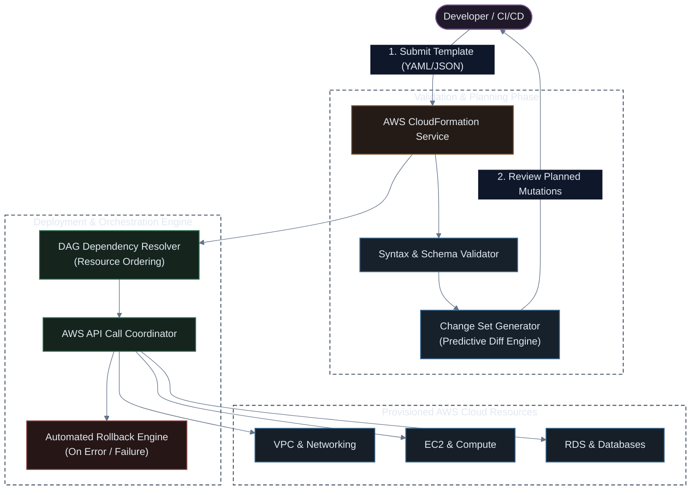

# AWS CloudFormation: Architecture, Fundamentals & Lifecycle Guide

[](#)
[](#)
[](#)

AWS CloudFormation is Amazon Web Services' native, declarative Infrastructure as Code (IaC) service. It allows you to model, provision, and manage entire AWS and third-party resource lifecycles through declarative configuration templates written in YAML or JSON.

---

## 🏗️ CloudFormation Engine Architecture & Execution Workflow



---

## 🔑 Core Concepts

| Concept | Description |
| :--- | :--- |
| **Template** | A declarative JSON or YAML text file describing all target AWS resources, relationships, dependencies, and configuration parameters. |
| **Stack** | A single management unit. All resources described in a template are instantiated, updated, or deleted as a single atomic stack. |
| **Change Set** | A preview/diff of changes CloudFormation will execute on existing resources before applying an update. Prevents accidental deletion of databases or persistent disks. |
| **Drift Detection** | A diagnostic tool that checks whether actual cloud resources have diverged from their declared CloudFormation template state due to manual out-of-band edits in the AWS Console. |
| **StackSets** | Extends stack management across multiple AWS accounts and multiple AWS regions in a single operation. |

---

## ⚡ Sample 1: The Bare Minimum Working Example (Hello World)

Before exploring advanced enterprise templates, here is the absolute simplest, 100% valid CloudFormation template that provisions an S3 storage bucket. Only the `Resources` block is strictly required:

### YAML (`sample-minimal.yaml`)
```yaml
Resources:
  MyBucket:
    Type: "AWS::S3::Bucket"
```

### JSON (`sample-minimal.json`)
```json
{
  "Resources": {
    "MyBucket": {
      "Type": "AWS::S3::Bucket"
    }
  }
}
```

### 🚀 How to Run & Verify Sample 1

```bash
# 1. Deploy the minimal stack to AWS
aws cloudformation deploy \
  --template-file sample-minimal.yaml \
  --stack-name my-first-cfn-stack

# 2. Check the physical resource created
aws cloudformation list-stack-resources \
  --stack-name my-first-cfn-stack \
  --query "StackResourceSummaries[*].[LogicalResourceId, PhysicalResourceId, ResourceStatus]" \
  --output table

# 3. Clean up and delete when done
aws cloudformation delete-stack \
  --stack-name my-first-cfn-stack
```

---

## 🏗️ Adding the "Extra": Full Production Template Anatomy (YAML & JSON)

While Sample 1 works for quick prototypes, production deployments require **Parameters**, **Conditions**, **Mappings**, and **Outputs**. Below is the complete 7-block skeleton:

### 1. YAML Syntax (`template.yaml`)
```yaml
AWSTemplateFormatVersion: "2010-09-09"
Description: "Standard Production Template Skeleton in YAML"

# 1. Custom input variables passed at deployment time
Parameters:
  Environment:
    Type: String
    Default: production
    AllowedValues: [development, staging, production]
    Description: Deployment target environment

# 2. Static lookup tables (e.g. Region to AMI mappings)
Mappings:
  RegionMap:
    us-east-1:
      AMI: "ami-0c7217cdde317cfec"
    us-west-2:
      AMI: "ami-008fe2fc65e717a2e"

# 3. Boolean logic determining whether resources are created
Conditions:
  IsProduction: !Equals [!Ref Environment, "production"]

# 4. Mandatory block declaring target infrastructure
Resources:
  MyBucket:
    Type: "AWS::S3::Bucket"
    Properties:
      BucketName: !Sub "company-data-${Environment}-${AWS::AccountId}"

# 5. Exported attributes for consumption by other stacks (Cross-Stack References)
Outputs:
  BucketArn:
    Description: ARN of the provisioned S3 Bucket
    Value: !GetAtt MyBucket.Arn
    Export:
      Name: !Sub "${AWS::StackName}-BucketArn"
```

### 2. JSON Syntax (`template.json`)
```json
{
  "AWSTemplateFormatVersion": "2010-09-09",
  "Description": "Standard Production Template Skeleton in JSON",
  "Parameters": {
    "Environment": {
      "Type": "String",
      "Default": "production",
      "AllowedValues": [
        "development",
        "staging",
        "production"
      ],
      "Description": "Deployment target environment"
    }
  },
  "Mappings": {
    "RegionMap": {
      "us-east-1": {
        "AMI": "ami-0c7217cdde317cfec"
      },
      "us-west-2": {
        "AMI": "ami-008fe2fc65e717a2e"
      }
    }
  },
  "Conditions": {
    "IsProduction": {
      "Fn::Equals": [
        { "Ref": "Environment" },
        "production"
      ]
    }
  },
  "Resources": {
    "MyBucket": {
      "Type": "AWS::S3::Bucket",
      "Properties": {
        "BucketName": {
          "Fn::Sub": "company-data-${Environment}-${AWS::AccountId}"
        }
      }
    }
  },
  "Outputs": {
    "BucketArn": {
      "Description": "ARN of the provisioned S3 Bucket",
      "Value": {
        "Fn::GetAtt": [
          "MyBucket",
          "Arn"
        ]
      },
      "Export": {
        "Name": {
          "Fn::Sub": "${AWS::StackName}-BucketArn"
        }
      }
    }
  }
}
```

---

## 🛠️ Essential Intrinsic Functions & Pseudo Parameters

CloudFormation evaluates special functions at runtime to resolve dynamic dependencies. Notice how YAML uses short bang syntax (e.g. `!Ref`), while JSON uses explicit object keys (e.g. `{"Ref": ...}`):

| Function / Parameter | YAML Short Syntax | JSON Object Syntax | Purpose & Example |
| :--- | :--- | :--- | :--- |
| **`Ref`** | `!Ref MyVPC` | `{"Ref": "MyVPC"}` | Returns the value of a parameter or resource ID |
| **`Fn::GetAtt`** | `!GetAtt MyEC2.PrivateIp` | `{"Fn::GetAtt": ["MyEC2", "PrivateIp"]}` | Retrieves a specific attribute from a resource |
| **`Fn::Sub`** | `!Sub "app-${AWS::Region}"` | `{"Fn::Sub": "app-${AWS::Region}"}` | String variable interpolation |
| **`Fn::Join`** | `!Join [":", ["a", "b"]]` | `{"Fn::Join": [":", ["a", "b"]]}` | Concatenates an array of strings with delimiter |
| **`Fn::Select`** | `!Select [0, !GetAZs ""]` | `{"Fn::Select": [0, {"Fn::GetAZs": ""}]}` | Retrieves a single element from an array index |
| **`Fn::FindInMap`** | `!FindInMap [Map, Key, Sub]` | `{"Fn::FindInMap": ["Map", "Key", "Sub"]}` | Resolves values from the `Mappings` block |
| **`Fn::Base64`** | `!Base64 "string"` | `{"Fn::Base64": "string"}` | Encodes plaintext into Base64 (UserData) |
| **`AWS::Region`** | `!Ref "AWS::Region"` | `{"Ref": "AWS::Region"}` | Pseudo-parameter resolving to current region |
| **`AWS::AccountId`** | `!Ref "AWS::AccountId"` | `{"Ref": "AWS::AccountId"}` | Current 12-digit AWS Account ID |
| **`AWS::StackName`** | `!Ref "AWS::StackName"` | `{"Ref": "AWS::StackName"}` | Name of the active executing stack |

---

## 🚀 Lifecycle CLI Commands Cheat Sheet

```bash
# 1. Validate template syntax locally (YAML or JSON)
aws cloudformation validate-template \
  --template-body file://template.yaml

aws cloudformation validate-template \
  --template-body file://template.json

# 2. Deploy or update a stack with parameters (Recommended: deploy command)
aws cloudformation deploy \
  --template-file template.json \
  --stack-name production-core-infra \
  --parameter-overrides Environment=production \
  --capabilities CAPABILITY_IAM CAPABILITY_NAMED_IAM

# 3. Create a Change Set before applying changes
aws cloudformation create-change-set \
  --stack-name production-core-infra \
  --change-set-name preview-v2 \
  --template-body file://template.yaml

# 4. Detect drift against live infrastructure
aws cloudformation detect-stack-drift \
  --stack-name production-core-infra

# 5. Delete stack and clean up all managed resources
aws cloudformation delete-stack \
  --stack-name production-core-infra
```

> [!TIP]
> Always enable **Termination Protection** on production database and VPC stacks to guard against accidental `delete-stack` CLI invocations:
> `aws cloudformation update-termination-protection --enable-termination-protection --stack-name prod-db`
