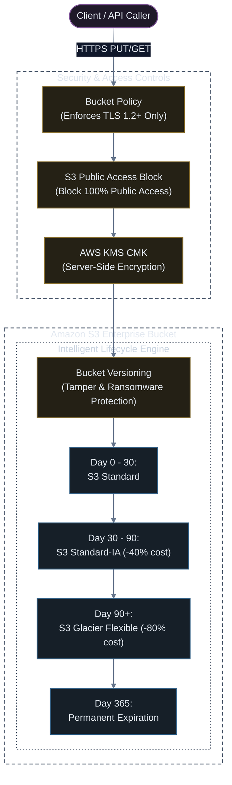

# Provisioning Enterprise Amazon S3 Storage with CloudFormation

[](#)
[](#)
[](#)

A production-grade CloudFormation template provisioning a secure Amazon S3 bucket adhering to AWS Well-Architected Security Best Practices: mandatory TLS/HTTPS access, automated SSE-KMS encryption, 4-tier Public Access Block, bucket versioning, and intelligent lifecycle transition rules.

---

## 🏗️ S3 Security & Lifecycle Architecture



---

## 📜 CloudFormation Template (`s3-secure-bucket.yaml`)

```yaml
AWSTemplateFormatVersion: "2010-09-09"
Description: "Production-ready, highly secure S3 bucket with KMS encryption, Public Access Block, and Lifecycle Rules."

Parameters:
  Environment:
    Type: String
    Default: production
    AllowedValues: [development, staging, production]
    Description: Environment stage for naming and tag attribution.

  BucketBaseName:
    Type: String
    Default: enterprise-assets
    AllowedPattern: "^[a-z0-9][a-z0-9.-]*[a-z0-9]$"
    Description: Base name for S3 bucket. A unique account ID suffix will be appended.

Resources:
  # 1. Dedicated KMS Customer Managed Key (CMK) for S3 Encryption
  S3KmsKey:
    Type: "AWS::KMS::Key"
    Properties:
      Description: !Sub "KMS Key for ${BucketBaseName}-${Environment} S3 Bucket"
      EnableKeyRotation: true
      KeyPolicy:
        Version: "2012-10-17"
        Id: "kms-s3-key-policy"
        Statement:
          - Sid: "Enable IAM User Permissions"
            Effect: Allow
            Principal:
              AWS: !Sub "arn:aws:iam::${AWS::AccountId}:root"
            Action: "kms:*"
            Resource: "*"

  S3KmsKeyAlias:
    Type: "AWS::KMS::Alias"
    Properties:
      AliasName: !Sub "alias/${BucketBaseName}-${Environment}-key"
      TargetKeyId: !Ref S3KmsKey

  # 2. Hardened S3 Bucket Definition
  EnterpriseS3Bucket:
    Type: "AWS::S3::Bucket"
    DeletionPolicy: Retain
    UpdateReplacePolicy: Retain
    Properties:
      BucketName: !Sub "${BucketBaseName}-${Environment}-${AWS::AccountId}-${AWS::Region}"
      
      # Server-Side Encryption with KMS
      BucketEncryption:
        ServerSideEncryptionConfiguration:
          - ServerSideEncryptionByDefault:
              SSEAlgorithm: "aws:kms"
              KMSMasterKeyID: !GetAtt S3KmsKey.Arn
            BucketKeyEnabled: true  # Reduces KMS API call costs by up to 99%

      # Enforce Versioning (Disaster Recovery & Immutability)
      VersioningConfiguration:
        Status: Enabled

      # Enforce Complete Block on Public Access
      PublicAccessBlockConfiguration:
        BlockPublicAcls: true
        IgnorePublicAcls: true
        BlockPublicPolicy: true
        RestrictPublicBuckets: true

      # Cost Optimization Lifecycle Management
      LifecycleConfiguration:
        Rules:
          - Id: "TransitionOldObjectsToGlacier"
            Status: Enabled
            Transitions:
              - TransitionInDays: 30
                StorageClass: STANDARD_IA
              - TransitionInDays: 90
                StorageClass: GLACIER
            NoncurrentVersionTransitions:
              - TransitionInDays: 30
                StorageClass: GLACIER
            NoncurrentVersionExpiration:
              NoncurrentDays: 180

      Tags:
        - Key: Environment
          Value: !Ref Environment
        - Key: ManagedBy
          Value: CloudFormation

  # 3. Bucket Policy Denying Non-TLS Connections
  EnforceTlsBucketPolicy:
    Type: "AWS::S3::BucketPolicy"
    Properties:
      Bucket: !Ref EnterpriseS3Bucket
      PolicyDocument:
        Version: "2012-10-17"
        Statement:
          - Sid: "DenyInsecureConnections"
            Effect: Deny
            Principal: "*"
            Action: "s3:*"
            Resource:
              - !GetAtt EnterpriseS3Bucket.Arn
              - !Sub "${EnterpriseS3Bucket.Arn}/*"
            Condition:
              Bool:
                "aws:SecureTransport": "false"

Outputs:
  BucketName:
    Description: Physical Name of the provisioned S3 Bucket
    Value: !Ref EnterpriseS3Bucket
    Export:
      Name: !Sub "${AWS::StackName}-BucketName"

  BucketArn:
    Description: ARN of the provisioned S3 Bucket
    Value: !GetAtt EnterpriseS3Bucket.Arn
    Export:
      Name: !Sub "${AWS::StackName}-BucketArn"

  KmsKeyArn:
    Description: ARN of the KMS Key securing the bucket
    Value: !GetAtt S3KmsKey.Arn
```

---

## 🚀 Deployment Guide

```bash
# Deploy with AWS CloudFormation CLI
aws cloudformation deploy \
  --template-file s3-secure-bucket.yaml \
  --stack-name prod-enterprise-s3 \
  --parameter-overrides \
      Environment=production \
      BucketBaseName=corp-data-lake \
  --capabilities CAPABILITY_IAM

# Verify Bucket Creation & Public Access Block
aws s3api get-public-access-block \
  --bucket corp-data-lake-production-<YOUR-ACCOUNT-ID>-<REGION>
```

> [!IMPORTANT]
> The template sets `DeletionPolicy: Retain`. If the CloudFormation stack is ever deleted, the physical S3 bucket and its data will remain untouched to prevent catastrophic accidental data loss.
