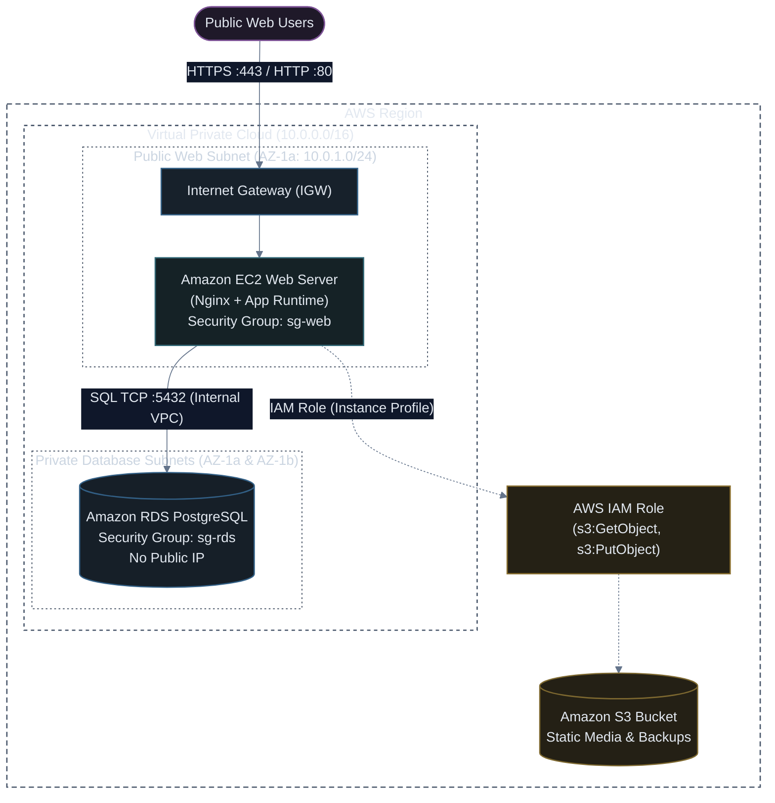

# Production Multi-Tier Stack (VPC + EC2 + S3 + RDS) with CloudFormation

[](#)
[](#)
[](#)

A complete, enterprise-grade Infrastructure as Code blueprint that provisions an end-to-end multi-tier production environment using native AWS CloudFormation: custom VPC, public/private subnets, secure EC2 web server, IAM Instance Profile, S3 object bucket, and isolated Amazon RDS PostgreSQL instance.

---

## 🏗️ Architecture Topology



---

## 📜 Complete CloudFormation Template (`multi-tier-stack.yaml`)

```yaml
AWSTemplateFormatVersion: "2010-09-09"
Description: "Multi-Tier Infrastructure: VPC, Public EC2 with IAM, Private RDS PostgreSQL, and S3 Bucket."

Parameters:
  Environment:
    Type: String
    Default: production
    AllowedValues: [development, staging, production]
    Description: Deployment target environment.

  DBUsername:
    Type: String
    Default: dbadmin
    Description: Master username for PostgreSQL.

  DBPassword:
    Type: String
    NoEcho: true
    MinLength: 8
    Description: Master password for PostgreSQL.

  InstanceType:
    Type: String
    Default: t4g.small
    Description: EC2 instance type (Graviton recommended).

  LatestAmiId:
    Type: "AWS::SSM::Parameter::Value<AWS::EC2::Image::Id>"
    Default: "/aws/service/ami-amazon-linux-latest/al2023-ami-kernel-default-arm64"
    Description: Automated dynamic SSM parameter lookup for latest AL2023 ARM64 AMI.

Resources:
  # =========================================================================
  # 1. NETWORKING LAYER (VPC, Subnets, Gateways, Route Tables)
  # =========================================================================
  ProductionVPC:
    Type: "AWS::EC2::VPC"
    Properties:
      CidrBlock: "10.0.0.0/16"
      EnableDnsHostnames: true
      EnableDnsSupport: true
      Tags:
        - Key: Name
          Value: !Sub "${Environment}-vpc"

  InternetGateway:
    Type: "AWS::EC2::InternetGateway"
    Properties:
      Tags:
        - Key: Name
          Value: !Sub "${Environment}-igw"

  VPCGatewayAttachment:
    Type: "AWS::EC2::VPCGatewayAttachment"
    Properties:
      VpcId: !Ref ProductionVPC
      InternetGatewayId: !Ref InternetGateway

  # Public Subnet (AZ-1a)
  PublicSubnet1:
    Type: "AWS::EC2::Subnet"
    Properties:
      VpcId: !Ref ProductionVPC
      CidrBlock: "10.0.1.0/24"
      AvailabilityZone: !Select [0, !GetAZs ""]
      MapPublicIpOnLaunch: true
      Tags:
        - Key: Name
          Value: !Sub "${Environment}-public-subnet-1"

  # Private Subnet 1 (AZ-1a)
  PrivateSubnet1:
    Type: "AWS::EC2::Subnet"
    Properties:
      VpcId: !Ref ProductionVPC
      CidrBlock: "10.0.10.0/24"
      AvailabilityZone: !Select [0, !GetAZs ""]
      MapPublicIpOnLaunch: false
      Tags:
        - Key: Name
          Value: !Sub "${Environment}-private-subnet-1"

  # Private Subnet 2 (AZ-1b - Required for RDS Multi-AZ Subnet Group)
  PrivateSubnet2:
    Type: "AWS::EC2::Subnet"
    Properties:
      VpcId: !Ref ProductionVPC
      CidrBlock: "10.0.20.0/24"
      AvailabilityZone: !Select [1, !GetAZs ""]
      MapPublicIpOnLaunch: false
      Tags:
        - Key: Name
          Value: !Sub "${Environment}-private-subnet-2"

  # Routing
  PublicRouteTable:
    Type: "AWS::EC2::RouteTable"
    Properties:
      VpcId: !Ref ProductionVPC
      Tags:
        - Key: Name
          Value: !Sub "${Environment}-public-rt"

  PublicDefaultRoute:
    Type: "AWS::EC2::Route"
    DependsOn: VPCGatewayAttachment
    Properties:
      RouteTableId: !Ref PublicRouteTable
      DestinationCidrBlock: "0.0.0.0/0"
      GatewayId: !Ref InternetGateway

  PublicSubnetRouteTableAssociation:
    Type: "AWS::EC2::SubnetRouteTableAssociation"
    Properties:
      SubnetId: !Ref PublicSubnet1
      RouteTableId: !Ref PublicRouteTable

  # =========================================================================
  # 2. S3 STORAGE & IAM PERMISSIONS
  # =========================================================================
  MediaBucket:
    Type: "AWS::S3::Bucket"
    Properties:
      BucketName: !Sub "app-media-${Environment}-${AWS::AccountId}-${AWS::Region}"
      PublicAccessBlockConfiguration:
        BlockPublicAcls: true
        IgnorePublicAcls: true
        BlockPublicPolicy: true
        RestrictPublicBuckets: true
      BucketEncryption:
        ServerSideEncryptionConfiguration:
          - ServerSideEncryptionByDefault:
              SSEAlgorithm: "AES256"

  EC2InstanceRole:
    Type: "AWS::IAM::Role"
    Properties:
      AssumeRolePolicyDocument:
        Version: "2012-10-17"
        Statement:
          - Effect: Allow
            Principal:
              Service: "ec2.amazonaws.com"
            Action: "sts:AssumeRole"
      ManagedPolicyArns:
        - "arn:aws:iam::aws:policy/AmazonSSMManagedInstanceCore" # Session Manager (No port 22 needed!)
      Policies:
        - PolicyName: "S3MediaAccessPolicy"
          PolicyDocument:
            Version: "2012-10-17"
            Statement:
              - Effect: Allow
                Action:
                  - "s3:GetObject"
                  - "s3:PutObject"
                  - "s3:ListBucket"
                Resource:
                  - !GetAtt MediaBucket.Arn
                  - !Sub "${MediaBucket.Arn}/*"

  EC2InstanceProfile:
    Type: "AWS::IAM::InstanceProfile"
    Properties:
      Roles:
        - !Ref EC2InstanceRole

  # =========================================================================
  # 3. SECURITY GROUPS (Strict Ingress Chaining)
  # =========================================================================
  WebServerSecurityGroup:
    Type: "AWS::EC2::SecurityGroup"
    Properties:
      GroupDescription: "Allow public HTTP/HTTPS traffic to Web EC2"
      VpcId: !Ref ProductionVPC
      SecurityGroupIngress:
        - IpProtocol: tcp
          FromPort: 80
          ToPort: 80
          CidrIp: "0.0.0.0/0"
        - IpProtocol: tcp
          FromPort: 443
          ToPort: 443
          CidrIp: "0.0.0.0/0"

  DatabaseSecurityGroup:
    Type: "AWS::EC2::SecurityGroup"
    Properties:
      GroupDescription: "Strict PostgreSQL access allowed ONLY from WebServer SG"
      VpcId: !Ref ProductionVPC
      SecurityGroupIngress:
        - IpProtocol: tcp
          FromPort: 5432
          ToPort: 5432
          SourceSecurityGroupId: !Ref WebServerSecurityGroup

  # =========================================================================
  # 4. COMPUTE TIER (Amazon EC2)
  # =========================================================================
  WebServerInstance:
    Type: "AWS::EC2::Instance"
    Properties:
      InstanceType: !Ref InstanceType
      ImageId: !Ref LatestAmiId
      SubnetId: !Ref PublicSubnet1
      IamInstanceProfile: !Ref EC2InstanceProfile
      SecurityGroupIds:
        - !Ref WebServerSecurityGroup
      UserData:
        Fn::Base64: !Sub |
          #!/bin/bash
          dnf update -y
          dnf install -y nginx postgresql15
          systemctl enable nginx
          systemctl start nginx
          echo "<h1>Production Web Tier - Online</h1><p>DB Host: ${DatabaseInstance.Endpoint.Address}</p><p>S3 Bucket: ${MediaBucket}</p>" > /usr/share/nginx/html/index.html
      Tags:
        - Key: Name
          Value: !Sub "${Environment}-web-server"

  # =========================================================================
  # 5. DATABASE TIER (Amazon RDS PostgreSQL)
  # =========================================================================
  DBSubnetGroup:
    Type: "AWS::RDS::DBSubnetGroup"
    Properties:
      DBSubnetGroupDescription: "Subnets for RDS PostgreSQL multi-AZ deployment"
      SubnetIds:
        - !Ref PrivateSubnet1
        - !Ref PrivateSubnet2
      Tags:
        - Key: Name
          Value: !Sub "${Environment}-db-subnet-group"

  DatabaseInstance:
    Type: "AWS::RDS::DBInstance"
    DeletionPolicy: Snapshot
    Properties:
      DBInstanceIdentifier: !Sub "${Environment}-postgres-db"
      Engine: postgres
      EngineVersion: "16.1"
      DBInstanceClass: db.t4g.micro
      AllocatedStorage: "20"
      StorageType: gp3
      MasterUsername: !Ref DBUsername
      MasterUserPassword: !Ref DBPassword
      DBSubnetGroupName: !Ref DBSubnetGroup
      VPCSecurityGroups:
        - !Ref DatabaseSecurityGroup
      PubliclyAccessible: false
      MultiAZ: false
      BackupRetentionPeriod: 7
      Tags:
        - Key: Environment
          Value: !Ref Environment

Outputs:
  WebServerPublicIP:
    Description: Public IP of the Web Server
    Value: !GetAtt WebServerInstance.PublicIp

  WebServerDNS:
    Description: Public DNS of the Web Server
    Value: !GetAtt WebServerInstance.PublicDnsName

  DatabaseEndpoint:
    Description: Internal Private Endpoint for PostgreSQL Database
    Value: !GetAtt DatabaseInstance.Endpoint.Address

  MediaBucketName:
    Description: S3 Storage Bucket Name
    Value: !Ref MediaBucket
```

<details>
<summary><b>📄 Click to view complete equivalent CloudFormation Template in JSON (<code>multi-tier-stack.json</code>)</b></summary>

```json
{
  "AWSTemplateFormatVersion": "2010-09-09",
  "Description": "Multi-Tier Infrastructure: VPC, Public EC2 with IAM, Private RDS PostgreSQL, and S3 Bucket (JSON format).",
  "Parameters": {
    "Environment": {
      "Type": "String",
      "Default": "production",
      "AllowedValues": [
        "development",
        "staging",
        "production"
      ],
      "Description": "Deployment target environment."
    },
    "DBUsername": {
      "Type": "String",
      "Default": "dbadmin",
      "Description": "Master username for PostgreSQL."
    },
    "DBPassword": {
      "Type": "String",
      "NoEcho": true,
      "MinLength": 8,
      "Description": "Master password for PostgreSQL."
    },
    "InstanceType": {
      "Type": "String",
      "Default": "t4g.small",
      "Description": "EC2 instance type (Graviton recommended)."
    },
    "LatestAmiId": {
      "Type": "AWS::SSM::Parameter::Value<AWS::EC2::Image::Id>",
      "Default": "/aws/service/ami-amazon-linux-latest/al2023-ami-kernel-default-arm64",
      "Description": "Automated dynamic SSM parameter lookup for latest AL2023 ARM64 AMI."
    }
  },
  "Resources": {
    "ProductionVPC": {
      "Type": "AWS::EC2::VPC",
      "Properties": {
        "CidrBlock": "10.0.0.0/16",
        "EnableDnsHostnames": true,
        "EnableDnsSupport": true,
        "Tags": [
          {
            "Key": "Name",
            "Value": {
              "Fn::Sub": "${Environment}-vpc"
            }
          }
        ]
      }
    },
    "InternetGateway": {
      "Type": "AWS::EC2::InternetGateway",
      "Properties": {
        "Tags": [
          {
            "Key": "Name",
            "Value": {
              "Fn::Sub": "${Environment}-igw"
            }
          }
        ]
      }
    },
    "VPCGatewayAttachment": {
      "Type": "AWS::EC2::VPCGatewayAttachment",
      "Properties": {
        "VpcId": {
          "Ref": "ProductionVPC"
        },
        "InternetGatewayId": {
          "Ref": "InternetGateway"
        }
      }
    },
    "PublicSubnet1": {
      "Type": "AWS::EC2::Subnet",
      "Properties": {
        "VpcId": {
          "Ref": "ProductionVPC"
        },
        "CidrBlock": "10.0.1.0/24",
        "AvailabilityZone": {
          "Fn::Select": [
            0,
            {
              "Fn::GetAZs": ""
            }
          ]
        },
        "MapPublicIpOnLaunch": true,
        "Tags": [
          {
            "Key": "Name",
            "Value": {
              "Fn::Sub": "${Environment}-public-subnet-1"
            }
          }
        ]
      }
    },
    "PrivateSubnet1": {
      "Type": "AWS::EC2::Subnet",
      "Properties": {
        "VpcId": {
          "Ref": "ProductionVPC"
        },
        "CidrBlock": "10.0.10.0/24",
        "AvailabilityZone": {
          "Fn::Select": [
            0,
            {
              "Fn::GetAZs": ""
            }
          ]
        },
        "MapPublicIpOnLaunch": false,
        "Tags": [
          {
            "Key": "Name",
            "Value": {
              "Fn::Sub": "${Environment}-private-subnet-1"
            }
          }
        ]
      }
    },
    "PrivateSubnet2": {
      "Type": "AWS::EC2::Subnet",
      "Properties": {
        "VpcId": {
          "Ref": "ProductionVPC"
        },
        "CidrBlock": "10.0.20.0/24",
        "AvailabilityZone": {
          "Fn::Select": [
            1,
            {
              "Fn::GetAZs": ""
            }
          ]
        },
        "MapPublicIpOnLaunch": false,
        "Tags": [
          {
            "Key": "Name",
            "Value": {
              "Fn::Sub": "${Environment}-private-subnet-2"
            }
          }
        ]
      }
    },
    "PublicRouteTable": {
      "Type": "AWS::EC2::RouteTable",
      "Properties": {
        "VpcId": {
          "Ref": "ProductionVPC"
        },
        "Tags": [
          {
            "Key": "Name",
            "Value": {
              "Fn::Sub": "${Environment}-public-rt"
            }
          }
        ]
      }
    },
    "PublicDefaultRoute": {
      "Type": "AWS::EC2::Route",
      "DependsOn": "VPCGatewayAttachment",
      "Properties": {
        "RouteTableId": {
          "Ref": "PublicRouteTable"
        },
        "DestinationCidrBlock": "0.0.0.0/0",
        "GatewayId": {
          "Ref": "InternetGateway"
        }
      }
    },
    "PublicSubnetRouteTableAssociation": {
      "Type": "AWS::EC2::SubnetRouteTableAssociation",
      "Properties": {
        "SubnetId": {
          "Ref": "PublicSubnet1"
        },
        "RouteTableId": {
          "Ref": "PublicRouteTable"
        }
      }
    },
    "MediaBucket": {
      "Type": "AWS::S3::Bucket",
      "Properties": {
        "BucketName": {
          "Fn::Sub": "app-media-${Environment}-${AWS::AccountId}-${AWS::Region}"
        },
        "PublicAccessBlockConfiguration": {
          "BlockPublicAcls": true,
          "IgnorePublicAcls": true,
          "BlockPublicPolicy": true,
          "RestrictPublicBuckets": true
        },
        "BucketEncryption": {
          "ServerSideEncryptionConfiguration": [
            {
              "ServerSideEncryptionByDefault": {
                "SSEAlgorithm": "AES256"
              }
            }
          ]
        }
      }
    },
    "EC2InstanceRole": {
      "Type": "AWS::IAM::Role",
      "Properties": {
        "AssumeRolePolicyDocument": {
          "Version": "2012-10-17",
          "Statement": [
            {
              "Effect": "Allow",
              "Principal": {
                "Service": "ec2.amazonaws.com"
              },
              "Action": "sts:AssumeRole"
            }
          ]
        },
        "ManagedPolicyArns": [
          "arn:aws:iam::aws:policy/AmazonSSMManagedInstanceCore"
        ],
        "Policies": [
          {
            "PolicyName": "S3MediaAccessPolicy",
            "PolicyDocument": {
              "Version": "2012-10-17",
              "Statement": [
                {
                  "Effect": "Allow",
                  "Action": [
                    "s3:GetObject",
                    "s3:PutObject",
                    "s3:ListBucket"
                  ],
                  "Resource": [
                    {
                      "Fn::GetAtt": [
                        "MediaBucket",
                        "Arn"
                      ]
                    },
                    {
                      "Fn::Sub": "${MediaBucket.Arn}/*"
                    }
                  ]
                }
              ]
            }
          }
        ]
      }
    },
    "EC2InstanceProfile": {
      "Type": "AWS::IAM::InstanceProfile",
      "Properties": {
        "Roles": [
          {
            "Ref": "EC2InstanceRole"
          }
        ]
      }
    },
    "WebServerSecurityGroup": {
      "Type": "AWS::EC2::SecurityGroup",
      "Properties": {
        "GroupDescription": "Allow public HTTP/HTTPS traffic to Web EC2",
        "VpcId": {
          "Ref": "ProductionVPC"
        },
        "SecurityGroupIngress": [
          {
            "IpProtocol": "tcp",
            "FromPort": 80,
            "ToPort": 80,
            "CidrIp": "0.0.0.0/0"
          },
          {
            "IpProtocol": "tcp",
            "FromPort": 443,
            "ToPort": 443,
            "CidrIp": "0.0.0.0/0"
          }
        ]
      }
    },
    "DatabaseSecurityGroup": {
      "Type": "AWS::EC2::SecurityGroup",
      "Properties": {
        "GroupDescription": "Strict PostgreSQL access allowed ONLY from WebServer SG",
        "VpcId": {
          "Ref": "ProductionVPC"
        },
        "SecurityGroupIngress": [
          {
            "IpProtocol": "tcp",
            "FromPort": 5432,
            "ToPort": 5432,
            "SourceSecurityGroupId": {
              "Ref": "WebServerSecurityGroup"
            }
          }
        ]
      }
    },
    "WebServerInstance": {
      "Type": "AWS::EC2::Instance",
      "Properties": {
        "InstanceType": {
          "Ref": "InstanceType"
        },
        "ImageId": {
          "Ref": "LatestAmiId"
        },
        "SubnetId": {
          "Ref": "PublicSubnet1"
        },
        "IamInstanceProfile": {
          "Ref": "EC2InstanceProfile"
        },
        "SecurityGroupIds": [
          {
            "Ref": "WebServerSecurityGroup"
          }
        ],
        "UserData": {
          "Fn::Base64": {
            "Fn::Sub": "#!/bin/bash\ndnf update -y\ndnf install -y nginx postgresql15\nsystemctl enable nginx\nsystemctl start nginx\necho \"<h1>Production Web Tier - Online</h1><p>DB Host: ${DatabaseInstance.Endpoint.Address}</p><p>S3 Bucket: ${MediaBucket}</p>\" > /usr/share/nginx/html/index.html\n"
          }
        },
        "Tags": [
          {
            "Key": "Name",
            "Value": {
              "Fn::Sub": "${Environment}-web-server"
            }
          }
        ]
      }
    },
    "DBSubnetGroup": {
      "Type": "AWS::RDS::DBSubnetGroup",
      "Properties": {
        "DBSubnetGroupDescription": "Subnets for RDS PostgreSQL multi-AZ deployment",
        "SubnetIds": [
          {
            "Ref": "PrivateSubnet1"
          },
          {
            "Ref": "PrivateSubnet2"
          }
        ],
        "Tags": [
          {
            "Key": "Name",
            "Value": {
              "Fn::Sub": "${Environment}-db-subnet-group"
            }
          }
        ]
      }
    },
    "DatabaseInstance": {
      "Type": "AWS::RDS::DBInstance",
      "DeletionPolicy": "Snapshot",
      "Properties": {
        "DBInstanceIdentifier": {
          "Fn::Sub": "${Environment}-postgres-db"
        },
        "Engine": "postgres",
        "EngineVersion": "16.1",
        "DBInstanceClass": "db.t4g.micro",
        "AllocatedStorage": "20",
        "StorageType": "gp3",
        "MasterUsername": {
          "Ref": "DBUsername"
        },
        "MasterUserPassword": {
          "Ref": "DBPassword"
        },
        "DBSubnetGroupName": {
          "Ref": "DBSubnetGroup"
        },
        "VPCSecurityGroups": [
          {
            "Ref": "DatabaseSecurityGroup"
          }
        ],
        "PubliclyAccessible": false,
        "MultiAZ": false,
        "BackupRetentionPeriod": 7,
        "Tags": [
          {
            "Key": "Environment",
            "Value": {
              "Ref": "Environment"
            }
          }
        ]
      }
    }
  },
  "Outputs": {
    "WebServerPublicIP": {
      "Description": "Public IP of the Web Server",
      "Value": {
        "Fn::GetAtt": [
          "WebServerInstance",
          "PublicIp"
        ]
      }
    },
    "WebServerDNS": {
      "Description": "Public DNS of the Web Server",
      "Value": {
        "Fn::GetAtt": [
          "WebServerInstance",
          "PublicDnsName"
        ]
      }
    },
    "DatabaseEndpoint": {
      "Description": "Internal Private Endpoint for PostgreSQL Database",
      "Value": {
        "Fn::GetAtt": [
          "DatabaseInstance",
          "Endpoint.Address"
        ]
      }
    },
    "MediaBucketName": {
      "Description": "S3 Storage Bucket Name",
      "Value": {
        "Ref": "MediaBucket"
      }
    }
  }
}
```

</details>

---

## 🚀 Step-by-Step Deployment Guide

```bash
# Option A: Deploy using YAML Template
aws cloudformation deploy \
  --template-file multi-tier-stack.yaml \
  --stack-name prod-multitier-stack \
  --parameter-overrides \
      Environment=production \
      DBUsername=appadmin \
      DBPassword="SuperSecurePassword2026!" \
      InstanceType=t4g.small \
  --capabilities CAPABILITY_IAM

# Option B: Deploy using JSON Template
aws cloudformation deploy \
  --template-file multi-tier-stack.json \
  --stack-name prod-multitier-stack \
  --parameter-overrides \
      Environment=production \
      DBUsername=appadmin \
      DBPassword="SuperSecurePassword2026!" \
      InstanceType=t4g.small \
  --capabilities CAPABILITY_IAM

# Fetch Outputs (Web Server Public IP and DB Private Endpoint)
aws cloudformation describe-stacks \
  --stack-name prod-multitier-stack \
  --query "Stacks[0].Outputs" \
  --output table
```

> [!TIP]
> Notice that port 22 (SSH) is completely closed in `WebServerSecurityGroup`. Administrative access is securely provided via **AWS Systems Manager Session Manager** (`AWS::IAM::Role` with `AmazonSSMManagedInstanceCore`):
> `aws ssm start-session --target <INSTANCE_ID>`
