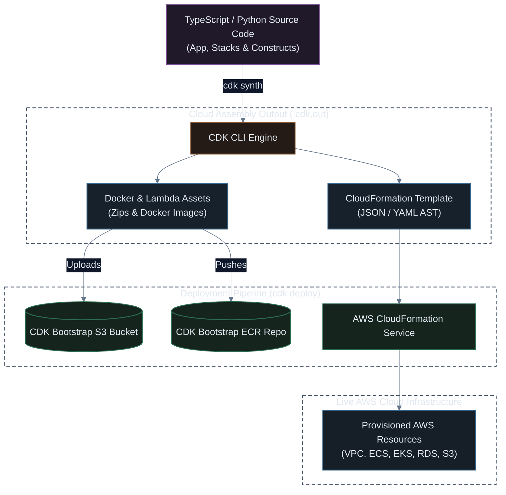

# AWS Cloud Development Kit (CDK v2): Architecture & Fundamentals Guide

[](#)
[](#)
[](#)

The **AWS Cloud Development Kit (AWS CDK v2)** is an open-source software development framework to define cloud infrastructure using modern programming languages (TypeScript, Python, Java, Go, C#). CDK synthesizes code into standard, fully compliant AWS CloudFormation templates, combining the expressive power of object-oriented code with the rock-solid provisioning engine of AWS CloudFormation.

---

## 🏗️ CDK Synthesis & Deployment Lifecycle



---

## 🧱 The 3 Construct Levels Explained

Constructs are the basic building blocks of AWS CDK applications:

| Level | Name | Description & Example |
| :---: | :--- | :--- |
| **L1** | **Cfn Primitives** | Direct 1-to-1 mappings of raw CloudFormation resource types (prefixed with `Cfn`). No defaults, every property must be explicitly declared (e.g. `s3.CfnBucket`). |
| **L2** | **AWS Curated Constructs** | AWS-designed classes with sensible security defaults, boilerplate reduction, automated IAM policy generation, and convenient helper methods (e.g. `s3.Bucket`, `vpc.addInterfaceEndpoint()`, `bucket.grantRead()`). |
| **L3** | **Solution Patterns** | Multi-resource opinionated architectures designed to achieve complete systems with minimal code (e.g. `aws-ecs-patterns.ApplicationLoadBalancedFargateService`). |

---

## 📁 Standard Project Structure (TypeScript)

```
my-cdk-project/
├── bin/
│   └── app.ts           # Entrypoint: Instantiates CDK App and attaches Stacks
├── lib/
│   └── my-stack.ts      # Core Stack logic: Defines Constructs and Resources
├── test/
│   └── my-stack.test.ts # Unit tests using @aws-cdk/assertions
├── cdk.json             # Runtime execution config and feature flags
├── package.json         # Node.js dependencies
└── tsconfig.json        # TypeScript compiler options
```

### 1. Application Entrypoint (`bin/app.ts`)
```typescript
import * as cdk from 'aws-cdk-lib';
import { CoreInfrastructureStack } from '../lib/core-infrastructure-stack';

const app = new cdk.App();

new CoreInfrastructureStack(app, 'ProdCoreInfraStack', {
  env: {
    account: process.env.CDK_DEFAULT_ACCOUNT,
    region: process.env.CDK_DEFAULT_REGION || 'us-east-1',
  },
  tags: {
    Environment: 'production',
    ManagedBy: 'AWS-CDK-v2',
  },
});

app.synth();
```

---

## ⚡ Essential CDK CLI Commands Cheat Sheet

```bash
# 1. Initialize a new CDK TypeScript project
npx cdk init app --language typescript

# 2. Bootstrap the target AWS environment (one-time setup per Account/Region)
# Provisions S3 bucket and ECR repo for asset staging
npx cdk bootstrap aws://123456789012/us-east-1

# 3. Synthesize TypeScript to raw CloudFormation JSON/YAML template
npx cdk synth

# 4. Compare live cloud state against local CDK code (Predictive Diff)
npx cdk diff

# 5. Deploy stack to AWS
npx cdk deploy --require-approval broadening

# 6. Watch mode for rapid local iteration (auto-synthesizes and deploys changes)
npx cdk watch

# 7. Destroy all resources managed by the stack
npx cdk destroy
```

---

## 🧪 Automated Unit Testing with `@aws-cdk/assertions`

CDK allows you to write actual unit tests asserting security compliance before any code reaches the cloud:

```typescript
import * as cdk from 'aws-cdk-lib';
import { Template, Match } from 'aws-cdk-lib/assertions';
import { MyStorageStack } from '../lib/my-storage-stack';

test('S3 Bucket enforces SSL and blocks all public access', () => {
  const app = new cdk.App();
  const stack = new MyStorageStack(app, 'TestStack');
  const template = Template.fromStack(stack);

  // Assert Bucket has Public Access Block completely active
  template.hasResourceProperties('AWS::S3::Bucket', {
    PublicAccessBlockConfiguration: {
      BlockPublicAcls: true,
      BlockPublicPolicy: true,
      IgnorePublicAcls: true,
      RestrictPublicBuckets: true,
    },
  });
});
```

> [!NOTE]
> Unlike pure CloudFormation or Terraform HCL, AWS CDK gives you loops, conditions, object inheritance, typed IDE auto-completion, and native npm/pip dependency management.
