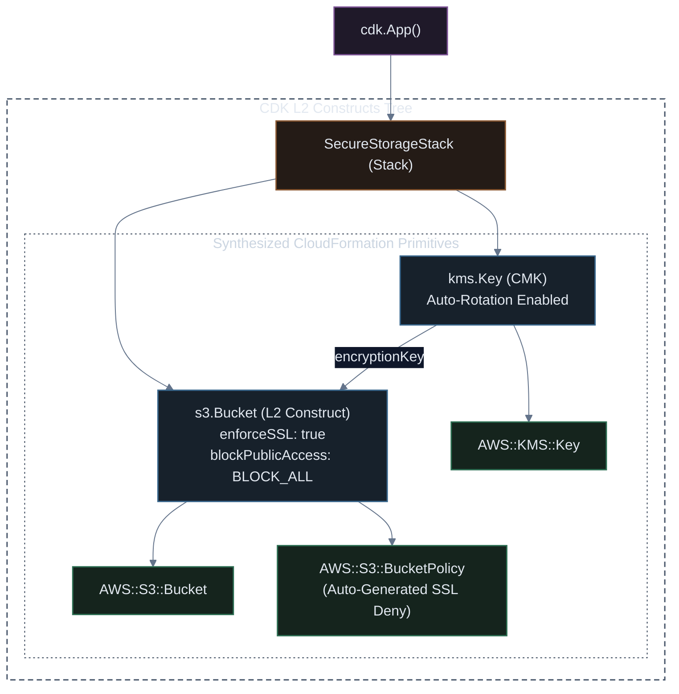

# Enterprise Amazon S3 Storage with AWS CDK (TypeScript)

[](#)
[](#)
[](#)

This guide demonstrates how to declare enterprise-grade Amazon S3 storage using AWS CDK v2 L2 Constructs in TypeScript. The stack automatically sets up automated KMS customer-managed key rotation, multi-stage lifecycle tiering, strict TLS transport policies, and CloudWatch metrics.

---

## ⚡ Sample 1: Simple Baseline CDK S3 Bucket (Minimal & Working)

Notice how AWS CDK dramatically simplifies S3 creation compared to raw CloudFormation. In CDK, a clean, versioned S3 bucket takes only a few lines:

### TypeScript (`lib/simple-bucket-stack.ts`)
```typescript
import * as cdk from 'aws-cdk-lib';
import { Construct } from 'constructs';
import * as s3 from 'aws-cdk-lib/aws-s3';

export class SimpleBucketStack extends cdk.Stack {
  public readonly bucket: s3.Bucket;

  constructor(scope: Construct, id: string, props?: cdk.StackProps) {
    super(scope, id, props);

    // Baseline L2 S3 Bucket
    this.bucket = new s3.Bucket(this, 'DemoBucket', {
      versioned: true,
      removalPolicy: cdk.RemovalPolicy.DESTROY, // Safe for dev/demos
    });

    // Output the generated bucket name
    new cdk.CfnOutput(this, 'BucketNameOutput', {
      value: this.bucket.bucketName,
      description: 'Name of the created demo bucket',
    });
  }
}
```

### 🚀 How to Run & Verify Sample 1

```bash
# 1. Preview the planned CloudFormation diff
npx cdk diff SimpleBucketStack

# 2. Deploy the simple stack
npx cdk deploy SimpleBucketStack

# 3. Test uploading a file
BUCKET_NAME=$(aws cloudformation describe-stacks \
  --stack-name SimpleBucketStack \
  --query "Stacks[0].Outputs[?OutputKey=='BucketNameOutput'].OutputValue" \
  --output text)

echo "Hello from CDK!" > hello.txt
aws s3 cp hello.txt s3://$BUCKET_NAME/hello.txt
aws s3 ls s3://$BUCKET_NAME/

# 4. Clean up
aws s3 rm s3://$BUCKET_NAME/hello.txt
npx cdk destroy SimpleBucketStack
```

---

## 🛡️ Adding the "Extra": Enterprise Hardening & KMS Encryption

For regulated enterprise production environments, we add **Customer-Managed KMS Keys (CMK)**, **automatic key rotation**, **4-tier Public Access Block**, **TLS-only transport policies**, and **automated lifecycle storage tiering**.

Below is the complete construct hierarchy:



---

## 💻 TypeScript Implementation (`lib/secure-storage-stack.ts`)

```typescript
import * as cdk from 'aws-cdk-lib';
import { Construct } from 'constructs';
import * as s3 from 'aws-cdk-lib/aws-s3';
import * as kms from 'aws-cdk-lib/aws-kms';
import * as iam from 'aws-cdk-lib/aws-iam';

export interface SecureStorageStackProps extends cdk.StackProps {
  environment: 'development' | 'staging' | 'production';
}

export class SecureStorageStack extends cdk.Stack {
  public readonly storageBucket: s3.Bucket;
  public readonly kmsKey: kms.Key;

  constructor(scope: Construct, id: string, props: SecureStorageStackProps) {
    super(scope, id, props);

    // 1. Customer Managed KMS Key with Automated Rotation
    this.kmsKey = new kms.Key(this, 'S3StorageEncryptionKey', {
      description: `Customer Managed Key for ${props.environment} S3 Bucket`,
      enableKeyRotation: true,
      removalPolicy: props.environment === 'production' 
        ? cdk.RemovalPolicy.RETAIN 
        : cdk.RemovalPolicy.DESTROY,
    });

    // Alias for human-readable KMS reference
    this.kmsKey.addAlias(`alias/enterprise-storage-${props.environment}`);

    // 2. Production Enterprise S3 Bucket
    this.storageBucket = new s3.Bucket(this, 'EnterpriseDataBucket', {
      bucketName: cdk.PhysicalName.GENERATE_IF_NEEDED, // Generates collision-proof name
      
      // Strict Security Controls
      encryption: s3.BucketEncryption.KMS,
      encryptionKey: this.kmsKey,
      bucketKeyEnabled: true, // Reduces KMS API costs by up to 99%
      enforceSSL: true,       // Injects automated Deny HTTP policy statement
      blockPublicAccess: s3.BlockPublicAccess.BLOCK_ALL,
      versioned: true,        // Required for tamper defense & ransomware recovery

      // Disaster Prevention & Deletion Protection
      removalPolicy: props.environment === 'production' 
        ? cdk.RemovalPolicy.RETAIN 
        : cdk.RemovalPolicy.DESTROY,
      autoDeleteObjects: props.environment !== 'production',

      // Automated Cost Tiering Lifecycle Rules
      lifecycleRules: [
        {
          id: 'IntelligentDataTiering',
          enabled: true,
          transitions: [
            {
              storageClass: s3.StorageClass.INFREQUENT_ACCESS,
              transitionAfter: cdk.Duration.days(30),
            },
            {
              storageClass: s3.StorageClass.GLACIER,
              transitionAfter: cdk.Duration.days(90),
            },
          ],
          noncurrentVersionTransitions: [
            {
              storageClass: s3.StorageClass.GLACIER,
              transitionAfter: cdk.Duration.days(30),
            },
          ],
          noncurrentVersionExpiration: cdk.Duration.days(180),
        },
      ],
    });

    // 3. Stack Outputs for Cross-Stack Consumption
    new cdk.CfnOutput(this, 'BucketArnOutput', {
      value: this.storageBucket.bucketArn,
      description: 'ARN of the created S3 storage bucket',
      exportName: `${this.stackName}-BucketArn`,
    });

    new cdk.CfnOutput(this, 'KmsKeyArnOutput', {
      value: this.kmsKey.keyArn,
      description: 'ARN of the KMS encryption key',
    });
  }

  /**
   * Helper method to grant an external consumer role read/write access
   */
  public grantAppAccess(grantee: iam.IGrantable): void {
    this.storageBucket.grantReadWrite(grantee);
    this.kmsKey.grantEncryptDecrypt(grantee);
  }
}
```

---

## 🧪 Unit Test Suite (`test/secure-storage-stack.test.ts`)

```typescript
import * as cdk from 'aws-cdk-lib';
import { Template, Match } from 'aws-cdk-lib/assertions';
import { SecureStorageStack } from '../lib/secure-storage-stack';

describe('SecureStorageStack Compliance', () => {
  let template: Template;

  beforeAll(() => {
    const app = new cdk.App();
    const stack = new SecureStorageStack(app, 'TestStorageStack', {
      environment: 'production',
    });
    template = Template.fromStack(stack);
  });

  test('Creates an S3 Bucket with BlockPublicAccess enabled', () => {
    template.hasResourceProperties('AWS::S3::Bucket', {
      PublicAccessBlockConfiguration: {
        BlockPublicAcls: true,
        BlockPublicPolicy: true,
        IgnorePublicAcls: true,
        RestrictPublicBuckets: true,
      },
    });
  });

  test('Enforces KMS encryption with bucketKeyEnabled', () => {
    template.hasResourceProperties('AWS::S3::Bucket', {
      BucketEncryption: {
        ServerSideEncryptionConfiguration: [
          Match.objectLike({
            BucketKeyEnabled: true,
            ServerSideEncryptionByDefault: {
              SSEAlgorithm: 'aws:kms',
            },
          }),
        ],
      },
    });
  });

  test('KMS Key has rotation enabled', () => {
    template.hasResourceProperties('AWS::KMS::Key', {
      EnableKeyRotation: true,
    });
  });
});
```

---

## 🚀 Deployment Instructions

```bash
# 1. Preview changes against target AWS account
npx cdk diff

# 2. Deploy to AWS
npx cdk deploy SecureStorageStack \
  --require-approval never

# 3. Test Jest compliance test suite
npm test
```
