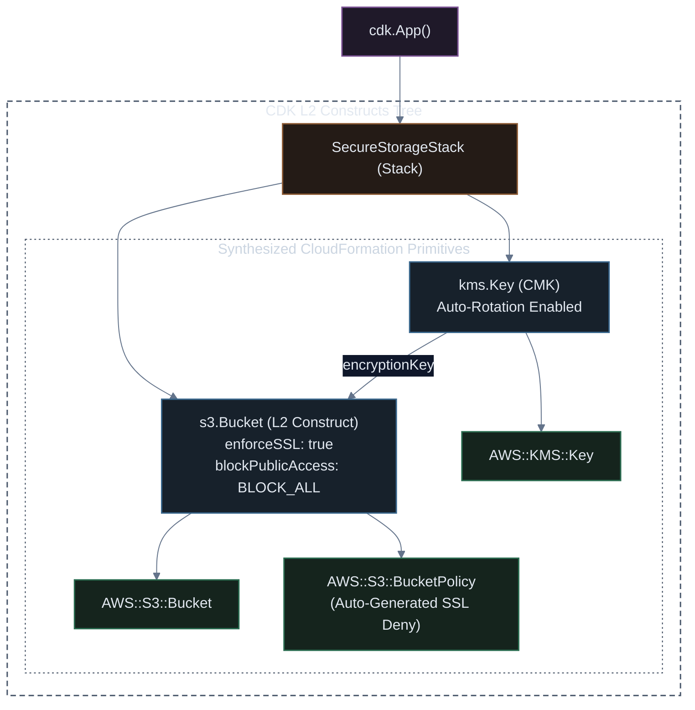

# Enterprise Amazon S3 Storage with AWS CDK & Bun.js (TypeScript)

[](#)
[](#)
[](#)
[](#)
[](#)

A practical, hands-on guide to building AWS infrastructure with **AWS CDK v2** and **Bun.js**. This guide covers project initialization using Bun, core lifecycle commands (`bootstrap`, `synth`, `deploy`, `diff`, `destroy`), followed by minimal and enterprise-grade Amazon S3 constructs.

---

## ⚡ 1. Getting Started: CDK with Bun.js

### 1.1 Why use Bun with AWS CDK?
* **Instant Startup:** Standard CDK uses `ts-node` which takes 3–5 seconds just to compile TypeScript before synthesis. Bun executes TypeScript natively in under **100ms**.
* **Blazing Fast Installs:** `bun install` installs CDK packages up to 20x faster than npm.
* **Built-in Test Runner:** Run compliance and unit tests instantly using `bun test` without Jest configuration friction.

---

### 1.2 Initialize a New CDK Project

> [!IMPORTANT]
> `cdk init` requires an **empty directory** to run.

```bash
# 1. Create a project directory and navigate into it
mkdir my-s3-cdk && cd my-s3-cdk

# 2. Initialize a fresh TypeScript CDK application
bunx cdk init app --language typescript

# 3. Install dependencies using Bun
bun install
```

---

### 1.3 Supercharge CDK with Bun (Crucial Speedup)

By default, CDK configures `cdk.json` to execute via `ts-node`. Switch it to **Bun** for instant synthesis:

Open `cdk.json` and replace the `"app"` property:

```json
{
  "app": "bun run bin/my-s3-cdk.ts",
  "watch": {
    "include": ["**"],
    "exclude": ["README.md", "cdk*.json", "**/*.d.ts", "**/*.js", "tsconfig.json", "package*.json", "yarn.lock", "node_modules", "test"]
  },
  "context": {
    "@aws-cdk/core:stackRelativeExports": true
  }
}
```

---

### 1.4 Step 1: Bootstrap AWS Environment (`cdk bootstrap`)

Before deploying stacks for the first time in an AWS account and region, you must **bootstrap** the environment. This creates an S3 bucket and IAM roles used by CDK to store CloudFormation templates and deployment assets:

```bash
bunx cdk bootstrap
```

*Expected output:*
```text
 ⏳  Bootstrapping environment aws://123456789012/ap-southeast-2...
CDKToolkit: creating CloudFormation changeset...
 ✅  Environment aws://123456789012/ap-southeast-2 bootstrapped.
```

---

### 1.5 Step 2: Write Initial Stack Code (`lib/my-s3-cdk-stack.ts`)

Open `lib/my-s3-cdk-stack.ts` and add a baseline S3 bucket:

```typescript
import * as cdk from 'aws-cdk-lib';
import { Construct } from 'constructs';
import * as s3 from 'aws-cdk-lib/aws-s3';

export class MyS3CdkStack extends cdk.Stack {
  public readonly bucket: s3.Bucket;

  constructor(scope: Construct, id: string, props?: cdk.StackProps) {
    super(scope, id, props);

    // Initial baseline S3 bucket
    this.bucket = new s3.Bucket(this, 'MyDemoBucket', {
      removalPolicy: cdk.RemovalPolicy.DESTROY,
      autoDeleteObjects: true,
    });

    // Output bucket name for testing
    new cdk.CfnOutput(this, 'BucketName', {
      value: this.bucket.bucketName,
    });
  }
}
```

---

### 1.6 Step 3: Synthesize CloudFormation (`cdk synth`)

`cdk synth` executes your TypeScript code and generates the synthesized CloudFormation JSON/YAML template without making any changes in AWS:

```bash
bunx cdk synth
```

*Expected output:* Prints the generated CloudFormation template to the terminal and writes it to `.cdk.out/MyS3CdkStack.template.json`.

---

### 1.7 Step 4: Deploy the Stack (`cdk deploy`)

Deploy your stack to live AWS infrastructure:

```bash
bunx cdk deploy
```

Press `y` when prompted to approve changes, or skip prompts using `--require-approval never`:

```bash
bunx cdk deploy --require-approval never
```

*Expected output:*
```text
MyS3CdkStack: deploying...
 ✅  MyS3CdkStack

Outputs:
MyS3CdkStack.BucketName = mys3cdkstack-mydemobucket1234abcd-apsoutheast2
```

---

### 1.8 Step 5: Update Code & Inspect with `cdk diff` (Update Example)

`cdk diff` compares your local code against the currently deployed CloudFormation stack (similar to `git diff`).

Let's make a real change! Open `lib/my-s3-cdk-stack.ts` and update your bucket to enable **versioning**, add a **lifecycle rule**, and attach a **tag**:

```typescript
    // Updated bucket: Enabled versioning & added lifecycle expiration
    this.bucket = new s3.Bucket(this, 'MyDemoBucket', {
      versioned: true, // <-- NEW
      removalPolicy: cdk.RemovalPolicy.DESTROY,
      autoDeleteObjects: true,
      lifecycleRules: [ // <-- NEW
        {
          expiration: cdk.Duration.days(30),
        },
      ],
    });

    // Add resource tag
    cdk.Tags.of(this.bucket).add('Environment', 'Development'); // <-- NEW
```

Now run **`cdk diff`**:

```bash
bunx cdk diff
```

*Output shows the exact planned updates:*
```text
Stack MyS3CdkStack
Resources
[~] AWS::S3::Bucket MyDemoBucket MyDemoBucket1234ABCD 
 ├─ [+] LifecycleConfiguration
 │   └─ Rules: [{"ExpirationInDays":30,"Status":"Enabled"}]
 ├─ [~] VersioningConfiguration
 │   └─ [~] .Status:
 │       ├─ [-] Suspended
 │       └─ [+] Enabled
 └─ [+] Tags
     └─ [{"Key":"Environment","Value":"Development"}]
```

Apply the update cleanly:

```bash
bunx cdk deploy
```

---

### 1.9 Step 6: Clean Up & Teardown (`cdk destroy`)

When you are finished testing, delete all created resources to prevent recurring AWS charges:

```bash
bunx cdk destroy
```
Type `y` to confirm deletion. All resources declared in the stack will be removed.

---

## ⚡ 2. Simple Baseline CDK S3 Bucket (Minimal & Working)

In CDK, a clean, versioned S3 bucket takes only a few lines:

### TypeScript (`lib/simple-bucket-stack.ts`)
```typescript
import * as cdk from 'aws-cdk-lib';
import { Construct } from 'constructs';
import * as s3 from 'aws-cdk-lib/aws-s3';

export class SimpleBucketStack extends cdk.Stack {
  public readonly bucket: s3.Bucket;

  constructor(scope: Construct, id: string, props?: cdk.StackProps) {
    super(scope, id, props);

    // Baseline L2 S3 Bucket
    this.bucket = new s3.Bucket(this, 'DemoBucket', {
      versioned: true,
      removalPolicy: cdk.RemovalPolicy.DESTROY, // Safe for dev/demos
    });

    // Output the generated bucket name
    new cdk.CfnOutput(this, 'BucketNameOutput', {
      value: this.bucket.bucketName,
      description: 'Name of the created demo bucket',
    });
  }
}
```

---

## 🛡️ 3. Enterprise Hardening & KMS Encryption

For regulated enterprise production environments, we add **Customer-Managed KMS Keys (CMK)**, **automatic key rotation**, **4-tier Public Access Block**, **TLS-only transport policies**, and **automated lifecycle storage tiering**.

Below is the complete construct hierarchy:



---

## 💻 4. TypeScript Implementation (`lib/secure-storage-stack.ts`)

```typescript
import * as cdk from 'aws-cdk-lib';
import { Construct } from 'constructs';
import * as s3 from 'aws-cdk-lib/aws-s3';
import * as kms from 'aws-cdk-lib/aws-kms';
import * as iam from 'aws-cdk-lib/aws-iam';

export interface SecureStorageStackProps extends cdk.StackProps {
  environment: 'development' | 'staging' | 'production';
}

export class SecureStorageStack extends cdk.Stack {
  public readonly storageBucket: s3.Bucket;
  public readonly kmsKey: kms.Key;

  constructor(scope: Construct, id: string, props: SecureStorageStackProps) {
    super(scope, id, props);

    // 1. Customer Managed KMS Key with Automated Rotation
    this.kmsKey = new kms.Key(this, 'S3StorageEncryptionKey', {
      description: `Customer Managed Key for ${props.environment} S3 Bucket`,
      enableKeyRotation: true,
      removalPolicy: props.environment === 'production' 
        ? cdk.RemovalPolicy.RETAIN 
        : cdk.RemovalPolicy.DESTROY,
    });

    // Alias for human-readable KMS reference
    this.kmsKey.addAlias(`alias/enterprise-storage-${props.environment}`);

    // 2. Production Enterprise S3 Bucket
    this.storageBucket = new s3.Bucket(this, 'EnterpriseDataBucket', {
      bucketName: cdk.PhysicalName.GENERATE_IF_NEEDED, // Generates collision-proof name
      
      // Strict Security Controls
      encryption: s3.BucketEncryption.KMS,
      encryptionKey: this.kmsKey,
      bucketKeyEnabled: true, // Reduces KMS API costs by up to 99%
      enforceSSL: true,       // Injects automated Deny HTTP policy statement
      blockPublicAccess: s3.BlockPublicAccess.BLOCK_ALL,
      versioned: true,        // Required for tamper defense & ransomware recovery

      // Disaster Prevention & Deletion Protection
      removalPolicy: props.environment === 'production' 
        ? cdk.RemovalPolicy.RETAIN 
        : cdk.RemovalPolicy.DESTROY,
      autoDeleteObjects: props.environment !== 'production',

      // Automated Cost Tiering Lifecycle Rules
      lifecycleRules: [
        {
          id: 'IntelligentDataTiering',
          enabled: true,
          transitions: [
            {
              storageClass: s3.StorageClass.INFREQUENT_ACCESS,
              transitionAfter: cdk.Duration.days(30),
            },
            {
              storageClass: s3.StorageClass.GLACIER,
              transitionAfter: cdk.Duration.days(90),
            },
          ],
          noncurrentVersionTransitions: [
            {
              storageClass: s3.StorageClass.GLACIER,
              transitionAfter: cdk.Duration.days(30),
            },
          ],
          noncurrentVersionExpiration: cdk.Duration.days(180),
        },
      ],
    });

    // 3. Stack Outputs for Cross-Stack Consumption
    new cdk.CfnOutput(this, 'BucketArnOutput', {
      value: this.storageBucket.bucketArn,
      description: 'ARN of the created S3 storage bucket',
      exportName: `${this.stackName}-BucketArn`,
    });

    new cdk.CfnOutput(this, 'KmsKeyArnOutput', {
      value: this.kmsKey.keyArn,
      description: 'ARN of the KMS encryption key',
    });
  }

  /**
   * Helper method to grant an external consumer role read/write access
   */
  public grantAppAccess(grantee: iam.IGrantable): void {
    this.storageBucket.grantReadWrite(grantee);
    this.kmsKey.grantEncryptDecrypt(grantee);
  }
}
```

---

## 🧪 5. Unit Test Suite with Bun Test (`test/secure-storage-stack.test.ts`)

Bun provides a built-in test runner fully compatible with `@aws-cdk/assertions`:

```typescript
import * as cdk from 'aws-cdk-lib';
import { Template, Match } from 'aws-cdk-lib/assertions';
import { describe, test } from 'bun:test';
import { SecureStorageStack } from '../lib/secure-storage-stack';

describe('SecureStorageStack Compliance', () => {
  const app = new cdk.App();
  const stack = new SecureStorageStack(app, 'TestStorageStack', {
    environment: 'production',
  });
  const template = Template.fromStack(stack);

  test('Creates an S3 Bucket with BlockPublicAccess enabled', () => {
    template.hasResourceProperties('AWS::S3::Bucket', {
      PublicAccessBlockConfiguration: {
        BlockPublicAcls: true,
        BlockPublicPolicy: true,
        IgnorePublicAcls: true,
        RestrictPublicBuckets: true,
      },
    });
  });

  test('Enforces KMS encryption with bucketKeyEnabled', () => {
    template.hasResourceProperties('AWS::S3::Bucket', {
      BucketEncryption: {
        ServerSideEncryptionConfiguration: [
          Match.objectLike({
            BucketKeyEnabled: true,
            ServerSideEncryptionByDefault: {
              SSEAlgorithm: 'aws:kms',
            },
          }),
        ],
      },
    });
  });

  test('KMS Key has rotation enabled', () => {
    template.hasResourceProperties('AWS::KMS::Key', {
      EnableKeyRotation: true,
    });
  });
});
```

Execute tests using Bun:
```bash
bun test
```

---

## 📌 6. CDK + Bun CLI Quick Reference Card

| Goal | Bun Command | Description |
| :--- | :--- | :--- |
| **Initialize App** | `bunx cdk init app --language typescript` | Scaffolds a new TypeScript CDK project in an empty folder. |
| **Install Packages** | `bun install` / `bun add <pkg>` | Ultra-fast dependency installation. |
| **Bootstrap Account** | `bunx cdk bootstrap` | Provisions S3 bucket and IAM roles required for CDK assets. |
| **Synthesize** | `bunx cdk synth` | Compiles `.ts` and outputs the CloudFormation template (`.cdk.out`). |
| **Preview Changes** | `bunx cdk diff` | Compares local code changes against the deployed stack in AWS. |
| **Deploy Stack** | `bunx cdk deploy` | Creates or updates resources in your AWS account. |
| **Deploy No Prompt** | `bunx cdk deploy --require-approval never` | Deploys without interactive confirmation prompts. |
| **Run Unit Tests** | `bun test` | Runs assertions and unit tests using Bun's native test runner. |
| **Destroy Resources** | `bunx cdk destroy` | Deletes all provisioned stack resources cleanly. |
