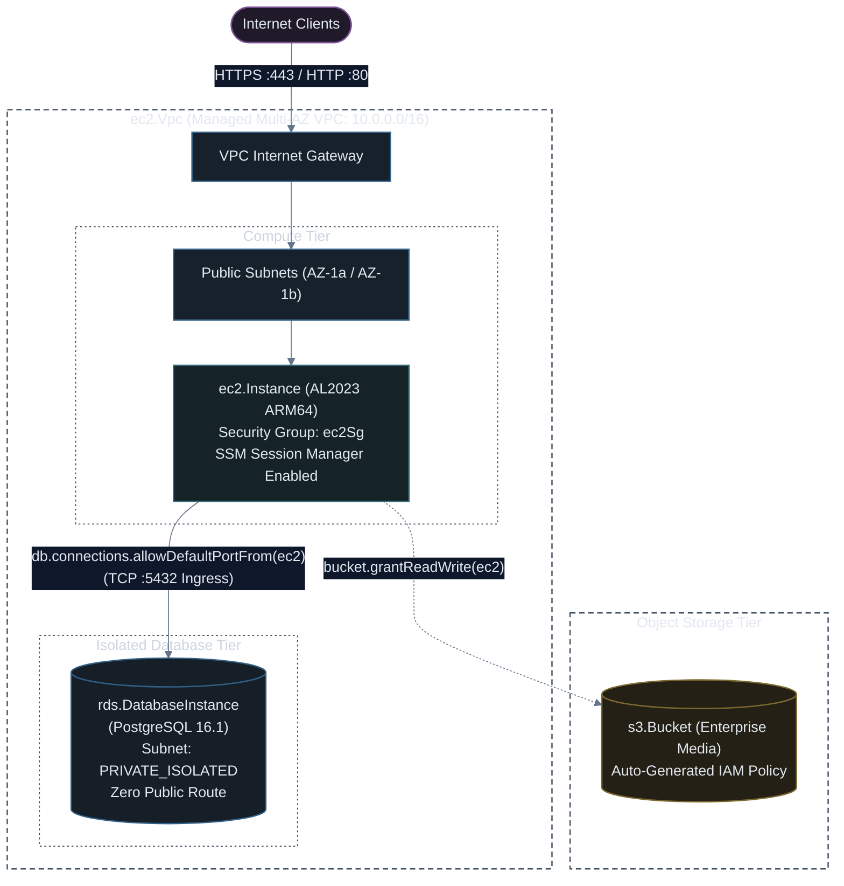

# Multi-Tier Infrastructure (VPC + EC2 + S3 + RDS) with AWS CDK (TypeScript)

[](#)
[](#)
[](#)

This guide demonstrates how to architect and provision a complete production-grade 3-tier web architecture using **AWS CDK v2 (TypeScript)**. It leverages CDK's high-level L2 constructs to handle complex networking, automated IAM policy generation (`grant` methods), and bidirectional security group rule chaining with zero manual boilerplate.

---

## ⚡ Sample 1: Baseline EC2 + S3 Stack (Minimal & Working)

Before managing custom multi-AZ subnets and database clusters, here is the simplest working sample in AWS CDK. It creates an S3 bucket, provisions an EC2 instance in your default VPC, and wires up IAM permissions in a single line of code (`bucket.grantReadWrite(instance)`):

### TypeScript (`lib/simple-ec2-s3-stack.ts`)
```typescript
import * as cdk from 'aws-cdk-lib';
import { Construct } from 'constructs';
import * as ec2 from 'aws-cdk-lib/aws-ec2';
import * as s3 from 'aws-cdk-lib/aws-s3';

export class SimpleEc2S3Stack extends cdk.Stack {
  constructor(scope: Construct, id: string, props?: cdk.StackProps) {
    super(scope, id, props);

    // 1. Look up existing default VPC
    const vpc = ec2.Vpc.fromLookup(this, 'DefaultVpc', { isDefault: true });

    // 2. Simple S3 Bucket
    const bucket = new s3.Bucket(this, 'AppBucket', {
      removalPolicy: cdk.RemovalPolicy.DESTROY,
    });

    // 3. Simple Web EC2 Instance (Graviton ARM64)
    const instance = new ec2.Instance(this, 'SimpleWebInstance', {
      vpc,
      instanceType: ec2.InstanceType.of(ec2.InstanceClass.T4G, ec2.InstanceSize.NANO),
      machineImage: ec2.MachineImage.latestAmazonLinux2023({
        cpuType: ec2.AmazonLinuxCpuType.ARM_64,
      }),
    });

    // CDK Grant Helper: Automatically generates and attaches the IAM policy!
    bucket.grantReadWrite(instance);

    new cdk.CfnOutput(this, 'InstancePublicIp', { value: instance.instancePublicIp });
    new cdk.CfnOutput(this, 'BucketName', { value: bucket.bucketName });
  }
}
```

### 🚀 How to Run & Verify Sample 1

```bash
# 1. Preview planned resources
npx cdk diff SimpleEc2S3Stack

# 2. Deploy sample stack
npx cdk deploy SimpleEc2S3Stack

# 3. Clean up
npx cdk destroy SimpleEc2S3Stack
```

---

## 🏗️ Adding the "Extra": Full 3-Tier Production Architecture (Custom Multi-AZ VPC + Private RDS)

In enterprise production environments, relying on default VPCs is forbidden. Production requires an isolated custom VPC, public DMZ subnets, private isolated database subnets, auto-scaling RDS PostgreSQL, and zero open SSH ports.

Below is the complete 3-tier enterprise architecture:



---

## 💻 Complete CDK TypeScript Stack (`lib/multi-tier-stack.ts`)

```typescript
import * as cdk from 'aws-cdk-lib';
import { Construct } from 'constructs';
import * as ec2 from 'aws-cdk-lib/aws-ec2';
import * as s3 from 'aws-cdk-lib/aws-s3';
import * as rds from 'aws-cdk-lib/aws-rds';
import * as iam from 'aws-cdk-lib/aws-iam';

export class MultiTierStack extends cdk.Stack {
  constructor(scope: Construct, id: string, props?: cdk.StackProps) {
    super(scope, id, props);

    // =========================================================================
    // 1. MANAGED MULTI-AZ VPC
    // =========================================================================
    // CDK automatically provisions Internet Gateways, Route Tables, and Subnet groups
    const vpc = new ec2.Vpc(this, 'ProductionVpc', {
      ipAddresses: ec2.IpAddresses.cidr('10.0.0.0/16'),
      maxAzs: 2,
      natGateways: 0, // Zero NAT Gateway idle cost; isolated DB does not require outbound internet
      subnetConfiguration: [
        {
          name: 'PublicWeb',
          subnetType: ec2.SubnetType.PUBLIC,
          cidrMask: 24,
        },
        {
          name: 'IsolatedDatabase',
          subnetType: ec2.SubnetType.PRIVATE_ISOLATED,
          cidrMask: 24,
        },
      ],
    });

    // =========================================================================
    // 2. S3 STORAGE BUCKET
    // =========================================================================
    const mediaBucket = new s3.Bucket(this, 'AppMediaBucket', {
      enforceSSL: true,
      blockPublicAccess: s3.BlockPublicAccess.BLOCK_ALL,
      encryption: s3.BucketEncryption.S3_MANAGED,
      versioned: true,
      removalPolicy: cdk.RemovalPolicy.RETAIN,
    });

    // =========================================================================
    // 3. COMPUTE TIER: EC2 WEB SERVER
    // =========================================================================
    // Web Security Group
    const webSecurityGroup = new ec2.SecurityGroup(this, 'WebSecurityGroup', {
      vpc,
      description: 'Allow inbound HTTP/HTTPS traffic to Web Instance',
      allowAllOutbound: true,
    });
    webSecurityGroup.addIngressRule(ec2.Peer.anyIpv4(), ec2.Port.tcp(80), 'Allow HTTP from anywhere');
    webSecurityGroup.addIngressRule(ec2.Peer.anyIpv4(), ec2.Port.tcp(443), 'Allow HTTPS from anywhere');

    // EC2 Instance (Graviton ARM64)
    const ec2Instance = new ec2.Instance(this, 'WebInstance', {
      vpc,
      vpcSubnets: { subnetType: ec2.SubnetType.PUBLIC },
      instanceType: ec2.InstanceType.of(ec2.InstanceClass.T4G, ec2.InstanceSize.SMALL),
      machineImage: ec2.MachineImage.latestAmazonLinux2023({
        cpuType: ec2.AmazonLinuxCpuType.ARM_64,
      }),
      securityGroup: webSecurityGroup,
      associatePublicIpAddress: true,
    });

    // IAM Role: Grant SSM Session Manager access (eliminates SSH key pairs and open port 22)
    ec2Instance.role.addManagedPolicy(
      iam.ManagedPolicy.fromAwsManagedPolicyName('AmazonSSMManagedInstanceCore')
    );

    // CDK Grant Helper: Automatically generates least-privilege IAM policy and attaches to EC2 role!
    mediaBucket.grantReadWrite(ec2Instance);

    // =========================================================================
    // 4. DATABASE TIER: RDS POSTGRESQL
    // =========================================================================
    const database = new rds.DatabaseInstance(this, 'PostgresDatabase', {
      engine: rds.DatabaseInstanceEngine.postgres({
        version: rds.PostgresEngineVersion.VER_16_1,
      }),
      instanceType: ec2.InstanceType.of(ec2.InstanceClass.T4G, ec2.InstanceSize.MICRO),
      vpc,
      vpcSubnets: { subnetType: ec2.SubnetType.PRIVATE_ISOLATED },
      allocatedStorage: 20,
      maxAllocatedStorage: 100, // Enables storage auto-scaling
      databaseName: 'productiondb',
      publiclyAccessible: false,
      multiAz: false,
      deletionProtection: false, // Set true for production enterprise
      removalPolicy: cdk.RemovalPolicy.SNAPSHOT,
    });

    // CDK Connections API: One-line bidirectional security group chaining!
    // Adds ingress rule to RDS SG referencing Web SG on port 5432
    database.connections.allowDefaultPortFrom(
      ec2Instance,
      'Allow PostgreSQL connections strictly from Web EC2 instance'
    );

    // UserData startup script bootstrapping Nginx
    ec2Instance.userData.addCommands(
      'dnf update -y',
      'dnf install -y nginx postgresql15',
      'systemctl enable nginx',
      'systemctl start nginx',
      `echo "<h1>Production CDK Stack Online</h1><p>DB Host: ${database.dbInstanceEndpointAddress}</p><p>S3 Bucket: ${mediaBucket.bucketName}</p>" > /usr/share/nginx/html/index.html`
    );

    // =========================================================================
    // 5. STACK OUTPUTS
    // =========================================================================
    new cdk.CfnOutput(this, 'WebServerPublicIpOutput', {
      value: ec2Instance.instancePublicIp,
      description: 'Web Server Public IP address',
    });

    new cdk.CfnOutput(this, 'DatabaseEndpointOutput', {
      value: database.dbInstanceEndpointAddress,
      description: 'Private RDS PostgreSQL Endpoint',
    });

    new cdk.CfnOutput(this, 'MediaBucketOutput', {
      value: mediaBucket.bucketName,
      description: 'Application S3 Bucket Name',
    });
  }
}
```

---

## 🚀 Deployment & Inspection Workflow

```bash
# 1. Synthesize template and inspect generated CloudFormation
npx cdk synth

# 2. View resource diff (Shows security group rules and IAM grants)
npx cdk diff

# 3. Deploy entire stack
npx cdk deploy MultiTierStack --require-approval broadening

# 4. Connect to Web Server securely via AWS Systems Manager (No SSH key needed!)
aws ssm start-session --target $(aws cloudformation describe-stacks \
  --stack-name MultiTierStack \
  --query "Stacks[0].Outputs[?OutputKey=='WebServerPublicIpOutput'].OutputValue" \
  --output text)
```

> [!TIP]
> Notice the power of the CDK `connections` API:
> `database.connections.allowDefaultPortFrom(ec2Instance)`
> You never need to hardcode port `5432`, inspect subnet IDs, or manually cross-reference Security Group IDs. CDK resolves the ports, protocols, and security group references dynamically at synthesis time.
