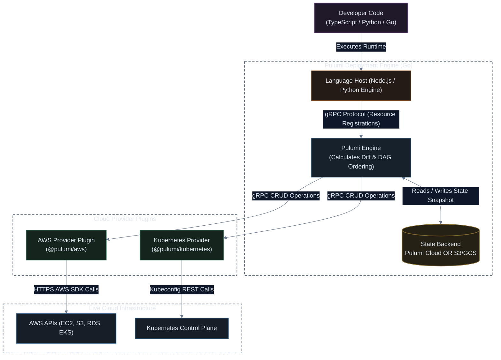

# Pulumi: Architecture, State Management & Fundamentals Guide

[](#)
[](#)
[](#)

**Pulumi** is an open-source, modern Infrastructure as Code platform that allows you to author infrastructure using standard, general-purpose programming languages (TypeScript, Python, Go, C#, Java) while orchestrating real-world cloud APIs using a high-performance declarative deployment engine.

---

## 🏗️ Pulumi Engine Architecture & Execution Flow



---

## ⚖️ IaC Architectural Comparison

| Dimension | AWS CloudFormation | AWS CDK (v2) | HashiCorp Terraform | Pulumi |
| :--- | :--- | :--- | :--- | :--- |
| **Language** | JSON / YAML (DSL) | TypeScript, Python, Go | HCL (DSL) | TypeScript, Python, Go, C# |
| **Execution Engine** | Managed AWS Engine | Synthesizes to CloudFormation | Terraform Engine (Go) | Pulumi Engine (Go) |
| **Cloud Scope** | AWS native only | Synthesizes to AWS CFN | Multi-Cloud | Multi-Cloud |
| **State Storage** | Managed by AWS internally | Managed by AWS internally | S3 / Terraform Cloud | Pulumi Cloud OR S3 / GCS |
| **Secret Management** | Parameter Store / Secrets Mgr | Parameter Store / Secrets Mgr | State is plaintext by default | **First-class envelope encryption** |
| **Speed & Feedback** | CloudFormation queue latency | CloudFormation deploy latency | Fast Direct API calls | **Ultra-Fast Direct API calls** |

---

## 🔑 Core Concepts & Programming Model

### 1. Stacks & Environments
A **Stack** is an isolated, independently configurable instance of your Pulumi program (e.g., `dev`, `staging`, `prod`). Each stack maintains its own distinct state file and configuration.

### 2. Inputs & Outputs (`Output<T>`)
Because cloud resources are provisioned asynchronously, resource attributes are wrapped in `pulumi.Output<T>` types (similar to a JavaScript Promise, but representing values that might only resolve once the cloud API responds).

To combine outputs, Pulumi provides `pulumi.interpolate`:
```typescript
import * as pulumi from "@pulumi/pulumi";
import * as aws from "@pulumi/aws";

const bucket = new aws.s3.BucketV2("my-bucket");

// pulumi.interpolate resolves async Outputs inside template strings cleanly
export const bucketUrl = pulumi.interpolate`https://${bucket.bucketDomainName}`;
```

### 3. Built-In Secrets Encryption
Pulumi encrypts secrets before saving them to the state file:
```bash
# Encrypts the database password using AES-256 GCM or AWS KMS
pulumi config set --secret dbPassword "SuperSecretDatabasePassword123!"
```
In code:
```typescript
const config = new pulumi.Config();
const dbPassword = config.requireSecret("dbPassword"); // Type: Output<string>, automatically redacted in logs!
```

---

## 📁 Standard Project Structure (TypeScript)

```
my-pulumi-project/
├── Pulumi.yaml          # Project metadata and language declaration
├── Pulumi.dev.yaml      # Configuration and encrypted secrets for 'dev' stack
├── Pulumi.prod.yaml     # Configuration and encrypted secrets for 'prod' stack
├── index.ts             # Main infrastructure program entrypoint
├── package.json         # Node.js dependencies (@pulumi/pulumi, @pulumi/aws)
└── tsconfig.json        # TypeScript configuration
```

---

## ⚡ Essential Pulumi CLI Commands Cheat Sheet

```bash
# 1. Create a new Pulumi project from a template
pulumi new aws-typescript

# 2. Select or create an environment stack
pulumi stack init staging
pulumi stack select production

# 3. Preview planned changes without applying (Dry-Run)
pulumi preview

# 4. Deploy infrastructure changes to the cloud
pulumi up --yes

# 5. Inspect current stack state outputs
pulumi stack output

# 6. Synchronize Pulumi state with actual real-world cloud state (Refresh)
pulumi refresh

# 7. Teardown and destroy all resources managed by the stack
pulumi destroy
```

> [!TIP]
> **Self-Managed Backend**: If you do not want to use Pulumi Cloud, you can store your state entirely inside your own AWS S3 bucket:
> `pulumi login s3://my-company-pulumi-state-bucket`
