# Provisioning Enterprise Amazon S3 Storage with Pulumi (TypeScript)

[](#)
[](#)
[](#)

This guide walks through declaring a hardened, enterprise-ready Amazon S3 bucket using **Pulumi with TypeScript** and modern `@pulumi/aws` V2 modular resources. The implementation features Customer-Managed KMS Key encryption, 100% public access blocking, versioning, automated multi-tier lifecycle rules, and an SSL-enforcing bucket policy.

---

## ⚡ Sample 1: Simple Baseline Pulumi S3 Bucket (Minimal & Working)

In Pulumi, creating a functional, fully managed S3 bucket takes only 3 lines of TypeScript:

### TypeScript (`index.ts`)
```typescript
import * as aws from "@pulumi/aws";

// 1. Create a baseline Amazon S3 Bucket (V2 API)
const bucket = new aws.s3.BucketV2("demo-simple-bucket", {
  forceDestroy: true, // Enables clean teardown for test buckets
});

// 2. Export stack outputs
export const bucketId = bucket.id;
export const bucketDomain = bucket.bucketRegionalDomainName;
```

### 🚀 How to Run & Verify Sample 1

```bash
# 1. Preview changes
pulumi preview

# 2. Deploy bucket to AWS
pulumi up --yes

# 3. Test uploading a file
BUCKET_ID=$(pulumi stack output bucketId)
echo "Hello from Pulumi S3!" > hello.txt
aws s3 cp hello.txt s3://$BUCKET_ID/hello.txt
aws s3 ls s3://$BUCKET_ID/

# 4. Clean up test file and destroy bucket
aws s3 rm s3://$BUCKET_ID/hello.txt
pulumi destroy --yes
```

---

## 🛡️ Adding the "Extra": Enterprise Hardening & Modular Architecture

The baseline bucket in Sample 1 lacks encryption key ownership, automated lifecycle tiering, public access blocking, and TLS transport policies.

Modern `@pulumi/aws` uses a **modular architecture** where security and lifecycle features are attached as separate, independent cloud resources.

Below is the complete resource dependency graph:

```mermaid
%%{init: {
  'theme': 'base',
  'themeVariables': {
    'darkMode': true,
    'background': '#0f172a',
    'primaryColor': '#1e293b',
    'primaryTextColor': '#e2e8f0',
    'primaryBorderColor': '#475569',
    'lineColor': '#64748b',
    'textColor': '#e2e8f0',
    'edgeLabelBackground': '#0f172a'
  },
  'themeCSS': '* { filter: none !important; box-shadow: none !important; } .node * { filter: none !important; } .cluster * { filter: none !important; }'
}}%%
graph TD
    KMS["aws.kms.Key<br/>(Server-Side Encryption CMK)"] --> SSE["aws.s3.BucketServerSideEncryptionConfigurationV2"]

    subgraph S3SecurityEnsemble["Enterprise S3 Resource Modular Suite"]
        Bucket["aws.s3.BucketV2<br/>(Core Physical Storage Entity)"]
        
        Bucket --> SSE
        Bucket --> PAB["aws.s3.BucketPublicAccessBlock<br/>(blockPublicAcls: true, etc.)"]
        Bucket --> Versioning["aws.s3.BucketVersioningV2<br/>(Status: Enabled)"]
        Bucket --> Lifecycle["aws.s3.BucketLifecycleConfigurationV2<br/>(Standard-IA & Glacier Transitions)"]
        Bucket --> Policy["aws.s3.BucketPolicy<br/>(Deny Insecure HTTP / TLS < 1.2)"]
    end

    %% Container Boundaries
    style S3SecurityEnsemble fill:none,stroke:#475569,stroke-width:1.5px,stroke-dasharray: 6 4,color:#e2e8f0;

    %% Component Classes
    classDef cKMS fill:#252115,stroke:#8a7030,stroke-width:1.5px,color:#e2e8f0;
    classDef cBucket fill:#242015,stroke:#7d6830,stroke-width:1.5px,color:#e2e8f0;
    classDef cSec fill:#17212b,stroke:#38668c,stroke-width:1.5px,color:#e2e8f0;
    classDef cLifecycle fill:#161f28,stroke:#325f85,stroke-width:1.5px,color:#e2e8f0;

    class KMS cKMS;
    class Bucket cBucket;
    class SSE,PAB,Policy cSec;
    class Versioning,Lifecycle cLifecycle;
```



---

## 💻 Complete Pulumi TypeScript Program (`index.ts`)

```typescript
import * as pulumi from "@pulumi/pulumi";
import * as aws from "@pulumi/aws";

// 1. Read Stack Configuration
const config = new pulumi.Config();
const environment = config.get("environment") || "production";
const current = aws.getCallerIdentity({});
const region = aws.getRegion({});

// 2. Provision KMS Customer Managed Key for S3 Encryption
const s3KmsKey = new aws.kms.Key("enterprise-s3-kms-key", {
  description: `KMS Customer Managed Key for ${environment} S3 Bucket`,
  enableKeyRotation: true,
  deletionWindowInDays: 30,
  tags: {
    Environment: environment,
    ManagedBy: "Pulumi",
  },
});

const s3KmsKeyAlias = new aws.kms.Alias("enterprise-s3-kms-alias", {
  name: `alias/s3-storage-${environment}`,
  targetKeyId: s3KmsKey.keyId,
});

// 3. Core S3 Bucket (V2 Architecture)
const storageBucket = new aws.s3.BucketV2("enterpriseStorageBucket", {
  bucketPrefix: `corp-assets-${environment}-`,
  forceDestroy: environment !== "production", // Protect production from accidental deletion
  tags: {
    Environment: environment,
    Compliance: "SOC2-HIPAA",
    ManagedBy: "Pulumi",
  },
});

// 4. Server-Side Encryption Configuration with KMS & Bucket Key
const bucketEncryption = new aws.s3.BucketServerSideEncryptionConfigurationV2("bucketEncryption", {
  bucket: storageBucket.id,
  rules: [{
    applyServerSideEncryptionByDefault: {
      kmsMasterKeyId: s3KmsKey.arn,
      sseAlgorithm: "aws:kms",
    },
    bucketKeyEnabled: true, // Reduces KMS API request costs by 99%
  }],
});

// 5. Four-Tier Public Access Block
const bucketPublicAccessBlock = new aws.s3.BucketPublicAccessBlock("bucketPublicAccessBlock", {
  bucket: storageBucket.id,
  blockPublicAcls: true,
  blockPublicPolicy: true,
  ignorePublicAcls: true,
  restrictPublicBuckets: true,
});

// 6. Bucket Versioning
const bucketVersioning = new aws.s3.BucketVersioningV2("bucketVersioning", {
  bucket: storageBucket.id,
  versioningConfiguration: {
    status: "Enabled",
  },
});

// 7. Cost Optimization Lifecycle Configuration
const bucketLifecycle = new aws.s3.BucketLifecycleConfigurationV2("bucketLifecycle", {
  bucket: storageBucket.id,
  rules: [{
    id: "TieringAndExpirationRule",
    status: "Enabled",
    transitions: [
      {
        days: 30,
        storageClass: "STANDARD_IA",
      },
      {
        days: 90,
        storageClass: "GLACIER",
      },
    ],
    noncurrentVersionTransitions: [
      {
        noncurrentDays: 30,
        storageClass: "GLACIER",
      },
    ],
    noncurrentVersionExpiration: {
      noncurrentDays: 180,
    },
  }],
});

// 8. Bucket Policy Enforcing TLS Transport
const enforceTlsPolicy = new aws.s3.BucketPolicy("enforceTlsPolicy", {
  bucket: storageBucket.id,
  policy: pulumi.all([storageBucket.arn]).apply(([bucketArn]) => JSON.stringify({
    Version: "2012-10-17",
    Statement: [
      {
        Sid: "DenyInsecureConnections",
        Effect: "Deny",
        Principal: "*",
        Action: "s3:*",
        Resource: [
          bucketArn,
          `${bucketArn}/*`,
        ],
        Condition: {
          Bool: {
            "aws:SecureTransport": "false",
          },
        },
      },
    ],
  })),
}, { dependsOn: [bucketPublicAccessBlock] });

// =========================================================================
// 9. STACK OUTPUTS
// =========================================================================
export const bucketId = storageBucket.id;
export const bucketArn = storageBucket.arn;
export const bucketDomainName = storageBucket.bucketRegionalDomainName;
export const kmsKeyArn = s3KmsKey.arn;
```

---

## 🚀 Execution & Verification Workflow

```bash
# 1. Set configuration variables
pulumi config set environment production
pulumi config set aws:region us-east-1

# 2. Preview changes (Shows all 7 modular resources to be created)
pulumi preview

# 3. Apply changes to live AWS environment
pulumi up --yes

# 4. View provisioned stack outputs
pulumi stack output bucketDomainName
```

> [!TIP]
> Notice the usage of `pulumi.all([storageBucket.arn]).apply(...)`:
> In Pulumi, `storageBucket.arn` is an `Output<string>`. The `.apply()` closure cleanly resolves the asynchronous cloud ARN before generating the JSON IAM bucket policy without race conditions.
