# Provisioning Enterprise Amazon S3 Storage with Pulumi & Bun.js (TypeScript)

[](#)
[](#)
[](#)
[](#)

A practical, hands-on guide to building AWS infrastructure with **Pulumi** and **Bun.js**. This guide covers project initialization using Bun, managing state with local/cloud backends, core lifecycle commands (`login`, `preview`, `up`, `destroy`), update diffing workflows, and declaring minimal as well as hardened enterprise Amazon S3 storage.

---

## ⚡ 1. Getting Started: Pulumi with Bun.js

### 1.1 Why use Bun with Pulumi?
* **Lightning Fast Installs:** `@pulumi/aws` is a large package (~100MB+). `bun install` downloads and installs Pulumi dependencies up to 20x faster than npm.
* **Native TypeScript Support:** Bun executes TypeScript natively without extra compilation steps or complex tsconfig tuning.
* **Unified Developer Experience:** Keep a consistent runtime across CDK, Pulumi, and backend applications.

---

### 1.2 Step 1: Set Up State Backend (`pulumi login`)

Unlike AWS CDK which automatically uses CloudFormation in AWS to track state, Pulumi manages its own state file. You can store state **100% locally on your machine for free** (no account required) or in AWS S3 / Pulumi Cloud:

```bash
# Option A: Local state on your computer (Fastest for learning, zero signup)
pulumi login --local

# Option B: Self-managed S3 bucket state (Production)
# pulumi login s3://my-company-pulumi-state-bucket

# Option C: Pulumi Cloud managed service
# pulumi login
```

---

### 1.3 Step 2: Initialize a New Pulumi Project with Bun

> [!IMPORTANT]
> Like CDK, `pulumi new` requires an **empty directory** to run.

```bash
# 1. Create a project directory and navigate into it
mkdir my-s3-pulumi && cd my-s3-pulumi

# 2. Initialize an AWS TypeScript project configured for Bun
pulumi new aws-typescript \
  --runtime-options packagemanager=bun \
  --stack dev \
  --yes

# 3. Install dependencies using Bun
bun install
```

---

### 1.4 Step 3: Configure `Pulumi.yaml` for Bun

Check your generated **`Pulumi.yaml`**. Ensure `packagemanager: bun` is set under `runtime`:

```yaml
name: my-s3-pulumi
description: Enterprise Amazon S3 storage with Pulumi and Bun
runtime:
  name: nodejs
  options:
    packagemanager: bun
```

Set your target AWS region (e.g. `ap-southeast-2`):
```bash
pulumi config set aws:region ap-southeast-2
```

---

### 1.5 Step 4: Write Initial Code (`index.ts`)

Open **`index.ts`** and declare a baseline S3 bucket:

```typescript
import * as aws from "@pulumi/aws";

// 1. Create a baseline Amazon S3 Bucket (V2 API)
const bucket = new aws.s3.BucketV2("my-demo-bucket", {
  forceDestroy: true, // Allows clean teardown even if bucket has files
});

// 2. Export stack outputs
export const bucketId = bucket.id;
export const bucketArn = bucket.arn;
```

---

### 1.6 Step 5: Preview Planned Changes (`pulumi preview`)

`pulumi preview` reads your code and calculates the exact changes required on AWS without creating or modifying any resources (equivalent to `cdk diff` or `terraform plan`):

```bash
pulumi preview
```

*Expected output:*
```text
Previewing update (dev)

     Type                 Name              Plan       
 +   pulumi:pulumi:Stack  my-s3-pulumi-dev  create     
 +   └─ aws:s3:BucketV2   my-demo-bucket    create     

Resources:
    + 2 to create
```

---

### 1.7 Step 6: Deploy the Stack to AWS (`pulumi up`)

Apply the changes to provision real AWS resources:

```bash
pulumi up
```
Select **`yes`** when prompted to confirm, or pass `--yes` to skip the prompt:

```bash
pulumi up --yes
```

*Expected output:*
```text
Updating (dev)

     Type                 Name              Status      
 +   pulumi:pulumi:Stack  my-s3-pulumi-dev  created (2s)
 +   └─ aws:s3:BucketV2   my-demo-bucket    created (1s)

Outputs:
    bucketArn: "arn:aws:s3:::my-demo-bucket-a1b2c3d"
    bucketId : "my-demo-bucket-a1b2c3d"

Resources:
    + 2 created
Duration: 4s
```

---

### 1.8 Step 7: Update Code & Inspect with `pulumi preview` (Update Example)

Let's make a real modification! Open `index.ts` and update your bucket to add **versioning** and **tags**:

```typescript
import * as aws from "@pulumi/aws";

// 1. Baseline Amazon S3 Bucket with tags
const bucket = new aws.s3.BucketV2("my-demo-bucket", {
  forceDestroy: true,
  tags: {
    Environment: "Development", // <-- NEW
    ManagedBy: "Pulumi",        // <-- NEW
  },
});

// 2. Enable Bucket Versioning (Modular V2 resource) <-- NEW
const bucketVersioning = new aws.s3.BucketVersioningV2("my-demo-bucket-versioning", {
  bucket: bucket.id,
  versioningConfiguration: {
    status: "Enabled",
  },
});

// 3. Export stack outputs
export const bucketId = bucket.id;
export const bucketArn = bucket.arn;
```

Now run **`pulumi preview`** to inspect the planned diff:

```bash
pulumi preview
```

*Output shows the planned resource addition (`+`) and modification (`~`):*
```text
Previewing update (dev)

     Type                         Name                       Plan       Info
     pulumi:pulumi:Stack          my-s3-pulumi-dev                      
 ~   ├─ aws:s3:BucketV2           my-demo-bucket             update     [diff: ~tags]
 +   └─ aws:s3:BucketVersioningV2 my-demo-bucket-versioning  create     

Resources:
    + 1 to create
    ~ 1 to update
    2 changes. 1 unchanged
```

Apply the update cleanly:
```bash
pulumi up --yes
```

---

### 1.9 Step 8: Clean Up & Teardown (`pulumi destroy`)

When you are done testing, delete all created resources to avoid any AWS charges:

```bash
pulumi destroy --yes
```

*Expected output:*
```text
Destroying (dev)

     Type                         Name                       Status      
 -   aws:s3:BucketVersioningV2    my-demo-bucket-versioning  deleted     
 -   aws:s3:BucketV2              my-demo-bucket             deleted     
 -   pulumi:pulumi:Stack          my-s3-pulumi-dev           deleted     

Resources:
    - 3 deleted
Duration: 3s
```

---

## ⚡ 2. Simple Baseline Pulumi S3 Bucket (Minimal & Working)

In Pulumi, creating a functional, fully managed S3 bucket takes only 3 lines of TypeScript:

### TypeScript (`index.ts`)
```typescript
import * as aws from "@pulumi/aws";

// 1. Create a baseline Amazon S3 Bucket (V2 API)
const bucket = new aws.s3.BucketV2("demo-simple-bucket", {
  forceDestroy: true, // Enables clean teardown for test buckets
});

// 2. Export stack outputs
export const bucketId = bucket.id;
export const bucketDomain = bucket.bucketRegionalDomainName;
```

### 🚀 How to Run & Verify Sample 1
```bash
# 1. Preview changes
pulumi preview

# 2. Deploy bucket to AWS
pulumi up --yes

# 3. Test uploading a file
BUCKET_ID=$(pulumi stack output bucketId)
echo "Hello from Pulumi S3!" > hello.txt
aws s3 cp hello.txt s3://$BUCKET_ID/hello.txt
aws s3 ls s3://$BUCKET_ID/

# 4. Clean up test file and destroy bucket
aws s3 rm s3://$BUCKET_ID/hello.txt
pulumi destroy --yes
```

---

## 🛡️ 3. Adding the "Extra": Enterprise Hardening & Modular Architecture

The baseline bucket in Sample 1 lacks encryption key ownership, automated lifecycle tiering, public access blocking, and TLS transport policies.

Modern `@pulumi/aws` uses a **modular architecture** where security and lifecycle features are attached as separate, independent cloud resources.

Below is the complete resource dependency graph:

```mermaid
%%{init: {
  'theme': 'base',
  'themeVariables': {
    'darkMode': true,
    'background': '#0f172a',
    'primaryColor': '#1e293b',
    'primaryTextColor': '#e2e8f0',
    'primaryBorderColor': '#475569',
    'lineColor': '#64748b',
    'textColor': '#e2e8f0',
    'edgeLabelBackground': '#0f172a'
  },
  'themeCSS': '* { filter: none !important; box-shadow: none !important; } .node * { filter: none !important; } .cluster * { filter: none !important; }'
}}%%
graph TD
    KMS["aws.kms.Key<br/>(Server-Side Encryption CMK)"] --> SSE["aws.s3.BucketServerSideEncryptionConfigurationV2"]

    subgraph S3SecurityEnsemble["Enterprise S3 Resource Modular Suite"]
        Bucket["aws.s3.BucketV2<br/>(Core Physical Storage Entity)"]
        
        Bucket --> SSE
        Bucket --> PAB["aws.s3.BucketPublicAccessBlock<br/>(blockPublicAcls: true, etc.)"]
        Bucket --> Versioning["aws.s3.BucketVersioningV2<br/>(Status: Enabled)"]
        Bucket --> Lifecycle["aws.s3.BucketLifecycleConfigurationV2<br/>(Standard-IA & Glacier Transitions)"]
        Bucket --> Policy["aws.s3.BucketPolicy<br/>(Deny Insecure HTTP / TLS < 1.2)"]
    end

    %% Container Boundaries
    style S3SecurityEnsemble fill:none,stroke:#475569,stroke-width:1.5px,stroke-dasharray: 6 4,color:#e2e8f0;

    %% Component Classes
    classDef cKMS fill:#252115,stroke:#8a7030,stroke-width:1.5px,color:#e2e8f0;
    classDef cBucket fill:#242015,stroke:#7d6830,stroke-width:1.5px,color:#e2e8f0;
    classDef cSec fill:#17212b,stroke:#38668c,stroke-width:1.5px,color:#e2e8f0;
    classDef cLifecycle fill:#161f28,stroke:#325f85,stroke-width:1.5px,color:#e2e8f0;

    class KMS cKMS;
    class Bucket cBucket;
    class SSE,PAB,Policy cSec;
    class Versioning,Lifecycle cLifecycle;
```



---

## 💻 4. Complete Pulumi TypeScript Program (`index.ts`)

```typescript
import * as pulumi from "@pulumi/pulumi";
import * as aws from "@pulumi/aws";

// 1. Read Stack Configuration
const config = new pulumi.Config();
const environment = config.get("environment") || "production";
const current = aws.getCallerIdentity({});
const region = aws.getRegion({});

// 2. Provision KMS Customer Managed Key for S3 Encryption
const s3KmsKey = new aws.kms.Key("enterprise-s3-kms-key", {
  description: `KMS Customer Managed Key for ${environment} S3 Bucket`,
  enableKeyRotation: true,
  deletionWindowInDays: 30,
  tags: {
    Environment: environment,
    ManagedBy: "Pulumi",
  },
});

const s3KmsKeyAlias = new aws.kms.Alias("enterprise-s3-kms-alias", {
  name: `alias/s3-storage-${environment}`,
  targetKeyId: s3KmsKey.keyId,
});

// 3. Core S3 Bucket (V2 Architecture)
const storageBucket = new aws.s3.BucketV2("enterpriseStorageBucket", {
  bucketPrefix: `corp-assets-${environment}-`,
  forceDestroy: environment !== "production", // Protect production from accidental deletion
  tags: {
    Environment: environment,
    Compliance: "SOC2-HIPAA",
    ManagedBy: "Pulumi",
  },
});

// 4. Server-Side Encryption Configuration with KMS & Bucket Key
const bucketEncryption = new aws.s3.BucketServerSideEncryptionConfigurationV2("bucketEncryption", {
  bucket: storageBucket.id,
  rules: [{
    applyServerSideEncryptionByDefault: {
      kmsMasterKeyId: s3KmsKey.arn,
      sseAlgorithm: "aws:kms",
    },
    bucketKeyEnabled: true, // Reduces KMS API request costs by 99%
  }],
});

// 5. Four-Tier Public Access Block
const bucketPublicAccessBlock = new aws.s3.BucketPublicAccessBlock("bucketPublicAccessBlock", {
  bucket: storageBucket.id,
  blockPublicAcls: true,
  blockPublicPolicy: true,
  ignorePublicAcls: true,
  restrictPublicBuckets: true,
});

// 6. Bucket Versioning
const bucketVersioning = new aws.s3.BucketVersioningV2("bucketVersioning", {
  bucket: storageBucket.id,
  versioningConfiguration: {
    status: "Enabled",
  },
});

// 7. Cost Optimization Lifecycle Configuration
const bucketLifecycle = new aws.s3.BucketLifecycleConfigurationV2("bucketLifecycle", {
  bucket: storageBucket.id,
  rules: [{
    id: "TieringAndExpirationRule",
    status: "Enabled",
    transitions: [
      {
        days: 30,
        storageClass: "STANDARD_IA",
      },
      {
        days: 90,
        storageClass: "GLACIER",
      },
    ],
    noncurrentVersionTransitions: [
      {
        noncurrentDays: 30,
        storageClass: "GLACIER",
      },
    ],
    noncurrentVersionExpiration: {
      noncurrentDays: 180,
    },
  }],
});

// 8. Bucket Policy Enforcing TLS Transport
const enforceTlsPolicy = new aws.s3.BucketPolicy("enforceTlsPolicy", {
  bucket: storageBucket.id,
  policy: pulumi.all([storageBucket.arn]).apply(([bucketArn]) => JSON.stringify({
    Version: "2012-10-17",
    Statement: [
      {
        Sid: "DenyInsecureConnections",
        Effect: "Deny",
        Principal: "*",
        Action: "s3:*",
        Resource: [
          bucketArn,
          `${bucketArn}/*`,
        ],
        Condition: {
          Bool: {
            "aws:SecureTransport": "false",
          },
        },
      },
    ],
  })),
}, { dependsOn: [bucketPublicAccessBlock] });

// =========================================================================
// 9. STACK OUTPUTS
// =========================================================================
export const bucketId = storageBucket.id;
export const bucketArn = storageBucket.arn;
export const bucketDomainName = storageBucket.bucketRegionalDomainName;
export const kmsKeyArn = s3KmsKey.arn;
```

---

## 📌 5. Pulumi vs AWS CDK Command Cheat Sheet

| Action | AWS CDK (with Bun) | Pulumi (with Bun) | Purpose |
| :--- | :--- | :--- | :--- |
| **Initialize Project** | `bunx cdk init app --language typescript` | `pulumi new aws-typescript --runtime-options packagemanager=bun` | Creates new IaC project. |
| **State / Setup** | `bunx cdk bootstrap` | `pulumi login --local` & `pulumi stack init` | Prepares backend state tracking. |
| **Preview Planned Changes** | `bunx cdk diff` / `cdk synth` | `pulumi preview` | Compares local code vs deployed cloud state. |
| **Deploy / Apply** | `bunx cdk deploy` | `pulumi up` | Provisions resources on live AWS. |
| **Deploy without Prompt** | `bunx cdk deploy --require-approval never` | `pulumi up --yes` | Unattended automated CI/CD deployment. |
| **Destroy / Teardown** | `bunx cdk destroy` | `pulumi destroy --yes` | Cleans up and deletes provisioned resources. |
| **View Outputs** | `aws cloudformation describe-stacks ...` | `pulumi stack output <key>` | Reads stack outputs directly. |
