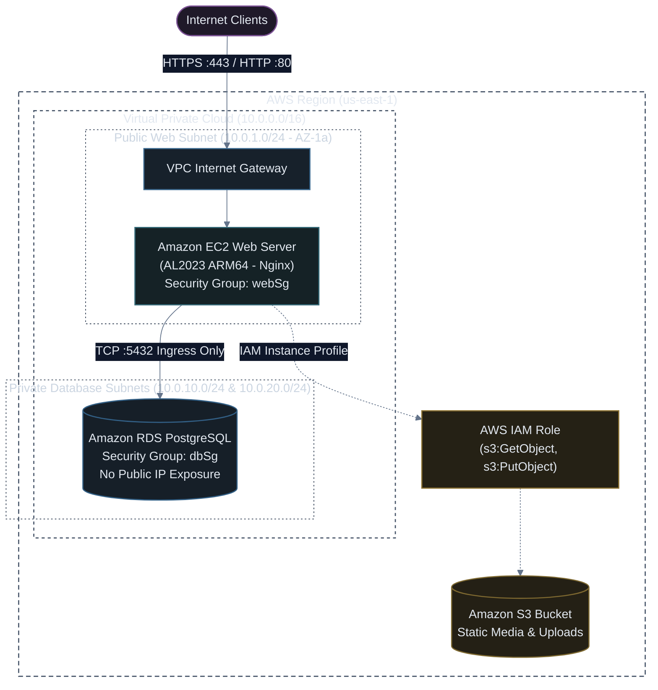

# Production Multi-Tier Stack (VPC + EC2 + S3 + RDS) with Pulumi (TypeScript)

[](#)
[](#)
[](#)

A complete, battle-tested Infrastructure as Code blueprint written in **Pulumi TypeScript**. It provisions a robust 3-tier production cloud topology on AWS: custom VPC with isolated public/private subnets, secure EC2 web server, automated IAM Instance Profile, S3 storage bucket, and private Amazon RDS PostgreSQL database with native secret encryption.

---

## ⚡ Sample 1: Baseline EC2 + S3 Stack in Pulumi (Minimal & Working)

Before building a custom multi-AZ VPC and provisioning private relational databases, here is a simple working Pulumi sample that launches an EC2 web server in your default VPC and provisions an S3 storage bucket:

### TypeScript (`index.ts`)
```typescript
import * as aws from "@pulumi/aws";

// 1. Simple S3 Storage Bucket
const bucket = new aws.s3.BucketV2("sample-app-bucket", {
  forceDestroy: true, // Allows clean deletion for test environments
});

// 2. Fetch Default VPC and Subnet
const defaultVpc = aws.ec2.getVpc({ default: true });
const defaultSubnet = defaultVpc.then(vpc => 
  aws.ec2.getSubnetIds({ vpcId: vpc.id })
).then(subnets => subnets.ids[0]);

// 3. Simple Web Security Group (Port 80)
const webSg = new aws.ec2.SecurityGroup("simpleWebSg", {
  ingress: [{ protocol: "tcp", fromPort: 80, toPort: 80, cidrBlocks: ["0.0.0.0/0"] }],
  egress: [{ protocol: "-1", fromPort: 0, toPort: 0, cidrBlocks: ["0.0.0.0/0"] }],
});

// 4. Latest Amazon Linux 2023 ARM64 AMI Lookup
const al2023Ami = aws.ec2.getAmi({
  mostRecent: true,
  owners: ["amazon"],
  filters: [{ name: "name", values: ["al2023-ami-kernel-default-arm64"] }],
});

// 5. Baseline EC2 Web Server
const webServer = new aws.ec2.Instance("simpleWebServer", {
  instanceType: aws.ec2.InstanceTypes.T4G_Nano,
  ami: al2023Ami.then(a => a.id),
  subnetId: defaultSubnet,
  vpcSecurityGroupId: [webSg.id],
  associatePublicIpAddress: true,
  userData: `#!/bin/bash
dnf install -y nginx
systemctl enable --now nginx
echo "<h1>Sample 1: Pulumi EC2 + S3 Online</h1>" > /usr/share/nginx/html/index.html
`,
});

// Stack Outputs
export const publicIp = webServer.publicIp;
export const bucketId = bucket.id;
```

### 🚀 How to Run & Verify Sample 1

```bash
# 1. Preview planned resources
pulumi preview

# 2. Deploy sample stack
pulumi up --yes

# 3. Test HTTP response
SERVER_IP=$(pulumi stack output publicIp)
curl http://$SERVER_IP

# 4. Clean up and destroy
pulumi destroy --yes
```

---

## 🏗️ Adding the "Extra": Full 3-Tier Production Architecture (Custom VPC + Private RDS + Encrypted Secrets)

In production enterprise deployments, workloads cannot run inside the default VPC. You need a dedicated Virtual Private Cloud, isolated private subnets with no internet ingress for the database, and encrypted secret management for database passwords.

Below is the complete 3-tier enterprise architecture:



---

## 💻 Complete Pulumi TypeScript Program (`index.ts`)

```typescript
import * as pulumi from "@pulumi/pulumi";
import * as aws from "@pulumi/aws";

// 1. Stack Configuration & Encrypted Secrets
const config = new pulumi.Config();
const environment = config.get("environment") || "production";
const dbUsername = config.get("dbUsername") || "appadmin";
// Secret is encrypted in state and masked in CLI logs!
const dbPassword = config.requireSecret("dbPassword");

// 2. Fetch Available Availability Zones
const availableAzs = aws.getAvailabilityZones({ state: "available" });

// =========================================================================
// 3. NETWORKING LAYER (VPC, Subnets, Gateways, Route Tables)
// =========================================================================
const vpc = new aws.ec2.Vpc("productionVpc", {
  cidrBlock: "10.0.0.0/16",
  enableDnsHostnames: true,
  enableDnsSupport: true,
  tags: { Name: `${environment}-vpc`, Environment: environment },
});

const igw = new aws.ec2.InternetGateway("vpcIgw", {
  vpcId: vpc.id,
  tags: { Name: `${environment}-igw` },
});

// Public Subnet in AZ 0
const publicSubnet1 = new aws.ec2.Subnet("publicSubnet1", {
  vpcId: vpc.id,
  cidrBlock: "10.0.1.0/24",
  availabilityZone: availableAzs.then(az => az.names[0]),
  mapPublicIpOnLaunch: true,
  tags: { Name: `${environment}-public-1` },
});

// Private Database Subnet 1 in AZ 0
const privateSubnet1 = new aws.ec2.Subnet("privateSubnet1", {
  vpcId: vpc.id,
  cidrBlock: "10.0.10.0/24",
  availabilityZone: availableAzs.then(az => az.names[0]),
  tags: { Name: `${environment}-private-1` },
});

// Private Database Subnet 2 in AZ 1 (RDS requires at least 2 AZs in a Subnet Group)
const privateSubnet2 = new aws.ec2.Subnet("privateSubnet2", {
  vpcId: vpc.id,
  cidrBlock: "10.0.20.0/24",
  availabilityZone: availableAzs.then(az => az.names[1]),
  tags: { Name: `${environment}-private-2` },
});

// Routing for Public Subnet
const publicRouteTable = new aws.ec2.RouteTable("publicRouteTable", {
  vpcId: vpc.id,
  routes: [{ cidrBlock: "0.0.0.0/0", gatewayId: igw.id }],
  tags: { Name: `${environment}-public-rt` },
});

new aws.ec2.RouteTableAssociation("publicRta1", {
  subnetId: publicSubnet1.id,
  routeTableId: publicRouteTable.id,
});

// =========================================================================
// 4. STORAGE TIER: S3 BUCKET & IAM INSTANCE PROFILE
// =========================================================================
const mediaBucket = new aws.s3.BucketV2("appMediaBucket", {
  bucketPrefix: `app-media-${environment}-`,
  forceDestroy: environment !== "production",
});

new aws.s3.BucketPublicAccessBlock("mediaBucketPab", {
  bucket: mediaBucket.id,
  blockPublicAcls: true,
  blockPublicPolicy: true,
  ignorePublicAcls: true,
  restrictPublicBuckets: true,
});

// IAM Role for EC2
const ec2Role = new aws.iam.Role("ec2InstanceRole", {
  assumeRolePolicy: JSON.stringify({
    Version: "2012-10-17",
    Statement: [{
      Action: "sts:AssumeRole",
      Effect: "Allow",
      Principal: { Service: "ec2.amazonaws.com" },
    }],
  }),
});

// Attach AWS Systems Manager Managed Policy (Zero port 22 open)
new aws.iam.RolePolicyAttachment("ssmPolicyAttachment", {
  role: ec2Role.name,
  policyArn: "arn:aws:iam::aws:policy/AmazonSSMManagedInstanceCore",
});

// Grant S3 access to the EC2 Role
new aws.iam.RolePolicy("s3AccessPolicy", {
  role: ec2Role.id,
  policy: mediaBucket.arn.apply(arn => JSON.stringify({
    Version: "2012-10-17",
    Statement: [{
      Effect: "Allow",
      Action: ["s3:GetObject", "s3:PutObject", "s3:ListBucket"],
      Resource: [arn, `${arn}/*`],
    }],
  })),
});

const instanceProfile = new aws.iam.InstanceProfile("ec2InstanceProfile", {
  role: ec2Role.name,
});

// =========================================================================
// 5. SECURITY GROUPS (Strict Ingress Chaining)
// =========================================================================
const webSg = new aws.ec2.SecurityGroup("webSecurityGroup", {
  vpcId: vpc.id,
  description: "Allow inbound HTTP/HTTPS traffic to Web Instance",
  ingress: [
    { protocol: "tcp", fromPort: 80, toPort: 80, cidrBlocks: ["0.0.0.0/0"] },
    { protocol: "tcp", fromPort: 443, toPort: 443, cidrBlocks: ["0.0.0.0/0"] },
  ],
  egress: [
    { protocol: "-1", fromPort: 0, toPort: 0, cidrBlocks: ["0.0.0.0/0"] },
  ],
  tags: { Name: `${environment}-web-sg` },
});

const dbSg = new aws.ec2.SecurityGroup("dbSecurityGroup", {
  vpcId: vpc.id,
  description: "Allow PostgreSQL ingress strictly from Web Security Group",
  ingress: [
    {
      protocol: "tcp",
      fromPort: 5432,
      toPort: 5432,
      securityGroups: [webSg.id], // Chained SG Reference!
    },
  ],
  egress: [
    { protocol: "-1", fromPort: 0, toPort: 0, cidrBlocks: ["0.0.0.0/0"] },
  ],
  tags: { Name: `${environment}-db-sg` },
});

// =========================================================================
// 6. DATABASE TIER: RDS POSTGRESQL
// =========================================================================
const dbSubnetGroup = new aws.rds.SubnetGroup("rdsSubnetGroup", {
  subnetIds: [privateSubnet1.id, privateSubnet2.id],
  tags: { Name: `${environment}-rds-subnet-group` },
});

const postgresDb = new aws.rds.Instance("postgresDatabase", {
  engine: "postgres",
  engineVersion: "16.1",
  instanceClass: aws.rds.InstanceTypes.T4G_Micro,
  allocatedStorage: 20,
  maxAllocatedStorage: 100,
  dbName: "productiondb",
  username: dbUsername,
  password: dbPassword,
  dbSubnetGroupName: dbSubnetGroup.name,
  vpcSecurityGroupIds: [dbSg.id],
  publiclyAccessible: false,
  skipFinalSnapshot: environment !== "production",
  tags: { Environment: environment },
});

// =========================================================================
// 7. COMPUTE TIER: EC2 INSTANCE (AL2023 ARM64)
// =========================================================================
const al2023Ami = aws.ec2.getAmi({
  mostRecent: true,
  owners: ["amazon"],
  filters: [
    { name: "name", values: ["al2023-ami-kernel-default-arm64"] },
    { name: "state", values: ["available"] },
  ],
});

// UserData bootstraps Nginx web page dynamically embedding DB endpoint and S3 bucket
const userDataScript = pulumi.interpolate`#!/bin/bash
dnf update -y
dnf install -y nginx postgresql15
systemctl enable nginx
systemctl start nginx
echo "<h1>Production Pulumi Stack Online</h1><p>DB Host: ${postgresDb.address}</p><p>S3 Bucket: ${mediaBucket.id}</p>" > /usr/share/nginx/html/index.html
`;

const webInstance = new aws.ec2.Instance("webServerInstance", {
  instanceType: aws.ec2.InstanceTypes.T4G_Small,
  ami: al2023Ami.then(a => a.id),
  subnetId: publicSubnet1.id,
  vpcSecurityGroupId: [webSg.id],
  iamInstanceProfile: instanceProfile.name,
  associatePublicIpAddress: true,
  userData: userDataScript,
  tags: { Name: `${environment}-web-server` },
});

// =========================================================================
// 8. STACK OUTPUTS
// =========================================================================
export const webServerPublicIp = webInstance.publicIp;
export const webServerPublicDns = webInstance.publicDns;
export const databaseEndpoint = postgresDb.address;
export const s3BucketName = mediaBucket.id;
```

---

## 🚀 Deployment Instructions

```bash
# 1. Configure deployment parameters and sensitive secrets
pulumi config set environment production
pulumi config set dbUsername appadmin
# Encrypt the database password into the stack config
pulumi config set --secret dbPassword "SuperSecurePassword2026!"

# 2. Preview changes (Review VPC, Subnets, EC2, RDS, and S3 resources)
pulumi preview

# 3. Apply changes and provision infrastructure
pulumi up --yes

# 4. Connect to Web Server using AWS Systems Manager
aws ssm start-session --target $(pulumi stack output webServerInstanceId)
```

> [!IMPORTANT]
> The database password is never exposed in cleartext. Pulumi uses per-stack encryption keys (or an AWS KMS envelope key) to encrypt secrets in `Pulumi.production.yaml` and redacts values automatically from all terminal logs and console outputs.
