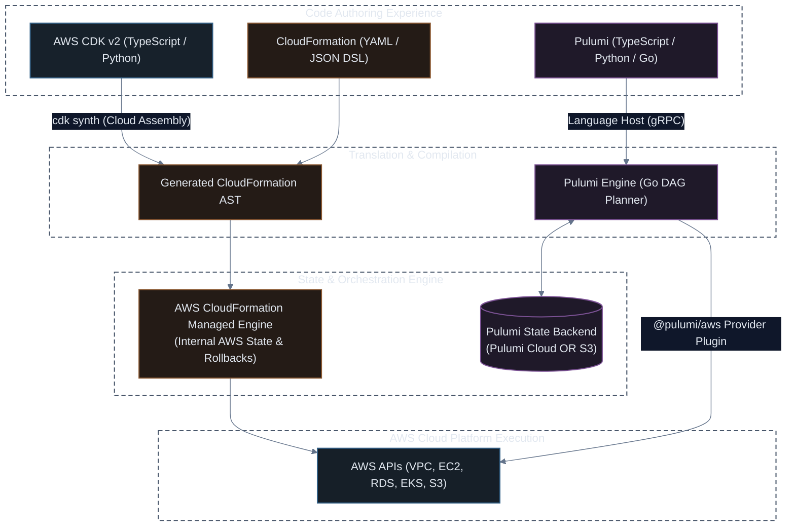

# Infrastructure as Code (IaC) Master Reference Guide

[](#)
[](#)
[](#)

A comprehensive, production-grade guide covering the three leading Infrastructure as Code (IaC) frameworks for modern AWS and cloud-native Kubernetes environments: **AWS CloudFormation**, **AWS Cloud Development Kit (CDK v2)**, and **Pulumi**.

---

## 📖 Progressive Learning Structure in Every Module

Every module in this directory follows a strict, developer-first **progressive learning structure**:

```text
1. ⚡ Sample 1: Baseline (Minimal & Working)
   └── Absolute simplest, 100% executable snippet (typically 3–15 lines).
       Zero distractions, immediately understandable.

2. 🚀 How to Run & Verify Sample 1
   └── Copy-paste CLI commands (create/preview/deploy/test/teardown).
       Verify live resources in under 2 minutes.

3. 🛡️ Adding the "Extra": Enterprise Hardening & Production Topology
   └── The real-world production engineering:
       • Multi-AZ VPC networking & subnet routing
       • KMS customer-managed key rotation & TLS enforcement
       • IAM least-privilege instance profiles & security group isolation
       • Architectural Mermaid diagrams adhering to ui.md dark mode standards
```

---

## 🗺️ Roadmap & Module Navigator

| Module | Framework | Topic 1: Fundamentals | Topic 2: Storage & Security | Topic 3: 3-Tier Production Stack |
| :---: | :--- | :--- | :--- | :--- |
| **01** | **[CloudFormation](01-cloudformation/01-intro.md)** | [01-intro.md](01-cloudformation/01-intro.md)<br>• Sample 1 + Run Guide<br>• Template Anatomy & JSON/YAML | [02-s3.md](01-cloudformation/02-s3.md)<br>• Sample 1 + Run Guide<br>• Extra: KMS, TLS, PublicAccessBlock | [03-ec2-s3-rds.md](01-cloudformation/03-ec2-s3-rds.md)<br>• Sample 1 + Run Guide<br>• Extra: Multi-AZ VPC + RDS PostgreSQL |
| **02** | **[AWS CDK (v2)](02-cdk/01-intro.md)** | [01-intro.md](02-cdk/01-intro.md)<br>• Sample 1 + Run Guide<br>• L1/L2/L3 Constructs & Synth | [02-s3.md](02-cdk/02-s3.md)<br>• Sample 1 + Run Guide<br>• Extra: L2 Bucket, Jest Assertions | [03-ec2-s3-rds.md](02-cdk/03-ec2-s3-rds.md)<br>• Sample 1 + Run Guide<br>• Extra: Auto-Subnets, RDS & IAM Wiring |
| **03** | **[Pulumi](03-pulumi/01-intro.md)** | [01-intro.md](03-pulumi/01-intro.md)<br>• Sample 1 + Run Guide<br>• State, DAG Engine & gRPC | [02-s3.md](03-pulumi/02-s3.md)<br>• Sample 1 + Run Guide<br>• Extra: Modular V2 Resources & Policies | [03-ec2-s3-rds.md](03-pulumi/03-ec2-s3-rds.md)<br>• Sample 1 + Run Guide<br>• Extra: Secret Encryption, VPC & Database |

---

## 🏗️ Comparative Framework Architecture



---

## ⚖️ Framework Comparison Matrix

| Evaluation Criteria | AWS CloudFormation | AWS CDK (v2) | Pulumi |
| :--- | :--- | :--- | :--- |
| **Language Paradigm** | Declarative YAML / JSON | Imperative OOP synthesizing to Declarative AST | Imperative programming executing via Engine |
| **Tooling & IDE** | YAML syntax highlighting, linter (cfn-lint) | Full auto-complete, compile-time type checking, refactoring | Full auto-complete, typed SDKs, multi-cloud modules |
| **State Management** | Handled natively and transparently by AWS | Handled natively by AWS CloudFormation | Managed in Pulumi Cloud or self-managed S3 bucket |
| **Secret Management** | Parameter Store / Secrets Manager references | Parameter Store / Secrets Manager references | Built-in first-class encryption per stack / KMS |
| **Testing** | TaskCat / cfn-guard (Validation rules) | Unit tests (`@aws-cdk/assertions`) & snapshot tests | Integration & unit testing via Jest / PyTest / Go test |
| **Deployment Speed** | Subject to CloudFormation queue & poll delays | CloudFormation synthesis + CFN deploy time | **Extremely fast** direct parallel API execution |
| **Multi-Cloud** | AWS only | AWS only (CDK for Terraform exists as separate project) | **Native Multi-Cloud** (AWS, Azure, GCP, K8s) |

---

## 🎯 Which Framework Should You Choose?

<details open>
<summary><b>1. Choose AWS CloudFormation if:</b></summary>

* You have strict compliance requirements demanding zero external toolchains, zero node/python dependencies, and pure AWS-managed lifecycle.
* You need audited, auditable static JSON/YAML manifests stored in plain text repositories.
* Your operations teams rely exclusively on standard AWS Console Service Catalog or standard AWS CLI.
</details>

<details open>
<summary><b>2. Choose AWS CDK (v2) if:</b></summary>

* Your primary cloud provider is **AWS** and you want to write real software engineering code (TypeScript/Python).
* You want the safety and reliability of **CloudFormation's rollback engine** without writing thousands of lines of boilerplate YAML.
* You want high-level abstractions: e.g. L2 `new ec2.Vpc()` or `bucket.grantReadWrite(ec2Instance)` saving days of manual IAM and networking wiring.
</details>

<details open>
<summary><b>3. Choose Pulumi if:</b></summary>

* You operate in a **Multi-Cloud** or Kubernetes-first environment (e.g. provisioning an EKS cluster and deploying Helm charts in the exact same TypeScript file).
* You want **fast feedback cycles** and direct cloud API execution without waiting on CloudFormation service orchestrator queues.
* You want built-in client-side secrets encryption without additional paid third-party tools.
</details>
