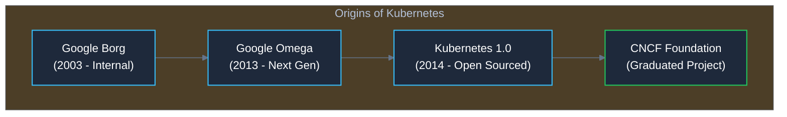
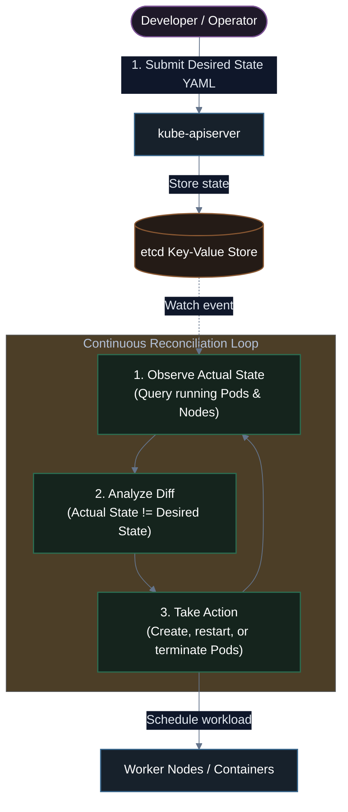
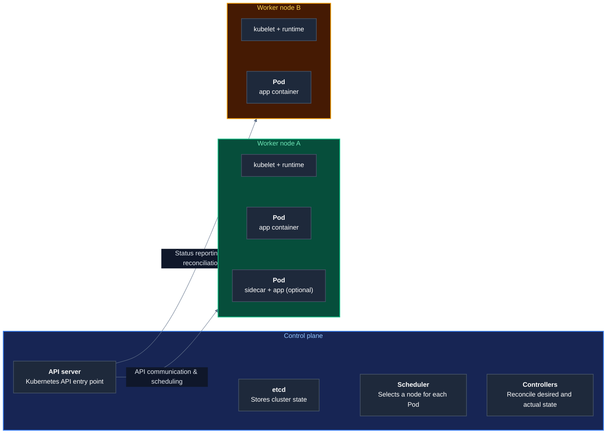
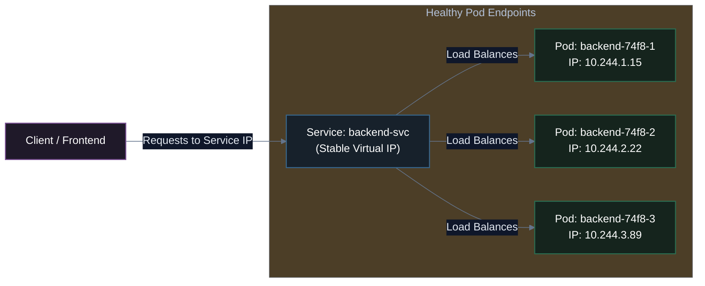
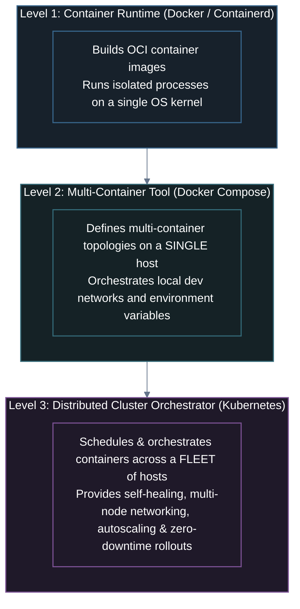
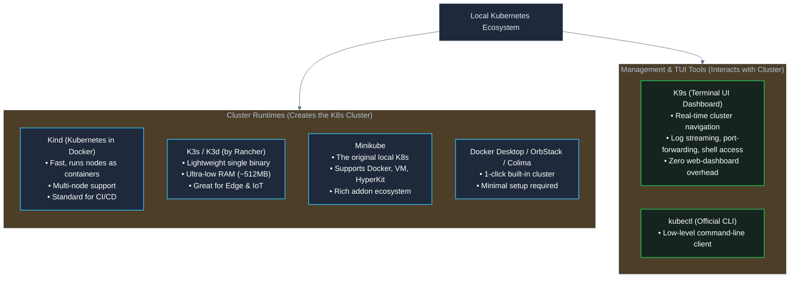
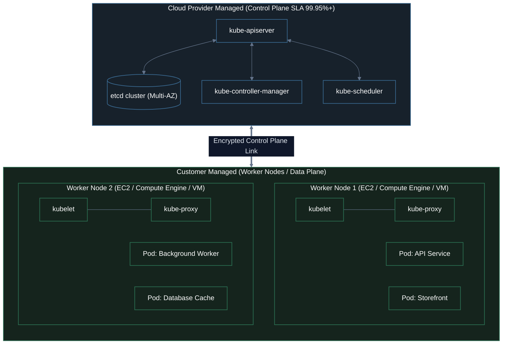
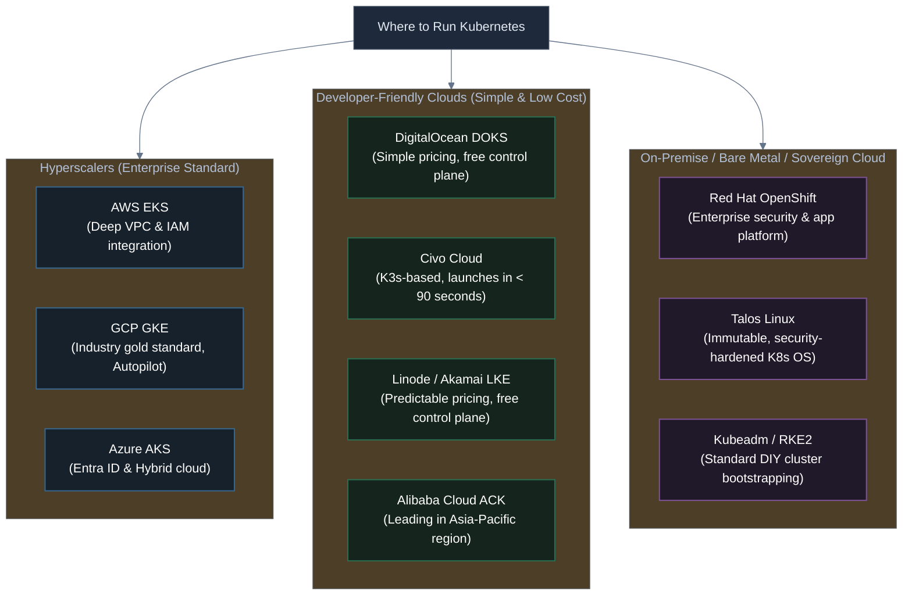
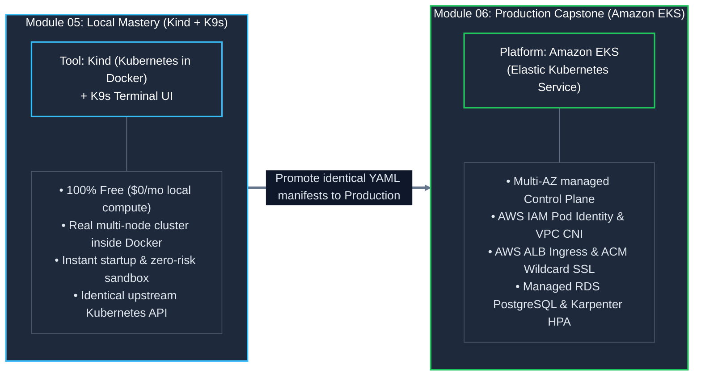

# 01. What is Kubernetes? Architecture, Features & Ecosystem

An in-depth introduction to Kubernetes (K8s): why container orchestration is essential in production, core platform capabilities, architectural comparisons with Docker and Docker Compose, and a comprehensive tour of local and cloud Kubernetes distributions.

---

## 1. What is Kubernetes?

**Kubernetes** (often abbreviated as **K8s**, replacing the 8 letters between *K* and *s*) is an open-source container orchestration platform designed to automate deploying, scaling, networking, and managing containerized applications across a distributed cluster of machines.

Originally designed by engineers at **Google** based on over a decade of experience running production workloads at planetary scale with internal systems (**Borg** and **Omega**), Kubernetes was open-sourced in 2014 and donated to the **Cloud Native Computing Foundation (CNCF)** as its foundational seed project. Today, it stands as the undisputed industry standard for running cloud-native production workloads.



### The Declarative Model & The Reconciliation Loop

The core philosophical breakthrough of Kubernetes is **declarative configuration**. Instead of executing imperative instructions (*"start container X, attach it to port 8080, reboot if failed"*), you declare your **Desired State** in a YAML or JSON manifest. 

Kubernetes runs an endless **Control Loop (Reconciliation Loop)**: it inspects the **Actual State** of the cluster, compares it against your **Desired State**, and continuously applies adjustments to bring reality into convergence.



### Architectural Anatomy: Inside a Kubernetes Cluster

Before exploring production use cases, here is the high-level structural blueprint of how a Kubernetes cluster coordinates workloads between the **Control Plane** and multiple **Worker Nodes**:



<p align="center"><i>API communication, scheduling, and status reporting</i></p>

---

## 2. Why Do We Need Kubernetes?

In development or staging environments, running a single container with `docker run` or orchestrating three containers with `docker compose` is simple and fast. However, running software in enterprise production introduces severe operational challenges:

### The Production Reality

| Production Challenge | Without Kubernetes (Manual / Bare Docker) | With Kubernetes Orchestration |
| :--- | :--- | :--- |
| **Node Hardware Crash** | The host server crashes at 3:00 AM. Every container on that host dies. Requires manual engineer intervention to provision a new server and re-deploy. | The Control Plane detects the dead node via heartbeats. Pods are automatically evicted and rescheduled onto healthy nodes in seconds. |
| **Traffic Spikes** | Sudden viral traffic overwhelms 2 backend containers. CPU hits 100%, requests timeout, and users receive 502 Bad Gateway errors. | Horizontal Pod Autoscaler (HPA) triggers automatically, scaling replicas from 2 to 20 within seconds to absorb the surge. |
| **Zero-Downtime Deployments** | Deploying a new release requires stopping the old process or container, swapping binaries, and starting the new one—causing seconds or minutes of outage. | Rolling updates deploy new Pods one by one, verifying health probes before redirecting live user traffic away from old Pods. |
| **Service Discovery & Networking** | Dynamic IPs of ephemeral containers force engineers to manually update upstream Nginx configs or hardcode IP addresses. | CoreDNS and Kubernetes Services provide stable, permanent DNS names (e.g., `api.production.svc.cluster.local`) backed by built-in Layer 4 load balancing. |
| **Resource Waste** | Overprovisioned virtual machines run at 10-15% CPU utilization because teams isolate workloads onto dedicated servers to avoid dependency conflicts. | Automated bin-packing packs heterogeneous workloads onto shared compute nodes based on CPU and memory reservations (`requests` & `limits`). |

> [!NOTE]
> **Pets vs. Cattle Mental Model**: In traditional systems administration, servers are treated like **Pets**—given unique names (e.g., `db-master-01`, `zeus`), carefully nurtured, hand-configured, and mourned when they crash. In Kubernetes, infrastructure is treated like **Cattle**—servers and containers are numbered, identical, disposable resources that can be terminated and replaced at any second without manual intervention.

---

## 3. Main Features of Kubernetes

Kubernetes provides an extensive suite of production-grade abstractions out of the box:

```mermaid
%%{init: {
  'theme': 'base',
  'themeVariables': {
    'darkMode': true,
    'background': '#0f172a',
    'primaryColor': '#1e293b',
    'primaryTextColor': '#e2e8f0',
    'primaryBorderColor': '#475569',
    'lineColor': '#64748b',
    'textColor': '#e2e8f0',
    'edgeLabelBackground': '#0f172a'
  },
  'themeCSS': '* { filter: none !important; box-shadow: none !important; } .node * { filter: none !important; } .cluster * { filter: none !important; }'
}}%%
flowchart TD
    K8sCore["Kubernetes Core Capabilities"]
    
    K8sCore --> F1["1. Self-Healing & High Availability"]
    K8sCore --> F2["2. Autoscaling (Horizontal & Vertical)"]
    K8sCore --> F3["3. Service Discovery & Load Balancing"]
    K8sCore --> F4["4. Automated Rollouts & Rollbacks"]
    K8sCore --> F5["5. Secret & Configuration Management"]
    K8sCore --> F6["6. Storage Orchestration (PV / PVC)"]
    K8sCore --> F7["7. Resource Optimization & Bin Packing"]

    classDef cCenter fill:#1f1929,stroke:#7c5295,stroke-width:2px,color:#ffffff;
    classDef cFeature fill:#1e293b,stroke:#38bdf8,stroke-width:1.5px,color:#ffffff;
    class K8sCore cCenter;
    class F1,F2,F3,F4,F5,F6,F7 cFeature;
```



### 1. Self-Healing
Kubernetes continuously inspects container health using three distinct probe types:
- **Startup Probes**: Checks if slow-starting apps (e.g., Java/Spring boot) have initialized before liveness checks kick in.
- **Liveness Probes**: Detects deadlocks or crashed processes and automatically kills and restarts the container.
- **Readiness Probes**: Confirms whether an application is ready to accept incoming traffic (e.g., database connection pool established). If failing, traffic is removed without terminating the container.
- If a physical node fails, Kubernetes marks it `NotReady` and reschedules all its workloads to other available nodes in the cluster.

### 2. Multi-Tier Autoscaling
Kubernetes scales workloads across two distinct dimensions:
- **Horizontal Pod Autoscaler (HPA)**: Dynamically scales the count of Pod replicas up or down based on metrics like CPU usage, memory utilization, or custom business metrics (e.g., SQS queue depth or HTTP requests per second).
- **Vertical Pod Autoscaler (VPA)**: Automatically adjusts the CPU and memory `requests` and `limits` of containers based on historical utilization.
- **Cluster Autoscaler & Karpenter**: When Pods cannot be scheduled because the existing nodes are full, node autoscalers communicate with cloud APIs (AWS, GCP, Azure) to provision new virtual machines automatically.

### 3. Service Discovery & Load Balancing
Every Pod receives its own unique IP address within the cluster network (Container Network Interface - CNI). Because Pods are ephemeral and their IPs change whenever they restart, Kubernetes provides:
- **Services (ClusterIP, NodePort, LoadBalancer)**: A stable virtual IP and DNS name representing a group of Pods selected by labels.
- **kube-proxy & CoreDNS**: Traffic to a Service is automatically distributed across all healthy backend Pods using round-robin or random Layer 4 load balancing.



### 4. Automated Rollouts & Rollbacks
- Deploy new image versions progressively using `RollingUpdate` strategies (e.g., maintaining at least 75% capacity while replacing old Pods).
- If the new version fails its readiness probe or crashes, Kubernetes pauses the rollout.
- You can instantly rollback to any previous revision with a single command: `kubectl rollout undo deployment/<name>`.

### 5. Storage Orchestration
Kubernetes abstracts physical storage infrastructure through the **Container Storage Interface (CSI)**:
- Decouples storage definitions (**PersistentVolume** - PV) from workload requests (**PersistentVolumeClaim** - PVC).
- Supports dynamic provisioning via **StorageClasses** across cloud block stores (AWS EBS, GCP Persistent Disk, Azure Managed Disk), distributed file systems (NFS, AWS EFS), or local disks.

### 6. Secret & Configuration Management
- **ConfigMaps**: Inject non-sensitive configuration data (environment variables, configuration files, CLI arguments) into containers without rebuilding container images.
- **Secrets**: Store sensitive credentials (passwords, TLS certificates, OAuth tokens, API keys) encrypted at rest in `etcd` and mount them as in-memory tmpfs files or environment variables.

---

## 4. Kubernetes vs. Docker vs. Docker Compose

A frequent source of confusion for newcomers is the relationship between Docker, Docker Compose, and Kubernetes. They are not mutually exclusive competitors; rather, they operate at different layers of abstraction:



### Direct Feature Comparison

| Dimension | Docker Engine | Docker Compose | Kubernetes (K8s) |
| :--- | :--- | :--- | :--- |
| **Primary Scope** | Single container management | Multi-container application on **1 host** | Distributed fleet of **many hosts (nodes)** |
| **Execution Target** | Single machine / VM | Single machine / VM | Cluster (1 to 5,000+ nodes) |
| **High Availability** | ❌ None (host dies = app dies) | ❌ None (host dies = app dies) | ✅ Built-in multi-AZ node failover |
| **Horizontal Autoscaling** | ❌ Manual (`docker run ...`) | ❌ Manual (`docker compose up --scale`) | ✅ Automatic via metrics (HPA, VPA, Karpenter) |
| **Self-Healing** | Partial (`restart: always` on process crash) | Partial (`restart: always` on single host) | ✅ Comprehensive (process crash + node failure + probe eviction) |
| **Zero-Downtime Updates** | ❌ Manual cutover | ❌ Disruptive container recreations | ✅ Declarative rolling, canary, and blue-green updates |
| **Multi-Node Networking** | ❌ Single host bridge network | ❌ Single host bridge network | ✅ Overlay CNI network spanning across all nodes |
| **Declarative API & RBAC** | ❌ Docker daemon CLI | ❌ Local YAML file | ✅ Enterprise API server with fine-grained RBAC & admission controllers |
| **Learning Curve** | Low (hours) | Moderate (days) | High (weeks to months) |
| **Ideal For** | Packaging software & building images | Local development & prototyping | Production environments, high traffic, SLA-critical systems |

> [!TIP]
> **Summary Rule of Thumb**: Use **Docker** to build images. Use **Docker Compose** to quickly spin up your database, cache, and backend on your local laptop for daily development. Use **Kubernetes** when deploying software into production across multiple servers where high availability, zero-downtime updates, and automated scaling are required.

---

## 5. Running Kubernetes Locally

Before deploying to expensive cloud infrastructure, developers and DevOps engineers run Kubernetes locally on their workstations for development, testing, and debugging.



### 1. Kind (Kubernetes in Docker)
- **How it works**: Runs each Kubernetes node (control plane or worker) as a standard **Docker container**.
- **Strengths**: Extremely fast cluster spin-up, zero VM overhead, native support for multi-node clusters (e.g., 1 control-plane and 3 workers in one config file), and the de-facto standard for running Kubernetes end-to-end tests in GitHub Actions CI/CD.
- **Spin up in 30 seconds**:
  ```bash
  kind create cluster --name dev-cluster
  ```

### 2. K3s and K3d
- **K3s** (developed by Rancher, now CNCF sandbox project): A fully compliant, stripped-down Kubernetes distribution packaged into a single `<100MB` binary. It replaces `etcd` with SQLite for single-node setups and removes legacy in-tree cloud providers. Consumes less than 512MB of RAM.
- **K3d**: A lightweight wrapper that runs K3s nodes inside Docker containers, giving you blazing-fast local multi-node clusters.
- **Spin up with k3d**:
  ```bash
  k3d cluster create my-k3s-cluster --servers 1 --agents 2
  ```

### 3. Minikube
- **How it works**: The original tool officially maintained by the Kubernetes project. Can provision a virtual machine (via VirtualBox, Hyper-V, or QEMU) or use Docker/Podman container drivers.
- **Strengths**: Extensive built-in addon ecosystem (`minikube addons enable ingress`, `dashboard`, `metrics-server`).

### 4. Docker Desktop / OrbStack / Colima
- **Docker Desktop**: Includes a checkbox in Settings to enable a single-node Kubernetes cluster.
- **OrbStack** (macOS): Blazing fast, lightweight drop-in replacement for Docker Desktop with instant Kubernetes support and nearly zero idle CPU drain.
- **Colima**: Open-source, container-based runtime for macOS and Linux supporting both Docker and Kubernetes runtimes.

### 5. What is K9s? (Important Distinction)
> [!IMPORTANT]
> **K9s is NOT a Kubernetes distribution!** It does not create or run a cluster. 
> 
> Instead, **K9s is a terminal-based UI (TUI)** that connects to any existing Kubernetes cluster (local or cloud). It provides an ultra-fast, keyboard-driven interface to observe Pod statuses, stream logs, execute interactive shells inside containers, manage Secrets and ConfigMaps, and describe resources without typing lengthy `kubectl` commands.

```
       ┌─────────────────────────── K9s Terminal UI ────────────────────────────┐
       │ Context: kind-dev-cluster    Namespace: default         CPU: 12%  MEM: 24%  │
       ├────────────────────────────────────────────────────────────────────────┤
       │ STATUS   NAME                           READY   RESTARTS   AGE    IP   │
       │ Running  api-server-6789b7875-9x8qp     1/1     0          4m     10.2 │
       │ Running  api-server-6789b7875-lp4wq     1/1     0          4m     10.2 │
       │ Running  postgres-0                     1/1     0          12m    10.2 │
       │ Running  storefront-web-54b9cb796-mk291 1/1     0          2m     10.2 │
       └────────────────────────────────────────────────────────────────────────┘
```

### Local Tool Comparison Matrix

| Local Tool | Type | Memory Footprint | Multi-Node Simulation | Best Use Case |
| :--- | :--- | :--- | :--- | :--- |
| **Kind** | Cluster Runtime | Low (~1GB) | ⭐⭐⭐ Native & Simple | CI/CD testing, custom multi-node setups |
| **K3s / K3d** | Cluster Runtime | Ultra-Low (~512MB) | ⭐⭐⭐ Fast with K3d | Resource-constrained laptops, edge devices |
| **Minikube** | Cluster Runtime | Moderate (~2-3GB) | ⭐⭐ Supported | Beginners exploring built-in addons |
| **OrbStack** | Container + K8s | Ultra-Low | ⭐ Single-node only | macOS daily development |
| **K9s** | Terminal UI Client | Negligible (~20MB) | N/A (Connects to any) | Fast, real-time cluster management & debugging |

---

## 6. Running Kubernetes in the Cloud (Managed Kubernetes)

In production, running your own Kubernetes control plane (installing `kube-apiserver`, `etcd`, `kube-controller-manager`, and `kube-scheduler` on raw VMs via `kubeadm`) requires significant operational overhead, high-availability quorum tuning, manual backup automation, and continuous OS patching.

Cloud providers solve this through **Managed Kubernetes Services**: the cloud provider guarantees a highly available, multi-AZ control plane with automated backups, while you only pay for and manage the worker nodes (or use serverless compute).



### The "Big Three" Cloud Kubernetes Platforms

#### 1. AWS — Amazon EKS (Elastic Kubernetes Service)
- **The Market Leader for Enterprise AWS Stacks**: Deeply integrated into the AWS ecosystem (IAM via Pod Identity / IRSA, VPC CNI for native AWS IP addresses per Pod, AWS Application Load Balancer via AWS Load Balancer Controller).
- **Worker Node Options**:
  - **Managed Node Groups**: AWS handles EC2 AMI provisioning, OS updates, and autoscaling.
  - **Karpenter**: High-performance, open-source node autoscaler built by AWS that provisions rightsized EC2 instances in under 45 seconds based on unfulfilled Pod requirements.
  - **AWS Fargate**: Serverless pod compute—run Pods without managing any EC2 instances or node OS at all.
- **Control Plane Cost**: ~$0.10/hour (~$73/month) per cluster.

#### 2. GCP — Google Kubernetes Engine (GKE)
- **The Pioneer and Gold Standard**: Built and maintained by Google (the creators of Kubernetes). GKE is widely recognized as the most advanced, seamless, and feature-rich managed Kubernetes offering.
- **Two Operating Modes**:
  - **GKE Standard**: You configure and manage the underlying Google Compute Engine (GCE) node pools.
  - **GKE Autopilot**: Fully automated, zero-ops Kubernetes. Google provisions, configures, optimizes, secures, and autoscales the entire infrastructure (both control plane and worker nodes). You only pay for the exact CPU, memory, and storage requested by your Pods.
- **Key Features**: Best-in-class multi-cluster management, instantaneous node autoscaling, native integration with Google Cloud IAM and BigQuery.

#### 3. Azure — Azure Kubernetes Service (AKS)
- **The Enterprise Microsoft Standard**: Optimized for enterprise hybrid clouds and organizations integrated with Microsoft Entra ID (formerly Azure Active Directory).
- **Worker Node Options**: Standard Azure VM Virtual Machine Scale Sets (VMSS) or **Azure Container Instances (ACI)** for serverless burst scaling (Virtual Nodes).
- **Key Features**: Azure CNI, native Azure Policy integration, Microsoft Entra ID RBAC authentication, and a **free tier** for standard control plane management (with paid SLA option).

---

### Alternative Cloud & Bare-Metal Offerings

Beyond the "Big Three", there is a rich ecosystem of managed cloud and self-hosted Kubernetes options:



#### 4. Developer-Friendly Clouds
- **DigitalOcean Kubernetes (DOKS)**: Highly popular among startups and developers. Features a free control plane, straightforward UI, 1-click marketplace addons, and predictable monthly VM pricing.
- **Civo**: The world's first managed Kubernetes service built entirely on lightweight **K3s**. Remarkable for spinning up new clusters in under 90 seconds with lower cloud bills.
- **Linode Kubernetes Engine (LKE)** (Akamai): Free control plane with high availability options and simple linear VM pricing.
- **Alibaba Cloud ACK (Container Service for Kubernetes)**: The dominant cloud Kubernetes platform across the Asia-Pacific region, supporting massive e-commerce scale during Global Shopping Festivals.

#### 5. Enterprise On-Premise & Bare Metal
- **Red Hat OpenShift**: A full-fledged enterprise application platform built on Kubernetes, adding built-in CI/CD pipelines, container registry, logging/monitoring stack, and strict enterprise security controls out of the box.
- **Talos Linux**: A modern, minimalistic, immutable operating system designed exclusively to run Kubernetes. No SSH, no shell, no package manager—entirely managed via gRPC API.
- **Kubeadm**: The official Kubernetes cluster bootstrapper tool used to manually install control plane and worker components on bare-metal Ubuntu/Debian/RHEL servers.

---

### Managed Cloud Kubernetes Comparison Matrix

| Platform | Control Plane Fee | Serverless Pod Option | Best-in-Class Autoscaler | Ingress Controller | Standout Advantage |
| :--- | :--- | :--- | :--- | :--- | :--- |
| **AWS EKS** | $0.10 / hr (~$73/mo) | AWS Fargate | **Karpenter** (fast EC2 bin-packing) | AWS ALB Controller | Deepest AWS services & IAM integration |
| **GCP GKE** | 1 free cluster/billing acct, then ~$73/mo | **GKE Autopilot** (Zero-ops) | GKE Cluster Autoscaler | Google Cloud Armor / Ingress | Most seamless developer UX; birthplace of K8s |
| **Azure AKS** | Free tier (or $0.10/hr with SLA) | Azure Virtual Nodes (ACI) | AKS Cluster Autoscaler | Application Routing / AGIC | Seamless integration with Microsoft Entra ID |
| **DigitalOcean (DOKS)** | **Free** | ❌ (Standard Droplets) | DO Cluster Autoscaler | DO Load Balancer | Zero control plane cost; easiest learning curve |
| **Civo** | **Free** | ❌ (Standard Instances) | Civo Autoscaler | Traefik / NGINX | Lightning-fast cluster spin-up (<90 sec) via K3s |
| **Red Hat OpenShift** | High (Commercial license) | Serverless (Knative) | OpenShift Machine Autoscaler | OpenShift Ingress Router | Turnkey enterprise security & compliance platform |

---

## 7. Our Course Architecture: Kind for Local, Amazon EKS for Production

With so many local tools and cloud platforms available, we make a deliberate, battle-tested architectural choice for this curriculum:



### Why We Pick **Kind** for Local Development
1. **Zero Cost & Lightweight ($0/mo)**: Runs directly inside your existing Docker daemon on macOS, Linux, or Windows without heavy VM hypervisors.
2. **True Multi-Node Simulation**: Unlike Docker Desktop or basic Minikube which default to a single node, Kind lets us simulate realistic multi-node topologies (e.g., 1 control-plane node + 2 worker nodes) using simple YAML files. This allows us to witness real Pod scheduling, anti-affinity, and node drain events locally.
3. **Upstream Purity & CI/CD Parity**: Kind runs standard upstream Kubernetes images from the official Kubernetes project. The exact manifests you test locally in Kind will run without modification in GitHub Actions CI/CD and on cloud clusters.
4. **Paired with K9s**: We will use **K9s** throughout Module 05 for instant terminal navigation, pod inspection, real-time log streaming, and container shell exec.

### Why We Pick **Amazon EKS** for Cloud Production
1. **The Enterprise Standard**: Amazon EKS powers the largest share of enterprise cloud workloads worldwide, making it the most demanded production skill set for DevOps and Platform engineers.
2. **Deep AWS Cloud Integration**: EKS bridges raw Kubernetes abstractions with enterprise AWS infrastructure:
   - **AWS IAM**: Fine-grained least-privilege security per Pod via IAM Roles for Service Accounts (IRSA) and EKS Pod Identity.
   - **AWS VPC CNI**: Pods receive real, routable IP addresses directly from your AWS VPC subnets.
   - **AWS ALB Controller**: Automatically provisions AWS Application Load Balancers with AWS Certificate Manager (ACM) SSL certificates from Kubernetes Ingress manifests.
   - **Stateful Persistence**: Seamless connectivity to managed AWS RDS PostgreSQL databases.
   - **Next-Gen Autoscaling**: Blazing-fast node provisioning with **Karpenter** and Pod autoscaling with **HPA**.
3. **Seamless Transition to Module 06**: Every manifest, secret pattern, and deployment technique mastered locally in `05-learn-k8s` translates directly into the full-stack e-commerce production deployment in [`06-try-production-eks`](file:///Users/kendirck/Desktop/learn/k8s-in-production/06-try-production-eks/).

---

## 8. Chapter Summary & What's Next

In this lesson, we established the foundational intuition for Kubernetes:
1. **Kubernetes (K8s)** is a declarative container orchestration platform operating via continuous reconciliation loops.
2. It solves enterprise production challenges that single-host tools cannot address: **self-healing**, **multi-tier autoscaling**, **automated rollouts**, **service discovery**, and **storage orchestration**.
3. **Docker** builds the container image; **Docker Compose** runs multi-container setups on a single machine; **Kubernetes** orchestrates containers across a resilient cluster of machines.
4. For our curriculum, we pick **Kind** (+ **K9s**) for our local development sandbox ($0/mo) and **Amazon EKS** as our flagship cloud production platform.

---

### 🗺️ Next Lesson in Module 05
In **[`02-kubernetes-in-local-with-kind.md`](./02-kubernetes-in-local-with-kind.md)**, we get hands-on with our local workstation setup:
- Installing and validating `kind` and `kubectl`.
- Managing cluster lifecycles (`kind create`, `kind get`, `kind delete`).
- The division of responsibilities: `kind` manages clusters vs. `kubectl` manages workloads.
- The critical image loading workflow: **`kind load docker-image`** and avoiding `ImagePullBackOff`.

