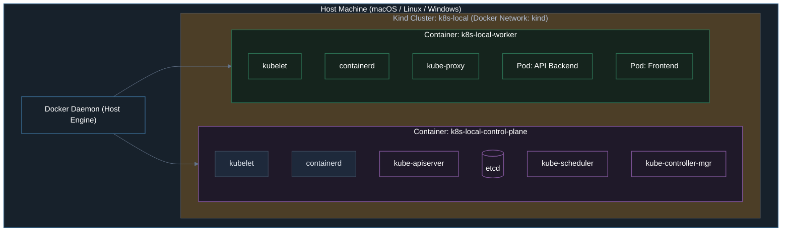
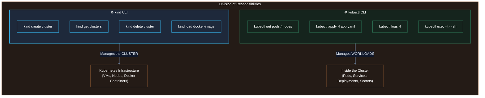
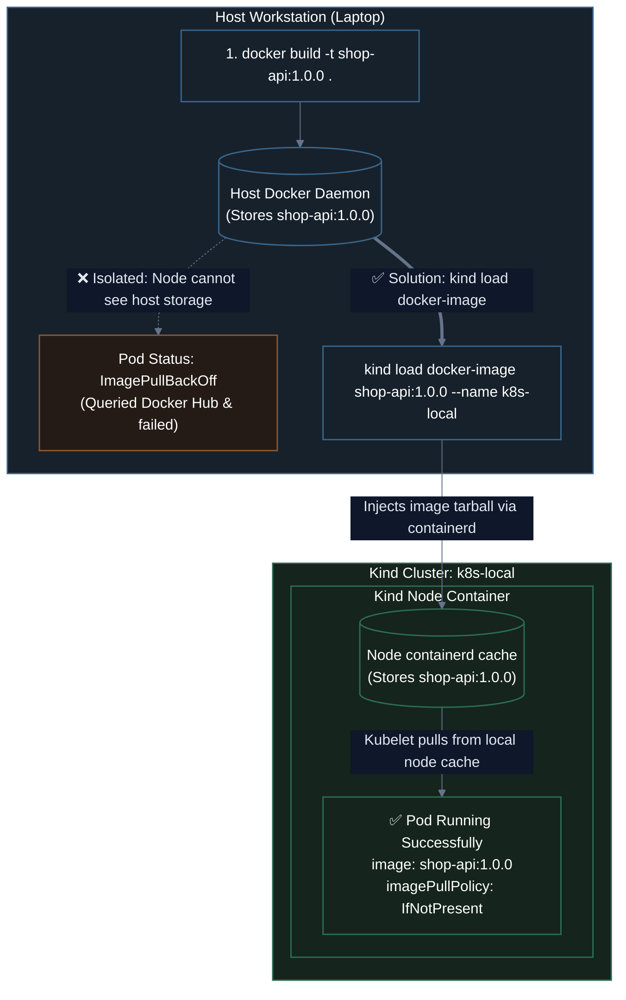

# 02. Kubernetes in Local with Kind

A practical, step-by-step guide to running Kubernetes locally using **Kind** (`Kubernetes in Docker`): CLI lifecycle management, the core mental model dividing `kind` and `kubectl`, and mastering the local Docker image loading workflow (`kind load docker-image`).

---

## 1. Introduction: What is Kind?

**Kind** (`Kubernetes IN Docker`) is an official CNCF tool that runs local Kubernetes clusters by turning **Docker containers into Kubernetes nodes**.

Instead of provisioning heavy virtual machines (like VirtualBox or Hyper-V), Kind launches lightweight container instances running a full Linux userland with **`systemd`**, **`containerd`**, and the **`kubelet`** inside each container.



---

## 2. Step ①: Install `kind` and `kubectl`

Before running Kubernetes locally, we install two distinct tools:
1. **`kind`**: The cluster lifecycle engine (creates, lists, and deletes clusters).
2. **`kubectl`**: The standard Kubernetes client (talks to the API server inside the cluster).

### On macOS (Homebrew)
```bash
brew install kind kubectl
```

### On Linux
```bash
# 1. Install kind binary
[ $(uname -m) = x86_64 ] && curl -Lo ./kind https://kind.sigs.k8s.io/dl/v0.25.0/kind-linux-amd64
chmod +x ./kind
sudo mv ./kind /usr/local/bin/kind

# 2. Install kubectl binary
curl -LO "https://dl.k8s.io/release/$(curl -L -s https://dl.k8s.io/release/stable.txt)/bin/linux/amd64/kubectl"
chmod +x ./kubectl
sudo mv ./kubectl /usr/local/bin/kubectl
```

### On Windows
```powershell
# Using Chocolatey
choco install kind kubernetes-cli

# Or using Winget
winget install Kubernetes.kind
winget install Kubernetes.kubectl
```

---

## 3. Step ②: Check Installed Versions

Always verify that both tools are properly recognized by your terminal:

```bash
# Check kind version
kind version
```
*Sample Output:*
```text
kind v0.25.0 go1.23.2 darwin/arm64
```

```bash
# Check kubectl version (client only)
kubectl version --client
```
*Sample Output:*
```text
Client Version: v1.31.1
Kustomize Version: v5.4.2
```

> [!NOTE]
> We use the `--client` flag with `kubectl` because we haven't started a cluster yet. Without `--client`, `kubectl` will attempt to reach `localhost:8080` or `localhost:6443` to query the server version and timeout.

---

## 4. Step ③: Create a Cluster (`kind create cluster`)

### Method A: Single-Node Cluster (Quickest)
To create a simple, single-node cluster (where the control-plane and worker workloads run on the same node):

```bash
kind create cluster --name k8s-local
```

**What Kind executes under the hood:**
1. Pulls the base node image (e.g., `kindest/node:v1.31.0`).
2. Starts a Docker container named `k8s-local-control-plane`.
3. Prepares certificates and spins up `etcd`, `kube-apiserver`, `kube-controller-manager`, and `kube-scheduler`.
4. Writes cluster credentials into your `~/.kube/config`.
5. Automatically switches your current `kubectl` context to `kind-k8s-local`.

```text
Creating cluster "k8s-local" ...
 ✓ Ensuring node image (kindest/node:v1.31.0) 🖼
 ✓ Preparing nodes 📦 
 ✓ Writing configuration 📜 
 ✓ Starting control-plane 🕹️ 
 ✓ Installing CNI 🔌 
 ✓ Installing StorageClass 💾 
Set kubectl context to "kind-k8s-local"
You can now use your cluster with:

kubectl cluster-info --context kind-k8s-local
```

---

### Method B: Multi-Node Cluster (Realistic Production Simulation)

In production, control-plane nodes never host user applications. To test real-world multi-node scheduling, node drains, and anti-affinity locally, Kind supports declarative configuration files:

Create `kind-config.yaml`:
```yaml
# kind-config.yaml
kind: Cluster
apiVersion: kind.x-k8s.io/v1alpha4
name: prod-local
nodes:
  - role: control-plane
  - role: worker
  - role: worker
```

Launch the multi-node cluster:
```bash
kind create cluster --config kind-config.yaml
```

Verify your cluster nodes with `kubectl`:
```bash
kubectl get nodes -o wide
```
*Output:*
```text
NAME                       STATUS   ROLES           AGE   VERSION   INTERNAL-IP   OS-IMAGE
prod-local-control-plane   Ready    control-plane   85s   v1.31.0   172.18.0.4    Ubuntu 24.04
prod-local-worker          Ready    <none>          60s   v1.31.0   172.18.0.3    Ubuntu 24.04
prod-local-worker2         Ready    <none>          60s   v1.31.0   172.18.0.2    Ubuntu 24.04
```

---

## 5. Step ④: List Clusters (`kind get clusters`)

To list all existing Kind clusters on your machine:

```bash
kind get clusters
```
*Output:*
```text
k8s-local
prod-local
```

### Inspecting Kind Nodes in Docker
Because Kind nodes are standard Docker containers, you can inspect them directly using Docker CLI:

```bash
docker ps --filter "name=k8s-local"
```
*Output:*
```text
CONTAINER ID   IMAGE                  COMMAND                  CREATED         STATUS         PORTS                       NAMES
d4a8e0f1b2c3   kindest/node:v1.31.0   "/usr/local/bin/entr…"   3 minutes ago   Up 3 minutes   127.0.0.1:51234->6443/tcp   k8s-local-control-plane
```

You can also list all node containers associated with a specific cluster:
```bash
kind get nodes --name k8s-local
```

---

## 6. Step ⑤: Delete a Cluster (`kind delete cluster`)

When you are finished testing and want to clean up CPU and memory on your machine:

```bash
kind delete cluster --name k8s-local
```

*Output:*
```text
Deleting cluster "k8s-local" ...
Deleted nodes: ["k8s-local-control-plane"]
```

Kind automatically:
- Stops and deletes all associated Docker node containers.
- Cleans up the Docker network bridge.
- Removes the cluster context from `~/.kube/config`.

---

## 7. ※ Core Mental Model: `kind` vs. `kubectl`

One of the most important mental models for beginners is understanding the boundary between **infrastructure lifecycle** and **workload operations**:



### Responsibility Matrix

| Feature / Task | Handled by `kind` | Handled by `kubectl` | Command Example |
| :--- | :---: | :---: | :--- |
| **Create cluster nodes** | ✅ | ❌ | `kind create cluster --name dev` |
| **Tear down cluster** | ✅ | ❌ | `kind delete cluster --name dev` |
| **Inject local image into nodes** | ✅ | ❌ | `kind load docker-image my-app:1.0 --name dev` |
| **List running Pods** | ❌ | ✅ | `kubectl get pods -A` |
| **Deploy an application manifest** | ❌ | ✅ | `kubectl apply -f deployment.yaml` |
| **Stream container logs** | ❌ | ✅ | `kubectl logs -f <pod-name>` |
| **Open shell inside container** | ❌ | ✅ | `kubectl exec -it <pod-name> -- sh` |

---

## 8. Step ⑥: The "Extra" Secret — Loading Docker Images (`kind load docker-image`)

This is the **#1 stumbling block** for engineers moving from Docker Compose to Kind.

### The Problem: Why `ErrImagePull` Happens
When you build an image locally on your workstation:
```bash
docker build -t shop-api:1.0.0 .
```
This image is stored exclusively in your **Host Machine's Docker Daemon**.

Now suppose you write a Kubernetes Pod manifest referencing that image:
```yaml
apiVersion: v1
kind: Pod
metadata:
  name: shop-api-pod
spec:
  containers:
    - name: shop-api
      image: shop-api:1.0.0
```

And apply it:
```bash
kubectl apply -f pod.yaml
```

When you inspect the Pod, it will fail:
```bash
kubectl get pods
```
*Output:*
```text
NAME           READY   STATUS             RESTARTS   AGE
shop-api-pod   0/1     ImagePullBackOff   0          18s
```

```bash
kubectl describe pod shop-api-pod
```
*Events:*
```text
Events:
  Type     Reason     Message
  ----     ------     -------
  Normal   BackOff    Back-off pulling image "shop-api:1.0.0"
  Warning  Failed     Failed to pull image "shop-api:1.0.0": rpc error: code = NotFound desc = failed to pull and unpack image "docker.io/library/shop-api:1.0.0"
```

### Why Did This Fail?
Kind nodes run inside Docker containers. Inside each Kind node is an **isolated `containerd` runtime**:
1. The Kind node **has zero visibility** into your host machine's Docker storage.
2. Because the node doesn't have the image, Kubernetes assumes it must be pulled from the internet (e.g., Docker Hub).
3. Docker Hub responds with `404 Not Found` because your private image has never been pushed there.



---

### The Solution: `kind load docker-image`

The `kind load docker-image` command packages your local Docker image on the host, streams the archive into the Kind node containers, and loads it directly into the node's **`containerd`** cache.

#### Command Syntax
```bash
kind load docker-image <IMAGE_NAME>:<TAG> --name <CLUSTER_NAME>
```

```
                 kind load docker-image shop-api:1.0.0 --name k8s-local
                                        │               │     │
                 Image Name & Tag ──────┘               │     │
                 Flag: Cluster name ────────────────────┘     │
                 Cluster Name ────────────────────────────────┘
```

#### Step-by-Step Execution:
```bash
# 1. Build image on host
docker build -t shop-api:1.0.0 ./services/shop-api

# 2. Transfer image directly into the Kind cluster nodes
kind load docker-image shop-api:1.0.0 --name k8s-local

# 3. Verify the image is now present inside the node's containerd cache
docker exec -it k8s-local-control-plane crictl images | grep shop-api
```
*Output:*
```text
docker.io/library/shop-api   1.0.0   a1b2c3d4e5f6   28.4MB
```

---

### ⚠️ The Golden Gotcha: `imagePullPolicy`

Even after running `kind load docker-image`, your Pod can still fail if you omit the version tag or use `:latest`:

> [!WARNING]
> **The `:latest` Trap**: If your container image tag is `:latest` (or if you don't specify any tag), Kubernetes automatically defaults to:
> ```yaml
> imagePullPolicy: Always
> ```
> With `imagePullPolicy: Always`, Kubernetes **explicitly ignores the local cache inside the node** and tries to connect to Docker Hub to check for newer digests. Since your local image doesn't exist on Docker Hub, the Pod will crash with `ImagePullBackOff`!
>
> **The Golden Rule for Kind**:
> 1. Always use an explicit version tag (e.g., `:1.0.0`, `:v1`, or `:dev`).
> 2. Explicitly set `imagePullPolicy: IfNotPresent` in your Pod manifest:

```yaml
apiVersion: v1
kind: Pod
metadata:
  name: shop-api-pod
spec:
  containers:
    - name: shop-api
      image: shop-api:1.0.0
      imagePullPolicy: IfNotPresent   # <-- CRITICAL for kind load to work!
```

---

## 9. Complete Hands-On Lab: Build, Load & Run Locally

Let's put everything together in a 5-minute hands-on test.

### 1. Create a Test Cluster
```bash
kind create cluster --name lab-demo
```

### 2. Create a Minimal App Dockerfile
Create a temporary directory and Dockerfile:
```bash
mkdir -p /tmp/kind-demo && cd /tmp/kind-demo

cat << 'EOF' > Dockerfile
FROM alpine:3.20
RUN apk add --no-cache curl
CMD ["sh", "-c", "echo 'Hello from inside Kind!' && sleep 3600"]
EOF
```

### 3. Build the Image on Your Host
```bash
docker build -t my-local-tool:1.0.0 .
```

### 4. Load the Image into Kind
```bash
kind load docker-image my-local-tool:1.0.0 --name lab-demo
```

### 5. Run the Pod Manifest
Create `test-pod.yaml`:
```yaml
apiVersion: v1
kind: Pod
metadata:
  name: local-tool-pod
spec:
  containers:
    - name: tool
      image: my-local-tool:1.0.0
      imagePullPolicy: IfNotPresent
```

Apply and check:
```bash
kubectl apply -f test-pod.yaml
kubectl get pod local-tool-pod
```
*Output:*
```text
NAME             READY   STATUS    RESTARTS   AGE
local-tool-pod   1/1     Running   0          5s
```

Check the pod logs:
```bash
kubectl logs local-tool-pod
```
*Output:*
```text
Hello from inside Kind!
```

### 6. Clean Up
```bash
kind delete cluster --name lab-demo
rm -rf /tmp/kind-demo
```

---

## 10. Navigating Kind with K9s (Terminal UI)

Instead of constantly re-typing `kubectl get pods`, `kubectl describe`, and `kubectl logs`, use **K9s** for real-time terminal cluster navigation:

### Install K9s
```bash
brew install derailed/k9s/k9s
```

### Launch K9s
```bash
k9s
```

### Essential K9s Keybindings Cheat Sheet

```
┌──────────────────────────────── K9s Cheatsheet ────────────────────────────────┐
│ Key              Action                                                        │
├────────────────────────────────────────────────────────────────────────────────┤
│ :pods            Jump to Pods view                                             │
│ :nodes           Jump to Nodes view                                            │
│ :deployments     Jump to Deployments view                                      │
│ :ns              Switch active Namespace                                       │
│ l                Stream real-time logs of the highlighted Pod                  │
│ s                Open an interactive shell inside the highlighted container   │
│ d                Describe the highlighted resource (inspect events & errors)   │
│ ctrl-d           Delete / kill the highlighted Pod (tests self-healing)       │
│ /<search>        Filter resources in current view                              │
│ esc              Go back / exit current view                                   │
│ :q               Quit K9s                                                      │
└────────────────────────────────────────────────────────────────────────────────┘
```

---

## 11. Chapter Summary & What's Next

In this lesson, we mastered local Kubernetes cluster operations:
1. **`kind`** runs full Kubernetes clusters by packaging nodes as Docker containers.
2. **`kind` vs `kubectl`**: `kind` controls cluster lifecycles; `kubectl` controls the workloads running inside.
3. **`kind load docker-image`** solves the image isolation boundary between the host Docker daemon and Kind's internal `containerd` runtime.
4. **`imagePullPolicy: IfNotPresent`** prevents Kubernetes from bypassing the local cache to query Docker Hub.
5. **`k9s`** gives platform engineers an ultra-fast, interactive terminal UI to inspect and debug running clusters.

---

### 🗺️ Next Lesson in Module 05
In **[`03-kubectl-commands-pods-and-networking.md`](./03-kubectl-commands-pods-and-networking.md)**, we start interacting directly with our cluster using `kubectl`:
- Managing contexts & cluster discovery (`get-contexts`, `use-context`, `cluster-info`).
- Creating Pods with commands and generating YAML via `--dry-run=client -o yaml`.
- Scaling up to self-healing Deployments.
- Testing container network connectivity using `kubectl port-forward`.

