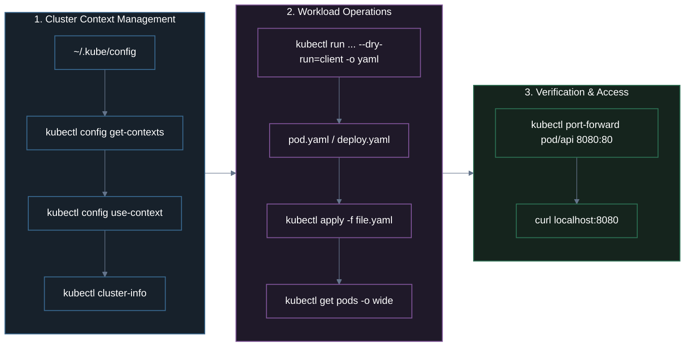
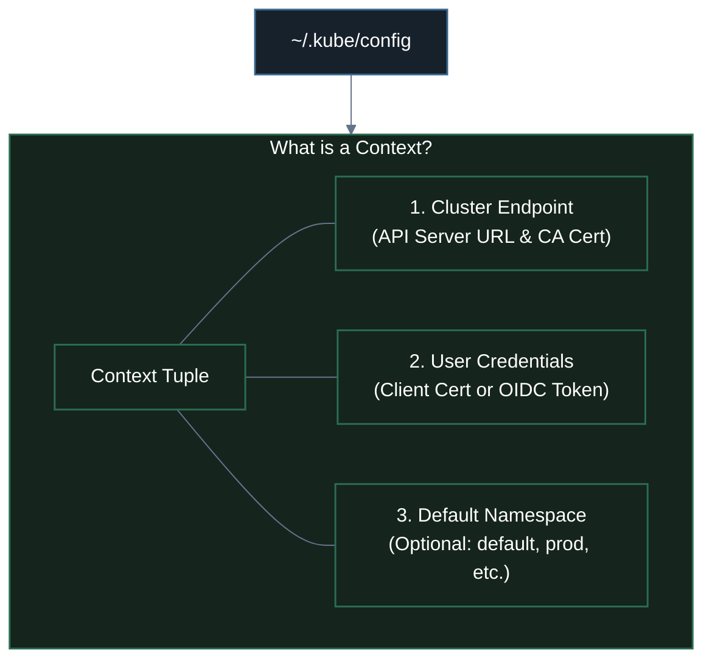
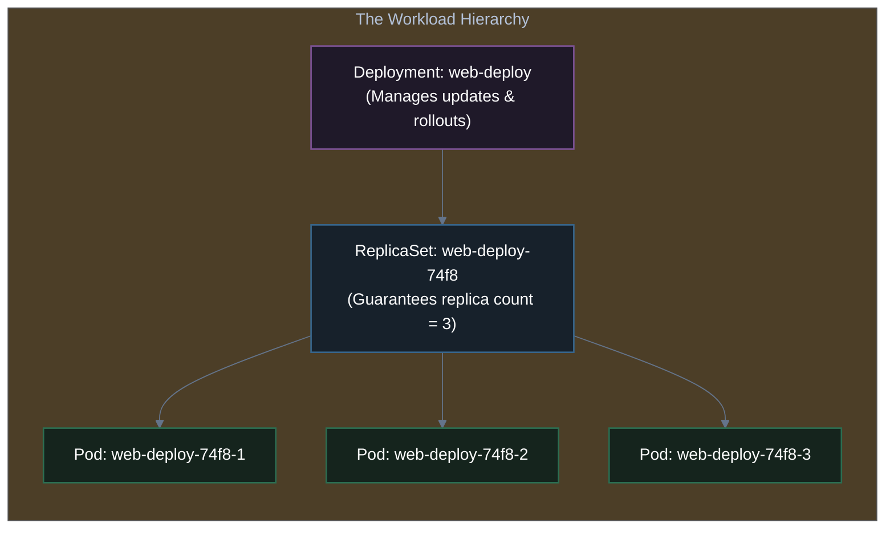
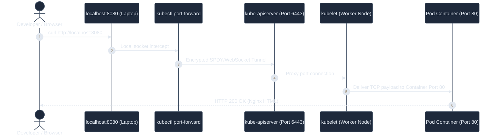

# 03. Hands-On with kubectl: Contexts, Pods, Deployments & Port-Forwarding

A practical, hands-on guide to mastering `kubectl`: cluster context switching, creating and inspecting Pods imperatively and declaratively, promoting Pods to self-healing Deployments, and testing container networking using `kubectl port-forward`.

---

## 1. Overview & Learning Objectives

Now that we have **Kind** running locally, `kubectl` becomes our primary operational tool. 

In this lesson, we will cover:
1. **Managing Kubernetes Contexts**: Listing, inspecting, and switching active clusters.
2. **Cluster Health & Discovery**: Checking nodes, pods, and cluster endpoints.
3. **The Pod Lifecycle**: Imperative creation vs. declarative YAML generation with `--dry-run=client`.
4. **Promoting to Deployments**: Why single Pods are insufficient for production and how Deployments provide automated self-healing.
5. **Testing Networking**: Tunneling traffic through `kubectl port-forward` to test applications locally.



---

## 2. Managing Kubernetes Contexts (`kubectl config`)

A developer or DevOps engineer often manages multiple Kubernetes clusters simultaneously (e.g., local `kind-dev`, staging `eks-staging`, and production `eks-prod`). 

All cluster access credentials live inside your local configuration file: **`~/.kube/config`**.



### ① List Kubernetes Contexts
To see all clusters configured on your workstation:

```bash
kubectl config get-contexts
```

*Sample Output:*
```text
CURRENT   NAME              CLUSTER           AUTHINFO          NAMESPACE
*         kind-k8s-local    kind-k8s-local    kind-k8s-local    default
          kind-prod-test    kind-prod-test    kind-prod-test    default
          arn:aws:eks:...   prod-eks-cluster  aws-iam-role      production
```

> [!NOTE]
> The asterisk (`*`) in the `CURRENT` column indicates the **active context** that all subsequent `kubectl` commands will execute against.

---

### ② Switch Active Cluster Context
To redirect `kubectl` to a different cluster:

```bash
kubectl config use-context <CONTEXT_NAME>
```

**Example**:
```bash
kubectl config use-context kind-k8s-local
```
*Output:*
```text
Switched to context "kind-k8s-local".
```

---

### ③ Check Current Cluster & Health

#### Check Active Context Name
```bash
kubectl config current-context
```
*Output:*
```text
kind-k8s-local
```

#### Check Cluster Control Plane Info
```bash
kubectl cluster-info
```
*Output:*
```text
Kubernetes control plane is running at https://127.0.0.1:51234
CoreDNS is running at https://127.0.0.1:51234/api/v1/namespaces/kube-system/services/kube-dns:dns/proxy

To further debug and diagnose cluster problems, use 'kubectl cluster-info dump'.
```

---

### ④ Inspect Nodes and Pods Inside the Cluster

#### Check Cluster Nodes
```bash
kubectl get nodes
```
To view additional hardware details (OS image, kernel version, internal IP, container runtime):
```bash
kubectl get nodes -o wide
```
*Output:*
```text
NAME                      STATUS   ROLES           AGE   VERSION   INTERNAL-IP   OS-IMAGE       KERNEL-VERSION     CONTAINER-RUNTIME
k8s-local-control-plane   Ready    control-plane   12m   v1.31.0   172.18.0.2    Ubuntu 24.04   6.6.137+rpt-rpi   containerd://1.7.15
```

#### Check Pods in Current Namespace
```bash
kubectl get pods
```
To view pods across **all namespaces** (including system components like CoreDNS and kube-proxy):
```bash
kubectl get pods -A
# or: kubectl get pods --all-namespaces
```

---

## 3. Kubernetes Pod Basics

A **Pod** is the smallest execution unit in Kubernetes. Let's look at the two distinct ways to create and manage Pods:
1. **Imperative Commands**: Fast, one-off commands directly executed from your terminal.
2. **Declarative Manifests**: Version-controlled YAML files that declare the desired state.

```mermaid
%%{init: {
  'theme': 'base',
  'themeVariables': {
    'darkMode': true,
    'background': '#0f172a',
    'primaryColor': '#1e293b',
    'primaryTextColor': '#e2e8f0',
    'primaryBorderColor': '#475569',
    'lineColor': '#64748b',
    'textColor': '#e2e8f0',
    'edgeLabelBackground': '#0f172a'
  },
  'themeCSS': '* { filter: none !important; box-shadow: none !important; } .node * { filter: none !important; } .cluster * { filter: none !important; }'
}}%%
flowchart TD
    subgraph Imperative["Imperative Approach (CLI Execution)"]
        RunCmd["kubectl run nginx-app --image=nginx:alpine"] --> API1["API Server executes immediately"]
    end

    subgraph Declarative["Declarative Approach (Industry Standard)"]
        DryRunCmd["kubectl run nginx-app --image=nginx:alpine<br/>--dry-run=client -o yaml > pod.yaml"] --> Manifest["pod.yaml (Version Controlled in Git)"]
        Manifest --> ApplyCmd["kubectl apply -f pod.yaml"]
        ApplyCmd --> API2["API Server reconciles Desired State"]
    end

    classDef cImp fill:#241b16,stroke:#8a5832,stroke-width:1.5px,color:#ffffff;
    classDef cDec fill:#15241d,stroke:#2b6d51,stroke-width:1.5px,color:#ffffff;
    class Imperative,RunCmd,API1 cImp;
    class Declarative,DryRunCmd,Manifest,ApplyCmd,API2 cDec;
```



---

### ① Create a Pod: Imperative vs. The `--dry-run=client` Pro Trick

#### Option A: Immediate Imperative Run
```bash
kubectl run hello-api --image=nginx:alpine
```
*Output:*
```text
pod/hello-api created
```

#### Option B: The Pro Dry-Run Trick (Generate YAML Template in 1 Second)
Writing Kubernetes YAML from memory is error-prone. Senior engineers use the **client-side dry-run flag** to generate valid manifests instantly:

```bash
kubectl run hello-api --image=nginx:alpine --dry-run=client -o yaml > pod.yaml
```

**Deconstructing the command:**
- `kubectl run hello-api`: Desired Pod name.
- `--image=nginx:alpine`: Container image to pull.
- `--dry-run=client`: **Do NOT contact the cluster or create the Pod**. Validate the flags locally on your laptop.
- `-o yaml`: Output the generated specification as standard YAML format.
- `> pod.yaml`: Redirect output into a file.

Let's examine the generated `pod.yaml`:
```yaml
apiVersion: v1
kind: Pod
metadata:
  creationTimestamp: null
  labels:
    run: hello-api
  name: hello-api
spec:
  containers:
  - image: nginx:alpine
    name: hello-api
    resources: {}
  dnsPolicy: ClusterFirst
  restartPolicy: Always
status: {}
```

---

### ② Apply and List Pods

Deploy the Pod declaratively using `kubectl apply`:
```bash
kubectl apply -f pod.yaml
```
*Output:*
```text
pod/hello-api created
```

#### Inspect Running Pods
```bash
kubectl get pods
```
*Output:*
```text
NAME        READY   STATUS    RESTARTS   AGE
hello-api   1/1     Running   0          25s
```

#### Detailed View with IP and Node Placement
```bash
kubectl get pods -o wide
```
*Output:*
```text
NAME        READY   STATUS    RESTARTS   AGE   IP           NODE                      NOMINATED NODE   READINESS GATES
hello-api   1/1     Running   0          45s   10.244.0.5   k8s-local-control-plane   <none>           <none>
```

> [!NOTE]
> Notice the assigned IP: `10.244.0.5`. This is an internal cluster IP allocated by the CNI plugin. It is **only reachable from inside the Kubernetes cluster network**, not directly from your host browser!

---

### ③ Delete a Pod

#### Delete by Name (Imperative):
```bash
kubectl delete pod hello-api
```

#### Delete by Manifest (Declarative):
```bash
kubectl delete -f pod.yaml
```
*Output:*
```text
pod "hello-api" deleted
```

---

## 4. Moving from Pods to Deployments

> [!CRITICAL]
> **Why are bare Pods never used in production?**
> 
> If you deploy a standalone Pod and the underlying node crashes, or the process dies without restart policies, **the Pod is dead forever**. A standalone Pod has **no controller** watching over it to recreate it.

In real-world systems, we wrap our Pods inside a **Deployment**:
- Automatically maintains your desired replica count (e.g., 3 copies).
- Self-heals: If a Pod is deleted or crashes, the ReplicaSet controller instantly launches a replacement.
- Supports zero-downtime rolling updates and instant rollbacks.



### Generate a Deployment Manifest with `--dry-run=client`

Just like `kubectl run`, you can generate clean Deployment YAML without writing it by hand:

```bash
kubectl create deployment web-app --image=nginx:alpine --replicas=3 --dry-run=client -o yaml > deployment.yaml
```

Inspect `deployment.yaml`:
```yaml
apiVersion: apps/v1
kind: Deployment
metadata:
  labels:
    app: web-app
  name: web-app
spec:
  replicas: 3
  selector:
    matchLabels:
      app: web-app
  template:
    metadata:
      labels:
        app: web-app
    spec:
      containers:
      - image: nginx:alpine
        name: nginx
        ports:
        - containerPort: 80
```

Apply the deployment:
```bash
kubectl apply -f deployment.yaml
```
*Output:*
```text
deployment.apps/web-app created
```

Verify the 3 running replicas:
```bash
kubectl get deployments
kubectl get pods -l app=web-app
```
*Output:*
```text
NAME                       READY   STATUS    RESTARTS   AGE
web-app-585449566-4k8pt    1/1     Running   0          18s
web-app-585449566-9zx2m    1/1     Running   0          18s
web-app-585449566-qj99w    1/1     Running   0          18s
```

### 🧪 Test Self-Healing in Real Time
Delete one of the pods manually:
```bash
kubectl delete pod web-app-585449566-4k8pt
```

Immediately run `kubectl get pods -l app=web-app`. You will see the ReplicaSet Controller already spawned a brand-new Pod within milliseconds to maintain the desired count of 3!

---

## 5. Network Testing with `kubectl port-forward`

Because Kubernetes Pods run inside an isolated internal virtual network, typing `http://10.244.0.5` in your Mac or Windows browser will fail with `Connection Timed Out`.

To test Pods and Deployments locally without provisioning complex cloud load balancers or Ingress controllers, Kubernetes provides **`kubectl port-forward`**.

### How Port-Forwarding Works Under the Hood



---

### Command Syntax

```bash
kubectl port-forward <RESOURCE_TYPE>/<RESOURCE_NAME> <LOCAL_PORT>:<CONTAINER_PORT>
```

```
       kubectl port-forward pod/hello-api 8080:80
                            │             │    │
       Target Resource ─────┘             │    │
       Local Port (on your machine) ──────┘    │
       Container Port (inside the Pod) ────────┘
```

---

### Hands-on Verification: Testing a Pod

1. Run the port-forward command in your terminal:
```bash
kubectl port-forward pod/hello-api 8080:80
```
*Output:*
```text
Forwarding from 127.0.0.1:8080 -> 80
Forwarding from [::1]:8080 -> 80
```

2. Open a separate terminal window and send an HTTP request:
```bash
curl http://localhost:8080
```
*Response:*
```html
<!DOCTYPE html>
<html>
<head>
<title>Welcome to nginx!</title>
...
```

In your port-forward terminal, you will see real-time connection logging:
```text
Handling connection for 8080
```

---

### Pro Tip: Port-Forwarding a Deployment Directly

Instead of finding an ephemeral, randomized Pod name (e.g., `web-app-585449566-9zx2m`), you can port-forward directly to a **Deployment**:

```bash
kubectl port-forward deployment/web-app 8080:80
```

`kubectl` will automatically pick one of the healthy, ready replica Pods managed by that Deployment and forward all traffic to it!

---

## 6. Comprehensive Cheat Sheet

| Category | Command | Description |
| :--- | :--- | :--- |
| **Contexts** | `kubectl config get-contexts` | Lists all known cluster contexts in `~/.kube/config`. |
| **Contexts** | `kubectl config use-context <name>` | Switches active cluster context. |
| **Contexts** | `kubectl config current-context` | Displays currently active context. |
| **Health** | `kubectl cluster-info` | Shows control-plane and CoreDNS status. |
| **Discovery** | `kubectl get nodes -o wide` | Displays nodes with OS, kernel, and internal IPs. |
| **Discovery** | `kubectl get pods -A` | Lists all pods across all namespaces. |
| **Workload** | `kubectl run <name> --image=` | Runs a pod imperatively. |
| **Pro Trick** | `kubectl run <n> --image=<i> --dry-run=client -o yaml > pod.yaml` | Generates declarative Pod manifest without creating it. |
| **Workload** | `kubectl create deployment <n> --image=<i> --replicas=3` | Creates a self-healing Deployment with 3 replicas. |
| **Lifecycle** | `kubectl apply -f <manifest.yaml>` | Creates or updates resources declaratively. |
| **Lifecycle** | `kubectl delete -f <manifest.yaml>` | Deletes all resources declared in the manifest. |
| **Lifecycle** | `kubectl delete pod <pod-name>` | Deletes an individual pod. |
| **Networking** | `kubectl port-forward pod/<name> 8080:80` | Tunnels local port 8080 to container port 80. |
| **Networking** | `kubectl port-forward deployment/<name> 8080:80` | Tunnels local port directly to a deployment. |

---

## 7. Chapter Summary & What's Next

In this lesson, we established practical day-to-day fluency with `kubectl`:
1. **Contexts**: Managed multi-cluster connections through `kubectl config` and `~/.kube/config`.
2. **Pod Basics**: Understood imperative creation vs. declarative manifests generated with `--dry-run=client -o yaml`.
3. **Deployments**: Saw why production requires Deployments and ReplicaSets to achieve automated self-healing.
4. **Networking**: Bridged isolated cluster container networks to our workstation using `kubectl port-forward`.

---

### 🗺️ Next Lesson in Module 05
In **[`04-kubernetes-architecture-and-core-components.md`](./04-kubernetes-architecture-and-core-components.md)**, we inspect what is actually happening behind the scenes inside our cluster when these commands run:
- The Control Plane: `kube-apiserver`, `etcd`, `kube-scheduler`, and `kube-controller-manager`.
- The Worker Node: `kubelet`, `containerd`, and `kube-proxy`.
- Complete Lifecycle Trace: The life of a Pod request from `kubectl apply` to running process.

