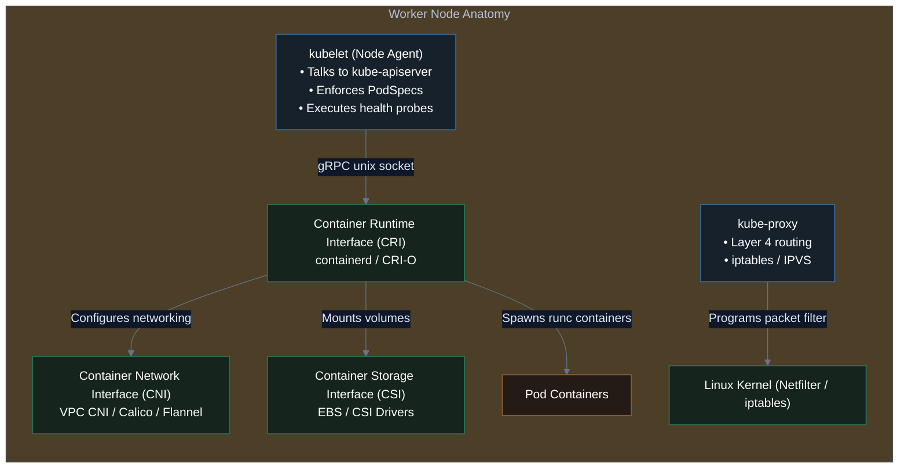
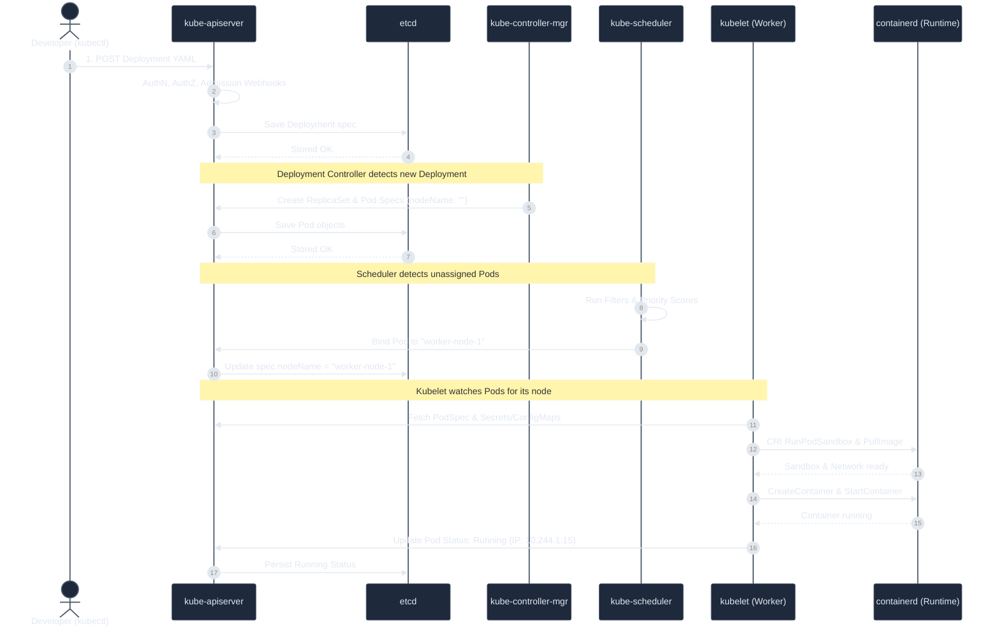
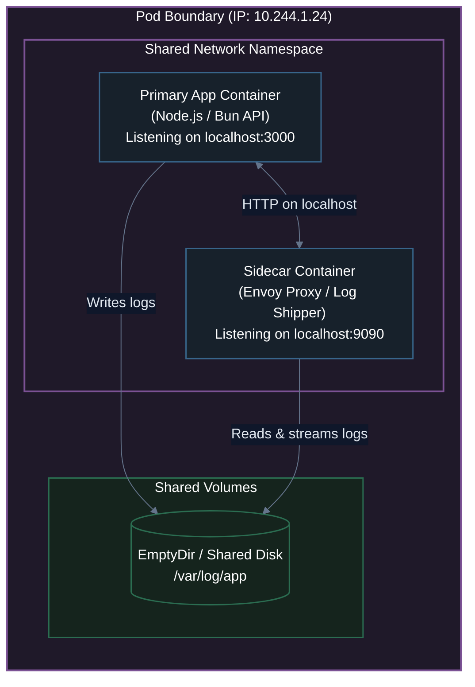

# 04. Kubernetes Architecture & Core Components

A complete deep dive into the internal anatomy of a Kubernetes cluster: the Control Plane (the "brain"), Worker Nodes (the "muscles"), the life of a Pod request, and hands-on inspection of runtime internals using **Kind** and **crictl**.

---

## 1. High-Level Cluster Architecture

A Kubernetes cluster consists of two distinct operational tiers:
1. **The Control Plane (Master Tier)**: The "brain" that makes global decisions about the cluster (scheduling, detecting node failures, responding to events, maintaining desired state).
2. **The Data Plane (Worker Nodes Tier)**: The "muscles" that run the actual containerized application workloads and handle user traffic.

```mermaid
%%{init: {
  'theme': 'base',
  'themeVariables': {
    'darkMode': true,
    'background': '#0f172a',
    'primaryColor': '#1e293b',
    'primaryTextColor': '#e2e8f0',
    'primaryBorderColor': '#475569',
    'lineColor': '#64748b',
    'textColor': '#e2e8f0',
    'edgeLabelBackground': '#0f172a'
  },
  'themeCSS': '* { filter: none !important; box-shadow: none !important; } .node * { filter: none !important; } .cluster * { filter: none !important; }'
}}%%
flowchart TD
    subgraph ControlPlane["Control Plane (Master Node / Managed Tier)"]
        direction TB
        API["kube-apiserver<br/>(Port 6443 - Front Door)"]
        ETCD[("etcd<br/>(Port 2379/2380 - Datastore)")]
        SCHED["kube-scheduler<br/>(Placement Engine)"]
        KCM["kube-controller-manager<br/>(Reconciliation Loops)"]
        CCM["cloud-controller-manager<br/>(Cloud Provider Sync)"]

        API <==>|Raft Read/Write| ETCD
        API <--> SCHED
        API <--> KCM
        API <--> CCM
    end

    subgraph Worker1["Worker Node 1"]
        direction TB
        Kubelet1["kubelet<br/>(Node Agent)"]
        KP1["kube-proxy<br/>(L4 Network Rules)"]
        CRI1["Container Runtime<br/>(containerd)"]
        
        subgraph Pods1["Application Workloads"]
            PodA["Pod: API Backend"]
            PodB["Pod: Storefront"]
        end
        
        Kubelet1 -->|CRI (gRPC)| CRI1
        CRI1 --> Pods1
    end

    subgraph Worker2["Worker Node 2"]
        direction TB
        Kubelet2["kubelet<br/>(Node Agent)"]
        KP2["kube-proxy<br/>(L4 Network Rules)"]
        CRI2["Container Runtime<br/>(containerd)"]
        
        subgraph Pods2["Application Workloads"]
            PodC["Pod: Redis Cache"]
            PodD["Pod: Worker Job"]
        end
        
        Kubelet2 -->|CRI (gRPC)| CRI2
        CRI2 --> Pods2
    end

    User(["Operator / kubectl"]) -->|HTTPS REST| API
    API <===>|Port 10250 (TLS)| Kubelet1
    API <===>|Port 10250 (TLS)| Kubelet2
    KP1 -.->|Updates iptables / IPVS| Worker1
    KP2 -.->|Updates iptables / IPVS| Worker2

    classDef cControl fill:#17212b,stroke:#38668c,stroke-width:1.5px,color:#ffffff;
    classDef cWorker fill:#15241d,stroke:#2b6d51,stroke-width:1.5px,color:#ffffff;
    classDef cStorage fill:#241b16,stroke:#8a5832,stroke-width:1.5px,color:#ffffff;
    classDef cUser fill:#1f1929,stroke:#7c5295,stroke-width:1.5px,color:#ffffff;

    class ControlPlane,API,SCHED,KCM,CCM cControl;
    class Worker1,Worker2,Kubelet1,Kubelet2,KP1,KP2,CRI1,CRI2,Pods1,Pods2,PodA,PodB,PodC,PodD cWorker;
    class ETCD cStorage;
    class User cUser;
```

---

## 2. The Control Plane Deep Dive (The "Brain")

The Control Plane components coordinate the entire cluster. In a production cluster (like AWS EKS or high-availability bare-metal), these components run across multiple availability zones.

### 1. `kube-apiserver` (The Hub)
- **Role**: The central communication backbone of Kubernetes. It exposes the Kubernetes HTTP REST API (`/api/v1`, `/apis/apps/v1`, etc.).
- **Crucial Rule**: **No component communicates directly with `etcd` except `kube-apiserver`**. All other components (`kube-scheduler`, `kubelet`, `kube-controller-manager`) communicate exclusively through the API Server.
- **Request Pipeline**:
  ```text
  Client Request ──► [ Authentication ] ──► [ Authorization (RBAC) ] ──► [ Admission Control ] ──► [ etcd ]
  ```
  1. **Authentication (AuthN)**: Validates identity using X.509 client certificates, OpenID Connect (OIDC), or ServiceAccount Bearer Tokens.
  2. **Authorization (AuthZ)**: Evaluates Role-Based Access Control (RBAC) to verify if the subject has permission to perform the verb (`get`, `list`, `create`, `delete`) on the resource (`pods`, `services`).
  3. **Admission Controllers**:
     - *Mutating Admission Webhooks*: Automatically modifies requests before saving (e.g., injecting sidecars like Istio or Vault secrets).
     - *Validating Admission Webhooks*: Enforces security guardrails (e.g., denying containers running as root).

### 2. `etcd` (The Source of Truth)
- **Role**: A strongly consistent, distributed, transactional key-value store implementing the **Raft Consensus Algorithm**.
- **Cluster State**: All cluster state, configuration, and secrets reside in `etcd`. If `etcd` is lost without backups, the cluster state is permanently destroyed.
- **Quorum Mathematics**:
  To tolerate node failures, `etcd` requires an odd number of voting members to establish a majority quorum ($Q = \lfloor N/2 \rfloor + 1$):
  - **3-node cluster**: Can tolerate **1 node failure** (Quorum = 2).
  - **5-node cluster**: Can tolerate **2 node failures** (Quorum = 3).
- **Watch API**: Components subscribe to change streams via HTTP/2 gRPC `watch()` calls instead of polling.

### 3. `kube-scheduler` (The Matchmaker)
- **Role**: Watches for newly created Pods that have no assigned node (`spec.nodeName == ""`) and selects the optimal worker node for them to execute on.
- **Two-Stage Decision Algorithm**:
  ```text
  All Cluster Nodes ──► Stage 1: Filtering (Predicates) ──► Stage 2: Scoring (Priorities) ──► Selected Node
  ```
  1. **Stage 1: Filtering (Predicates)**:
     - Discards nodes that cannot run the Pod:
       - Does the node have enough unallocated CPU/Memory (`PodFitsResources`)?
       - Does the node match `nodeSelector` or `nodeAffinity`?
       - Does the node have taints that the Pod lacks tolerations for (`NodeTaints`)?
       - Does the node host a conflicting host port (`PodFitsHostPorts`)?
  2. **Stage 2: Scoring (Priorities)**:
     - Ranks the remaining candidates on a score from 0 to 100:
       - *LeastRequestedPriority*: Spreads workloads evenly to maximize available head-room.
       - *ImageLocalityPriority*: Prefers nodes that already have the container image cached locally to eliminate download time.
       - *NodeAffinityPriority*: Favors nodes matching preferred affinity rules.
  3. **Binding**: Once selected, the scheduler writes a `Binding` object back to the `kube-apiserver`.

### 4. `kube-controller-manager` (The Regulator)
- **Role**: Runs continuous control loops (reconciliation loops) that observe actual state through the API Server and enforce desired state.
- Multiple logical controllers compiled into a single binary:
  - **Node Controller**: Monitors node heartbeats. If a node fails to report for 40 seconds, it marks it `NotReady`. If down for 5 minutes, it evicts Pods.
  - **Deployment / ReplicaSet Controller**: Ensures the exact number of Pod replicas specified in the manifest are running.
  - **Endpoints / EndpointSlice Controller**: Populates Service endpoints with healthy Pod IP addresses.
  - **ServiceAccount Controller**: Generates default ServiceAccounts and API access tokens for new namespaces.

### 5. `cloud-controller-manager` (CCM)
- **Role**: Decouples cloud-provider-specific logic from core Kubernetes code.
- Manages external Cloud Load Balancers (AWS NLB/ALB, GCP Cloud Load Balancing), cloud routes, and node lifecycle.

---

## 3. The Data Plane Deep Dive (The "Muscles")

Every Worker Node in a Kubernetes cluster runs three essential components:



### 1. `kubelet` (The Node Captain)
- **Role**: The primary node agent running as a system daemon.
- **Responsibilities**:
  - Registers the node with the API server, reporting hardware resources (CPU, Memory, Ephemeral Storage).
  - Watches for Pod manifests assigned to this specific node.
  - Communicates with the container runtime via **CRI (Container Runtime Interface)** to start, stop, and inspect containers.
  - Executes **Liveness, Readiness, and Startup health probes**.
  - Mounts storage volumes and injects ConfigMaps and Secrets into container filesystems.

### 2. Container Runtime (CRI — `containerd` / `CRI-O`)
- **Role**: Responsible for the low-level lifecycle of containers: pulling images, unpacking root filesystems, configuring Linux namespaces, and invoking `runc` to execute processes.
- Kubernetes communicates with `containerd` via standard gRPC unix domain sockets (`unix:///run/containerd/containerd.sock`).

### 3. `kube-proxy` (The Network Dispatcher)
- **Role**: A network proxy that runs on each worker node as a `DaemonSet`. It enables Kubernetes **Service** networking.
- Writes Linux `iptables` NAT rules or IPVS hash tables to load-balance traffic hitting a Service Virtual IP to backend Pod IPs.

---

## 4. The Life of a Pod: Complete Lifecycle Trace



---

## 5. The Atomic Unit: What is a Pod?

In Kubernetes, you never deploy a raw container directly. The smallest deployable unit of compute is a **Pod**.

A Pod wraps one or more tightly coupled containers that share:
1. **Network Namespace**: Same IP address, port space, and `localhost` networking.
2. **Storage Volumes**: Shared volumes mounted across containers.
3. **Linux Namespaces**: Shared UTS hostname and optional shared IPC/PID.



---

## 6. Chapter Summary & Key Takeaways

1. **Control Plane** = `kube-apiserver` (API gateway & sole communicator with `etcd`), `etcd` (Raft datastore), `kube-scheduler` (node selection), and `kube-controller-manager` (reconciliation loops).
2. **Worker Node** = `kubelet` (node captain enforcing PodSpecs), `containerd` (CRI runtime spawning containers), and `kube-proxy` (programming iptables/IPVS for Service routing).
3. **The Pod** is the atomic deployable unit; multiple containers within a Pod share an IP address, port space (`localhost`), and volume mounts.

---

### 🗺️ Next Lesson in Module 05
In **`04-workload-management-deployments-and-replicas.md`**, we move beyond single Pods to production workload controllers:
- Why raw Pods are never used in production (no self-healing on node death).
- **ReplicaSets**: Maintaining exact replica counts.
- **Deployments**: Declarative rolling updates, rollbacks, maxSurge, and maxUnavailable tuning.

