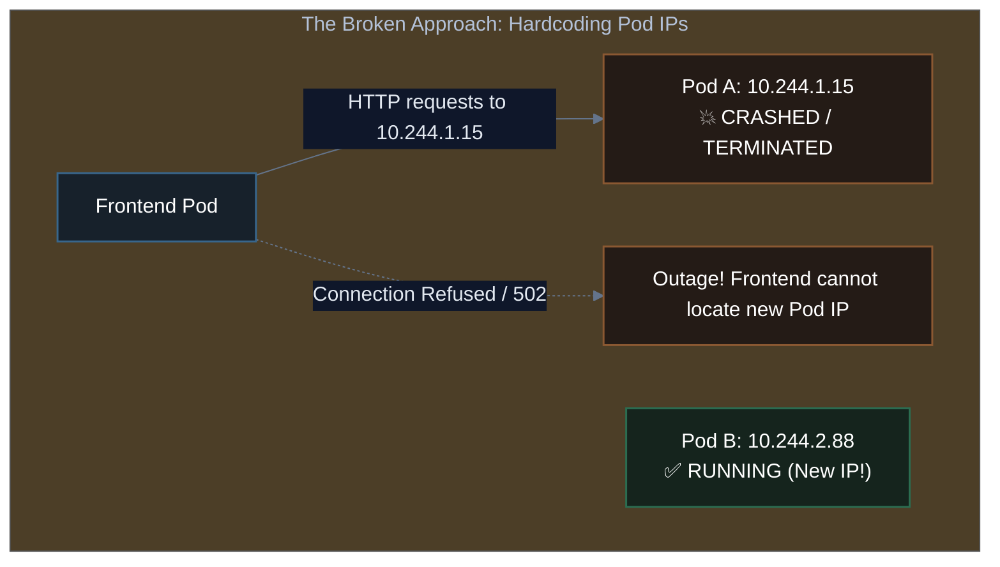
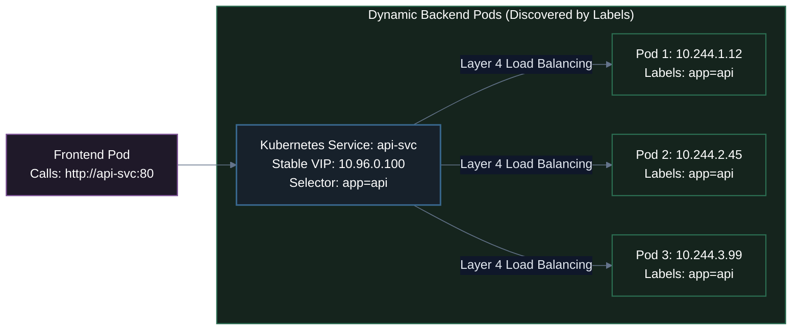
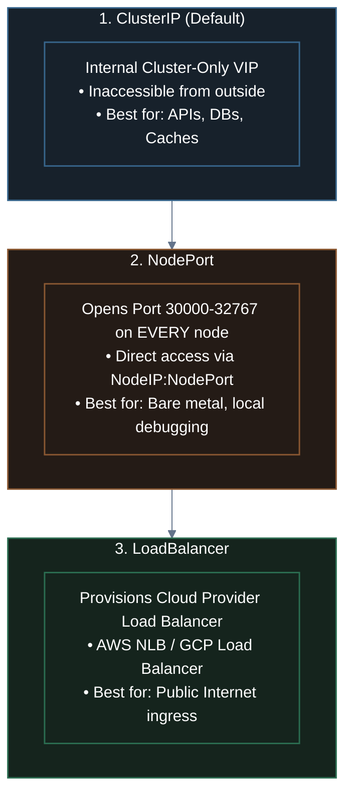
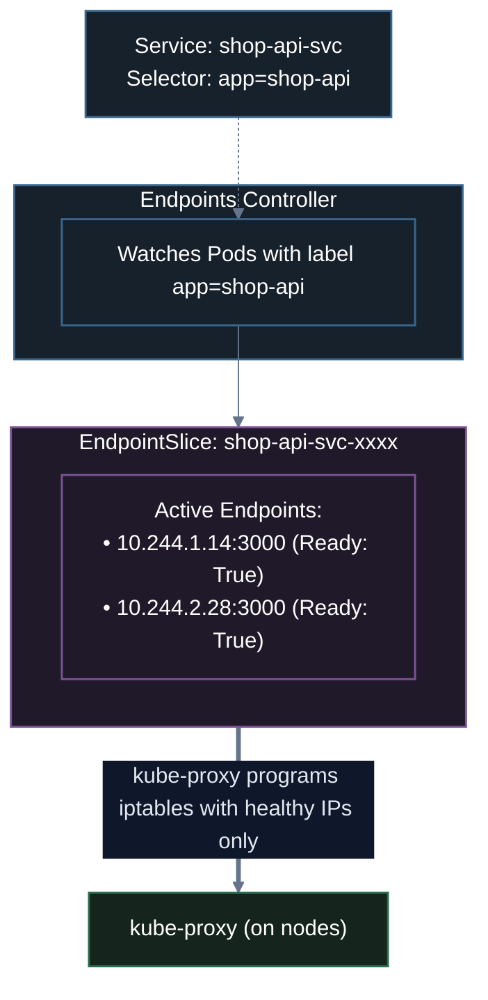

# 04. Kubernetes Services & Internal Networking

A complete guide to Kubernetes networking: solving the ephemeral Pod IP problem, mastering the 3 core Service types (`ClusterIP`, `NodePort`, `LoadBalancer`), understanding `Port` vs. `TargetPort`, service discovery via **CoreDNS**, and verifying in-cluster load balancing.

---

## 1. The Core Problem: Why Pod IPs Cannot Be Trusted

In Lesson 03, we deployed Pods and used `kubectl port-forward` to test them locally on `localhost:8080`. But in production, applications consist of dozens of microservices that must communicate **internally** (e.g., Frontend talking to Backend API, Backend API talking to PostgreSQL).

### The Ephemeral Pod IP Trap
Every Pod in Kubernetes receives its own private IP address from the Container Network Interface (CNI), such as `10.244.1.15`. 

However, **Pods are mortal and ephemeral**:
- If a Pod crashes, Kubernetes terminates it and launches a new one with a **brand new IP address**.
- If a Deployment scales from 2 to 5 replicas, 3 new IP addresses are added dynamically.
- During a zero-downtime rolling update, old Pod IPs are destroyed and replaced with new ones every few seconds.



> [!CAUTION]
> **Production Rule #1**: Never, under any circumstances, hardcode a Pod IP address in configuration files, environment variables, or application code.

---

## 2. What is a Kubernetes Service?

A **Service** is a durable, permanent abstraction that sits in front of a dynamic set of Pods. It provides:
1. **A Stable Virtual IP (VIP)**: A static IP (`ClusterIP`) that never changes throughout the lifetime of the Service.
2. **A Stable DNS Name**: Automatically registered in CoreDNS (e.g., `http://shop-api:8080`).
3. **Automatic Load Balancing**: Transparently distributes traffic across all healthy Pods.
4. **Dynamic Membership**: Discovers backend Pods using **Label Selectors** (`app: shop-api`).



When Pod 1 crashes and is replaced by Pod 4 (`10.244.1.99`), the Service automatically updates its backend list without dropping incoming frontend requests.

---

## 3. Demystifying Ports: `port` vs. `targetPort` vs. `nodePort`

One of the most frequent points of confusion for developers is understanding the three distinct port definitions inside a Service manifest:

```yaml
apiVersion: v1
kind: Service
metadata:
  name: shop-api-svc
spec:
  type: ClusterIP
  selector:
    app: shop-api
  ports:
    - name: http
      port: 80           # 1. Port exposed by the Service inside the cluster
      targetPort: 3000   # 2. Port your container application listens on
      # nodePort: 30080  # 3. Port opened on every node (only for NodePort / LoadBalancer)
```



```mermaid
%%{init: {
  'theme': 'base',
  'themeVariables': {
    'darkMode': true,
    'background': '#0f172a',
    'primaryColor': '#1e293b',
    'primaryTextColor': '#e2e8f0',
    'primaryBorderColor': '#475569',
    'lineColor': '#64748b',
    'textColor': '#e2e8f0',
    'edgeLabelBackground': '#0f172a'
  },
  'themeCSS': '* { filter: none !important; box-shadow: none !important; } .node * { filter: none !important; } .cluster * { filter: none !important; }'
}}%%
flowchart LR
    Caller["Client Pod"] -->|Connects to Service:80| SPort["Service Port: 80<br/>(port)"]
    SPort -->|kube-proxy forwards to| TPort["Container Port: 3000<br/>(targetPort)"]
    TPort --> App["Node.js / Bun / Go Process<br/>Listening on 0.0.0.0:3000"]

    classDef c1 fill:#17212b,stroke:#38668c,stroke-width:1.5px,color:#ffffff;
    classDef c2 fill:#1f1929,stroke:#7c5295,stroke-width:1.5px,color:#ffffff;
    classDef c3 fill:#15241d,stroke:#2b6d51,stroke-width:1.5px,color:#ffffff;

    class Caller c1;
    class SPort c2;
    class TPort,App c3;
```

| Port Field | Where it Lives | Who Connects to It? | Real-World Example |
| :--- | :--- | :--- | :--- |
| **`port`** | The **Service** | Other Pods in the cluster | Client connects to `http://shop-api-svc:80` |
| **`targetPort`** | The **Container** | The Service | Your Node.js/Go app listening on `3000` |
| **`nodePort`** | The **Host Node** | External clients outside cluster | Direct browser access to `http://<NodeIP>:30080` |

> [!TIP]
> **Best Practice**: If your backend app listens on port `3000`, set `port: 80` on the Service and `targetPort: 3000`. Other microservices can then use clean standard URLs like `http://shop-api` without remembering odd container port numbers!

---

## 4. The 3 Core Service Types

Kubernetes offers three primary Service types depending on the network reachability required:



---

### Type 1: `ClusterIP` (Internal Microservices)
- **Scope**: Internal to the cluster only.
- **Default**: If you omit `spec.type`, Kubernetes automatically assigns `ClusterIP`.
- **Use Case**: 95% of your production services (Databases, Redis caches, internal gRPC/REST microservices).

```yaml
# service-clusterip.yaml
apiVersion: v1
kind: Service
metadata:
  name: backend-service
spec:
  type: ClusterIP
  selector:
    app: backend
  ports:
    - name: http
      port: 80
      targetPort: 8080
```

---

### Type 2: `NodePort` (Direct Node Access)
- **Scope**: Accessible from outside the cluster using `<Any-Node-IP>:<NodePort>`.
- **Port Range**: Kubernetes reserves ports `30000–32767` by default.
- **How it works**: `kube-proxy` opens the designated port on **every worker node** in the cluster. Traffic sent to that port on any node is routed to backend Pods.

```yaml
# service-nodeport.yaml
apiVersion: v1
kind: Service
metadata:
  name: web-nodeport
spec:
  type: NodePort
  selector:
    app: storefront
  ports:
    - name: http
      port: 80
      targetPort: 80
      nodePort: 30080   # Optional: if omitted, Kubernetes picks random 30000-32767
```

---

### Type 3: `LoadBalancer` (Cloud Ingress)
- **Scope**: Publicly reachable over the Internet.
- **Cloud Integration**: Only works on cloud providers (AWS, GCP, Azure, DigitalOcean) or with on-premise controllers like MetalLB.
- When deployed on AWS EKS, Kubernetes automatically provisions an **AWS Network Load Balancer (NLB)** and assigns a public DNS hostname.

```yaml
# service-loadbalancer.yaml
apiVersion: v1
kind: Service
metadata:
  name: public-ingress-svc
spec:
  type: LoadBalancer
  selector:
    app: storefront
  ports:
    - name: http
      port: 80
      targetPort: 80
```

---

## 5. Service Discovery & CoreDNS

How do Pods know the IP address of a Service? **They don't need to**. 

Kubernetes runs a cluster-internal DNS server called **CoreDNS**. Whenever a Service is created, CoreDNS automatically publishes an `A` record for it.

### Anatomy of an In-Cluster DNS Name

```
                     shop-api-svc.default.svc.cluster.local
                     │            │       │   │
  Service Name ──────┘            │       │   │
  Namespace ──────────────────────┘       │   │
  Service Record Subdomain ───────────────┘   │
  Cluster Domain Suffix ──────────────────────┘
```

### Automatic Search Domains in Linux Containers
Every container spawned in Kubernetes has its `/etc/resolv.conf` automatically configured with search domains:
```text
search default.svc.cluster.local svc.cluster.local cluster.local
nameserver 10.96.0.10
options ndots:5
```

This allows applications to use **clean, short domain names**:
1. **Same Namespace**: A Pod in `default` can simply curl:
   ```bash
   curl http://shop-api-svc
   ```
2. **Different Namespace**: A Pod in `staging` connecting to `production` can curl:
   ```bash
   curl http://shop-api-svc.production
   ```
3. **Full FQDN**: Always works from anywhere in the cluster:
   ```bash
   curl http://shop-api-svc.production.svc.cluster.local
   ```

---

## 6. Under the Hood: Endpoints & EndpointSlices

A Service is only a frontend routing rule. How does it know which Pods are ready to receive traffic?

Whenever a Service is created, Kubernetes automatically generates an **`Endpoints`** (and modern **`EndpointSlice`**) resource with the exact same name:



### Inspect Endpoints via CLI:
```bash
kubectl get endpoints shop-api-svc
```
*Output:*
```text
NAME           ENDPOINTS                           AGE
shop-api-svc   10.244.1.14:3000,10.244.2.28:3000   4m
```

> [!IMPORTANT]
> **Health Check Protection**: If a Pod's **Readiness Probe** fails, the EndpointSlice controller **immediately removes that Pod's IP** from the active endpoints list. The Pod remains running for debugging, but user traffic will never hit it!

---

## 7. Complete Hands-On Lab: Deploy, Expose & Verify Load Balancing with `task-api`

Let's verify internal networking, CoreDNS resolution, and round-robin load balancing using our custom ElysiaJS **`task-api:1.0.0`** image in your local Kind cluster.

### Step 1: Deploy a 3-Replica `task-api` Service
Create a Deployment and Service manifest:

```yaml
# lab-networking.yaml
apiVersion: apps/v1
kind: Deployment
metadata:
  name: task-api
  labels:
    app: task-api
spec:
  replicas: 3
  selector:
    matchLabels:
      app: task-api
  template:
    metadata:
      labels:
        app: task-api
    spec:
      containers:
        - name: task-api
          image: task-api:1.0.0
          imagePullPolicy: IfNotPresent
          ports:
            - containerPort: 3000
---
apiVersion: v1
kind: Service
metadata:
  name: task-api-service
spec:
  type: ClusterIP
  selector:
    app: task-api
  ports:
    - name: http
      port: 80          # Service port (clean default HTTP)
      targetPort: 3000  # ElysiaJS container port
```

Apply the manifest:
```bash
kubectl apply -f lab-networking.yaml
```

Verify that 3 Pods and the Service are running:
```bash
kubectl get pods -l app=task-api -o wide
kubectl get svc task-api-service
```
*Output:*
```text
NAME               TYPE        CLUSTER-IP     EXTERNAL-IP   PORT(S)   AGE
task-api-service   ClusterIP   10.96.18.240   <none>        80/TCP    25s
```

Check the active endpoints:
```bash
kubectl get endpoints task-api-service
```
*Output:*
```text
NAME               ENDPOINTS                                            AGE
task-api-service   10.244.0.7:3000,10.244.0.8:3000,10.244.0.9:3000      35s
```

---

### Step 2: Test Internal CoreDNS from a Client Pod

Because `ClusterIP` cannot be reached from your laptop's browser directly, launch an interactive curl container inside the cluster network:

```bash
kubectl run test-client --image=curlimages/curl -it --rm -- sh
```

Inside the `test-client` shell, test internal DNS resolution:

#### 1. Query by Short Service Name:
```sh
curl http://task-api-service/
```
*Sample Response:*
```json
{
  "app": "task-api",
  "framework": "ElysiaJS (Bun)",
  "message": "🦊 Hello from Task API running inside Kubernetes!",
  "servedByPod": "task-api-7c4f4b986b-4k99w",
  "timestamp": "2026-11-01T11:20:00.000Z"
}
```

#### 2. Query by Full Qualified Domain Name (FQDN):
```sh
curl http://task-api-service.default.svc.cluster.local/info
```

#### 3. Inspect DNS Resolution:
```sh
nslookup task-api-service
```
*Output:*
```text
Server:		10.96.0.10
Address:	10.96.0.10#53

Name:	task-api-service.default.svc.cluster.local
Address: 10.96.18.240
```

---

### Step 3: Observe Automatic Round-Robin Load Balancing

Because `task-api` returns its own Pod hostname in the response, we can directly watch `kube-proxy` distribute traffic!

While still inside the `test-client` shell, send 6 consecutive requests:

```sh
for i in $(seq 1 6); do curl -s http://task-api-service/info | grep -o '"podName":"[^"]*"'; done
```

*Output:*
```text
"podName":"task-api-7c4f4b986b-4k99w"
"podName":"task-api-7c4f4b986b-x89zt"
"podName":"task-api-7c4f4b986b-9p4ql"
"podName":"task-api-7c4f4b986b-4k99w"
"podName":"task-api-7c4f4b986b-x89zt"
"podName":"task-api-7c4f4b986b-9p4ql"
```

> [!NOTE]
> Look at the `podName` values! Every time you curl the single virtual IP (`http://task-api-service`), traffic alternates sequentially across all three Pod replicas without an external load balancer!

Exit the client shell:
```sh
exit
```

---

### Step 4: Clean Up the Lab
```bash
kubectl delete -f lab-networking.yaml
```

---

## 8. Summary Comparison Matrix & Cheat Sheet

### Service Types Comparison

| Service Type | Scope | Target Use Case | Cloud Dependency | Cost |
| :--- | :--- | :--- | :--- | :--- |
| **`ClusterIP`** | Cluster-Internal only | Backend APIs, Databases, Caching | None (runs everywhere) | $0 |
| **`NodePort`** | Node IP + Port (`30000-32767`) | Direct port access on bare-metal | None (runs everywhere) | $0 |
| **`LoadBalancer`** | Public Internet | Production public ingress entry points | AWS, GCP, Azure, or MetalLB | Cloud Load Balancer hourly fee |

---

### Essential Networking Commands Cheat Sheet

```bash
# Expose an existing deployment imperatively as a ClusterIP service:
kubectl expose deployment shop-api --port=80 --target-port=3000 --name=shop-api-svc

# Generate Service YAML template without creating it:
kubectl expose deployment shop-api --port=80 --target-port=3000 --dry-run=client -o yaml > service.yaml

# List all services and their ClusterIPs:
kubectl get svc -o wide

# Describe service configuration and label selectors:
kubectl describe svc shop-api-svc

# Inspect healthy backend Pod IPs currently wired to a Service:
kubectl get endpoints shop-api-svc
kubectl get endpointslices -l kubernetes.io/service-name=shop-api-svc
```

---

## 9. Chapter Summary & What's Next

In this lesson, we established complete mastery over Kubernetes internal networking:
1. **The Problem**: Pod IPs are ephemeral and change upon restart, scaling, or rolling updates.
2. **The Solution**: A **Kubernetes Service** provides a permanent Virtual IP and DNS record.
3. **Ports**: `port` is where clients connect on the Service; `targetPort` is the port your app container listens on.
4. **CoreDNS**: Automatically publishes records allowing microservices to communicate via clean domain names like `http://backend-service`.
5. **Endpoints**: Dynamically routes traffic only to healthy Pods that pass readiness probes.

---

### 🗺️ Next Lesson in Module 05
In **[`05-application-configuration-and-secrets.md`](./05-application-configuration-and-secrets.md)**, we decouple configuration from container code:
- Why hardcoding configuration or credentials inside Docker images violates 12-factor principles.
- **ConfigMaps**: Injecting environment variables and configuration files.
- **Secrets**: Storing passwords, API tokens, and TLS certificates safely.
- Hot-reloading configurations using mounted volumes.

