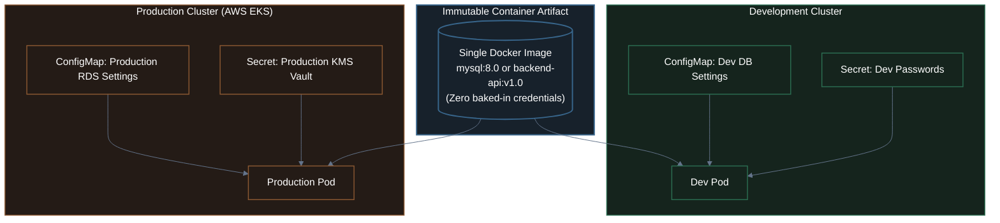

# 05. Application Configuration & Secrets (MySQL Lab)

A comprehensive guide to managing configuration in Kubernetes: decoupling configuration from container images using **ConfigMaps** and **Secrets**, securing credentials, mounting custom configuration files, and executing a complete hands-on lab with a containerized **MySQL database**.

---

## 1. The 12-Factor Principle: Decoupling Config from Code

In traditional monolithic development, teams often hardcoded database credentials inside source code or baked `.env` files directly into container images. 

In cloud-native production, this is a **critical anti-pattern**:
- **Security Vulnerability**: Anyone with access to the container image registry (Docker Hub, ECR) can extract database passwords via `docker inspect` or `docker history`.
- **Environment Inflexibility**: You would need to rebuild a new Docker image for every single environment (Development, Staging, QA, Production).

> 🛡️ **The 12-Factor Rule**: **Build your container image ONCE, run it ANYWHERE**. The container image remains strictly immutable across all environments. Configuration and credentials are dynamically injected into the container at runtime.



---

## 2. ConfigMaps: Non-Sensitive Configuration

A **ConfigMap** stores non-confidential configuration data in key-value pairs or whole configuration files.

### Common ConfigMap Use Cases:
- Application parameters: `LOG_LEVEL=info`, `PORT=3306`, `NODE_ENV=production`.
- Database names and usernames: `MYSQL_DATABASE=shopdb`, `MYSQL_USER=shopuser`.
- Whole configuration files: Custom `my.cnf` for MySQL, `nginx.conf` for reverse proxies, or JSON schema configs.

### Two Ways to Inject a ConfigMap into Containers:
1. **As Environment Variables**:
   - Individual keys injected via `valueFrom.configMapKeyRef`.
   - Bulk injection of all keys via `envFrom.configMapRef`.
2. **As Mounted Files/Volumes**:
   - Mounting config keys as real files inside a directory (e.g., `/etc/mysql/conf.d/custom.cnf`).
   - Supports **hot-reloading**: when the ConfigMap changes, Kubernetes automatically updates the mounted files inside the container without restarting the Pod!

---

## 3. Secrets: Sensitive Credentials

A **Secret** is specifically designed to store sensitive data: passwords, OAuth tokens, API private keys, and TLS certificates.

### ⚠️ The Base64 Myth
When you view a Kubernetes Secret YAML manifest, the values appear encoded:
```yaml
apiVersion: v1
kind: Secret
metadata:
  name: mysql-passwords
type: Opaque
data:
  password: c3VwZXJzZWNyZXQ=   # <-- Base64 for "supersecret"
```

> [!WARNING]
> **Base64 is NOT encryption!** 
> 
> Base64 is merely an encoding scheme designed to safely transmit arbitrary binary data across HTTP/JSON. Anyone who runs:
> ```bash
> echo "c3VwZXJzZWNyZXQ=" | base64 --decode
> ```
> will instantly reveal the plaintext password (`supersecret`). Never commit raw Secret YAML manifests to public Git repositories!

### How Kubernetes Protects Secrets in Production:
1. **`etcd` Encryption at Rest**: In cloud providers like AWS EKS or GCP GKE, the underlying `etcd` datastore encrypts all Secret keys using customer-managed **AWS KMS** or **Google Cloud KMS** keys.
2. **In-Memory `tmpfs` Storage**: When secrets are mounted as files into a container, Kubernetes mounts them into a RAM-backed `tmpfs` volume, ensuring credentials are never written to physical node storage disks.
3. **Role-Based Access Control (RBAC)**: Fine-grained permissions restrict which developer accounts or ServiceAccounts can run `kubectl get secrets`.

---

## 4. Architecture Blueprint: The MySQL Production Stack

In our hands-on lab, we will assemble a production-grade MySQL database workload by combining:
- **`mysql-secret`**: Stores sensitive `MYSQL_ROOT_PASSWORD` and `MYSQL_PASSWORD`.
- **`mysql-config`**: Stores the database name (`shopdb`), user (`shopuser`), and mounts a custom MySQL configuration file (`custom.cnf`).
- **`mysql-deployment`**: Consumes both ConfigMaps and Secrets.
- **`mysql-service`**: Exposes port `3306` inside the cluster.

```mermaid
%%{init: {
  'theme': 'base',
  'themeVariables': {
    'darkMode': true,
    'background': '#0f172a',
    'primaryColor': '#1e293b',
    'primaryTextColor': '#e2e8f0',
    'primaryBorderColor': '#475569',
    'lineColor': '#64748b',
    'textColor': '#e2e8f0',
    'edgeLabelBackground': '#0f172a'
  },
  'themeCSS': '* { filter: none !important; box-shadow: none !important; } .node * { filter: none !important; } .cluster * { filter: none !important; }'
}}%%
flowchart LR
    subgraph ConfigSources["Configuration Tier"]
        direction TB
        Sec["Secret: mysql-secret<br/>• MYSQL_ROOT_PASSWORD<br/>• MYSQL_PASSWORD"]
        CM["ConfigMap: mysql-config<br/>• MYSQL_DATABASE<br/>• MYSQL_USER<br/>• custom.cnf (file)"]
    end

    subgraph DatabaseTier["Workload Tier"]
        direction TB
        Pod["MySQL Pod (mysql:8.0)<br/>• Envs: from Secret & CM<br/>• Volume: /etc/mysql/conf.d"]
        SVC["Service: mysql-service<br/>ClusterIP: Port 3306"]
        Pod --- SVC
    end

    subgraph ClientTier["Application Tier"]
        Client["Client / API Pod<br/>Connects via: mysql-service:3306"]
    end

    Sec -->|Injected as Env Vars| Pod
    CM -->|Injected as Env Vars & VolumeMount| Pod
    Client -->|TCP Query (shopdb)| SVC

    classDef c1 fill:#241b16,stroke:#8a5832,stroke-width:1.5px,color:#ffffff;
    classDef c2 fill:#17212b,stroke:#38668c,stroke-width:2px,color:#ffffff;
    classDef c3 fill:#15241d,stroke:#2b6d51,stroke-width:1.5px,color:#ffffff;

    class ConfigSources,Sec,CM c1;
    class DatabaseTier,Pod,SVC c2;
    class ClientTier,Client c3;
```

---

## 5. Complete Hands-On Lab: Deploying MySQL with ConfigMaps & Secrets

Let's build, deploy, and verify this complete stack in your local Kind cluster.

### Step 1: Create the Secret for Database Passwords

We will create a Secret named `mysql-secret` holding the root password and the application user password.

You can generate the manifest using `kubectl create secret`:
```bash
kubectl create secret generic mysql-secret \
  --from-literal=mysql-root-password='RootPassword123!' \
  --from-literal=mysql-password='AppUserPassword456!' \
  --dry-run=client -o yaml > mysql-secret.yaml
```

Inspect `mysql-secret.yaml`:
```yaml
apiVersion: v1
kind: Secret
metadata:
  name: mysql-secret
type: Opaque
stringData:
  # stringData automatically base64-encodes the plaintext values on apply
  mysql-root-password: "RootPassword123!"
  mysql-password: "AppUserPassword456!"
```

Apply the secret:
```bash
kubectl apply -f mysql-secret.yaml
```
*Output:*
```text
secret/mysql-secret created
```

Verify with `kubectl`:
```bash
kubectl get secrets
```
*Output:*
```text
NAME           TYPE     DATA   AGE
mysql-secret   Opaque   2      12s
```

> [!TIP]
> Notice the `stringData` field? While standard `data` requires you to manually convert strings to base64, `stringData` accepts raw human-readable strings and base64-encodes them automatically when submitted to the API server!

---

### Step 2: Create the ConfigMap with Environment & Custom `my.cnf`

In this step, we demonstrate both ConfigMap capabilities in a single manifest:
1. **Key-value pairs**: `MYSQL_DATABASE` and `MYSQL_USER`.
2. **A full configuration file**: Custom MySQL server tuning parameters (`max_connections`, `character-set-server`, `default-time-zone`).

Create `mysql-config.yaml`:
```yaml
apiVersion: v1
kind: ConfigMap
metadata:
  name: mysql-config
data:
  # 1. Plain Key-Value Pairs
  MYSQL_DATABASE: "shopdb"
  MYSQL_USER: "shopuser"

  # 2. Complete Configuration File
  custom.cnf: |
    [mysqld]
    max_connections = 250
    character-set-server = utf8mb4
    collation-server = utf8mb4_unicode_ci
    default-time-zone = '+00:00'
    innodb_buffer_pool_size = 64M
```

Apply the ConfigMap:
```bash
kubectl apply -f mysql-config.yaml
```
*Output:*
```text
configmap/mysql-config created
```

---

### Step 3: Deploy MySQL Consuming ConfigMaps, Secrets & Volumes

Now we create the Deployment that wires everything together:
- Injects database name & user from `mysql-config`.
- Injects root & user passwords from `mysql-secret`.
- Mounts `custom.cnf` into MySQL's configuration folder (`/etc/mysql/conf.d`).

Create `mysql-deployment.yaml`:
```yaml
apiVersion: apps/v1
kind: Deployment
metadata:
  name: mysql-db
  labels:
    app: mysql
spec:
  replicas: 1
  selector:
    matchLabels:
      app: mysql
  template:
    metadata:
      labels:
        app: mysql
    spec:
      containers:
        - name: mysql
          image: mysql:8.0
          ports:
            - containerPort: 3306
              name: mysql
          env:
            # 1. Database name from ConfigMap
            - name: MYSQL_DATABASE
              valueFrom:
                configMapKeyRef:
                  name: mysql-config
                  key: MYSQL_DATABASE

            # 2. Database application username from ConfigMap
            - name: MYSQL_USER
              valueFrom:
                configMapKeyRef:
                  name: mysql-config
                  key: MYSQL_USER

            # 3. Root password from Secret
            - name: MYSQL_ROOT_PASSWORD
              valueFrom:
                secretKeyRef:
                  name: mysql-secret
                  key: mysql-root-password

            # 4. Application user password from Secret
            - name: MYSQL_PASSWORD
              valueFrom:
                secretKeyRef:
                  name: mysql-secret
                  key: mysql-password

          # 5. Mount the custom.cnf configuration file
          volumeMounts:
            - name: mysql-custom-config-vol
              mountPath: /etc/mysql/conf.d/custom.cnf
              subPath: custom.cnf

      volumes:
        - name: mysql-custom-config-vol
          configMap:
            name: mysql-config
            items:
              - key: custom.cnf
                path: custom.cnf
```

Apply the deployment:
```bash
kubectl apply -f mysql-deployment.yaml
```
*Output:*
```text
deployment.apps/mysql-db created
```

Watch the Pod start (MySQL takes ~20-30 seconds to initialize database tables):
```bash
kubectl get pods -l app=mysql -w
```
Wait until status transitions to **`Running`**:
```text
NAME                        READY   STATUS    RESTARTS   AGE
mysql-db-7d8b5bc4bf-8k4wz   1/1     Running   0          35s
```

---

### Step 4: Expose MySQL Internally via a Service

Create a `ClusterIP` Service so client applications can discover MySQL:

```yaml
# mysql-service.yaml
apiVersion: v1
kind: Service
metadata:
  name: mysql-service
spec:
  type: ClusterIP
  selector:
    app: mysql
  ports:
    - name: mysql
      port: 3306
      targetPort: 3306
```

Apply the service:
```bash
kubectl apply -f mysql-service.yaml
```
*Output:*
```text
service/mysql-service created
```

---

### Step 5: Verify Configuration & Custom `my.cnf` Inside MySQL

Let's execute a shell inside the running MySQL container to verify our ConfigMap volume mount:

```bash
# 1. Find your MySQL pod name:
MYSQL_POD=$(kubectl get pod -l app=mysql -o jsonpath="{.items[0].metadata.name}")

# 2. View the mounted custom.cnf:
kubectl exec -it $MYSQL_POD -- cat /etc/mysql/conf.d/custom.cnf
```

*Output:*
```ini
[mysqld]
max_connections = 250
character-set-server = utf8mb4
collation-server = utf8mb4_unicode_ci
default-time-zone = '+00:00'
innodb_buffer_pool_size = 64M
```

Notice how `custom.cnf` was injected directly from our Kubernetes ConfigMap without touching or modifying the official `mysql:8.0` Docker image!

---

### Step 6: Connect Our ElysiaJS `task-api` to MySQL

Now we deploy our custom **`task-api`** (from [`task-api`](./task-api/)) to communicate with MySQL internally:
- `DB_HOST`: Injected from Service name `mysql-service`.
- `DB_USER` & `DB_NAME`: Injected from `mysql-config` ConfigMap.
- `DB_PASSWORD`: Injected securely from `mysql-secret` Secret.

Create `task-api-deployment.yaml`:
```yaml
apiVersion: apps/v1
kind: Deployment
metadata:
  name: task-api
  labels:
    app: task-api
spec:
  replicas: 2
  selector:
    matchLabels:
      app: task-api
  template:
    metadata:
      labels:
        app: task-api
    spec:
      containers:
        - name: task-api
          image: task-api:1.0.0
          imagePullPolicy: IfNotPresent
          ports:
            - containerPort: 3000
          env:
            # 1. Connect to MySQL internal Service
            - name: DB_HOST
              value: "mysql-service"
            - name: DB_PORT
              value: "3306"

            # 2. Database Name & Username from ConfigMap
            - name: DB_NAME
              valueFrom:
                configMapKeyRef:
                  name: mysql-config
                  key: MYSQL_DATABASE
            - name: DB_USER
              valueFrom:
                configMapKeyRef:
                  name: mysql-config
                  key: MYSQL_USER

            # 3. Database Password securely from Secret
            - name: DB_PASSWORD
              valueFrom:
                secretKeyRef:
                  name: mysql-secret
                  key: mysql-password
```

Apply the deployment:
```bash
kubectl apply -f task-api-deployment.yaml
```

Wait until running:
```bash
kubectl get pods -l app=task-api
```
*Output:*
```text
NAME                        READY   STATUS    RESTARTS   AGE
task-api-5c7499484f-4m9zt   1/1     Running   0          15s
task-api-5c7499484f-w9kql   1/1     Running   0          15s
```

Check the pod logs to verify it auto-connected to MySQL and created the `tasks` table:
```bash
kubectl logs -l app=task-api --tail=5
```
*Output:*
```text
✅ [DB] Connected successfully to MySQL at mysql-service:3306/shopdb
🦊 [task-api] Elysia is running at http://0.0.0.0:3000
```

---

### Step 7: Test the Live Todo API (Create & Read Real MySQL Data)

Forward port `3000` to your host:
```bash
kubectl port-forward deployment/task-api 3000:3000
```

Open a second terminal window and interact with the database through our Elysia API:

#### 1. Check Info & Database Health:
```bash
curl http://localhost:3000/info
```
*Response:*
```json
{
  "podName": "task-api-5c7499484f-4m9zt",
  "nodeEnv": "production",
  "port": 3000,
  "uptimeSeconds": 24,
  "database": {
    "status": "connected",
    "host": "mysql-service:3306",
    "database": "shopdb"
  }
}
```

#### 2. Create a New Todo / Task via `POST /tasks`:
```bash
curl -X POST http://localhost:3000/tasks \
  -H "Content-Type: application/json" \
  -d '{"title": "Deploy to Production EKS", "description": "Master ConfigMaps and Secrets with MySQL"}'
```
*Response:*
```json
{
  "message": "Task created successfully",
  "pod": "task-api-5c7499484f-4m9zt",
  "task": {
    "id": 1,
    "title": "Deploy to Production EKS",
    "description": "Master ConfigMaps and Secrets with MySQL",
    "completed": false,
    "created_at": "2026-11-01T11:25:00.000Z"
  }
}
```

#### 3. Read Data Back from MySQL via `GET /tasks`:
```bash
curl http://localhost:3000/tasks
```
*Response:*
```json
{
  "pod": "task-api-5c7499484f-4m9zt",
  "source": "mysql",
  "count": 1,
  "tasks": [
    {
      "id": 1,
      "title": "Deploy to Production EKS",
      "description": "Master ConfigMaps and Secrets with MySQL",
      "completed": 0,
      "created_at": "2026-11-01T11:25:00.000Z"
    }
  ]
}
```

Notice `"source": "mysql"`! Our ElysiaJS API successfully parsed the credentials injected from Kubernetes ConfigMaps and Secrets and performed real persistent SQL queries!

---

### Step 8: Clean Up Lab Resources
```bash
kubectl delete -f task-api-deployment.yaml
kubectl delete -f mysql-service.yaml
kubectl delete -f mysql-deployment.yaml
kubectl delete -f mysql-config.yaml
kubectl delete -f mysql-secret.yaml
```

---

## 6. ConfigMap vs. Secret: Direct Comparison

| Dimension | ConfigMap | Secret |
| :--- | :--- | :--- |
| **Intended Purpose** | Non-sensitive parameters & configuration files | Passwords, tokens, private keys, TLS certs |
| **Encoding / Encryption** | Plaintext UTF-8 string | Base64 encoded; encrypted at rest in `etcd` |
| **File Mounting** | Mounted via Volumes (supports hot-reloading) | Mounted via RAM-backed `tmpfs` volume |
| **API Object** | `apiVersion: v1`, `kind: ConfigMap` | `apiVersion: v1`, `kind: Secret` |
| **Primary Risk** | Accidental exposure of settings | Accidental commit of Base64 to Git repositories |
| **Enterprise Standard** | Helm values, Kustomize | AWS Secrets Manager / HashiCorp Vault via External Secrets Operator |

---

## 7. Essential Cheat Sheet

```bash
# Create ConfigMap from literal values:
kubectl create configmap app-config --from-literal=ENV=prod --from-literal=LOG=debug

# Create ConfigMap from an entire file:
kubectl create configmap nginx-conf --from-file=nginx.conf

# Create Generic Secret from literals:
kubectl create secret generic db-secret --from-literal=password='Pass123!'

# Create TLS Secret for SSL/HTTPS:
kubectl create secret tls ssl-cert --cert=tls.crt --key=tls.key

# Inspect ConfigMap values:
kubectl describe configmap app-config

# Decode and reveal a Secret value in terminal:
kubectl get secret db-secret -o jsonpath="{.data.password}" | base64 --decode
```

---

## 8. Chapter Summary & What's Next

In this lesson, we established complete control over application configuration:
1. **The 12-Factor Principle**: Images remain strictly immutable; environments are configured by injecting external ConfigMaps and Secrets.
2. **ConfigMaps**: Injected as environment variables (`env`) or mounted as real configuration files (`volumeMounts`).
3. **Secrets**: Secured credentials using Kubernetes Secret objects, dispelling the myth that Base64 is encryption.
4. **Hands-On MySQL**: Deployed a complete database stack with custom configuration tuning and password authentication.

---

### 🗺️ Next Lesson in Module 05
In **[`06-what-you-need-to-learn-more.md`](./06-what-you-need-to-learn-more.md)**, we bridge our local knowledge directly into the production EKS capstone project:
- Probes & graceful termination (`preStop` hooks for zero 502s).
- CPU/Memory requests & limits (QoS and noisy neighbor defense).
- AWS ALB Ingress & Wildcard ACM SSL termination.
- Horizontal Pod Autoscaler (HPA) and AWS VPC CNI considerations.
- Managed AWS RDS vs StatefulSets & External Secrets Operator (ESO).
- Full reading map and deployment quickstart for [`06-try-production-eks`](file:///Users/kendirck/Desktop/learn/k8s-in-production/06-try-production-eks/).

