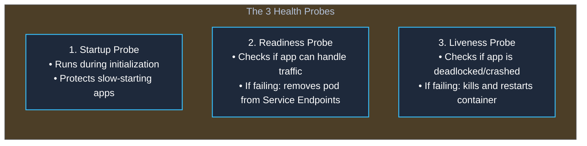
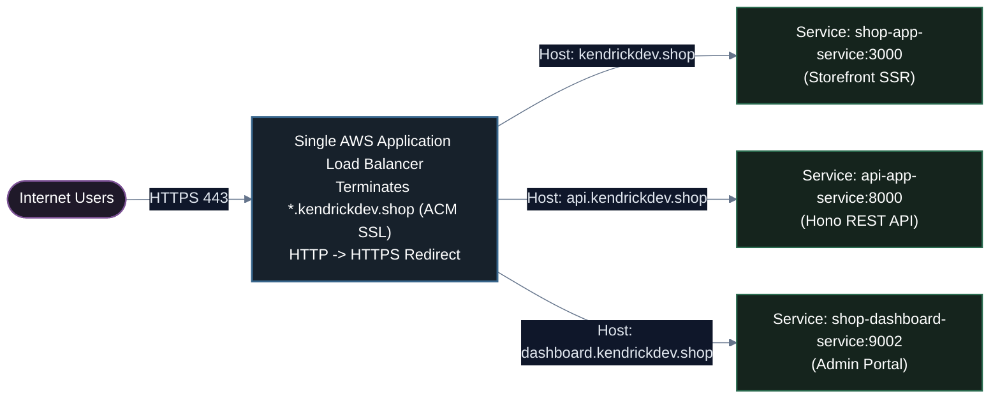

# 06. What You Need to Learn More & The Bridge to Production EKS

A comprehensive transition guide connecting the fundamentals mastered in **`05-learn-k8s`** to the enterprise production stack in **[`06-try-production-eks`](file:///Users/kendirck/Desktop/learn/k8s-in-production/06-try-production-eks/)**: health probes, resource management, Ingress controllers, autoscaling (HPA), managed cloud databases, and secret operators.

---

## 1. The Transition: From Local Sandbox to Production Reality

Across Lessons 01 through 05, you built a strong foundational mental model:
- **`01`**: Understood orchestration, declarative control loops, and cloud options.
- **`02`**: Mastered **Kind** cluster lifecycles and the `kind load docker-image` secret.
- **`03`**: Created Pods and Deployments, tested self-healing, and used `kubectl port-forward`.
- **`04`**: Solved the ephemeral Pod IP problem with **Services** (`ClusterIP`, `NodePort`) and **CoreDNS**.
- **`05`**: Decoupled environment configuration and database credentials using **ConfigMaps** and **Secrets** with MySQL.

However, in **enterprise production**, applications do not run on a developer laptop inside Kind. They run on managed cloud infrastructure like **Amazon EKS** serving thousands of concurrent users, processing real payments, and adhering to strict SLAs (99.95%+ uptime).


---

## 2. What You Need to Learn More (The 6 Enterprise Pillars)

To graduate from toy manifests to production-grade deployments, there are six essential engineering patterns you must master:

---

### Pillar 1: Health Probes & Graceful Shutdown (Zero 502s)

In Lesson 03, Kubernetes marked our Pods `Running` as soon as the container process started. But in real applications (e.g. Bun, Node.js, Spring Boot), the app takes 5 to 15 seconds to connect to the database, run migrations, and warm up caches.

If user traffic hits the container during those 10 seconds, users receive **`502 Bad Gateway`**!



#### How it is implemented in `06-try-production-eks`:
Take a look at [`06-try-production-eks/k8s/eks/01-api-app.yaml`](file:///Users/kendirck/Desktop/learn/k8s-in-production/06-try-production-eks/k8s/eks/01-api-app.yaml#L79-L90):

```yaml
readinessProbe:
  httpGet:
    path: /health
    port: 8000
  initialDelaySeconds: 5
  periodSeconds: 5

livenessProbe:
  httpGet:
    path: /health
    port: 8000
  initialDelaySeconds: 10
  periodSeconds: 10
```

#### The Secret PreStop Hook for AWS Load Balancers:
When rolling out a new release on AWS EKS, there is a race condition: the AWS ALB target group takes 3–5 seconds to deregister an old pod IP, while Kubernetes stops the pod immediately. 

To eliminate dropped requests, [`01-api-app.yaml`](file:///Users/kendirck/Desktop/learn/k8s-in-production/06-try-production-eks/k8s/eks/01-api-app.yaml#L41-L45) includes a **preStop hook**:
```yaml
lifecycle:
  preStop:
    exec:
      # 5s delay gives AWS ALB time to deregister the pod IP before process stops
      command: ["/bin/sh", "-c", "sleep 5"]
terminationGracePeriodSeconds: 30 # Gives in-flight DB queries 30s to finish
```

---

### Pillar 2: Resource Management (Requests & Limits)

Without explicit CPU and memory reservations, a single rogue pod suffering a memory leak can consume 100% of the worker node's RAM, causing the Linux kernel to panic and killing all neighboring containers (the **"Noisy Neighbor"** problem).

Kubernetes defines resources across two levels:
1. **`requests`**: The baseline resource reservation guaranteed to the container. The **`kube-scheduler`** uses this value to decide which worker node has room to schedule the Pod.
2. **`limits`**: The hard ceiling. If the container tries to consume more CPU, it is **throttled**. If it consumes more Memory than the limit, Kubernetes triggers the Linux kernel OOM Killer and kills the container (**`OOMKilled`**).

```yaml
# From 06-try-production-eks/k8s/eks/01-api-app.yaml
resources:
  requests:
    cpu: "100m"      # 0.1 vCPU (baseline reservation)
    memory: "128Mi"  # 128 Megabytes
  limits:
    cpu: "500m"      # 0.5 vCPU (burst limit before throttling)
    memory: "256Mi"  # 256 Megabytes (burst ceiling before OOMKill)
```

---

### Pillar 3: Layer 7 Ingress Controllers (AWS ALB)

In Lesson 04, we learned that a `LoadBalancer` Service creates an external load balancer. 

However, in an enterprise microservice architecture with 10 frontend and backend services, creating 10 individual cloud load balancers is **terrible practice**:
- 💸 **Cost Sprawl**: 10 AWS Classic/Network Load Balancers $\times$ ~$20/month = **$200+/month** just for load balancers!
- 🔐 **SSL Management**: Managing TLS certificates across 10 separate endpoints is an administrative nightmare.

The production solution is an **Ingress Controller**: **One single AWS Application Load Balancer (ALB)** terminating SSL and routing traffic dynamically based on hostname and URL path:



Inspect the real-world manifest in [`06-try-production-eks/k8s/eks/05-ingress.yaml`](file:///Users/kendirck/Desktop/learn/k8s-in-production/06-try-production-eks/k8s/eks/05-ingress.yaml).

---

### Pillar 4: Horizontal Pod Autoscaling (HPA)

In static setups, if traffic surges 10x during a flash sale, your 2 replica pods will max out their CPU limits and time out.

The **Horizontal Pod Autoscaler (HPA)** queries the cluster **Metrics Server** every 15 seconds. If average CPU utilization exceeds the target threshold (e.g. 70%), HPA automatically increases the replica count from 2 up to 6 pods within seconds.

#### How it is implemented in `06-try-production-eks`:
Inspect [`06-try-production-eks/k8s/eks/04-hpa.yaml`](file:///Users/kendirck/Desktop/learn/k8s-in-production/06-try-production-eks/k8s/eks/04-hpa.yaml#L31-L50):

```yaml
apiVersion: autoscaling/v2
kind: HorizontalPodAutoscaler
metadata:
  name: api-app-hpa
spec:
  scaleTargetRef:
    apiVersion: apps/v1
    kind: Deployment
    name: api-app
  minReplicas: 2
  maxReplicas: 6
  metrics:
    - type: Resource
      resource:
        name: cpu
        target:
          type: Utilization
          averageUtilization: 70
```

> [!NOTE]
> HPA calculates utilization as a percentage of your **`resources.requests.cpu`**. If a pod has no resource requests declared, HPA cannot calculate percentage and will fail to scale!

---

### Pillar 5: Stateful Persistence — Managed Cloud RDS vs. In-Cluster DB

In Lesson 05, we deployed MySQL directly inside our Kind cluster. While running databases inside Kubernetes is fantastic for local development ($0 cost, fast iteration), running production databases inside raw Kubernetes introduces serious risks:
- Pod evictions during node maintenance.
- Complex stateful volume attachment delays.
- Disaster recovery and multi-region replication overhead.

#### The Dual-Strategy in `06-try-production-eks`:
1. **Local Mode ($0/mo)**: Runs PostgreSQL directly inside Kubernetes via a StatefulSet and local PVC ([`06-try-production-eks/k8s/local/00-postgres.yaml`](file:///Users/kendirck/Desktop/learn/k8s-in-production/06-try-production-eks/k8s/local/00-postgres.yaml)).
2. **Cloud Production Mode**: Offloads the database to **AWS RDS PostgreSQL** (Multi-AZ replication, automated hardware failover, daily automated snapshots, and high-performance EBS gp3 storage).

Read the detailed architecture guide: [`06-try-production-eks/doc/03-rds-connection-guide.md`](file:///Users/kendirck/Desktop/learn/k8s-in-production/06-try-production-eks/doc/03-rds-connection-guide.md).

---

### Pillar 6: Enterprise Secret Management (External Secrets Operator - ESO)

In Lesson 05, we saw that plain Kubernetes Secrets are simply Base64-encoded strings. Storing database passwords in plain Git commits is an immediate security breach.

The enterprise production standard is **GitOps Secret Synchronization**:
1. Human operators store secrets securely in **AWS Secrets Manager** (encrypted with AWS KMS customer-managed keys).
2. The **External Secrets Operator (ESO)** runs as a controller inside Amazon EKS.
3. ESO automatically fetches secrets from AWS Secrets Manager and injects them into Kubernetes Secrets in real time.

```mermaid
%%{init: {
  'theme': 'base',
  'themeVariables': {
    'darkMode': true,
    'background': '#0f172a',
    'primaryColor': '#1e293b',
    'primaryTextColor': '#e2e8f0',
    'primaryBorderColor': '#475569',
    'lineColor': '#64748b',
    'textColor': '#e2e8f0',
    'edgeLabelBackground': '#0f172a'
  },
  'themeCSS': '* { filter: none !important; box-shadow: none !important; } .node * { filter: none !important; } .cluster * { filter: none !important; }'
}}%%
flowchart LR
    Vault["AWS Secrets Manager<br/>(Encrypted via AWS KMS)"] -->|IAM Role for Service Account| ESO["External Secrets Operator<br/>(Controller inside EKS)"]
    ESO -->|Dynamically creates & syncs| K8sSecret["Kubernetes Secret<br/>postgres-secret"]
    K8sSecret -->|Injected into env| App["API Pods (api-app)"]

    classDef cAWS fill:#241b16,stroke:#8a5832,stroke-width:1.5px,color:#ffffff;
    classDef cK8s fill:#17212b,stroke:#38668c,stroke-width:1.5px,color:#ffffff;
    classDef cApp fill:#15241d,stroke:#2b6d51,stroke-width:1.5px,color:#ffffff;

    class Vault cAWS;
    class ESO,K8sSecret cK8s;
    class App cApp;
```



Read the full operational guide: [`06-try-production-eks/doc/07-external-secrets-operator-guide.md`](file:///Users/kendirck/Desktop/learn/k8s-in-production/06-try-production-eks/doc/07-external-secrets-operator-guide.md).

---

## 3. The Capstone Architecture: Inside `06-try-production-eks`

Now that you understand the bridge concepts, you are ready to explore the complete capstone system in [`06-try-production-eks`](file:///Users/kendirck/Desktop/learn/k8s-in-production/06-try-production-eks/).

### The Full-Stack Application Architecture
```
┌─────────────────────────────────────────────────────────────────────────────────┐
│                           Client Browser / Mobile App                           │
└──────────────────────────────────────┬──────────────────────────────────────────┘
                                       │ HTTPS (443)
                                       ▼
┌─────────────────────────────────────────────────────────────────────────────────┐
│                  AWS Application Load Balancer (ALB Ingress)                    │
│                  SSL: *.kendrickdev.shop (AWS Certificate Manager)              │
└──────────────┬───────────────────────┬───────────────────────────┬──────────────┘
               │                       │                           │
  kendrickdev.shop          api.kendrickdev.shop        dashboard.kendrickdev.shop
               │                       │                           │
               ▼                       ▼                           ▼
┌─────────────────────────┐ ┌─────────────────────┐ ┌─────────────────────────────┐
│  shop-app (Storefront)  │ │  api-app (REST API) │ │  shop-dashboard (Admin UI)  │
│  React 19 / TanStack    │ │  Bun / Hono / ORM   │ │  React 19 / TanStack        │
│  (Port 3000)            │ │  (Port 8000)        │ │  (Port 9002)                │
└─────────────────────────┘ └──────────┬──────────┘ └─────────────────────────────┘
                                       │
                                       │ Private VPC Subnets (Port 5432)
                                       ▼
                            ┌─────────────────────┐
                            │ AWS RDS PostgreSQL  │
                            │ Multi-AZ Production │
                            └─────────────────────┘
```

---

## 4. Reading Map for `06-try-production-eks`

Before deploying to AWS, follow this reading roadmap inside [`06-try-production-eks`](file:///Users/kendirck/Desktop/learn/k8s-in-production/06-try-production-eks/):

| Step | Guide Document | What You Will Learn |
| :---: | :--- | :--- |
| **0** | **[`06-try-production-eks/README.md`](file:///Users/kendirck/Desktop/learn/k8s-in-production/06-try-production-eks/README.md)** | Full project overview, microservice breakdown, and quickstart commands. |
| **1** | **[`doc/01-local-k8s-guide.md`](file:///Users/kendirck/Desktop/learn/k8s-in-production/06-try-production-eks/doc/01-local-k8s-guide.md)** | Deploy the entire e-commerce stack locally on Docker Desktop/Kind for **$0/month**. |
| **2** | **[`doc/02-eks-cluster-overview.md`](file:///Users/kendirck/Desktop/learn/k8s-in-production/06-try-production-eks/doc/02-eks-cluster-overview.md)** | Deep architectural dive into the AWS EKS cluster, VPC subnets, and node groups. |
| **3** | **[`doc/03-rds-connection-guide.md`](file:///Users/kendirck/Desktop/learn/k8s-in-production/06-try-production-eks/doc/03-rds-connection-guide.md)** | Setting up secure IAM credentials and VPC security groups to connect EKS to AWS RDS. |
| **4** | **[`doc/04-eks-scaling-guide.md`](file:///Users/kendirck/Desktop/learn/k8s-in-production/06-try-production-eks/doc/04-eks-scaling-guide.md)** | Tuning Horizontal Pod Autoscaling (HPA) and handling AWS VPC CNI IP limitations. |
| **5** | **[`doc/05-ci-cd-architecture.md`](file:///Users/kendirck/Desktop/learn/k8s-in-production/06-try-production-eks/doc/05-ci-cd-architecture.md)** | Automated GitHub Actions CI/CD building Docker images, pushing to ECR, and deploying. |
| **6** | **[`doc/06-backup.md`](file:///Users/kendirck/Desktop/learn/k8s-in-production/06-try-production-eks/doc/06-backup.md)** | Automated PostgreSQL backups to Amazon S3 using Kubernetes CronJobs. |
| **7** | **[`doc/07-external-secrets-operator-guide.md`](file:///Users/kendirck/Desktop/learn/k8s-in-production/06-try-production-eks/doc/07-external-secrets-operator-guide.md)** | Automated secret synchronization from AWS Secrets Manager via ESO. |

---

## 5. Action Checklist: How to Start Module 06

### Step 1: Run the Full Stack Locally ($0/mo)
Before touching AWS credentials, run the entire e-commerce stack locally using Docker Compose:
```bash
cd /Users/kendirck/Desktop/learn/k8s-in-production/06-try-production-eks
docker compose up -d
```
Visit:
- Customer Storefront: `http://localhost:3000`
- REST API Documentation: `http://localhost:8000/docs`
- Admin Dashboard: `http://localhost:9002`

### Step 2: Deploy to Local Kubernetes
Deploy the local manifests in [`k8s/local`](file:///Users/kendirck/Desktop/learn/k8s-in-production/06-try-production-eks/k8s/local/):
```bash
kubectl apply -k k8s/local
```

### Step 3: Deploy Production AWS EKS via Pulumi
When ready for cloud production, deploy the entire AWS infrastructure using Pulumi TypeScript:
```bash
bun install
pulumi up --stack prod
```
Deploy the production manifests in [`k8s/eks`](file:///Users/kendirck/Desktop/learn/k8s-in-production/06-try-production-eks/k8s/eks/):
```bash
kubectl apply -k k8s/eks
```

---

## 6. Congratulations! 🎓

You have completed the **`05-learn-k8s`** curriculum! You possess the operational and mental models required to understand container orchestration, debug cluster workloads, write clean declarative manifests, and bridge local development into cloud production.

👉 **Proceed to the capstone project**: [**`06-try-production-eks`**](file:///Users/kendirck/Desktop/learn/k8s-in-production/06-try-production-eks/README.md)

