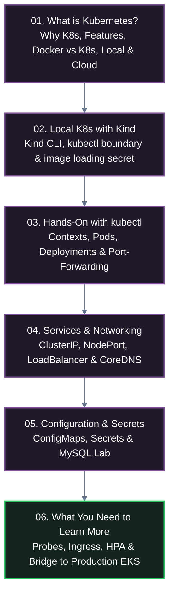

# Module 05: Learn Kubernetes (K8s)

A practical, hands-on curriculum taking you from container orchestration fundamentals to mastering core Kubernetes primitives (Pods, Deployments, Services, ConfigMaps, Secrets, Storage, Probes, and Autoscaling) running locally in **Kind** / **K3s** and preparing for cloud production on **AWS EKS**, **GCP GKE**, and **Azure AKS**.

---

## 🗺️ Curriculum Roadmap

---

## 📚 Lessons Overview

| Lesson | Title | Core Topics | Status |
| :---: | :--- | :--- | :---: |
| **01** | **[What is Kubernetes? Architecture, Features & Ecosystem](./01-what-is-kubernetes.md)** | • Why we need orchestration & main features • Docker vs. Docker Compose vs. Kubernetes • Local (Kind, K3s, K9s) vs. Cloud (AWS EKS, GCP GKE, Azure AKS) • Curriculum strategy: Kind local & AWS EKS production | ✅ Ready |
| **02** | **[Kubernetes in Local with Kind](./02-kubernetes-in-local-with-kind.md)** | • Installing `kind` & `kubectl` • Cluster lifecycle (`create`, `get`, `delete`) • `kind` manages clusters vs. `kubectl` manages workloads • The extra secret: `kind load docker-image` & `imagePullPolicy` | ✅ Ready |
| **03** | **[Hands-On with kubectl: Contexts, Pods, Deployments & Port-Forwarding](./03-kubectl-commands-pods-and-networking.md)** | • Context management (`get-contexts`, `use-context`) • Pod creation (imperative vs `--dry-run=client -o yaml`) • Deployments & self-healing verification • Network testing via `kubectl port-forward` | ✅ Ready |
| **04** | **[Kubernetes Services & Internal Networking](./04-services-and-networking.md)** | • The ephemeral Pod IP problem • Service types: `ClusterIP`, `NodePort`, `LoadBalancer` • Port mapping (`port` vs `targetPort` vs `nodePort`) • In-cluster DNS with CoreDNS & round-robin load balancing | ✅ Ready |
| **05** | **[Application Configuration & Secrets (MySQL Lab)](./05-application-configuration-and-secrets.md)** | • The 12-factor decoupling principle • ConfigMaps (env vars & mounting custom `my.cnf`) • Secrets (`Opaque`, base64 myth, etcd encryption) • Hands-on MySQL deployment & client query lab | ✅ Ready |
| **06** | **[What You Need to Learn More & Bridge to Production EKS](./06-what-you-need-to-learn-more.md)** | • Probes & graceful termination (`preStop` hooks) • CPU/Memory requests & limits • AWS ALB Ingress & Wildcard ACM SSL • Horizontal Pod Autoscaler (HPA) • Managed AWS RDS vs StatefulSets • External Secrets Operator & Capstone Roadmap | ✅ Ready |
| **07** | **Rollouts & Autoscaling** | • RollingUpdate tuning (`maxSurge`, `maxUnavailable`) • Rollback commands (`rollout undo`), HPA autoscaling | ⏳ Upcoming |
| **08** | **Observability, Security & Production Patterns** | • Mastering `k9s` and `kubectl describe/logs/exec` • Resource requests/limits, SecurityContext & EKS promotion | ⏳ Upcoming |

