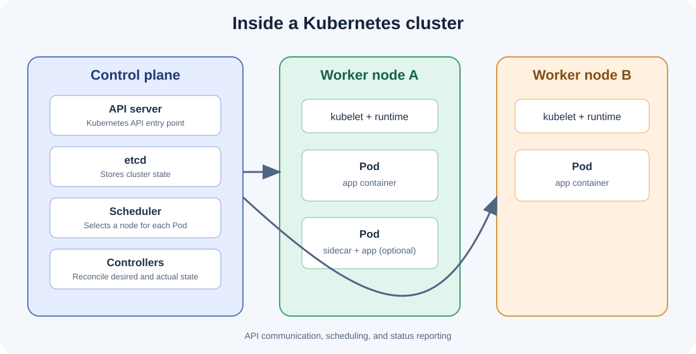
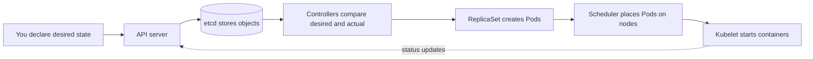

# Lesson 1 — Kubernetes fundamentals

## Goal

By the end, you can describe what Kubernetes manages and how a cluster responds when actual state differs from desired state.

## Why orchestration?

Docker can build and run a container. A production application usually needs more: several copies, placement across machines, stable networking, replacement after failure, controlled updates, and configuration. Kubernetes provides an API and controllers that coordinate these tasks.

Kubernetes does not build your application image. Build it with Docker or another image builder; Kubernetes schedules the image using the cluster's container runtime (commonly containerd).

## The vocabulary

- **Cluster**: a Kubernetes control plane plus worker machines.
- **Control plane**: accepts API requests, stores cluster state, schedules Pods, and runs controllers.
- **Node**: a machine registered in a cluster.
- **Pod**: the smallest schedulable workload unit. It contains one or more tightly coupled containers sharing network identity and mounted volumes.
- **Container**: the isolated process created from an image inside a Pod.
- **Object**: an API record describing a resource, such as a Deployment or Service.



### Control plane components

| Component | Role |
|---|---|
| API server | Validates and serves Kubernetes API requests |
| etcd | Durable key-value storage for cluster state |
| Scheduler | Chooses a suitable node for each unscheduled Pod |
| Controller manager | Runs controllers that reconcile actual state toward desired state |

A worker node runs a **kubelet**, which makes sure assigned Pods are running, and a container runtime. Service networking is implemented by the cluster network components; `kube-proxy` is common, but not required in every implementation.

## Desired state and reconciliation

You declare “I want three copies.” A Deployment controller creates or adjusts a ReplicaSet; the ReplicaSet creates Pods. If a Pod disappears, controllers observe the difference and create a replacement.



This loop is called **reconciliation**. Kubernetes does not guarantee that every change is instant; it continually works toward the declared state.

## Observe a cluster

Create a local cluster and inspect it:

```sh
kind create cluster --name learning
kubectl cluster-info
kubectl get nodes -o wide
kubectl get namespaces
```

A `kind` node is itself a container, which makes it useful for learning. It is not a production design.

## Try it

```sh
kubectl create deployment web --image=nginx:alpine
kubectl get deployment,pods -o wide
kubectl describe deployment web
kubectl delete pod "$(kubectl get pods -l app=web -o name | head -n 1)"
kubectl get pods -w
```

Notice that the deleted Pod is replaced. The Deployment expressed the desired number of replicas (one by default), and the controller reconciled the difference.

Clean up this experiment:

```sh
kubectl delete deployment web
```

## Check your understanding

1. What is the difference between a node and a Pod?
2. Which component chooses the node for an unscheduled Pod?
3. Why did deleting a Pod not permanently remove the application?

**Next:** [Pods, ReplicaSets, and Deployments](02-workloads.md).
