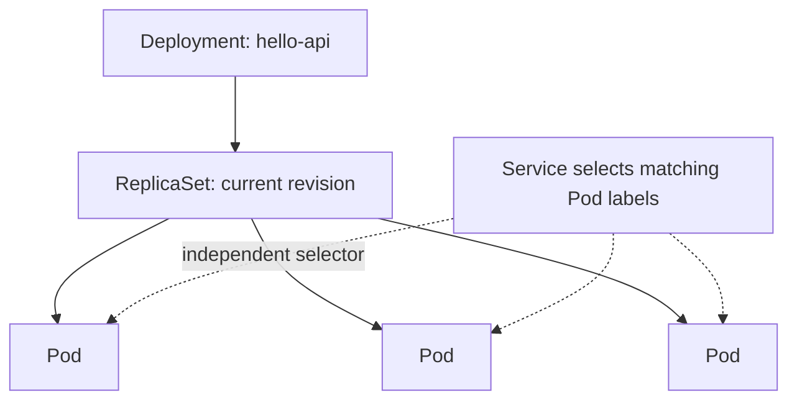

# Lesson 2 — Pods, ReplicaSets, and Deployments

## Goal

Create a replicated workload, understand the controller chain, and perform a safe image update.

## Relationship between objects

A Pod is ephemeral: it can be replaced and receive a different IP. A ReplicaSet keeps a matching set of Pods at a target count. A Deployment manages ReplicaSets and provides rollout history and update controls.



A Service is not a child of a Deployment. It selects Pods by labels, so it can keep routing to new Pods created by later rollouts.

## A minimal Pod

```yaml
apiVersion: v1
kind: Pod
metadata:
  name: hello-pod
  labels:
    app: hello
spec:
  containers:
    - name: web
      image: nginx:alpine
      ports:
        - name: http
          containerPort: 80
```

Save as `examples/k8s/pod.yaml`, then:

```sh
kubectl apply -f examples/k8s/pod.yaml
kubectl get pod hello-pod -o wide
kubectl describe pod hello-pod
kubectl delete -f examples/k8s/pod.yaml
```

A standalone Pod is useful for experiments, but application workloads normally use a Deployment so Kubernetes can maintain replicas and manage updates.

## Deployment example

```yaml
apiVersion: apps/v1
kind: Deployment
metadata:
  name: web
spec:
  replicas: 3
  selector:
    matchLabels:
      app: web
  template:
    metadata:
      labels:
        app: web
    spec:
      containers:
        - name: web
          image: nginx:1.27-alpine
          ports:
            - name: http
              containerPort: 80
```

The selector must match the Pod template labels. Save to `examples/k8s/web-deployment.yaml` and apply:

```sh
kubectl apply -f examples/k8s/web-deployment.yaml
kubectl get deployments,replicasets,pods -l app=web
kubectl scale deployment/web --replicas=5
kubectl rollout status deployment/web
```

To change the image and watch the rollout:

```sh
kubectl set image deployment/web web=nginx:1.28-alpine
kubectl rollout status deployment/web
kubectl rollout history deployment/web
kubectl rollout undo deployment/web
```

For repeatable work, edit the manifest to the intended image and use `kubectl apply`; the imperative command above is a convenient learning exercise.

## Declarative vs imperative

- `kubectl apply -f ...` describes the configuration you want.
- `kubectl scale ...` or `kubectl set image ...` directly changes a live object.

For team workflows, keep desired configuration in version control and review changes before applying them.

## Troubleshooting first steps

```sh
kubectl get pods -l app=web
kubectl describe pod <pod-name>
kubectl logs <pod-name>
kubectl get events --sort-by=.lastTimestamp
```

Look for image pull errors, failed scheduling, probe failures, or process exits. `CrashLoopBackOff` is a symptom that Kubernetes is repeatedly restarting a container; logs and events explain why.

**Next:** [Build and deploy the first app](03-first-app.md).
