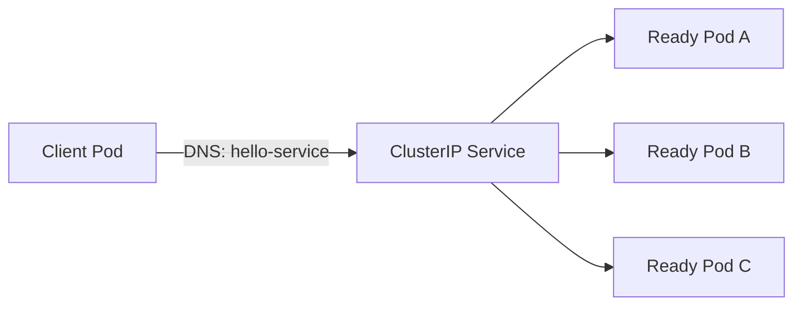

# Lesson 4 — Services and networking

## Goal

Understand how a Service gives replaceable Pods a stable name, then compare the common ways to expose an application.

## Pod networking in one picture



Within a cluster, Pods can usually reach each other by Pod IP, but Pod IPs are temporary. A Service selects Pods by labels and gives clients a stable virtual IP and DNS name. Kubernetes DNS commonly resolves `hello-service` within its namespace, and `hello-service.namespace` across namespaces.

## Service types

| Type | Typical use | Reachability |
|---|---|---|
| `ClusterIP` | Internal app-to-app traffic | Inside the cluster |
| `NodePort` | Simple access through node ports; often learning or special setups | Node address and allocated port |
| `LoadBalancer` | Cloud or supported local load balancer integration | External address provisioned by implementation |
| Ingress / Gateway | HTTP(S) routing by host/path, TLS termination | Requires a controller or gateway implementation |

A Service of type `LoadBalancer` does not itself create a public load balancer on every cluster. The infrastructure integration must support it. Ingress is an API object; a controller must implement it.

## Try a ClusterIP Service

The `hello-service` in `examples/k8s/hello-app.yaml` selects `app: hello-api` and maps port 80 to target port 3000.

```sh
kubectl get svc hello-service
kubectl get endpointslice -l kubernetes.io/service-name=hello-service
kubectl port-forward svc/hello-service 8080:80
```

From a second terminal run `curl http://localhost:8080/`. Endpointslices should show the ready backend addresses. If none appear, compare the Service selector with Pod labels and check readiness.

## In-cluster DNS test

Run a temporary client Pod:

```sh
kubectl run dns-check --image=busybox:1.36 --restart=Never --command -- sleep 3600
kubectl exec dns-check -- nslookup hello-service
kubectl exec dns-check -- wget -qO- http://hello-service/
kubectl delete pod dns-check
```

The Service name resolves to the stable Service address, and traffic is sent to ready matching Pods.

## When traffic fails

1. Check Pod state and readiness: `kubectl get pods -l app=hello-api`.
2. Check Service selector and ports: `kubectl describe svc hello-service`.
3. Check endpoints: `kubectl get endpointslice -l kubernetes.io/service-name=hello-service`.
4. Check the app listens on `0.0.0.0` and the expected target port.
5. Inspect logs and events.

**Next:** [Configuration and storage](05-configuration-storage.md).
