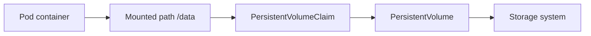

# Lesson 5 — Configuration and storage

## Goal

Separate environment-specific settings from the image, handle sensitive values carefully, and distinguish temporary from persistent data.

## ConfigMap for ordinary settings

A ConfigMap stores non-confidential configuration. For example:

```yaml
apiVersion: v1
kind: ConfigMap
metadata:
  name: hello-settings
data:
  APP_ENV: learning
  GREETING: Hello from Kubernetes
```

A Pod can read values as environment variables:

```yaml
envFrom:
  - configMapRef:
      name: hello-settings
```

Or select a key with `valueFrom.configMapKeyRef`. ConfigMap data mounted as files updates eventually; values injected as environment variables do not change in an already running process. Restart or roll out the workload when the app must reload them.

## Secret for sensitive configuration

A Secret is intended for sensitive values, such as a database password. Base64 encoding in a YAML `data:` field is not encryption. Avoid committing real credentials to source control. Use a managed secret store and an appropriate integration for production; restrict RBAC and enable encryption at rest in the cluster.

Example shape (placeholder only):

```yaml
apiVersion: v1
kind: Secret
metadata:
  name: database-credentials
type: Opaque
stringData:
  username: app
  password: replace-for-local-learning
```

Reference a key with `secretKeyRef`, just as with a ConfigMap key. Do not put a real password in this course repository.

## Volumes and persistence

A container's writable filesystem is disposable. A Pod can mount a volume; its lifetime depends on volume type. `emptyDir` lasts for the Pod lifetime and is useful for scratch space or sharing files between containers. Persistent storage uses a PersistentVolumeClaim (PVC), which requests storage from the cluster's available StorageClass.



A PVC example:

```yaml
apiVersion: v1
kind: PersistentVolumeClaim
metadata:
  name: app-data
spec:
  accessModes: [ReadWriteOnce]
  resources:
    requests:
      storage: 1Gi
```

A workload mounts it under `spec.template.spec.volumes` with `persistentVolumeClaim: { claimName: app-data }`, and names that volume under the container's `volumeMounts`. Whether the claim binds depends on the cluster's StorageClass and provisioner. Databases need backup, restore, and failure planning beyond simply attaching a PVC.

## Exercise

Create a ConfigMap, attach `APP_ENV` to the Hono Deployment, then verify the Pod receives it with `kubectl exec`. Change the ConfigMap and observe whether the running process reloads the value. Delete the exercise resources afterward.

**Next:** [Reliability and scaling](06-reliability-scaling.md).
