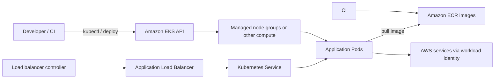

# Lesson 8 — Production patterns and AWS EKS

## Goal

Connect local concepts to production design and understand the components involved in a managed EKS deployment.

## Production changes the operating model

A production cluster needs clear ownership, access control, observability, backup and recovery, capacity planning, upgrade planning, network boundaries, and incident procedures. A successful `kubectl apply` is only one part of operating a service.

Useful production practices include:

- Keep manifests or Helm charts in version control and promote reviewed changes between environments.
- Use immutable image tags or digests; do not reuse `latest` for releases.
- Set health probes, resource requests, and disruption budgets based on measured behavior.
- Collect metrics, logs, and traces; alert on user-visible symptoms and saturation.
- Restrict network access and Kubernetes permissions; manage secrets through a controlled secret service.
- Back up state and regularly practice restoring it.
- Plan cluster and node upgrades, including compatibility testing and rollback paths.

## EKS architecture overview

EKS runs the Kubernetes control plane as an AWS managed service. You still choose and manage worker capacity, networking, workload configuration, permissions, add-ons, and application operations.

A common path is: build and scan image, push to ECR, deploy a pinned image reference, route traffic through a load balancer controller, and grant workloads scoped AWS access through IAM roles for service accounts or the current EKS Pod Identity option where appropriate.

## Production checklist for a small API

1. **Network**: private worker subnets where appropriate, deliberate ingress and egress, DNS, and load balancer design.
2. **Identity**: SSO/federated human access, least-privilege Kubernetes RBAC, scoped workload AWS permissions.
3. **Images**: ECR repository, scanning, immutable releases, and deployment by digest or unique tag.
4. **Availability**: multiple replicas across failure domains, readiness probes, disruption budgets, and capacity for node maintenance.
5. **Observability**: logs, metrics, traces, dashboards, alerts, and an owner for each service.
6. **Data**: managed data services where suitable, backups, tested restores, and migration planning.
7. **Delivery**: reviewed manifests/Helm, staged promotion, rollout monitoring, and a rollback plan.
8. **Cost and lifecycle**: budgets, autoscaling limits, version upgrades, and removal of unused resources.

The exact design depends on workload, compliance, traffic, and team operations. Avoid treating this checklist as a ready-made architecture.

## Suggested next project

Deploy the same Hono API to a non-production EKS environment. Add an ECR repository, a managed node group, a Service, an AWS load balancer controller and ingress, scoped workload identity, and centralized logs. First draw the network and permissions, then apply infrastructure through your team's reviewed IaC workflow.

## Course review

Explain these without looking back: how Deployment, ReplicaSet and Pod relate; how a Service finds ready Pods; what readiness and liveness change; how a PVC differs from a container filesystem; and why an EKS cluster still needs operational ownership.
