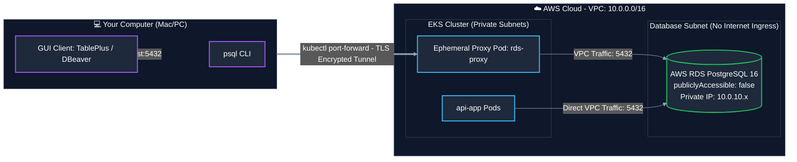
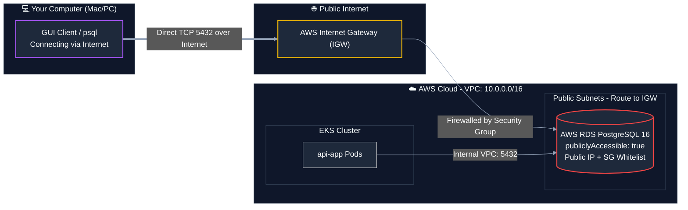

# AWS RDS Connection Guide: `publiclyAccessible: false` vs. `true`

This guide explains the architecture, security implications, infrastructure code, and connection workflows for both **Private (`publiclyAccessible: false`)** and **Public (`publiclyAccessible: true`)** AWS RDS PostgreSQL configurations.

---

## 🧭 Quick Summary & Recommendation

| Feature | Option A: `publiclyAccessible: false` *(Current Setup)* | Option B: `publiclyAccessible: true` |
| :--- | :--- | :--- |
| **Best For** | **Production, Staging, Enterprise Security** | **Quick Prototypes, Hackathons, Solo Dev** |
| **Subnet Location** | **Private Subnets** (No direct internet ingress) | **Public Subnets** (Direct Internet Gateway route) |
| **Public IP Assigned?** | ❌ No public IP; DNS resolves to private IP (`10.0.x.x`) | ✅ Yes; AWS assigns an Elastic/Public IP |
| **Internet Attack Surface**| **Zero** (Completely shielded from scanners & bots) | **High** (Exposed to internet scans & brute-force) |
| **Laptop Connection Method**| Secure tunnel via **Kubernetes Port-Forward** or VPN | **Direct connection** to RDS endpoint address |
| **AWS Best Practice** | ✅ **Recommended by AWS Well-Architected Framework** | ⚠️ Discouraged for sensitive data |

---

## 🏗️ Architectural Comparison

### Option A: `publiclyAccessible: false` (Private & Secure)

The RDS instance lives exclusively inside the VPC private subnets. Only resources with security group clearance inside the VPC (like EKS pods) can speak directly to port 5432. Developers connect to the database through a **Kubernetes Port-Forward bridge**:



---

### Option B: `publiclyAccessible: true` (Public & Direct)

The RDS instance lives in **public subnets** with a route to an Internet Gateway (IGW). It receives a public IP address, and developers connect directly over the open internet:



---

## 🔒 1. Option A: `publiclyAccessible: false` (Enterprise Standard)

### Why Use It?
- **Zero Attack Surface:** The database has no public IP address. Bots and malicious crawlers cannot even attempt password brute-forcing.
- **Compliance:** Required by SOC2, ISO 27001, HIPAA, and PCI-DSS standards.
- **Safe from Accidental Misconfiguration:** Even if someone creates a weak password, the database cannot be reached from outside the VPC.

### Infrastructure Configuration (Pulumi TypeScript)
```typescript
// 1. Subnet Group MUST be placed in Private Subnets
const dbSubnetGroup = new aws.rds.SubnetGroup("shop-db-subnet-group", {
  subnetIds: [privateSubnet1.id, privateSubnet2.id],
});

// 2. Security Group allows traffic ONLY from EKS worker nodes and VPC CIDR
const dbSecurityGroup = new aws.ec2.SecurityGroup("shop-db-sg", {
  vpcId: vpc.id,
  ingress: [
    {
      protocol: "tcp",
      fromPort: 5432,
      toPort: 5432,
      securityGroups: [cluster.nodeSecurityGroupId], // EKS nodes
      cidrBlocks: [vpc.cidrBlock],                  // VPC internal (10.0.0.0/16)
      description: "Allow PostgreSQL strictly from internal EKS nodes and VPC",
    },
  ],
  egress: [
    { protocol: "-1", fromPort: 0, toPort: 0, cidrBlocks: ["0.0.0.0/0"] },
  ],
});

// 3. RDS Instance with publiclyAccessible = false
const rdsInstance = new aws.rds.Instance("shop-postgres", {
  identifier: "shop-postgres-db",
  engine: "postgres",
  engineVersion: "16.10",
  instanceClass: "db.t4g.micro",
  allocatedStorage: 20,
  dbName: "shop",
  username: "shop",
  password: dbPassword,
  dbSubnetGroupName: dbSubnetGroup.name,
  vpcSecurityGroupIds: [dbSecurityGroup.id],
  publiclyAccessible: false, // 🔒 Kept private inside VPC
});
```

### How to Connect from Your Laptop (Step-by-Step)

Because the database is private, use Kubernetes as a secure bridge:

#### Step 1: Retrieve your RDS endpoint
```bash
RDS_HOST=$(aws rds describe-db-instances \
  --db-instance-identifier shop-postgres-db \
  --query 'DBInstances[0].Endpoint.Address' \
  --output text \
  --region ap-southeast-2)
```

#### Step 2: Spin up a lightweight proxy pod in EKS
```bash
kubectl run rds-proxy --image=alpine/socat --expose --port=5432 -- -d -d TCP-LISTEN:5432,fork TCP:$RDS_HOST:5432
```

#### Step 3: Forward port 5432 to your Mac
```bash
kubectl port-forward pod/rds-proxy 5432:5432
```
*(Keep this terminal window open while you work)*

#### Step 4: Connect in TablePlus / DBeaver / psql
- **Host:** `localhost` or `127.0.0.1`
- **Port:** `5432`
- **Database:** `shop`
- **User:** `shop`
- **Password:** `<YOUR_DB_PASSWORD>`
- **SSL Mode:** `prefer` or `require`

#### Step 5: Clean up proxy pod when finished
```bash
kubectl delete pod rds-proxy
```

> [!TIP]
> **One-Liner Terminal CLI:** If you only need a quick interactive `psql` shell, run:
> ```bash
> kubectl run psql-client --rm -it --image=postgres:16-alpine --env-from=secret/postgres-secret -- psql "$DATABASE_URL"
> ```

---

## 🌍 2. Option B: `publiclyAccessible: true` (Direct Access)

### Why Use It?
- **Extreme Convenience:** Connect directly using TablePlus or DBeaver without running `kubectl port-forward`.
- **Ideal for Fast Prototyping:** Useful in early exploration or hackathons where developer velocity precedes strict compliance.

> [!WARNING]
> ### ⚠️ Critical AWS Requirement: Subnet Routing
> Setting `publiclyAccessible: true` **will not work** if your RDS instance resides in **private subnets**.
> AWS RDS requires that the Subnet Group contains **public subnets** associated with a Route Table that has an active route `0.0.0.0/0` pointing to an **Internet Gateway (IGW)**. Otherwise, AWS cannot assign a public IP and connections will fail with `Connection timed out`.

### Infrastructure Configuration (Pulumi TypeScript)
```typescript
// 1. Subnet Group MUST use Public Subnets (Connected to Internet Gateway)
const dbPublicSubnetGroup = new aws.rds.SubnetGroup("shop-db-public-subnet-group", {
  subnetIds: [publicSubnet1.id, publicSubnet2.id], // ⚠️ Must be PUBLIC subnets!
  tags: { Name: "shop-db-public-subnet-group" },
});

// 2. Security Group: Restrict ingress strictly to your Home/Office Public IP
// DO NOT use "0.0.0.0/0" (All Internet)!
const myPublicIp = "203.0.113.45/32"; // Replace with your IP from `curl ifconfig.me`

const dbSecurityGroup = new aws.ec2.SecurityGroup("shop-db-public-sg", {
  vpcId: vpc.id,
  ingress: [
    {
      protocol: "tcp",
      fromPort: 5432,
      toPort: 5432,
      securityGroups: [cluster.nodeSecurityGroupId], // EKS nodes can still connect
      cidrBlocks: [myPublicIp],                     // Your laptop's IP only
      description: "Allow PostgreSQL from developer laptop IP and EKS nodes",
    },
  ],
  egress: [
    { protocol: "-1", fromPort: 0, toPort: 0, cidrBlocks: ["0.0.0.0/0"] },
  ],
});

// 3. RDS Instance with publiclyAccessible = true
const rdsInstance = new aws.rds.Instance("shop-postgres", {
  identifier: "shop-postgres-db",
  engine: "postgres",
  engineVersion: "16.10",
  instanceClass: "db.t4g.micro",
  allocatedStorage: 20,
  dbName: "shop",
  username: "shop",
  password: dbPassword,
  dbSubnetGroupName: dbPublicSubnetGroup.name, // ⚠️ Bound to Public Subnets
  vpcSecurityGroupIds: [dbSecurityGroup.id],
  publiclyAccessible: true,                   // 🌐 Publicly accessible over Internet
});
```

### How to Connect from Your Laptop (Direct)

#### Step 1: Find your RDS Public Endpoint
```bash
RDS_HOST=$(aws rds describe-db-instances \
  --db-instance-identifier shop-postgres-db \
  --query 'DBInstances[0].Endpoint.Address' \
  --output text \
  --region ap-southeast-2)

echo $RDS_HOST
# Example: shop-postgres-db.cz9xxxxxx.ap-southeast-2.rds.amazonaws.com
```

#### Step 2: Ensure your current IP is whitelisted in the Security Group
Check your current public IP:
```bash
curl -s https://checkip.amazonaws.com
```
If your ISP IP changed, authorize it:
```bash
SG_ID=$(aws rds describe-db-instances \
  --db-instance-identifier shop-postgres-db \
  --query 'DBInstances[0].VpcSecurityGroups[0].VpcSecurityGroupId' \
  --output text \
  --region ap-southeast-2)

MY_IP=$(curl -s https://checkip.amazonaws.com)

aws ec2 authorize-security-group-ingress \
  --group-id $SG_ID \
  --protocol tcp \
  --port 5432 \
  --cidr "${MY_IP}/32" \
  --region ap-southeast-2
```

#### Step 3: Connect directly via GUI or CLI
- **Host:** `shop-postgres-db.cz9xxxxxx.ap-southeast-2.rds.amazonaws.com` *(Your RDS Endpoint)*
- **Port:** `5432`
- **Database:** `shop`
- **User:** `shop`
- **Password:** `<YOUR_DB_PASSWORD>`
- **SSL Mode:** `require` *(Always enforce SSL across public internet!)*

```bash
# Terminal connection:
psql "host=shop-postgres-db.cz9xxxxxx.ap-southeast-2.rds.amazonaws.com port=5432 dbname=shop user=shop sslmode=require"
```

---

## ⚖️ Detailed Comparison Table

| Attribute | `publiclyAccessible: false` (Private) | `publiclyAccessible: true` (Public) |
| :--- | :--- | :--- |
| **AWS Subnet Placement** | Private Subnets (`10.0.10.0/24`, `10.0.20.0/24`) | Public Subnets (`10.0.1.0/24`, `10.0.2.0/24`) |
| **Route Table Target** | NAT Gateway (outbound only) | Internet Gateway (`0.0.0.0/0 -> igw-xxx`) |
| **Public DNS Record** | Resolves to private IP (e.g., `10.0.10.45`) | Resolves to public Elastic IP (e.g., `54.252.x.x`) |
| **Direct Internet Access** | ❌ Blocked at AWS routing level | ✅ Reachable from authorized public IPs |
| **Port-Forwarding Needed?** | ✅ Yes (`kubectl port-forward`) | ❌ No direct port-forwarding required |
| **Dynamic IP Changes** | Works anywhere (as long as `kubectl` works) | Requires updating SG rules whenever home Wi-Fi changes |
| **Security Risk Profile** | Low (Internal network only) | Medium to High (Depends heavily on SG whitelist) |
| **Compliance Readiness** | SOC2, PCI-DSS, HIPAA compliant | Usually flagged in automated security audits |

---

## 🛠️ Troubleshooting Connection Issues

### Issue 1: `Connection timed out` on `publiclyAccessible: true`
- **Cause:** The database was provisioned in **private subnets** instead of public subnets, OR your current public IP is not in the Security Group ingress list.
- **Fix:** Verify subnet route table has an Internet Gateway (`igw`) route, and run `curl ifconfig.me` to verify your IP matches the Security Group rule.

### Issue 2: `Connection refused` on `publiclyAccessible: false`
- **Cause:** The `rds-proxy` pod is not running, or `kubectl port-forward` terminated.
- **Fix:** Re-run `kubectl port-forward pod/rds-proxy 5432:5432` and check that the pod is `Running` with `kubectl get pod rds-proxy`.

### Issue 3: `SSL connection error: decryption failed or bad record mac`
- **Cause:** SSL configuration mismatch between your client and PostgreSQL 16.
- **Fix:** Set SSL Mode to **`require`** or **`prefer`** in TablePlus/DBeaver. AWS RDS PostgreSQL enforces SSL by default.
