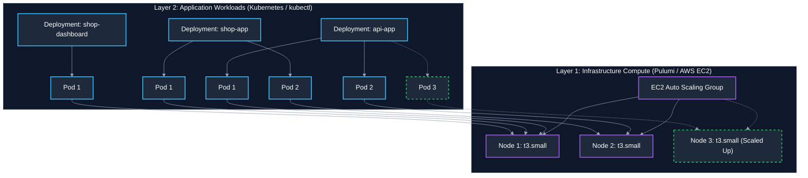

# AWS EKS & Pulumi Scaling Guide: Managing Nodes, Pods, and Auto-Scaling

> **Target Cluster:** `shop-eks-cluster` (`ap-southeast-2`)  
> **Current Live Compute:** 2x `t3.small` EC2 Worker Nodes  
> **Current Live Workloads:** 11 Pods across 3 Applications & System Services  
> **Config Files:** [index.ts](file:///Users/kendirck/Desktop/learn/interview/hello-k8s/index.ts), [Pulumi.dev.yaml](file:///Users/kendirck/Desktop/learn/interview/hello-k8s/Pulumi.dev.yaml), [`k8s/eks/`](file:///Users/kendirck/Desktop/learn/interview/hello-k8s/k8s/eks)

---

## 1. The Two Layers of EKS Scaling

In Kubernetes on AWS EKS, scaling happens at two distinct layers that must stay in balance:



- **Layer 1: Node Scaling (EC2 Instances):** Managed by **Pulumi IaC** via Auto Scaling Group (ASG). Determines the total CPU and RAM capacity available to the cluster.
- **Layer 2: Pod Scaling (Containers):** Managed by **Kubernetes manifests ([`k8s/eks/`](file:///Users/kendirck/Desktop/learn/interview/hello-k8s/k8s/eks))** or `kubectl`. Determines how many copies of your application are running.

> [!CRITICAL]
> **Max Pods Limit per EC2 Instance Type (The `t3.small` Bottleneck)**  
> Because AWS VPC CNI assigns a real VPC IP address to every pod, the EC2 instance type limits how many pods can run on a single node:
> - **`t3.small` has a hard limit of 11 pods per node!**
> - Your cluster currently has **11 total pods** distributed across 2 nodes (~5-6 pods each).
> - **If you scale down to 1 node (`desiredCapacity: 1`), that single `t3.small` node will hit the 11-pod ceiling immediately!** Any extra pod will remain stuck in `Pending` state.
> - If you expect more than 11-20 pods, you must either scale out node count (`desiredCapacity: 3+`) or upgrade the instance type (`t3.medium` supports up to 17 pods, `m5.large` supports 29 pods).

---

## 2. Layer 1: Scaling Nodes via Pulumi (Compute Layer)

### 2.1 Where Node Counts Are Configured

In [index.ts#L133-L136](file:///Users/kendirck/Desktop/learn/interview/hello-k8s/index.ts#L133-L136):

```typescript
// Current Configuration in index.ts:
const cluster = new eks.Cluster("shop-cluster", {
  name: "shop-eks-cluster",
  vpcId: vpc.id,
  publicSubnetIds: [publicSubnet1.id, publicSubnet2.id],
  privateSubnetIds: [privateSubnet1.id, privateSubnet2.id],
  nodeAssociatePublicIpAddress: false,
  instanceType: "t3.small", // EC2 Instance Type
  desiredCapacity: 2,        // Current active node count
  minSize: 2,                // Minimum nodes ASG will maintain
  maxSize: 6,                // Maximum nodes ASG will scale up to
  createOidcProvider: false,
  corednsAddonOptions: { enabled: false },
  authenticationMode: "API_AND_CONFIG_MAP",
  enabledClusterLogTypes: ["api", "audit", "authenticator", "controllerManager", "scheduler"],
  tags: {
    Environment: "dev",
    Project: "hello-k8s",
  },
});
```

### 2.2 How to Change Node Counts (Hardcoded vs. Dynamic Config)

#### Option A: Direct Edit in `index.ts`
Simply edit the numbers in `index.ts`:
```typescript
  desiredCapacity: 3, // Scale up from 2 to 3 nodes
  minSize: 2,
  maxSize: 5,
```
Then run:
```bash
pulumi preview
pulumi up -y
```

#### Option B: Dynamic Configuration via `Pulumi.dev.yaml` (Best Practice)
Make node scaling dynamically configurable without editing TypeScript code each time:

1. Update `index.ts` to read from Pulumi config with fallbacks:
```typescript
const desiredNodes = config.getNumber("desiredNodes") || 2;
const minNodes = config.getNumber("minNodes") || 1;
const maxNodes = config.getNumber("maxNodes") || 3;
const nodeInstanceType = config.get("nodeInstanceType") || "t3.small";

const cluster = new eks.Cluster("shop-cluster", {
  // ...
  instanceType: nodeInstanceType as aws.ec2.InstanceType,
  desiredCapacity: desiredNodes,
  minSize: minNodes,
  maxSize: maxNodes,
  // ...
});
```

2. Adjust node counts on the fly using CLI commands:
```bash
# Scale UP to 3 nodes:
pulumi config set desiredNodes 3
pulumi up -y

# Scale DOWN to 1 node (for low-cost off-peak dev):
pulumi config set desiredNodes 1
pulumi up -y
```

### 2.3 Emergency Instant Node Scaling via AWS CLI (No Pulumi Run)

If you need to instantly scale nodes without waiting for a full `pulumi up` pipeline:

```bash
# 1. Find your Auto Scaling Group Name:
ASG_NAME=$(aws autoscaling describe-auto-scaling-groups \
  --region ap-southeast-2 \
  --query "AutoScalingGroups[?contains(AutoScalingGroupName, 'shop-cluster')].AutoScalingGroupName" \
  --output text)

echo "Auto Scaling Group: $ASG_NAME"

# 2. Scale up to 3 nodes immediately:
aws autoscaling set-desired-capacity \
  --region ap-southeast-2 \
  --auto-scaling-group-name "$ASG_NAME" \
  --desired-capacity 3

# 3. Watch new node register:
kubectl get nodes -w
```
*(Note: Running `pulumi up` later will reconcile the ASG back to whatever is defined in `index.ts` or Pulumi config).*

---

## 3. Layer 2: Scaling Pods via Kubernetes (Application Layer)

### 3.1 Declarative Scaling via Manifests (`k8s/eks/`)

Edit the `replicas` field under `spec` for any deployment in [`k8s/eks/01-api-app.yaml`](file:///Users/kendirck/Desktop/learn/interview/hello-k8s/k8s/eks/01-api-app.yaml):

```yaml
# Example: Scale api-app from 2 to 4 replicas
apiVersion: apps/v1
kind: Deployment
metadata:
  name: api-app
spec:
  replicas: 4  # <-- Change from 2 to 4
  template:
    # ...
```

Apply the changes:
```bash
kubectl apply -k k8s/eks
kubectl rollout status deployment/api-app
```

### 3.2 Imperative Scaling via `kubectl scale` (Instant Scaling)

You can scale any deployment immediately without modifying YAML files or committing to git:

```bash
# 1. Scale Up api-app to 4 pods
kubectl scale deployment/api-app --replicas=4

# 2. Scale Up storefront to 3 pods
kubectl scale deployment/shop-app --replicas=3

# 3. Scale Down admin dashboard to 0 (pause it to free memory)
kubectl scale deployment/shop-dashboard --replicas=0

# 4. View pods scheduling live
kubectl get pods -l app=api-app -o wide
```

---

## 4. Horizontal Pod Autoscaler (HPA) — Automated Pod Scaling

Rather than manually scaling pods, Kubernetes can automatically scale pod replicas based on CPU or Memory usage.

### Prerequisites: Metrics Server
Autoscaling requires Kubernetes to know how much CPU/memory pods are consuming:
```bash
kubectl apply -f https://github.com/kubernetes-sigs/metrics-server/releases/latest/download/components.yaml
```
Verify metrics are working:
```bash
kubectl top nodes
kubectl top pods
```

### Production HPA Manifest ([`k8s/eks/04-hpa.yaml`](file:///Users/kendirck/Desktop/learn/interview/hello-k8s/k8s/eks/04-hpa.yaml))

The production HPA manifest defines autoscaling for all 3 applications:
- **`api-app-hpa`:** Min 2, Max 6 replicas (scales when CPU > 70% or Memory > 80%)
- **`shop-app-hpa`:** Min 2, Max 5 replicas (scales when CPU > 70% or Memory > 80%)
- **`shop-dashboard-hpa`:** Min 1, Max 3 replicas (scales when CPU > 70% or Memory > 80%)

```yaml
apiVersion: autoscaling/v2
kind: HorizontalPodAutoscaler
metadata:
  name: api-app-hpa
spec:
  scaleTargetRef:
    apiVersion: apps/v1
    kind: Deployment
    name: api-app
  minReplicas: 2
  maxReplicas: 6
  metrics:
    - type: Resource
      resource:
        name: cpu
        target:
          type: Utilization
          averageUtilization: 70
    - type: Resource
      resource:
        name: memory
        target:
          type: Utilization
          averageUtilization: 80
---
apiVersion: autoscaling/v2
kind: HorizontalPodAutoscaler
metadata:
  name: shop-app-hpa
spec:
  scaleTargetRef:
    apiVersion: apps/v1
    kind: Deployment
    name: shop-app
  minReplicas: 2
  maxReplicas: 5
  metrics:
    - type: Resource
      resource:
        name: cpu
        target:
          type: Utilization
          averageUtilization: 70
    - type: Resource
      resource:
        name: memory
        target:
          type: Utilization
          averageUtilization: 80
---
apiVersion: autoscaling/v2
kind: HorizontalPodAutoscaler
metadata:
  name: shop-dashboard-hpa
spec:
  scaleTargetRef:
    apiVersion: apps/v1
    kind: Deployment
    name: shop-dashboard
  minReplicas: 1
  maxReplicas: 3
  metrics:
    - type: Resource
      resource:
        name: cpu
        target:
          type: Utilization
          averageUtilization: 70
    - type: Resource
      resource:
        name: memory
        target:
          type: Utilization
          averageUtilization: 80
```

Apply with:
```bash
# Option A: Apply via Kustomize (recommended)
kubectl apply -k k8s/eks

# Option B: Apply directly
kubectl apply -f k8s/eks/04-hpa.yaml

# Check live HPA status:
kubectl get hpa
```

---

## 5. Practical Scaling Scenarios

### Scenario A: Handling a Traffic Surge (Scale Up)

1. **Step 1 — Scale Nodes First (give the cluster room to breathe):**
   ```bash
   pulumi config set desiredNodes 3
   pulumi config set maxNodes 5
   pulumi up -y
   ```
2. **Step 2 — Scale Pods:**
   ```bash
   kubectl scale deployment/api-app --replicas=4
   kubectl scale deployment/shop-app --replicas=4
   ```
3. **Step 3 — Verify:**
   ```bash
   kubectl get pods -o wide
   ```

---

### Scenario B: Low-Cost Dev Mode / Nightly Scale Down

When not actively developing or testing, scale down to reduce AWS charges:

1. **Step 1 — Scale Down Pods:**
   ```bash
   # Reduce apps to 1 replica each
   kubectl scale deployment/api-app --replicas=1
   kubectl scale deployment/shop-app --replicas=1
   kubectl scale deployment/shop-dashboard --replicas=1
   ```
   *Total pods drops from 11 to 7 (3 app pods + 2 coredns + 2 daemonsets).*

2. **Step 2 — Safely Scale Down to 1 Worker Node:**
   Since total pods is now 7, it fits under the `t3.small` 11-pod limit:
   ```bash
   pulumi config set desiredNodes 1
   pulumi up -y
   ```

---

### Scenario C: Safe Node Drain Before Scale Down

When an EC2 node is terminated during scale down, pods on that node need to be gracefully migrated to remaining nodes:

```bash
# 1. Identify node to drain
kubectl get nodes

# 2. Mark node unschedulable and evict pods to other nodes
kubectl drain <NODE_NAME> --ignore-daemonsets --delete-emptydir-data

# 3. Check all pods moved safely
kubectl get pods -o wide

# 4. If keeping the node later, uncordon it:
kubectl uncordon <NODE_NAME>
```

---

## 6. Comparison & Summary Cheat Sheet

| Action | Target | Tool | Command / File | Speed |
| :--- | :--- | :--- | :--- | :--- |
| **Scale Pods (Declarative)** | Application Replicas | Git / YAML | Edit `replicas:` in [`k8s/eks/`](file:///Users/kendirck/Desktop/learn/interview/hello-k8s/k8s/eks) $\rightarrow$ `kubectl apply -k k8s/eks` | ~5–15 seconds |
| **Scale Pods (Instant)** | Application Replicas | CLI | `kubectl scale deployment/api-app --replicas=N` | ~2–5 seconds |
| **Auto-Scale Pods** | Application Replicas | HPA | Kubernetes HPA (scales on CPU/RAM %) | Automatic |
| **Scale Nodes (IaC)** | EC2 Worker Instances | Pulumi | Edit `desiredCapacity` in [index.ts](file:///Users/kendirck/Desktop/learn/interview/hello-k8s/index.ts) $\rightarrow$ `pulumi up` | ~2–3 minutes |
| **Scale Nodes (Dynamic)** | EC2 Worker Instances | Pulumi Config | `pulumi config set desiredNodes N && pulumi up` | ~2–3 minutes |
| **Emergency Node Scale** | EC2 Worker Instances | AWS CLI | `aws autoscaling set-desired-capacity ...` | ~1–2 minutes |
| **Upgrade Node Size** | Instance Type | Pulumi | Change `instanceType: "t3.medium"` in [index.ts](file:///Users/kendirck/Desktop/learn/interview/hello-k8s/index.ts) $\rightarrow$ `pulumi up` | Rolling replacement |
