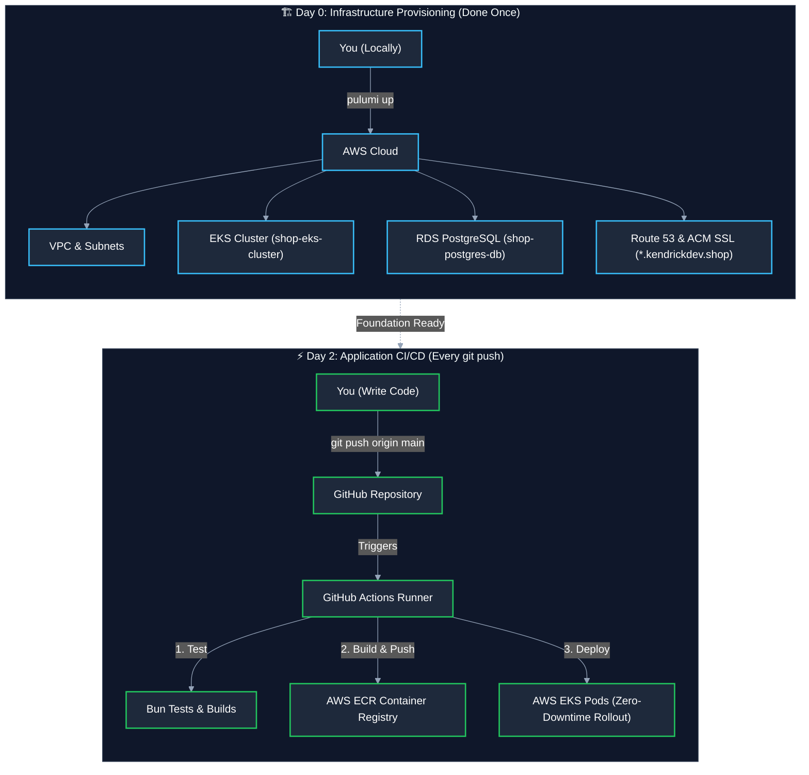

# Cloud Architecture & CI/CD Pipeline Guide

This document explains the complete cloud architecture, the role of CI/CD, and why today's deployment felt different from your usual `git push` workflow.

---

## 🧠 1. The Core Concept: Day 0 vs. Day 2

When building in the cloud, work is divided into two distinct phases:



### Why it felt different today
* **Normally**, when joining an existing project or company, the Kubernetes cluster, databases, domain names, and SSL certificates **already exist**. Your only job is writing code and pushing to GitHub.
* **Today**, we started from **blank AWS cloud space**. We had to build the entire "airport" (VPC, EKS, RDS, SSL, DNS) using Pulumi before the airplanes (your Docker containers) had anywhere to land.
* **From now on**, the infrastructure is built and permanent. You are now in **Day 2 (CI/CD)** mode.

---

## 🔄 2. How the GitHub Actions CI/CD Pipeline Works

When you push code to GitHub, `.github/workflows/deploy.yml` runs a 3-stage automated pipeline:

```mermaid
%%{init: {'theme': 'dark', 'themeVariables': {'darkMode': true, 'background': '#0d1117', 'actorBkg': '#1e293b', 'actorTextColor': '#ffffff', 'actorBorder': '#38bdf8', 'signalColor': '#38bdf8', 'signalTextColor': '#ffffff', 'labelBoxBkgColor': '#1e293b', 'labelTextColor': '#ffffff', 'loopTextColor': '#ffffff'}}}%%
sequenceDiagram
    autonumber
    actor Dev as Developer
    participant GH as GitHub Repository
    participant GHA as GitHub Actions Runner
    participant ECR as AWS ECR Registry
    participant EKS as AWS EKS Cluster

    Dev->>GH: git push origin main
    GH->>GHA: Trigger .github/workflows/deploy.yml

    rect rgb(15, 23, 42)
    Note over GHA: Stage 1: Test & Validate
    GHA->>GHA: bun install & bun test (api-app)
    GHA->>GHA: bun run build (shop-app)
    GHA->>GHA: bun run build (shop-dashboard)
    end

    rect rgb(6, 44, 28)
    Note over GHA, ECR: Stage 2: Build & Push (linux/amd64)
    GHA->>GHA: Authenticate to AWS via Secrets
    GHA->>GHA: Compute Git Commit Short SHA
    GHA->>ECR: docker build & push api-app:sha & :latest
    GHA->>ECR: docker build & push shop-app:sha & :latest
    GHA->>ECR: docker build & push shop-dashboard:sha & :latest
    end

    rect rgb(45, 28, 12)
    Note over GHA, EKS: Stage 3: Zero-Downtime EKS Deployment
    GHA->>EKS: aws eks update-kubeconfig
    GHA->>EKS: kubectl apply -k k8s/eks (manifests & autoscalers)
    GHA->>EKS: kubectl set image deployment/* with new image tags
    EKS->>ECR: Pull new container images
    EKS->>EKS: Start new pods, wait for readiness checks
    EKS->>EKS: Terminate old pods (Zero Downtime)
    GHA-->>Dev: Deployment Successful Notification
    end
```



---

## ⚙️ 3. What is Required to Enable Fully Automated CI/CD

For GitHub Actions to run without manual intervention, GitHub needs an IAM User with permission to connect to your AWS account and EKS cluster.

### Step 1: Create the AWS IAM User

You can create the user using the **AWS Console** or **AWS CLI**:

```bash
# 1. Create dedicated CI/CD IAM user
aws iam create-user --user-name github-actions-deployer

# 2. Attach deployment policy (AdministratorAccess for dev/interview)
aws iam attach-user-policy \
  --user-name github-actions-deployer \
  --policy-arn arn:aws:iam::aws:policy/AdministratorAccess

# 3. Generate Access Key ID & Secret Key
aws iam create-access-key --user-name github-actions-deployer
```
*(Or via AWS Console $\rightarrow$ **IAM** $\rightarrow$ **Users** $\rightarrow$ **Create user** $\rightarrow$ Attach `AdministratorAccess` $\rightarrow$ **Security credentials** $\rightarrow$ **Create access key**)*

---

### Step 2: Add AWS Credentials into GitHub Secrets

1. Open your repository on GitHub:
   `https://github.com/heinhtetzan/interview/settings/secrets/actions`
2. Click **New repository secret** and create:
   - `AWS_ACCESS_KEY_ID`: Your IAM user access key
   - `AWS_SECRET_ACCESS_KEY`: Your IAM secret access key

---

### Step 3: Grant the IAM User Access to EKS via IAM Access Entries

Our EKS cluster uses the modern `API_AND_CONFIG_MAP` authentication mode. Instead of editing the deprecated `aws-auth` ConfigMap, we use native **EKS Access Entries** (which are **100% free / $0.00**):

```bash
# 1. Create EKS Access Entry
aws eks create-access-entry \
  --cluster-name shop-eks-cluster \
  --principal-arn arn:aws:iam::542601847638:user/github-actions-deployer \
  --type STANDARD \
  --region ap-southeast-2

# 2. Attach Cluster Admin Policy
aws eks associate-access-policy \
  --cluster-name shop-eks-cluster \
  --principal-arn arn:aws:iam::542601847638:user/github-actions-deployer \
  --policy-arn arn:aws:eks::aws:cluster-access-policy/AmazonEKSClusterAdminPolicy \
  --access-scope type=cluster \
  --region ap-southeast-2
```
*(Verified: Configured with `AmazonEKSClusterAdminPolicy` and `AmazonEKSAdminPolicy`)*

---

## 📋 4. Summary: What Tool Does What?

| Tool / Layer | What it does | When it runs |
| :--- | :--- | :--- |
| **Docker Compose** | Runs PostgreSQL, backend, and frontends on your Mac (`localhost:9000-9002`) | During local coding and offline testing |
| **Pulumi (IaC)** | Creates cloud infrastructure (VPC, EKS, RDS, Route 53, SSL) | **Only once (Day 0)** or when infrastructure topology changes |
| **GitHub Actions** | Tests code, builds container images, and deploys to Kubernetes | **On every `git push` (Day 2)** |
| **AWS EKS** | Runs and autoscales your containers with high availability | Runs 24/7 in the cloud |
| **AWS RDS** | Manages persistent PostgreSQL storage and automated backups | Runs 24/7 in the cloud |
