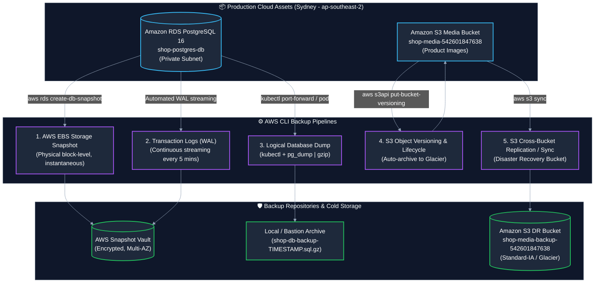
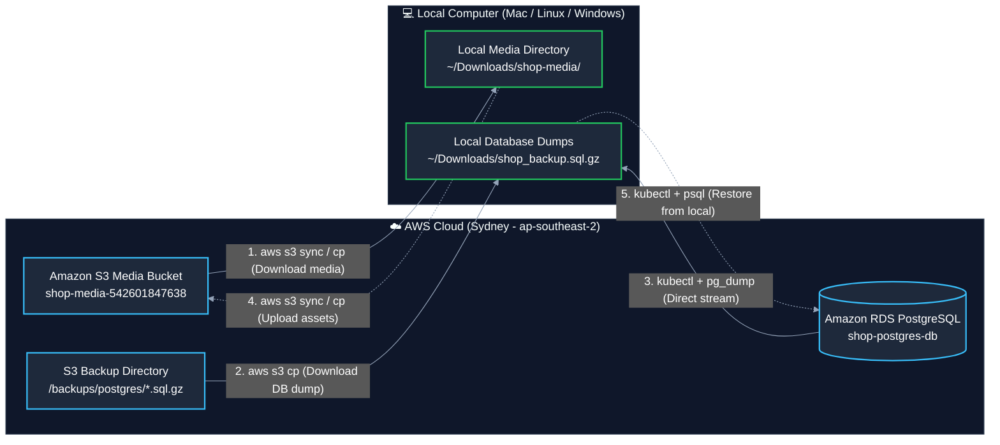

# AWS CLI Backup & Disaster Recovery Guide: RDS PostgreSQL & Amazon S3

> **Cloud Environment:** AWS Sydney (`ap-southeast-2`)  
> **AWS Account ID:** `542601847638`  
> **RDS Instance Identifier:** `shop-postgres-db` (PostgreSQL 16.10, `db.t4g.micro`)  
> **Primary S3 Media Bucket:** `shop-media-542601847638`  
> **Disaster Recovery S3 Bucket:** `shop-media-backup-542601847638`  
> **Related Configs:** [`index.ts`](../index.ts), [`doc/03-rds-connection-guide.md`](./03-rds-connection-guide.md)

---

## 🧭 1. Backup Strategy, RPO & RTO Overview

An enterprise-grade backup strategy combines **physical snapshots**, **continuous point-in-time logging**, and **object versioning**:



### 🎯 Recovery Objectives & Metrics

| Asset | Backup Type | Frequency | RPO (Data Loss Window) | RTO (Time to Recover) | Target Cost |
| :--- | :--- | :--- | :--- | :--- | :--- |
| **RDS PostgreSQL** | Automated Snapshots + WAL | Continuous + Daily | **< 5 minutes** | ~10–15 minutes | Included (up to 100% of DB size free) |
| **RDS PostgreSQL** | Manual On-Demand Snapshot | Pre-deployment / Milestones | **0 seconds** at capture | ~10–15 minutes | $0.096 / GB-month for snapshot storage |
| **RDS PostgreSQL** | Logical SQL Dump (`pg_dump`) | Weekly / On-demand | Point of execution | ~2–5 minutes | Free (Stored locally or in S3) |
| **S3 Media Bucket** | Bucket Versioning | Instant upon upload/edit | **0 seconds** | Instant (revert version) | Free tier / standard storage |
| **S3 Media Bucket** | S3-to-S3 Sync / Mirror | Daily / Real-time | **< 24 hours** | ~2–10 minutes | Standard-IA storage rates |

---

## 🗄️ 2. Amazon RDS PostgreSQL Backup & Restore (AWS CLI)

All AWS CLI commands target region `ap-southeast-2` and DB instance `shop-postgres-db`.

### 2.1 Configure Automated Daily Backups & Retention Period

By default, Amazon RDS automated backups are enabled with a 1-day retention period. For production, extend this to 7–35 days:

```bash
# Enable automated backups with a 7-day retention period and a backup window (UTC 16:00-16:30 / 02:00-02:30 AEST)
aws rds modify-db-instance \
  --db-instance-identifier shop-postgres-db \
  --backup-retention-period 7 \
  --preferred-backup-window "16:00-16:30" \
  --apply-immediately \
  --region ap-southeast-2
```

Verify automated backup configuration:
```bash
aws rds describe-db-instances \
  --db-instance-identifier shop-postgres-db \
  --region ap-southeast-2 \
  --query 'DBInstances[0].[DBInstanceIdentifier, BackupRetentionPeriod, PreferredBackupWindow, LatestRestorableTime]' \
  --output table
```

---

### 2.2 Create an On-Demand Manual DB Snapshot

Before executing major application upgrades, schema migrations, or infrastructure changes, take a manual snapshot:

```bash
# Generate timestamped snapshot identifier
SNAPSHOT_ID="shop-postgres-manual-$(date +%Y%m%d-%H%M%S)"

# Trigger snapshot creation
aws rds create-db-snapshot \
  --db-instance-identifier shop-postgres-db \
  --db-snapshot-identifier "$SNAPSHOT_ID" \
  --tags Key=Environment,Value=production Key=Project,Value=shop-eks-prod \
  --region ap-southeast-2

echo "Triggered snapshot: $SNAPSHOT_ID"
```

---

### 2.3 Monitor & Check Snapshot Progress

```bash
# Poll until snapshot status turns to 'available'
aws rds describe-db-snapshots \
  --db-snapshot-identifier "$SNAPSHOT_ID" \
  --region ap-southeast-2 \
  --query 'DBSnapshots[0].[DBSnapshotIdentifier, Status, PercentProgress, AllocatedStorage]' \
  --output table
```

To block execution until completion:
```bash
aws rds wait db-snapshot-available \
  --db-snapshot-identifier "$SNAPSHOT_ID" \
  --region ap-southeast-2

echo "✅ Snapshot $SNAPSHOT_ID is ready and available!"
```

---

### 2.4 List All Existing Snapshots

```bash
# List all manual snapshots for shop-postgres-db
aws rds describe-db-snapshots \
  --db-instance-identifier shop-postgres-db \
  --snapshot-type manual \
  --region ap-southeast-2 \
  --query 'DBSnapshots[*].[DBSnapshotIdentifier, SnapshotCreateTime, Status, AllocatedStorage]' \
  --output table
```

---

### 2.5 Restore RDS Instance from a Snapshot

> [!IMPORTANT]
> When restoring from a snapshot, RDS creates a **brand-new database instance**. It does not overwrite the existing one. Once verified, update Kubernetes secrets or re-route endpoints.

```bash
# Choose target snapshot and new instance identifier
RESTORE_SNAPSHOT_ID="shop-postgres-manual-20261019-083000"
RESTORED_DB_NAME="shop-postgres-restored"

# 1. Fetch DB Subnet Group and Security Group from existing instance
VPC_SG_ID=$(aws ec2 describe-security-groups \
  --filters "Name=group-name,Values=shop-db-sg*" \
  --region ap-southeast-2 \
  --query 'SecurityGroups[0].GroupId' --output text)

# 2. Restore to new instance inside the private DB subnet group
aws rds restore-db-instance-from-db-snapshot \
  --db-instance-identifier "$RESTORED_DB_NAME" \
  --db-snapshot-identifier "$RESTORE_SNAPSHOT_ID" \
  --db-instance-class db.t4g.micro \
  --db-subnet-group-name shop-db-subnet-group \
  --vpc-security-group-ids "$VPC_SG_ID" \
  --no-publicly-accessible \
  --region ap-southeast-2

echo "Restore initiated for $RESTORED_DB_NAME. Waiting for instance to become available..."
aws rds wait db-instance-available \
  --db-instance-identifier "$RESTORED_DB_NAME" \
  --region ap-southeast-2

echo "✅ Restored database is now active!"
```

---

### 2.6 Point-in-Time Recovery (PITR)

If an accidental `DELETE` or `DROP TABLE` occurred at a known time (e.g. `2026-10-19T08:15:00Z`), roll back to right before the disaster:

```bash
# Restore to exact timestamp (UTC)
aws rds restore-db-instance-to-point-in-time \
  --source-db-instance-identifier shop-postgres-db \
  --target-db-instance-identifier "shop-postgres-pitr" \
  --restore-time "2026-10-19T08:14:00.000Z" \
  --db-instance-class db.t4g.micro \
  --db-subnet-group-name shop-db-subnet-group \
  --no-publicly-accessible \
  --region ap-southeast-2
```

---

### 2.7 Export Snapshot to Amazon S3 (Parquet Format for Analytics / Long-Term Cold Storage)

You can export snapshot data directly to an S3 bucket in Apache Parquet format:

```bash
# Prerequisites: IAM role with s3:PutObject and KMS key
EXPORT_TASK_ID="export-shop-db-$(date +%Y%m%d)"

aws rds start-export-task \
  --export-task-identifier "$EXPORT_TASK_ID" \
  --source-arn "arn:aws:rds:ap-southeast-2:542601847638:snapshot:$SNAPSHOT_ID" \
  --s3-bucket-name "shop-media-542601847638" \
  --s3-prefix "database-exports/$EXPORT_TASK_ID" \
  --iam-role-arn "arn:aws:iam::542601847638:role/rds-s3-export-role" \
  --kms-key-id "arn:aws:kms:ap-southeast-2:542601847638:alias/aws/s3" \
  --region ap-southeast-2
```

---

### 2.8 Delete Outdated Manual Snapshots

```bash
# Delete a specific manual snapshot
aws rds delete-db-snapshot \
  --db-snapshot-identifier "shop-postgres-manual-20261018-120000" \
  --region ap-southeast-2
```

---

## 💾 3. Logical Database Backups (`pg_dump` via Kubernetes)

Physical snapshots back up the entire EBS volume. A **logical backup** creates portable SQL statements (`CREATE TABLE`, `INSERT`) allowing you to restore individual tables or migrate between environments.

Because `shop-postgres-db` is private (`publiclyAccessible: false`), run `pg_dump` securely using Kubernetes:

### 3.1 One-Liner Remote Backup to Local Compressed File

```bash
# 1. Run ephemeral PostgreSQL client pod in EKS and stream compressed dump to your Mac:
TIMESTAMP=$(date +%Y%m%d_%H%M%S)
BACKUP_FILE="shop_backup_${TIMESTAMP}.sql.gz"

kubectl run pg-dump-job --rm -i --restart=Never \
  --image=postgres:16-alpine \
  --env-from=secret/postgres-secret \
  -- /bin/sh -c 'pg_dump "$DATABASE_URL" --format=plain --no-owner --no-privileges' | gzip > "$BACKUP_FILE"

echo "✅ Backup written to $BACKUP_FILE (Size: $(du -h "$BACKUP_FILE" | cut -f1))"
```

### 3.2 Upload Logical Dump Directly to Amazon S3

```bash
# Upload local backup file to S3 backup folder
aws s3 cp "$BACKUP_FILE" "s3://shop-media-542601847638/backups/postgres/$BACKUP_FILE" --region ap-southeast-2

echo "✅ Stored in s3://shop-media-542601847638/backups/postgres/$BACKUP_FILE"
```

### 3.3 Restore Logical SQL Dump into Database

```bash
# Restore compressed SQL backup back into database
gunzip -c "$BACKUP_FILE" | kubectl run pg-restore-job --rm -i --restart=Never \
  --image=postgres:16-alpine \
  --env-from=secret/postgres-secret \
  -- /bin/sh -c 'psql "$DATABASE_URL"'
```

---

## 🪣 4. Amazon S3 Media Bucket Backup & Disaster Recovery (AWS CLI)

The `shop-media-542601847638` S3 bucket stores product images, brand logos, and static catalog assets.

### 4.1 Enable S3 Bucket Versioning

Versioning protects against accidental object deletion and malicious overwrites:

```bash
# Enable object versioning on primary media bucket
aws s3api put-bucket-versioning \
  --bucket shop-media-542601847638 \
  --versioning-configuration Status=Enabled \
  --region ap-southeast-2

# Verify versioning status:
aws s3api get-bucket-versioning \
  --bucket shop-media-542601847638 \
  --region ap-southeast-2
```
*Expected output: `{"Status": "Enabled"}`*

---

### 4.2 Configure S3 Lifecycle Configuration (Automated Glacier Archival)

Automatically move non-current object versions to lower-cost cold storage after 30 days and expire them after 90 days:

```bash
cat << 'EOF' > /tmp/s3-lifecycle.json
{
  "Rules": [
    {
      "ID": "ArchiveOldVersionsToGlacier",
      "Status": "Enabled",
      "Filter": {},
      "NoncurrentVersionTransitions": [
        {
          "NoncurrentDays": 30,
          "StorageClass": "GLACIER"
        }
      ],
      "NoncurrentVersionExpiration": {
        "NoncurrentDays": 90
      }
    }
  ]
}
EOF

# Apply lifecycle policy
aws s3api put-bucket-lifecycle-configuration \
  --bucket shop-media-542601847638 \
  --lifecycle-configuration file:///tmp/s3-lifecycle.json \
  --region ap-southeast-2

rm -f /tmp/s3-lifecycle.json
echo "✅ S3 lifecycle rules configured for automatic cold storage archival."
```

---

### 4.3 Mirror / Sync S3 to a Secondary Disaster Recovery Bucket

Create an isolated backup bucket and sync assets on demand or via cron:

```bash
DR_BUCKET="shop-media-backup-542601847638"

# 1. Create Disaster Recovery Bucket in Sydney (if not already existing)
aws s3api create-bucket \
  --bucket "$DR_BUCKET" \
  --region ap-southeast-2 \
  --create-bucket-configuration LocationConstraint=ap-southeast-2

# 2. Block all public access on the DR bucket (strictly private)
aws s3api put-public-access-block \
  --bucket "$DR_BUCKET" \
  --public-access-block-configuration "BlockPublicAcls=true,IgnorePublicAcls=true,BlockPublicPolicy=true,RestrictPublicBuckets=true" \
  --region ap-southeast-2

# 3. Synchronize all objects from Primary Bucket to DR Bucket
aws s3 sync \
  s3://shop-media-542601847638 \
  s3://shop-media-backup-542601847638 \
  --storage-class STANDARD_IA \
  --region ap-southeast-2

echo "✅ S3 Sync to DR bucket completed successfully."
```

---

### 4.4 Backup S3 Bucket to Local Mac

```bash
LOCAL_BACKUP_DIR="$HOME/backups/shop-media-$(date +%Y%m%d)"
mkdir -p "$LOCAL_BACKUP_DIR"

# Download all assets from S3 to local disk
aws s3 sync \
  s3://shop-media-542601847638 \
  "$LOCAL_BACKUP_DIR" \
  --region ap-southeast-2

echo "✅ S3 media files backed up locally to $LOCAL_BACKUP_DIR"
```

---

### 4.5 Restore Deleted S3 Object Using Version ID

When versioning is enabled, a `DELETE` request simply places a **Delete Marker** on the object. To restore it:

```bash
TARGET_KEY="products/iphone-16-pro.png"

# 1. List all versions and delete markers for the file
aws s3api list-object-versions \
  --bucket shop-media-542601847638 \
  --prefix "$TARGET_KEY" \
  --region ap-southeast-2 \
  --query '[Versions[*].[VersionId, LastModified], DeleteMarkers[*].[VersionId, LastModified]]' \
  --output table

# 2. Find the VersionId of the DeleteMarker and delete it (restores the object instantly):
DELETE_MARKER_ID="INSERT_DELETE_MARKER_VERSION_ID_HERE"

aws s3api delete-object \
  --bucket shop-media-542601847638 \
  --key "$TARGET_KEY" \
  --version-id "$DELETE_MARKER_ID" \
  --region ap-southeast-2

echo "✅ Object $TARGET_KEY restored successfully!"
```

---

## 💻 5. Local Computer Operations: Downloading & Uploading (Mac / Linux / Windows)

Whether performing offline development, creating air-gapped cold archives, or restoring assets from your local workstation, the AWS CLI makes two-way data transfers seamless between AWS and your local computer.



---

### 5.1 Download from S3 to Local Computer

#### Option 1: Download Entire S3 Bucket to Local Directory
Downloads all assets (preserving the entire directory structure):
```bash
# Target folder on your local computer
LOCAL_DEST="$HOME/Downloads/shop-media"
mkdir -p "$LOCAL_DEST"

# Synchronize all bucket objects down to your local directory
aws s3 sync s3://shop-media-542601847638 "$LOCAL_DEST" --region ap-southeast-2

echo "✅ Download complete! Files stored in $LOCAL_DEST"
```

#### Option 2: Download a Single Specific File from S3
```bash
# Download a single product or category image
aws s3 cp \
  s3://shop-media-542601847638/products/iphone-16-pro.png \
  "$HOME/Downloads/iphone-16-pro.png" \
  --region ap-southeast-2
```

#### Option 3: Download a Specific Folder / Prefix
```bash
# Download only product images (recursive)
mkdir -p "$HOME/Downloads/products"

aws s3 cp \
  s3://shop-media-542601847638/products/ \
  "$HOME/Downloads/products/" \
  --recursive \
  --region ap-southeast-2
```

#### Option 4: Filter by File Type (e.g., Only Download Images)
```bash
# Download only .png and .jpg files, ignoring any other extensions
aws s3 sync s3://shop-media-542601847638 "$HOME/Downloads/shop-images" \
  --exclude "*" \
  --include "*.png" \
  --include "*.jpg" \
  --include "*.jpeg" \
  --region ap-southeast-2
```

#### Option 5: Safe Preview with `--dryrun`
Check which files will be downloaded without actually transferring any data:
```bash
aws s3 sync s3://shop-media-542601847638 "$HOME/Downloads/shop-media" \
  --dryrun \
  --region ap-southeast-2
```

---

### 5.2 Download Database Backups to Local Computer

#### Option 1: Download Database `.sql.gz` Dump from S3
If your automated backups or `backup.sh` uploaded SQL dumps to S3:
```bash
# 1. List available backup dumps in S3
aws s3 ls s3://shop-media-542601847638/backups/postgres/ --region ap-southeast-2

# 2. Download the specific backup file to your local computer
aws s3 cp \
  s3://shop-media-542601847638/backups/postgres/shop_backup_latest.sql.gz \
  "$HOME/Downloads/shop_backup.sql.gz" \
  --region ap-southeast-2
```

#### Option 2: Download All Historical Database Backups from S3
```bash
mkdir -p "$HOME/backups/postgres-dumps"

aws s3 sync \
  s3://shop-media-542601847638/backups/postgres/ \
  "$HOME/backups/postgres-dumps/" \
  --region ap-southeast-2
```

#### Option 3: Direct Stream Database Backup to Local Computer via Kubernetes
Stream a live database backup directly from private RDS into a local `.sql.gz` file on your Mac with zero intermediate S3 storage:
```bash
LOCAL_BACKUP="$HOME/Downloads/shop_db_$(date +%Y%m%d_%H%M%S).sql.gz"

kubectl run pg-dump-to-local --rm -i --restart=Never \
  --image=postgres:16-alpine \
  --env-from=secret/postgres-secret \
  -- /bin/sh -c 'pg_dump "$DATABASE_URL" --format=plain --no-owner --no-privileges' | gzip > "$LOCAL_BACKUP"

echo "✅ Downloaded live database dump to $LOCAL_BACKUP"
echo "📊 File size: $(du -h "$LOCAL_BACKUP" | cut -f1)"
```

#### Option 4: Inspect Local Downloaded Database Backup
Quickly view the schema and tables inside the downloaded compressed dump without decompressing it:
```bash
# View table definitions inside the gzipped backup
gunzip -c "$HOME/Downloads/shop_backup.sql.gz" | head -n 40

# Count table rows or verify specific table data
gunzip -c "$HOME/Downloads/shop_backup.sql.gz" | grep -i "INSERT INTO" | head -n 10
```

---

### 5.3 Upload / Restore from Local Computer to AWS

#### Upload Media Files from Local Computer to S3:
```bash
# 1. Upload a single local image to S3:
aws s3 cp "$HOME/Downloads/new-product.png" \
  s3://shop-media-542601847638/products/new-product.png \
  --region ap-southeast-2

# 2. Upload / sync an entire local directory to S3:
aws s3 sync "$HOME/my-product-catalog/" \
  s3://shop-media-542601847638/products/ \
  --region ap-southeast-2
```

#### Restore Downloaded Backup into AWS RDS Database:
```bash
# Feed your local .sql.gz dump back into the live cloud database
gunzip -c "$HOME/Downloads/shop_backup.sql.gz" | kubectl run pg-restore-from-local --rm -i --restart=Never \
  --image=postgres:16-alpine \
  --env-from=secret/postgres-secret \
  -- /bin/sh -c 'psql "$DATABASE_URL"'

echo "✅ Database restored from local backup!"
```

---

## 🤖 6. Automated Full Backup Script (`backup.sh`)

Here is an automated bash script that executes both RDS snapshotting, logical database dumping, and S3 media synchronization in one unified execution:

```bash
#!/usr/bin/env bash
# ==============================================================================
# kendrick-shop Unified Daily Backup Script
# Backs up AWS RDS PostgreSQL + Amazon S3 Media Bucket
# ==============================================================================
set -euo pipefail

REGION="ap-southeast-2"
RDS_INSTANCE="shop-postgres-db"
S3_PRIMARY="shop-media-542601847638"
S3_DR="shop-media-backup-542601847638"
DATE_STR="$(date +%Y%m%d_%H%M%S)"
SNAPSHOT_NAME="auto-daily-${DATE_STR}"
BACKUP_DIR="./backups"

mkdir -p "$BACKUP_DIR"

echo "=== [1/3] Initiating RDS Physical Snapshot: ${SNAPSHOT_NAME} ==="
aws rds create-db-snapshot \
  --db-instance-identifier "$RDS_INSTANCE" \
  --db-snapshot-identifier "$SNAPSHOT_NAME" \
  --tags Key=Type,Value=AutomatedDaily Key=Project,Value=kendrick-shop \
  --region "$REGION" > /dev/null

echo "=== [2/3] Generating Logical pg_dump via Kubernetes ==="
DUMP_FILE="${BACKUP_DIR}/postgres_${DATE_STR}.sql.gz"
kubectl run pg-dump-automated --rm -i --restart=Never \
  --image=postgres:16-alpine \
  --env-from=secret/postgres-secret \
  -- /bin/sh -c 'pg_dump "$DATABASE_URL" --format=plain --no-owner --no-privileges' | gzip > "$DUMP_FILE"

# Upload dump to primary S3 backup directory
aws s3 cp "$DUMP_FILE" "s3://${S3_PRIMARY}/backups/postgres/$(basename "$DUMP_FILE")" --region "$REGION"

echo "=== [3/3] Synchronizing S3 Media Bucket to DR Bucket ==="
aws s3 sync "s3://${S3_PRIMARY}" "s3://${S3_DR}" \
  --exclude "backups/*" \
  --storage-class STANDARD_IA \
  --region "$REGION"

echo "=== ✅ All backups completed successfully at $(date) ==="
```

---

## 🆘 7. Disaster Recovery (DR) Runbook: Common Incidents

### Scenario A: Accidental `DROP TABLE` or Corrupted Schema
1. Stop incoming API traffic to prevent writing corrupted state:
   ```bash
   kubectl scale deployment/api-app --replicas=0
   ```
2. Find the exact timestamp before the query occurred (using UTC time).
3. Execute Point-in-Time Recovery (PITR):
   ```bash
   aws rds restore-db-instance-to-point-in-time \
     --source-db-instance-identifier shop-postgres-db \
     --target-db-instance-identifier shop-postgres-recovered \
     --restore-time "2026-10-19T08:00:00.000Z" \
     --region ap-southeast-2
   ```
4. Once recovered, point `DATABASE_URL` in `postgres-secret` to the new endpoint and restart `api-app`:
   ```bash
   kubectl scale deployment/api-app --replicas=2
   ```

---

### Scenario B: Massive S3 Media File Deletion
If product images were deleted or overwritten accidentally:
1. Sync files back from the Disaster Recovery bucket:
   ```bash
   aws s3 sync s3://shop-media-backup-542601847638 s3://shop-media-542601847638 --region ap-southeast-2
   ```
2. Or roll back delete markers using AWS CLI batch deletion:
   ```bash
   aws s3api list-object-versions \
     --bucket shop-media-542601847638 \
     --query 'DeleteMarkers[].{Key:Key,VersionId:VersionId}' \
     --output json > /tmp/markers.json
   ```

---

## ⚡ 8. AWS CLI Commands Quick Reference

| Action | Target | AWS CLI Command |
| :--- | :--- | :--- |
| **Create Manual RDS Snapshot** | RDS | `aws rds create-db-snapshot --db-instance-identifier shop-postgres-db --db-snapshot-identifier <NAME>` |
| **List RDS Snapshots** | RDS | `aws rds describe-db-snapshots --db-instance-identifier shop-postgres-db` |
| **Wait for Snapshot Ready** | RDS | `aws rds wait db-snapshot-available --db-snapshot-identifier <NAME>` |
| **Restore RDS Snapshot** | RDS | `aws rds restore-db-instance-from-db-snapshot --db-instance-identifier <NEW_ID> --db-snapshot-identifier <SNAP_ID>` |
| **Point-in-Time Recovery** | RDS | `aws rds restore-db-instance-to-point-in-time --source-db-instance-identifier shop-postgres-db --target-db-instance-identifier <NEW_ID> --restore-time <UTC_ISO>` |
| **Delete RDS Snapshot** | RDS | `aws rds delete-db-snapshot --db-snapshot-identifier <NAME>` |
| **Enable S3 Versioning** | S3 | `aws s3api put-bucket-versioning --bucket shop-media-542601847638 --versioning-configuration Status=Enabled` |
| **Sync S3 Primary $\rightarrow$ DR** | S3 | `aws s3 sync s3://shop-media-542601847638 s3://shop-media-backup-542601847638` |
| **Download Entire S3 to Local** | S3 $\rightarrow$ Local | `aws s3 sync s3://shop-media-542601847638 ~/Downloads/shop-media/` |
| **Download Single S3 File** | S3 $\rightarrow$ Local | `aws s3 cp s3://shop-media-542601847638/<KEY> ~/Downloads/<FILE>` |
| **Download S3 Folder / Prefix** | S3 $\rightarrow$ Local | `aws s3 cp s3://shop-media-542601847638/<DIR>/ ~/Downloads/<DIR>/ --recursive` |
| **Download DB Dump from S3** | S3 $\rightarrow$ Local | `aws s3 cp s3://shop-media-542601847638/backups/postgres/<FILE> ~/Downloads/` |
| **Stream Live DB to Local** | RDS $\rightarrow$ Local | `kubectl run pg-dump-job ... \| gzip > ~/Downloads/backup.sql.gz` |
| **Upload Local Folder to S3** | Local $\rightarrow$ S3 | `aws s3 sync ~/local-media/ s3://shop-media-542601847638/` |
| **Upload Single File to S3** | Local $\rightarrow$ S3 | `aws s3 cp ~/Downloads/file.png s3://shop-media-542601847638/products/file.png` |
| **Restore Local Dump to RDS** | Local $\rightarrow$ RDS | `gunzip -c backup.sql.gz \| kubectl run pg-restore-job ...` |
| **List S3 Object Versions** | S3 | `aws s3api list-object-versions --bucket shop-media-542601847638 --prefix <PATH>` |

