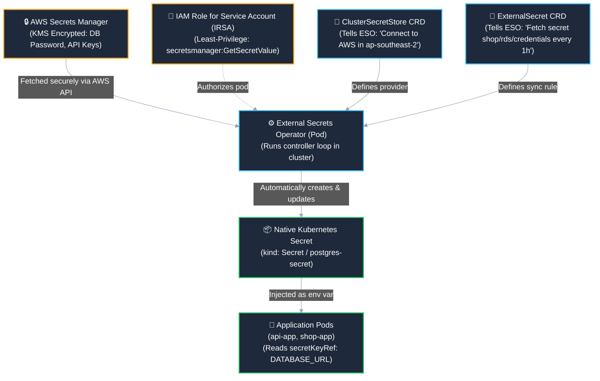

# Enterprise Secrets Management: External Secrets Operator (ESO) & AWS Secrets Manager

> **Concept:** Automating Kubernetes secret synchronization from AWS Secrets Manager using IAM Roles for Service Accounts (IRSA).  
> **Target Audience:** DevOps / Platform Engineering interview preparation and enterprise production setups.  
> **Related Architecture:** [`k8s/eks/00-postgres-secret.yaml`](../k8s/eks/00-postgres-secret.yaml) & [`doc/02-eks-cluster-overview.md`](./02-eks-cluster-overview.md)

---

## 1. The Core Problem: Why Base64 Secrets Fail in Production

In standard Kubernetes, a `Secret` is only **base64-encoded**, not encrypted:

```bash
# Any engineer or compromised pod with RBAC access can decode it:
echo "YXNkZmZkc2E=" | base64 -d
# Output: asdffdsa
```

### The 3 Major Anti-Patterns in Real Companies:
1. **Never Commit Secrets to Git:** If you commit a YAML secret file with real DB passwords to GitHub/GitLab, it stays in Git history forever and triggers compliance audit failures (SOC 2, ISO 27001).
2. **Manual `kubectl create secret` Doesn't Scale:** Having human engineers run `kubectl create secret` manually across staging, dev, and production clusters causes human error and breaks automated GitOps pipelines (ArgoCD/Flux).
3. **No Automatic Secret Rotation:** When AWS RDS rotates its database password every 30 or 90 days, standard Kubernetes secrets break, causing instant application downtime.

---

## 2. The Enterprise Solution: External Secrets Operator (ESO)

The **External Secrets Operator (ESO)** is an industry-standard Kubernetes operator that automatically reads secrets from cloud providers (AWS Secrets Manager, HashiCorp Vault, Google Secret Manager) and writes them into native Kubernetes `Secret` objects.

### Architecture Flow:



---

## 3. How the 3 Custom Resources Work Together

| Resource | Who Writes It? | Purpose |
| :--- | :--- | :--- |
| **`AWS Secrets Manager`** | Cloud Admin / Terraform / Pulumi | Single source of truth. Encrypted with AWS KMS keys. |
| **`ClusterSecretStore`** | Platform / DevOps Team | Cluster-wide configuration defining how to authenticate with AWS (Region, IRSA ServiceAccount). |
| **`ExternalSecret`** | Application Developers (in Git) | Safe to commit to Git! Only contains secret *names* and mapping rules, **never plaintext values**. |
| **`Secret` (Native K8s)** | **Generated by ESO** | Standard `kind: Secret`. Applications mount this without needing any AWS SDK or code changes! |

---

## 4. Production Manifest Examples

### Step A: Define the Cloud Store (`ClusterSecretStore`)
This tells Kubernetes where your cloud secrets live:

```yaml
apiVersion: external-secrets.io/v1beta1
kind: ClusterSecretStore
metadata:
  name: aws-secrets-manager
spec:
  provider:
    aws:
      service: SecretsManager
      region: ap-southeast-2
      auth:
        jwt:
          serviceAccountRef:
            name: external-secrets-sa
            namespace: external-secrets
```

---

### Step B: Define What Secret to Pull (`ExternalSecret`)
This safely lives in your Git repository (`k8s/eks/00-external-secret.yaml`). Notice that **there are zero plaintext passwords here**:

```yaml
apiVersion: external-secrets.io/v1beta1
kind: ExternalSecret
metadata:
  name: postgres-external-secret
  namespace: default
spec:
  # Check AWS for updates every 1 hour (automatic rotation)
  refreshInterval: "1h"
  secretStoreRef:
    name: aws-secrets-manager
    kind: ClusterSecretStore

  # The native Kubernetes Secret that ESO will create automatically
  target:
    name: postgres-secret
    creationPolicy: Owner

  # Mapping from AWS JSON keys to Kubernetes Secret keys
  data:
    - secretKey: POSTGRES_USER
      remoteRef:
        key: shop/production/rds
        property: username
    - secretKey: POSTGRES_PASSWORD
      remoteRef:
        key: shop/production/rds
        property: password
    - secretKey: DATABASE_URL
      remoteRef:
        key: shop/production/rds
        property: database_url
```

---

### Step C: How Applications Consume It
Your application manifests (`k8s/eks/01-api-app.yaml`) do **not** change at all. They consume the native secret generated by ESO:

```yaml
env:
  - name: DATABASE_URL
    valueFrom:
      secretKeyRef:
        name: postgres-secret # <--- Created and kept up-to-date by ESO!
        key: DATABASE_URL
```

---

## 5. Security Architecture: Zero AWS Keys in Kubernetes (IRSA)

In amateur setups, engineers create permanent AWS IAM Access Keys (`AKIA...`) and store them in Kubernetes secrets. **This is a critical security vulnerability.**

In enterprise setups, we use **IAM Roles for Service Accounts (IRSA)** or **EKS Pod Identity**:
1. EKS creates an **OIDC Identity Provider** (OpenID Connect).
2. The `external-secrets` Kubernetes ServiceAccount is annotated with an AWS IAM Role ARN:
   ```yaml
   apiVersion: v1
   kind: ServiceAccount
   metadata:
     name: external-secrets-sa
     namespace: external-secrets
     annotations:
       eks.amazonaws.com/role-arn: arn:aws:iam::542601847638:role/EKS-ExternalSecrets-Role
   ```
3. AWS STS automatically exchanges short-lived JWT tokens directly with the pod container.
4. **Result:** Zero long-lived AWS keys exist inside the cluster! If an attacker compromises a node, there are no hardcoded credentials to steal.

---

## 6. SRE & DevOps Interview Cheat Sheet: Secrets on Kubernetes

When an interviewer asks: **"How do you handle secrets and sensitive credentials in Kubernetes?"**

Use this structured 3-point answer:

### 1. Point 1: Separation of Storage & GitOps
> *"We treat cloud secret stores (AWS Secrets Manager or HashiCorp Vault) as the single source of truth, encrypted at rest with AWS KMS. We never commit secrets or base64 strings to Git."*

### 2. Point 2: Automated Synchronization via ESO
> *"We use the External Secrets Operator (ESO) inside the cluster. Developers commit `ExternalSecret` custom resources to Git that reference secret names and paths, and ESO reconciles and generates native Kubernetes secrets automatically."*

### 3. Point 3: Password Rotation & Zero Long-Lived Keys
> *"We authenticate the ESO controller pod using AWS IAM Roles for Service Accounts (IRSA) with OIDC, eliminating static AWS access keys entirely. Furthermore, ESO polls AWS Secrets Manager on a configurable `refreshInterval` (e.g. 1 hour), allowing automated database password rotations without manual developer intervention."*

---

## 7. Comparison: ESO vs. AWS Secrets Store CSI Driver

| Feature | External Secrets Operator (ESO) | AWS Secrets Store CSI Driver |
| :--- | :--- | :--- |
| **How Secrets are Delivered** | Creates native Kubernetes `kind: Secret` objects | Mounts secrets as a **filesystem volume** inside the pod |
| **Environment Variable Support** | **Native & Easy** (`valueFrom.secretKeyRef`) | Clunky (requires CSI SecretProviderClass syncing) |
| **Application Code Changes** | **Zero** (apps just read env vars or standard secrets) | Apps must read files from disk or use specific volume mounts |
| **Multi-Cloud Support** | AWS, Azure, GCP, Vault, 1Password, Bitwarden | AWS-only or CSI provider-specific |
| **Industry Adoption** | **Most Popular in DevOps / Platform Teams** | Common in strict PCI-DSS environments requiring volume mounts |
