# AWS EKS Kubernetes Manifests & HPA Architecture

This directory contains the modularized production Kubernetes manifests for running the `kendrick-shop` stack on Amazon EKS.

---

## 📁 Directory Structure & Execution Order

| File | Type | Description | External Endpoint |
| :--- | :--- | :--- | :--- |
| [`00-configmap.yaml`](./00-configmap.yaml) | `ConfigMap` | Centralized non-sensitive settings (Ports, URLs, flags) | *Internal Only* |
| [`00-postgres-secret.yaml`](./00-postgres-secret.yaml) | `Secret` | Template & instructions for AWS RDS credentials | *Internal Only* |
| [`01-api-app.yaml`](./01-api-app.yaml) | `Deployment`, `Service` | Bun + Hono API Backend & Swagger Docs | `https://api.kendrickdev.shop` |
| [`02-shop-app.yaml`](./02-shop-app.yaml) | `Deployment`, `Service` | TanStack Start Customer Storefront | `https://kendrickdev.shop` |
| [`03-shop-dashboard.yaml`](./03-shop-dashboard.yaml) | `Deployment`, `Service` | TanStack Start Admin Dashboard | `https://dashboard.kendrickdev.shop` |
| [`04-hpa.yaml`](./04-hpa.yaml) | `HorizontalPodAutoscaler` | Automatic scaling based on CPU & Memory usage | *Kubernetes Control Plane* |
| [`05-ingress.yaml`](./05-ingress.yaml) | `Ingress` | Single AWS ALB ($20/mo) routing all 3 domains with SSL | `https://*.kendrickdev.shop` |
| [`cluster-autoscaler.yaml`](./cluster-autoscaler.yaml) | `Deployment`, `RBAC` | Automatic EC2 node auto-scaler controller (2–6 nodes) | *Kubernetes Control Plane* |
| [`kustomization.yaml`](./kustomization.yaml) | `Kustomization` | Bundles all resources for `kubectl apply -k` | N/A |

---

## 🚀 Quick Deployment Guide

### Step 1: Ensure AWS RDS Secret Exists
```bash
DATABASE_URL=$(pulumi stack output databaseUrl --show-secrets)

kubectl create secret generic postgres-secret \
  --from-literal=POSTGRES_DB=shop \
  --from-literal=POSTGRES_USER=shop \
  --from-literal=POSTGRES_PASSWORD="asdffdsa" \
  --from-literal=DATABASE_URL="$DATABASE_URL" \
  --dry-run=client -o yaml | kubectl apply -f -
```

### Step 2: Install Kubernetes Metrics Server (Required for HPA)
```bash
kubectl apply -f https://github.com/kubernetes-sigs/metrics-server/releases/latest/download/components.yaml

# Verify that metrics server is collecting CPU & RAM:
kubectl top nodes
kubectl top pods
```

### Step 3: Deploy All Workloads with Kustomize
```bash
# Option A: Deploy all at once with Kustomize
kubectl apply -k k8s/eks

# Option B: Deploy by directory
kubectl apply -f k8s/eks/

# Option C: Deploy or update an individual service
kubectl apply -f k8s/eks/01-api-app.yaml
```

---

## 📈 How Horizontal Pod Autoscaler (HPA) Works

Each HPA in [`04-hpa.yaml`](./04-hpa.yaml) observes pod metrics via the Kubernetes Metrics API:

```mermaid
%%{init: {'theme': 'dark', 'themeVariables': {'darkMode': true, 'background': '#0d1117', 'mainBkg': '#1e293b', 'primaryColor': '#1e293b', 'primaryTextColor': '#ffffff', 'primaryBorderColor': '#38bdf8', 'lineColor': '#94a3b8', 'textColor': '#ffffff'}}}%%
graph LR
    Pods["Running Pods"] -->|"CPU / RAM Usage"| MS["Metrics Server"]
    MS -->|"Metrics API"| HPA["Horizontal Pod Autoscaler"]
    HPA -->|"Scale Target: 2 - 5 Replicas"| Deploy["Deployment api-app / shop-app"]

    classDef darkNode fill:#1e293b,stroke:#38bdf8,stroke-width:2px,color:#ffffff;
    classDef scaleNode fill:#1e293b,stroke:#22c55e,stroke-width:2px,color:#ffffff;
    class Pods,Deploy darkNode;
    class MS,HPA scaleNode;
```



### Scaling Rules & Thresholds:
- **`api-app-hpa`:** Min 2, Max 6 pods (Scales when CPU > 70% or Memory > 80%)
- **`shop-app-hpa`:** Min 2, Max 5 pods (Scales when CPU > 70% or Memory > 80%)
- **`shop-dashboard-hpa`:** Min 1, Max 3 pods (Scales when CPU > 70% or Memory > 80%)
- **Scale-Down Cool-Down:** 300 seconds (5 minutes) stabilization window to prevent rapid flapping.

### Verify Autoscalers:
```bash
# View active HPA status and current % targets across all 3 apps:
kubectl get hpa

# Detailed scaling events and triggers:
kubectl describe hpa api-app-hpa
kubectl describe hpa shop-app-hpa
kubectl describe hpa shop-dashboard-hpa
```

### Testing Autoscaling Under Load (Optional):
```bash
# Run a temporary pod generating load against the API
kubectl run load-test --rm -i --tty --image=busybox --restart=Never -- \
  /bin/sh -c "while true; do wget -q -O- http://api-app-service:8000/health; done"

# In a separate terminal, watch HPA react and scale out pods:
kubectl get hpa -w
```

---

## 📊 Observability: Prometheus Metrics & AWS CloudWatch

### 1. Prometheus Application Metrics (`/metrics`)
The backend API exposes real-time application telemetry in standard Prometheus exposition format:

- **Endpoint:** `GET /metrics` (Exposed on `api-app` port 8000)
- **Scrape Annotations:** Pod template in `01-api-app.yaml` includes:
  ```yaml
  prometheus.io/scrape: "true"
  prometheus.io/port: "8000"
  prometheus.io/path: "/metrics"
  ```
- **Tracked Metrics:**
  - `http_requests_total{method, route, status}` (Counter of all processed requests)
  - `http_request_duration_seconds_sum` & `_count` (Summary of request latency in seconds)
  - `process_uptime_seconds` (Pod uptime gauge)
  - `process_resident_memory_bytes` & `nodejs_heap_size_used_bytes` (Memory usage gauges)

#### Test Metrics Locally:
```bash
curl http://localhost:9000/metrics
# Or over cluster service:
kubectl exec -it $(kubectl get pod -l app=api-app -o jsonpath='{.items[0].metadata.name}') -- \
  wget -qO- http://localhost:8000/metrics
```

---

### 2. AWS CloudWatch Centralized Logging
Configured declaratively in Pulumi [`index.ts`](../../index.ts) via `enabledClusterLogTypes`:

- **Active Log Streams:**
  - `api`: All Kubernetes API server REST calls.
  - `audit`: Full audit trail of user and service account actions.
  - `authenticator`: EKS IAM authentication events (logins, access entry validations).
  - `controllerManager`: Deployment rollouts, replica checks, pod scheduling.
  - `scheduler`: Node placement decisions for pods.
- **Where to view in AWS Console:**  
  Navigate to **CloudWatch** $\rightarrow$ **Logs** $\rightarrow$ **Log groups** $\rightarrow$ `/aws/eks/shop-eks-cluster/cluster`.
