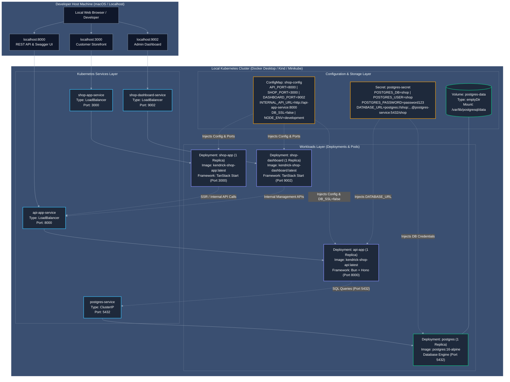

# Local Kubernetes Manifests (k8s/local/)

Modularized Kubernetes manifests designed for local development on **Docker Desktop Kubernetes**, **Minikube**, or **Kind**.

---

## 📁 Directory Structure & Execution Order

| File | Resource Kind | Purpose | Local Endpoint |
| :--- | :--- | :--- | :--- |
| [`00-configmap.yaml`](./00-configmap.yaml) | `ConfigMap` | Non-sensitive settings (Ports 8000/3000/9002, `DB_SSL=false`) | *Internal DNS* |
| [`00-postgres.yaml`](./00-postgres.yaml) | `Secret`, `Deployment`, `Service` | In-cluster PostgreSQL 16 database | `localhost:5432` |
| [`01-api-app.yaml`](./01-api-app.yaml) | `Deployment`, `Service` | Bun + Hono REST API & Swagger UI | [http://localhost:8000](http://localhost:8000) |
| [`02-shop-app.yaml`](./02-shop-app.yaml) | `Deployment`, `Service` | Customer Storefront (TanStack Start) | [http://localhost:3000](http://localhost:3000) |
| [`03-shop-dashboard.yaml`](./03-shop-dashboard.yaml) | `Deployment`, `Service` | Admin Dashboard (TanStack Start) | [http://localhost:9002](http://localhost:9002) |
| [`kustomization.yaml`](./kustomization.yaml) | `Kustomization` | Bundles all local manifests for single-command deployment | N/A |

---

## 🏛️ Local Architecture & Configuration Diagram

The diagram below illustrates the local Kubernetes configuration, pod networking, configuration injection, and service exposure:



### 💡 Local Configuration Breakdown:
- **Port Mapping & Ingress:** Each microservice is assigned a dedicated `LoadBalancer` service that binds directly to localhost ports: `3000` (Customer Storefront), `9002` (Admin Dashboard), and `8000` (Backend API & Swagger).
- **In-Cluster Database:** Unlike production (which uses managed AWS RDS), local development deploys an in-cluster PostgreSQL 16 instance with an ephemeral `emptyDir` volume for zero-cost, self-contained development.
- **Service Discovery & SSR:** Frontend applications (`shop-app` and `shop-dashboard`) communicate with the backend API via internal cluster DNS (`http://api-app-service:8000`), specified in [`00-configmap.yaml`](./00-configmap.yaml).
- **Environment Isolation:** Uses `DB_SSL="false"` and `NODE_ENV="development"`. Secrets are managed through [`00-postgres.yaml`](./00-postgres.yaml) with default local credentials (`shop:password123`).

---

## 🚀 Quickstart Guide

### 1. Build Local Docker Images
Before deploying, build images tagged locally (no need to push to AWS ECR):

```bash
# 1. API Backend
docker build -t kendrick-shop-api:latest ./services/api-app

# 2. Customer Storefront
docker build -t kendrick-shop-app:latest ./services/shop-app

# 3. Admin Dashboard
docker build -t kendrick-shop-dashboard:latest ./services/shop-dashboard
```

### 2. Deploy All Workloads with Kustomize
```bash
# Deploy all 4 workloads, database, and configmap together:
kubectl apply -k k8s/local

# Verify all pods reach 1/1 Running:
kubectl get pods -w
```

### 3. Seed Local In-Cluster Database
```bash
# Populates brands, categories, products, and admin credentials:
curl -X POST http://localhost:8000/seed
```

### 4. Access Local Endpoints
- **Storefront:** [http://localhost:3000](http://localhost:3000)
- **Admin Dashboard:** [http://localhost:9002](http://localhost:9002) *(Admin: `shop@kendrickdev.shop` / `admin123`)*
- **API Health:** [http://localhost:8000/health](http://localhost:8000/health)
- **Swagger Docs:** [http://localhost:8000/docs](http://localhost:8000/docs)
- **Metrics:** [http://localhost:8000/metrics](http://localhost:8000/metrics)

> [!NOTE]
> If your local Kubernetes cluster does not automatically bind `type: LoadBalancer` to macOS `localhost`, port-forward directly to the services:
> ```bash
> kubectl port-forward svc/api-app-service 8000:8000 &
> kubectl port-forward svc/shop-app-service 3000:3000 &
> kubectl port-forward svc/shop-dashboard-service 9002:9002 &
> ```

---

## 🧹 Teardown Local Cluster Workloads

```bash
kubectl delete -k k8s/local
```
