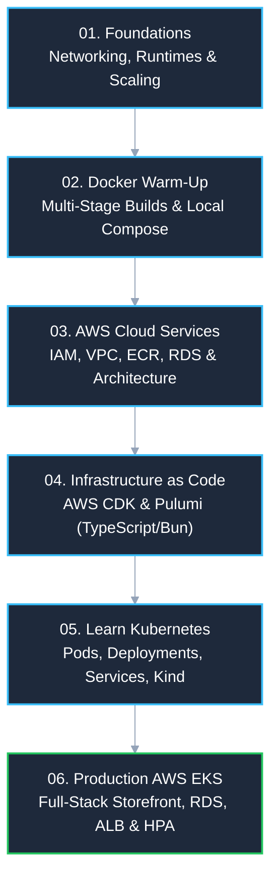

# Kubernetes in Production: Hands-on Learning Path

A comprehensive, step-by-step curriculum covering computer systems, multi-stage Docker builds, AWS cloud architecture, Infrastructure as Code (IaC), Kubernetes primitives, and a complete production e-commerce stack on Amazon EKS.

> 📖 **Instructor's Note**: Before starting, please read [**A Note from the Instructor (intro.md)**](./intro.md) for our class philosophy and how to approach this material effectively.

---

## 🗺️ The Progressive Roadmap

This repository follows a strict, progressive structure. Each milestone builds directly on the mental models and artifacts created in the previous one:

---

## 📁 Repository Modules & Curriculum

| Module | Topic | Core Focus | Key Concepts Covered |
| :--- | :--- | :--- | :--- |
| **[`01-foundation-knowledge`](./01-foundation-knowledge/)** | Foundations | Systems, Networking & Scaling | Operating system runtimes, TCP/IP, DNS, OSI layers, Layer 4 vs. Layer 7 load balancers, monolith vs. microservices evolution. |
| **[`02-docker-warm-up`](./02-docker-warm-up/)** | Containerization | Multi-Stage Builds | Multi-language Dockerfiles across 6 stacks (React, Bun, Go, Python, Rust), dev vs. production runner stages, Docker Compose. |
| **[`03-aws-services`](./03-aws-services/)** | Cloud Services | Infrastructure Primitives | AWS IAM least privilege, VPC subnets, NAT/Internet Gateways, Route Tables, and enterprise multi-AZ architecture blueprints. |
| **[`04-iac`](./04-iac/)** | IaC | Declarative Cloud Management | AWS CDK v2 & Pulumi using TypeScript and Bun; comparing CloudFormation state, previews (`diff`), and automated deployments. |
| **[`05-learn-k8s`](./05-learn-k8s/)** | Kubernetes | Core Abstractions & Local Kind | 8-lesson curriculum: Pods, ReplicaSets, rolling Deployments, Services (ClusterIP, NodePort, LoadBalancer), ConfigMaps, Secrets, Probes. |
| **[`06-try-production-eks`](./06-try-production-eks/)** | Production EKS | Complete Capstone Stack | 3 full-stack microservices (Bun API, TanStack Start storefront & dashboard), AWS RDS PostgreSQL, AWS ALB Ingress, HPA, and CI/CD. |

---

## 🔍 Module Deep-Dives

### 1. [`01-foundation-knowledge`](./01-foundation-knowledge/) — Core Systems & Architecture
Before writing YAML or provisioning cloud resources, we establish foundational systems intuition:
- **Application Stacks & Runtimes**: How runtimes (Node.js, Bun, Go, Python, Rust) manage memory, event loops, and system calls.
- **Networking Basics**: IP addressing, subnets, DNS resolution, TLS/SSL handshakes, reverse proxies, and Layer 4 vs. Layer 7 routing.
- **Scaling & Architecture**: Vertical vs. horizontal scaling, stateless vs. stateful services, and moving from monoliths to microservices.

### 2. [`02-docker-warm-up`](./02-docker-warm-up/) — Containerization Done Right
Kubernetes is only as resilient as the container images inside it:
- **Multi-Language Examples**: Ready-to-run container samples across 6 modern languages and frameworks.
- **Multi-Stage Builds**: Separating heavy development dependencies from ultra-lightweight, hardened production runner images (`scratch`, `alpine`).
- **Local Composition**: Running multi-container networks locally with Docker Compose.

### 3. [`03-aws-services`](./03-aws-services/) — Cloud Infrastructure Prerequisites
Enterprise Kubernetes requires robust AWS foundational primitives:
- **AWS IAM**: Role-based access control (RBAC), IAM policies, and machine-to-machine service identities.
- **VPC & Networking**: Designing public subnets for load balancers and private isolated subnets for worker nodes and databases.
- **Architectural Blueprints**: Progression from single EC2 servers to resilient, multi-AZ cloud deployments.

### 4. [`04-iac`](./04-iac/) — Infrastructure as Code (IaC)
Automating cloud resources with modern, typed programming languages:
- **AWS CDK v2**: Defining AWS resources using constructs in TypeScript and Bun.
- **Pulumi**: Managing AWS infrastructure with standard TypeScript, real-time diffs, and rapid deployments.
- **Reproducibility**: Eliminating manual console drift through version-controlled code.

### 5. [`05-learn-k8s`](./05-learn-k8s/) — Hands-on Kubernetes Step-by-Step
A structured, 8-lesson hands-on path running locally in `kind` or Docker Desktop:
- **Lesson 01–02**: Fundamentals, control plane reconciliation, Pods, and Deployments.
- **Lesson 03–04**: Deploying your first API and connecting workloads with Kubernetes Services.
- **Lesson 05–06**: ConfigMaps, Secrets, persistent volumes, liveness/readiness health probes, and resource requests/limits.
- **Lesson 07–08**: Security defaults, container debugging (`kubectl describe`, `kubectl logs`), and production patterns.

### 6. [`06-try-production-eks`](./06-try-production-eks/) — Full-Stack Production Capstone
A complete, real-world e-commerce system built for modern enterprise standards:
- **The Application Stack**:
  - **API Backend**: High-performance REST API built with Bun, Hono, Drizzle ORM, and Swagger UI.
  - **Customer Storefront**: Fast, modern storefront powered by TanStack Start (SSR), React 19, and Tailwind CSS.
  - **Admin Dashboard**: Comprehensive operations portal for catalog, orders, and inventory management.
- **Dual Deployment Options**:
  - **Local Mode ($0/mo)**: Run on Docker Compose or local Kubernetes (`k8s/local`) with an in-cluster PostgreSQL database.
  - **Cloud Production Mode**: Automated Pulumi deployment with Amazon EKS, AWS RDS PostgreSQL, AWS ALB Ingress, ACM Wildcard SSL, Horizontal Pod Autoscalers (HPA), Cluster Autoscaler, and GitHub Actions CI/CD.

---

## 🚀 Quick Access Links

- 📘 **[A Note from the Instructor](./intro.md)**: Class philosophy and how to learn effectively.
- 💻 **[06-try-production-eks README](./06-try-production-eks/README.md)**: Full capstone project documentation.
- 🐳 **[Local Docker Compose Quickstart](./06-try-production-eks/README.md#💻-0-local-development-quickstart)**: Start the full stack locally with `docker compose up`.
- ☸️ **[Local Kubernetes Guide ($0/mo)](./06-try-production-eks/doc/01-local-k8s-guide.md)**: Deploy to local Docker Desktop Kubernetes using `k8s/local`.
- ☁️ **[Production EKS Architecture Guide](./06-try-production-eks/doc/02-eks-cluster-overview.md)**: Deep dive into the AWS EKS cloud deployment.

---

## 🧭 Effective Study Principles

1. **Follow the Numbered Order**: Progress through the modules from `01` to `06`. Each step introduces the prerequisite knowledge needed for the next.
2. **Practice Locally First**: Build muscle memory using Docker Compose and local Kubernetes before touching the cloud. It is fast, free ($0), and safe for making mistakes.
3. **Observe State Changes**: Do not just run `kubectl apply`. Always follow up with `kubectl get`, `kubectl describe`, and `kubectl logs` to understand how Kubernetes reconciles state.
4. **Use as a Production Starter Kit**: Bookmark and use this codebase as your blueprint for real-world projects and interviews.
