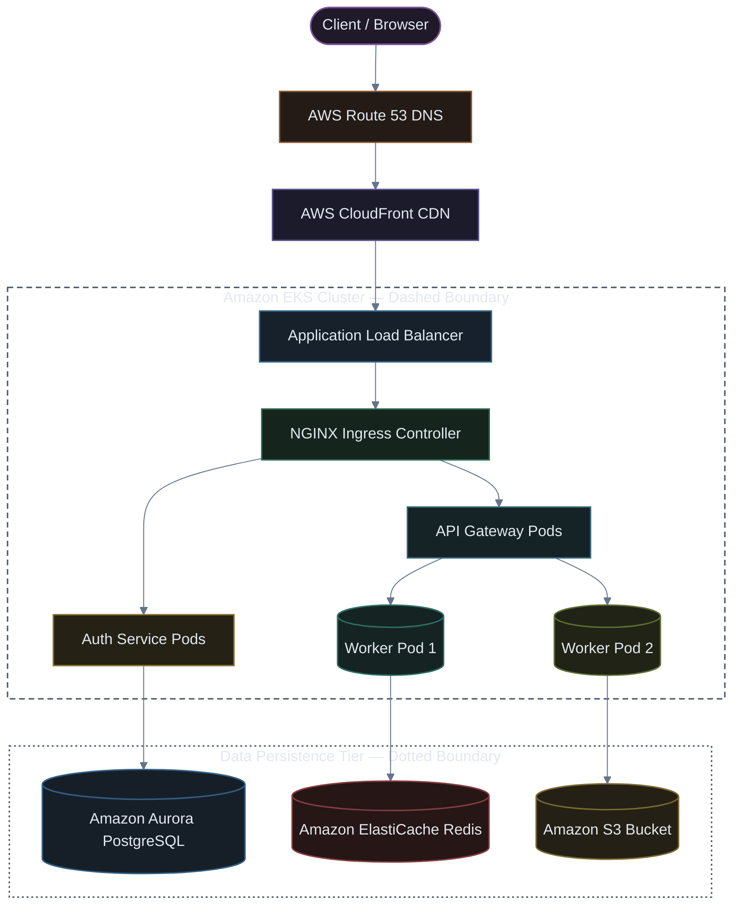
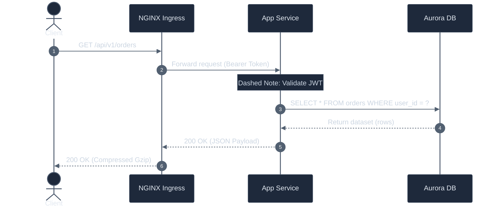

# Markdown UI Showcase & Reference Guide

A visual catalog of UI components, interactive widgets, tables, and diagrams achievable in Markdown.

[](#)
[](#)
[](#)

---

## 1. Alert & Callout Boxes

GitHub Flavored Markdown supports native styled callout banners for contextual messaging.

> [!NOTE]
> Standard note highlighting helpful background information or references.

> [!TIP]
> Best practices, tips, or performance suggestions to speed up workflows.

> [!IMPORTANT]
> Essential prerequisites, critical operational constraints, or must-know details.

> [!WARNING]
> Potential failure points, breaking changes, or deprecation notices.

> [!CAUTION]
> High-risk operations that could trigger irreversible data loss or downtime.

---

## 2. Interactive Collapsible Sections (`<details>`)

Keep documents clean by hiding secondary information, configurations, or logs behind collapsible panels.

<details>
<summary><b>▶ Click to view sample Kubernetes Deployment YAML</b></summary>

```yaml
apiVersion: apps/v1
kind: Deployment
metadata:
  name: web-api
  namespace: production
spec:
  replicas: 3
  selector:
    matchLabels:
      app: web-api
  template:
    metadata:
      labels:
        app: web-api
    spec:
      containers:
        - name: server
          image: nginx:1.25-alpine
          resources:
            requests:
              memory: "128Mi"
              cpu: "250m"
            limits:
              memory: "256Mi"
              cpu: "500m"
```

</details>

<details open>
<summary><b>▼ Open by default: Database Connection Specs</b></summary>

| Parameter | Value | Description |
| :--- | :--- | :--- |
| **Host** | `postgres.internal.net` | Internal VPC endpoint |
| **Port** | `5432` | Standard PostgreSQL port |
| **SSL Mode** | `require` | Enforced TLS encryption |

</details>

---

## 3. Task Checklists

Track workflows, deployment steps, or runbooks with interactive checkboxes.

- [x] Provision VPC & Subnets on AWS
- [x] Create Amazon EKS cluster with managed node groups
- [x] Install Ingress Controller (`ingress-nginx`)
- [ ] Configure `cert-manager` for automated Let's Encrypt certificates
- [ ] Enable Horizontal Pod Autoscaling (HPA)
- [ ] Set up Prometheus & Grafana alerting rules

---

## 4. Tables with Badges & Formatting

Structure metrics, status dashboards, and configurations with aligned columns.

| Service Name | Namespace | Replicas | CPU / Mem | Health Status | Actions |
| :--- | :---: | :---: | :---: | :---: | :---: |
| `auth-service` | `production` | 3 | 250m / 512Mi |  | [Restart](#) \| [Logs](#) |
| `order-worker` | `production` | 5 | 500m / 1Gi |  | [Restart](#) \| [Logs](#) |
| `payment-gateway`| `production` | 2 | 300m / 256Mi |  | [Restart](#) \| [Logs](#) |
| `legacy-sync` | `staging` | 0 | 0m / 0Mi |  | [Start](#) \| [Logs](#) |

---

## 5. Inline UI Elements & Micro-Widgets

Enhance readability with keyboard shortcuts, badges, and progress bars.

* **Keyboard Shortcuts:** Press <kbd>⌘</kbd> + <kbd>Shift</kbd> + <kbd>P</kbd> or <kbd>Ctrl</kbd> + <kbd>Shift</kbd> + <kbd>P</kbd> to open Command Palette.
* **Inline Key Combination:** To cancel a command in shell: <kbd>Ctrl</kbd> + <kbd>C</kbd>.
* **Native Progress Bar:**
  * Rolling update progress: <progress value="85" max="100"></progress> **85% complete**
  * Storage quota utilization: <progress value="42" max="100"></progress> **42% used**

---

## 6. Code Differences (`diff`)

Highlight changes in configuration files and source code.

```diff
  apiVersion: apps/v1
  kind: Deployment
  metadata:
    name: customer-service
  spec:
-   replicas: 1
+   replicas: 5
    template:
      spec:
        containers:
-         - image: customer-service:1.0.4
+         - image: customer-service:1.1.0
          env:
+           - name: ENABLE_REDIS_CACHE
+             value: "true"
```

---

## 7. Diagrams & Architecture (Mermaid)

Render dynamic flowcharts, sequences, and state transitions directly in Markdown.

### 7.1 Architecture Flowchart



### 7.2 Request Sequence Diagram



### 7.3 Pod Lifecycle State Machine

```mermaid
%%{init: {
  'theme': 'base',
  'themeVariables': {
    'darkMode': true,
    'primaryColor': '#1e293b',
    'primaryTextColor': '#e2e8f0',
    'primaryBorderColor': '#475569',
    'lineColor': '#64748b',
    'labelColor': '#e2e8f0'
  },
  'themeCSS': '* { filter: none !important; box-shadow: none !important; }'
}}%%
stateDiagram-v2
    [*] --> Pending: Manifest Applied
    Pending --> ContainerCreating: Image Pulling
    ContainerCreating --> Running: Containers Started
    Running --> CrashLoopBackOff: Container Exits Non-Zero
    CrashLoopBackOff --> Running: Auto-Restart Backoff
    Running --> Terminating: SIGTERM Received
    Terminating --> [*]: Evicted / Graceful Exit
```



### 7.4 Extension-Free Universal Embed (Solid Dark SVG)

If an environment does not have Mermaid extensions installed, you can render any Mermaid code directly as a solid dark SVG:


---

## 8. Mathematical & Scientific Formulas (LaTeX)

Render formulas for scaling, capacity planning, and metrics.

Horizontal Pod Autoscaler (HPA) target calculation:

$$ \text{Desired Replicas} = \left\lceil \text{Current Replicas} \times \left( \frac{\text{Current Metric Value}}{\text{Target Metric Value}} \right) \right\rceil $$

Service Level Availability (SLA):

$$ \text{Availability} = \frac{\text{Total Time} - \text{Downtime}}{\text{Total Time}} \times 100\% $$
